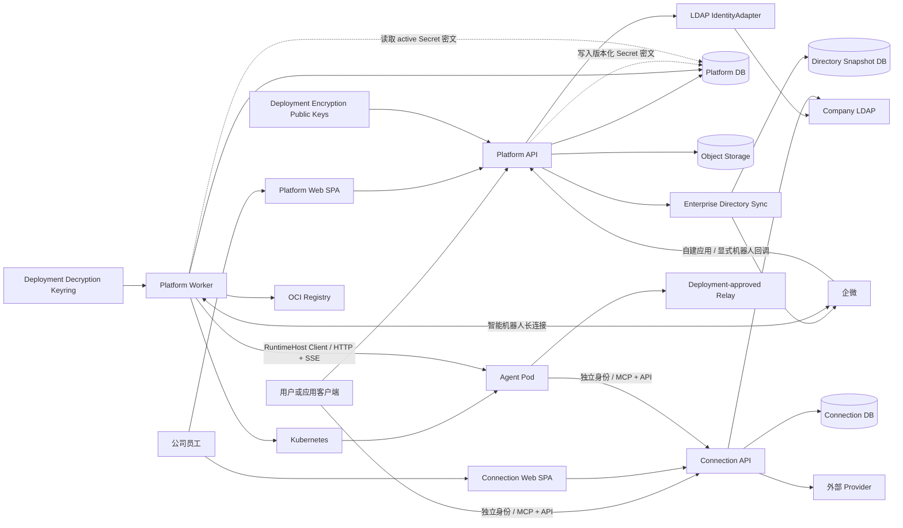
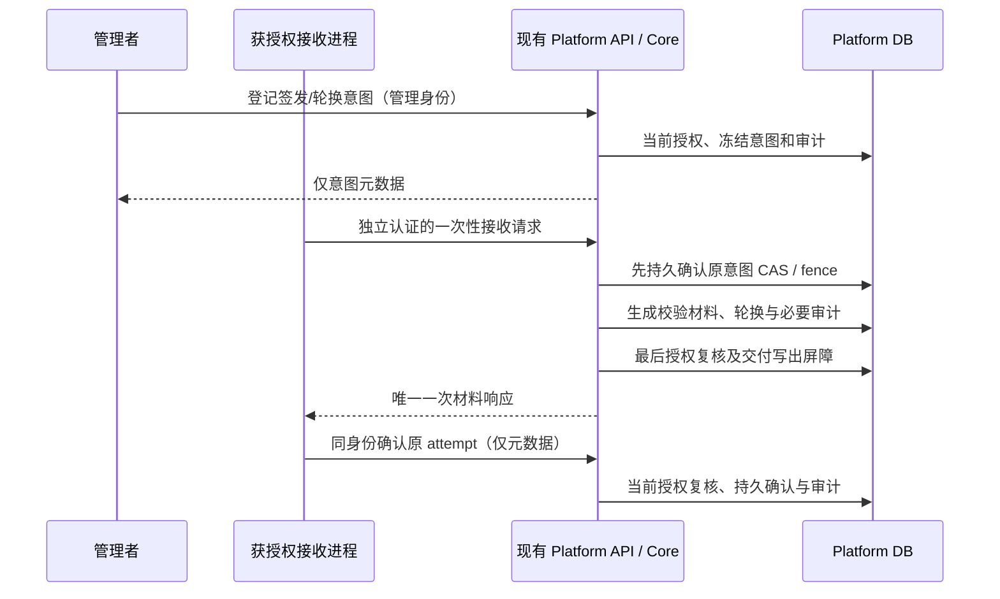
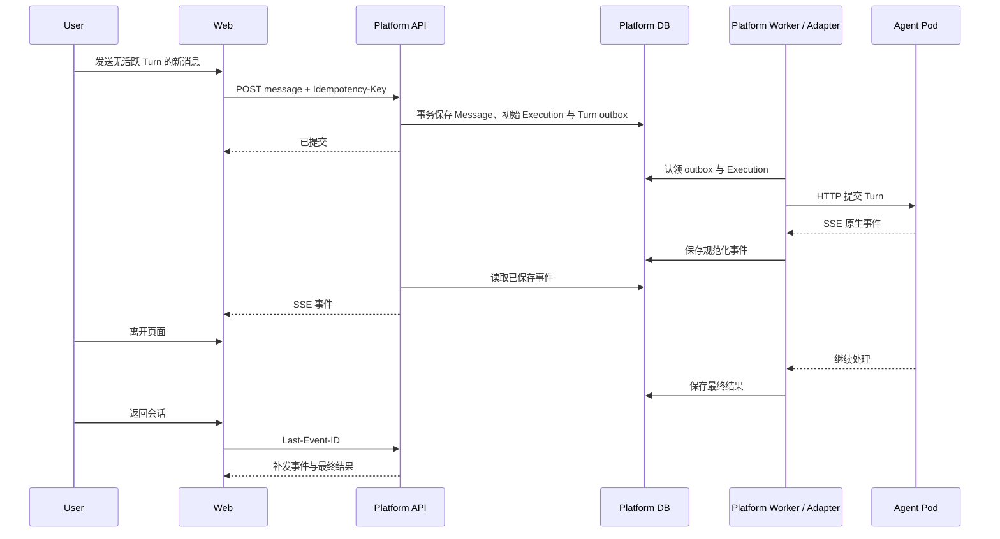
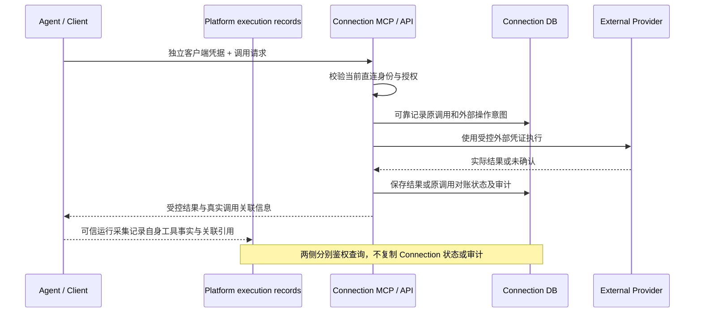

# agent-infra M1 工程架构 Spec

| 项目 | 内容 |
| --- | --- |
| 状态 | Draft for Review |
| 版本 | v0.2 |
| 日期 | 2026-09-13 |
| 适用范围 | Agent 平台 M1、Connection M1 |
| 关联 PRD | [企业级 Agent 平台 M1 产品需求](../prd/PRD-agent-platform-M1.md)、[Connection M1 产品需求](../prd/PRD-connection-M1.md) |

## 1. 文档目的

本文定义 agent-infra M1 的工程实现基线，供前端、后端、运维和安全相关成员评审。它回答以下问题：

1. M1 由哪些部署单元和工程模块组成。
2. Web、平台后端、Agent 运行时和 Connection 如何分工。
3. 用户身份、Agent 权限、Connection 授权和外部凭证如何传递与隔离。
4. 长任务、流式回复、Pod 生命周期和失败恢复如何落地。
5. 前后端分别交付什么，以及如何进行测试和上线验收。

本文不改变 PRD 的产品范围。M1 包含用户与应用 API、后台任务调度、运行可观测、模型质量评估与效果分析（Eval）、持久审计、§10.1.1 的 Session-owned Sandbox 隔离、Browser Capability 和 §11.6 的 Skill Hub。Skill Hub 与 Browser Capability 的工程边界见 §11.5–§11.6；平台会话隔离以外的通用 Sandbox 产品能力、多 Agent 协作、知识能力、Agent 删除、Webhook、定时任务和主动通知仍在 Roadmap。

## 2. 架构结论

M1 的自有产品与控制代码采用全 TypeScript 单仓库，使用 Better-T-Stack 初始化基础工程。Better-T-Stack 只负责生成工程骨架，不作为运行时依赖，也不决定领域模块的接口。Codex 使用固定官方 release，由 Native Driver/Adapter 消费上游能力；第三方源码、私有接缝与执行屏障的边界见 [10.11](#1011-codex-上游原生补丁与执行屏障)。

CI 的 PR-Agent 直接使用官方 GitHub Action，仅启用 Review 与 Suggestions；不维护自有
PR-Agent 脚本、上游补丁或派生 runtime。配置与权限边界见
[Workflow Spec §7.3](SPEC-ai-native-development-workflow.md#73-automated-pr-review)。

### 2.1 技术栈

| 层次 | 选型 | M1 用法 |
| --- | --- | --- |
| 语言 | TypeScript 6 | Web、平台后端、调谐进程、Connection 统一使用 |
| Web | React 19 + TanStack Router + Vite | 登录后的内部 SPA，不使用 SSR |
| Web 数据 | TanStack Query | 管理服务端状态、缓存和请求失效 |
| UI | Tailwind CSS + shadcn/ui | 构建平台工作台、表单、对话和管理页面 |
| HTTP | Hono + Node.js 24 LTS | 平台和 Connection 的 HTTP 接入层 |
| 契约 | Zod + OpenAPI 3.1 | 请求校验、接口文档和 TypeScript 客户端生成 |
| 流式协议 | Server-Sent Events | 对话增量、处理状态和执行详情推送 |
| 数据库 | PostgreSQL + Drizzle | 权威业务数据、事务、迁移和 outbox |
| 文件 | S3 兼容对象存储 Adapter | 附件、结果文件和大体积中间结果 |
| Kubernetes | `@kubernetes/client-node` | Agent Workload、Service 和访问入口调谐 |
| 工程 | pnpm workspace + Turborepo | 多应用构建、测试和缓存 |
| 质量 | Biome、Vitest、Playwright | 静态检查、模块测试和端到端测试 |
| 可观测性 | OpenTelemetry + Pino | Trace、Metric 和结构化日志 |
| 部署 | Docker + Helm + Kubernetes | Web/API 位置无关；Worker 与 Agent Workload 进入 Kubernetes Workload Plane |

Web 页面中凡 shadcn/ui 提供的可复用交互、导航、反馈或表格组件，均使用项目的 `components/ui` 实现，无业务页面例外。Base UI 原语只允许在 shadcn/ui 组件内部使用；语义内容标签和业务状态逻辑不属于组件替代。

初始化依赖以固定版本 Better-T-Stack 的生成结果为基线，并写入 lockfile。Node.js 使用公司支持的 LTS 版本；Kubernetes JavaScript Client 与目标集群版本配套，不使用浮动 `latest`。

### 2.2 Better-T-Stack 初始化基线

初始化参数固定为：

```text
frontend: tanstack-router
backend: hono
runtime: node
database: postgres
orm: drizzle
auth: none
api: none
package-manager: pnpm
addons: turborepo, biome
web-deploy: docker
server-deploy: docker
```

选择 `auth=none` 是为了不引入第二套框架认证协议。仓库提供第一方 LDAP IdentityAdapter，Platform Core 仍只消费可信 IdentityContext，其他部署可替换 Adapter。独立 Connection 按其 HLD 登录，不复用 Platform 浏览器会话。选择 `api=none` 是为了避免同时维护 tRPC/oRPC 与 OpenAPI 两套契约；M1 的浏览器接口、内部接口和 Agent Runtime Contract 统一以 HTTP/OpenAPI 为主，SSE 事件单独定义 Schema。

脚手架版本固定为 `create-better-t-stack@3.38.1`。生成依赖作为项目初始化基线；生成后代码归本项目维护，不通过重复运行脚手架升级项目，也不在初始化过程中主动升级生成依赖。

## 3. 架构原则

1. **产品状态与集群状态分离。** PostgreSQL 保存 Agent 期望状态，Kubernetes 保存实际运行状态，调谐进程负责持续收敛。
2. **平台与 Connection 各自保持权威数据。** Agent、应用与 API 凭证、执行、会话、Eval 和平台审计属于平台；直连身份、Connection Grant、Provider、外部账号、凭证、外部调用和审计属于 Connection。
3. **外部凭证不进入 Agent。** Agent 或客户端使用 Connection 独立签发的访问凭据直连 MCP/API，不能读取外部账号的 Access Token、Refresh Token 或 API Key。
4. **先持久化再异步处理。** 消息、API 任务、审批和生命周期命令先在平台持久受理；外部调用由实际执行系统先可靠记录意图，再触发处理。
5. **接口也是测试面。** Hono、Drizzle、Kubernetes Client 和 OpenConnector 都位于 Adapter 层，领域模块不依赖这些实现。
6. **M1 不预建扩展基础设施。** PostgreSQL 足以支持当前事务、outbox、任务认领和事件回放；不预先引入 Redis、Kafka、NATS 或 Temporal。
7. **主体隔离由服务端决定。** 用户与应用均使用可信主体上下文；浏览器、Agent、模型和 API 调用方提交的身份、组织或关联字段不能成为授权依据。
8. **部署能力通过 Port 接入。** 身份、OCI Registry、模型端点、Kubernetes 和对象存储的具体产品属于部署环境，领域模块只依赖稳定 Adapter 契约。
9. **只冻结跨模块契约。** Wire Schema、数据权威、事务和安全不变量属于 Architecture Baseline；数据库表、UI 结构和 Adapter 内部算法可以在模块内演进。

## 4. 系统结构



### 4.1 部署单元

| 部署单元 | 职责 | 是否保存权威状态 |
| --- | --- | --- |
| `web` | Agent、凭证与应用管理、审批、对话、执行详情、Eval 和审计；可独立静态托管 | 否 |
| `connection-web` | 独立 Connection 中文 SPA、登录和 OAuth/Grant 管理入口 | 否 |
| `platform-api` | 可信用户/应用接入、Agent 与任务 API、权限、业务状态/outbox/审计事务、SSE、企微配置与回调、Eval 管理和查询；部署位置无关 | 否 |
| `platform-worker` | Kubernetes Workload Plane 中的 Workload 调谐、模板升级、outbox 认领、有界任务投递、RuntimeHost Client、企微长连接与回复、Eval 执行/评分工作项 | 否 |
| `enterprise-directory-sync` | 每日同步企微员工和部门，原子发布完整、带版本与有效期的目录快照；通过内网受控接口供 Platform 查询 | 否 |
| `connection-api` | 独立登录与客户端身份、MCP/API、Provider/Action、OAuth、Grant、凭证、外部执行、恢复和审计 | 否 |
| `agent pod` | 标准模板与 `platform-adapter` 按 Session-owned Sandbox 运行 RuntimeHost/Driver；`self-managed` 保持自有服务边界 | 仅保存所属运行实例的自有数据 |
| `platform database` | Agent、Owner、范围、管理员手动禁用、应用/API 凭证及授权、个人和 Agent 默认 Relay Key 密文、审批、配置、会话、执行、Eval、反馈和平台审计 | 是 |
| `directory snapshot database` | 企微员工与部门的已确认完整快照、同步版本和有效期；不是 LDAP 身份或 Platform 授权权威 | 是，仅对目录快照 |
| `connection database` | 独立身份与客户端授权、Grant、Provider/Action、外部账号、加密凭证、OAuth 状态、调用/效果和审计 | 是 |

`platform-api` 与 `platform-worker` 使用同一平台领域模块，但以不同进程部署，并通过 Platform DB 状态与 outbox 协作；除下述 `native_metadata_read` 例外外，不建立直接 RPC 依赖。Web 和 `platform-api` 的部署位置不受 Kubernetes Workload Plane 限制；只有 `platform-worker` 获得目标 Kubernetes namespace 的 API 权限。Connection 使用独立数据库和数据库账号；两个数据库可以位于同一 PostgreSQL 集群，但不能跨库直接读写。

### 4.1.1 正式 Helm-native 部署单元

生产的 Platform、Worker 和 Directory 组合由一个明确的 Helm-native 部署单元装配：namespace 与 Helm release
均为 `agent-infra`。该单元的 chart 同时持有 Platform API 与 Worker 的配置 Secret；配置 Secret 的内容、引用和
变更随 chart values/私有输入进入同一 release 记录，应用不再依赖 Helm 外的脚本对配置 Secret 做原地替换。
数据库和 Directory 的迁移由同一 release 的启用 hooks 按既定顺序执行。

该部署单元的安装和升级唯一使用 `helm upgrade --install agent-infra ... --namespace agent-infra --atomic --wait`，
保持 Platform 与 Directory 的迁移 hooks 开启；不得通过 `--no-hooks`、`--post-renderer`、`--reuse-values`、
临时 `--set` 或对 release 对象执行 `kubectl patch/replace` 绕过 chart。生产切换前使用独立验收 host，切换到
生产 host 必须是具名 owner 窗口中的显式步骤，且以当前 cluster/namespace/release/source/CAS 回读为准。

本部署单元与旧的 `agent-infra-d-ws-1103` lane 并行存在一段受控窗口。用户已确定 A1：切换不迁移旧 lane 的
数据库、Agent、Session、消息、快照或 PVC；用户在新 lane 重新登录并重新创建资源。旧 lane 停用后保留 3–7 天，
再由单独的下线决定处理，旧 namespace 的清理不属于新 lane 的升级或 rollback。Helm rollback 只恢复
`agent-infra` release 自身的 revision、配置 Secret 和迁移状态，不接管、删除或回写旧 lane 的数据。

本节的 Helm-native 事实源为 Helm 仓库
`https://bitbucket.agoralab.co/projects/AI/repos/helm` 的 commit
`c3156272c7aaa09d8896e7f2b71046a6d68d95e1`（PR #169 merge），文件
`docs/superpowers/specs/2026-11-17-agent-infra-helm-native-lane-design.md`，blob
`542c4389ee6a2b35093d58707422b52ca0b7c522`，文件 SHA-256
`b93af1da087d977436ec0a7add30742b17e6dcf2a8d4658e2115c0d1ee5ed174`。设计文档第 1、2、3、6、7、10 节支持
本节的 namespace/release、Secret、hooks、命令、A1 和保留窗口事实；旧脚本的 `--no-hooks`/`--post-renderer`
实例可在同一 commit 的 `agent-infra-ack/scripts/publish-platform-code.mts:1067-1074,1154,1324,1351,1399`
及 `publish-api-resources.mts:741,856,920` 回读。

原生元数据的 API→Worker 读取投递和 Host→Worker→原 API 实例的在线确认只使用
[§9.3.1 的 `native_metadata_read`](#931-原生元数据读取授权) 规定的受认证内部 HTTP。
安装专用通道另按 [§13.5.6](#1356-标准-oauth-安装供应) 使用 TLS，适用范围限于该节所列流量。
禁止新增通用 API↔Worker RPC。
Worker 保持唯一证明签发与投递方；Host 不直接查询 Platform DB 或 IdentityAdapter。
该通路只服务于同一原 Request 及其可信绑定的 API/Worker/Host 实例关联；服务身份和实例映射由可信部署装配固定，
不能接受调用方回调 URL、任意 origin 或通过负载均衡猜测原实例。
原请求终结、当前确认不可核实、关联丢失或任一关联实例重启使本次读取永久失效，不恢复、续期或复用旧允许结果。
原用户凭证只留承载原 Request 的 API 内存，不进入内部 wire、DB、journal、日志或遥测。
当前认证、读取政策、原持久范围、固定期限、逐相关 await 与响应 bytes 前的复核均遵循 §9.3.1，不能用服务身份替代读取权。
任务调度、Execution/Session/Turn 创建和 control/recovery 仍通过 Platform DB/outbox，不能使用此通路；
metadata 读取不写任务、恢复、fence 或 Key 状态，也不新增持久授权或消息状态机。

目录服务与 Platform 同集群部署，经内部受认证服务边界通信，可使用同一 PostgreSQL 集群的独立数据库账号。它不读取 Platform 或 Connection 数据库；Platform 不把同步快照当作 LDAP 账号状态。Connection 的单一账号级权威和独立 Web 部署取舍分别见 [ADR: Connection 使用单一账号级权威](../adr/0005-use-one-account-backed-connection-authority.md)与 [ADR: 独立部署 Connection Web](../adr/0006-deploy-connection-web-independently.md)。

### 4.2 不拆分的部署单元

M1 不单独部署审批、企微渠道、审计、附件、任务调度、Eval 或模型配置微服务。这些能力作为平台领域模块存在，由 `platform-api` 或 `platform-worker` 调用。企微目录每日同步有独立的数据来源与快照完整性职责，因此使用上表的独立服务；它不处理机器人会话或 Agent 任务。

## 5. 单仓库结构

Connection 服务源码已迁至独立私有仓库 `AI/agora-connector`。本仓库保留 Agent 平台及其
Connection consumer 集成、共享 Wire 契约和部署配置，不再构建或启动 Connection 服务。
Connection 的身份、授权、数据和独立部署边界保持不变，其服务端实现与发布由独立仓库维护。
下图只列本仓库维护的模块；其他章节中的 Connection 服务职责仍描述跨系统契约。

```text
agent-infra/
  apps/
    web/                     React SPA
    platform-api/            Hono HTTP API、SSE、企微和查询入口
    platform-worker/         调谐、outbox、RuntimeHost Client、投递和 Eval 工作项
    enterprise-directory-sync/  企微目录同步服务入口
    agent-runtime-host/      Agent Pod 内的薄 RuntimeHost 进程入口
  packages/
    platform-core/           单一深 Platform 领域 Module、Use Case 与 Port
    contracts/               Wire-only OpenAPI、内部 HTTP、SSE 与 RuntimeHost Schema
    platform-store/          用例级事务 Port 的 Drizzle/PostgreSQL Adapter
    identity/                Platform IdentityAdapter、IdentityContext 与测试 Fake
    enterprise-directory/    企微快照、完整性与内网读取契约
    enterprise-directory-store/  目录快照的 Drizzle/PostgreSQL Adapter
    image-registry/          ImageRegistryAdapter、OCI Digest/Manifest 与测试 Fake
    secret-store/            版本化 AEAD 密文、DEK 封装与密钥轮换
    model-catalog/           ModelCatalogAdapter 与模型端点政策
    agent-runtime/           RuntimeHost 深 Module、固定 Driver 和 Conversation Contract
    kubernetes-runtime/      KubernetesRuntimeAdapter 与部署路由 Adapter
    observability/           Trace、Metric、日志和关联 ID
    test-support/            Fake Adapter、fixture 和契约测试工具
  migrations/
    platform/
    enterprise-directory/
  deploy/
    helm/
    environments/
  tests/
    contract/
    integration/
    e2e/
    load/
  docs/
    prd/
      PRD-agent-platform-M1.md
      PRD-connection-M1.md
    architecture/
      SPEC-agent-infra-M1-engineering-architecture.md
      HLD-agent-runtime-M1.md
  AGENTS.md
  README.md
```

`apps/*` 只负责进程启动、依赖装配和协议接入。领域规则不能直接写在 Hono 路由、React 页面或 Drizzle 查询中。`packages` 不设置无边界的 `shared-utils`；只有被多个明确调用方复用且接口稳定的能力才进入公共 package。

## 6. 工程模块

### 6.1 平台模块

| 模块 | 负责 | 不负责 |
| --- | --- | --- |
| Agent Lifecycle | Web 申请审批、API 直接创建、启动/停止/重启/停用、期望版本与状态迁移 | 直接操作 Kubernetes |
| Agent Access | Owner、员工/组织范围、管理员手动禁用、应用与责任人、API 凭证范围/失效、显式授权及当前权限交集 | LDAP 员工身份、企微目录快照、Connection 授权 |
| Agent Configuration | 模板、自定义镜像、交互模式、自有交互入口身份责任、env/Secret、个人与 Agent 默认 Relay Key、模型、渠道和已验证的集成能力 | Relay 路由和 Connection Provider 凭证 |
| Builder / 多服务 Agent | 普通 Agent 通过现有 Connection 读写 Repo；平台准入受限的多服务资源描述、Digest 版本和最终部署资源 | 用户业务授权、Connection 凭证、生产合并与发布决定 |
| Conversation | 会话、消息、回答版本、思考过程、附件引用、执行事件和历史查询 | 模型未公开的推理（加密内容、签名或被隐藏的思考） |
| Agent Dispatch | API 有界受理/等待与投递、幂等、取消/恢复、Web 繁忙与补充指令 | Runtime 内部执行算法、通用调度服务 |
| Channel | Web、API、企微的主体、会话与附件映射 | Runtime 原生 Session 和协议语义 |
| Platform Audit | 治理、API/执行/Eval 元数据、持久审计与受控查询 | 会话正文、Connection 状态或审计副本 |
| Evaluation | 评测用途授权、版本化数据集/标准、实验/逐例评分、对比、人工复核与主动反馈 | 第二套任务调度、自动导入线上正文 |

### 6.2 Connection 模块

Connection 在自己的 Core/Store/API/Web 中负责客户端身份、Provider/Action、外部账号与凭证、授权、执行、恢复和审计。Platform 只消费独立入口与真实调用的关联信息，不维护这些模块的目录、状态或授权投影。内部模块和 wire contract 由 [Connection M1 HLD](HLD-connection-M1.md) 维护，系统边界见第 13 节。

### 6.3 Adapter 接口

以下位置必须形成明确接口，并至少提供部署 Adapter 或项目实现，以及测试 Fake：

- IdentityAdapter 与可信 IdentityContext；仓库提供第一方 LDAP 实现和测试 Fake。
- 企微目录服务的版本化、受认证快照读取契约与测试 Fake。
- ImageRegistryAdapter、OCI Digest 与 Runtime Manifest 准入。
- RepositoryConnectionAdapter 与受控分支/工作区操作；Builder 只能通过现有 Connection 授权读取或修改 Repo。
- MultiServiceManifestAdapter 与受限 Kubernetes 资源描述、入口服务、规格档位和最终资源准入；镜像由仓库已有 CI 或用户自己的构建流程提供并按 Digest 固定。
- ModelCatalogAdapter 与获准模型端点政策。
- KubernetesRuntimeAdapter 与部署访问路由。
- 对象存储。
- 部署加密公钥与 Worker-only 解密 keyring；Secret 密文、DEK 封装、轮换和候选激活由项目实现。
- Codex Native、Claude Native、Generic ACP 和 Pi RPC Runtime。
- worker 侧 RuntimeHost Client 与 Agent Pod 内 RuntimeHost/Driver。
- 企微机器人与企微应用。
- OpenConnector Provider/Action 执行。

领域模块只接收业务 ID、命令和结果，不接收 Hono Context、数据库连接、Kubernetes 对象或 Provider Token。

`packages/platform-core` 是单一 Platform bounded context，对外只暴露版本化 Use Case、领域结果和窄 Port；Lifecycle、Access、Configuration、Conversation、Dispatch、Channel、Audit 和 Evaluation 只作为内部模块，不拆成 workspace package。Core 定义“业务状态 + outbox + 必要审计”的原子性，`platform-store` 以用例级事务实现；不创建通用 CRUD Repository，也不允许 Hono 路由或 Worker 编排领域 Drizzle 查询。

`packages/contracts` 只保存跨进程 wire DTO/Schema，不依赖 React、Hono、Drizzle、Kubernetes 或应用入口，也不复用数据库实体作为协议类型。Web、API、Worker、RuntimeHost 和 Connection Client 在边界显式映射协议 DTO 与领域对象。

### 6.4 Contract Schema authority

`packages/contracts` 中由 Agent Platform 主系统维护的 wire Schema 只手写 Zod 4，并从该 authoring source 单向生成两类提交到仓库的标准产物：浏览器、用户/应用 API 和内部 HTTP Contract 使用 OpenAPI 3.1，SSE payload、Runtime Manifest 等非 HTTP Contract 使用 JSON Schema 2020-12。生成后的 OpenAPI 是 HTTP 消费者评审和兼容检查的规范来源，其中浏览器 OpenAPI 也是 TypeScript Client 的生成输入；JSON Schema 是非 HTTP Contract 的机器校验入口。调用方不得直接编辑生成产物，也不能从 OpenAPI 或 JSON Schema 反向生成 Zod，项目不维护第三套通用 Schema IR。取舍见 [ADR: Wire Contract 使用 Zod authoring 与标准发布产物](../adr/0003-zod-authored-wire-contracts.md)。

M1 的 Schema family 由以下主责 artifact 维护；表中 Issue 是既有交付入口，新增 API、任务和 Eval 契约的实施归属须在交付计划中对齐，不隐式扩展原 Issue 范围：

| Schema family | 主责 artifact | Implementation Issue |
| --- | --- | --- |
| 公共 primitives、错误模型、生成与兼容工具 | Platform Core/API | [#179](https://github.com/AgoraIO-Extensions/agent-infra/issues/179) |
| Platform HTTP/OpenAPI、SSE 与生产 Web Client | Platform Core/API，Web/API 消费方评审 | [#180](https://github.com/AgoraIO-Extensions/agent-infra/issues/180) |
| 企微目录快照内部 HTTP/OpenAPI | 目录服务，Platform 消费方评审 | [#889](https://github.com/AgoraIO-Extensions/agent-infra/issues/889) |
| RuntimeHost/Driver wire Schema | Codex Runtime，Worker 消费方评审 | [#181](https://github.com/AgoraIO-Extensions/agent-infra/issues/181) |
| Registry、Secret、Kubernetes Workload 与 Runtime Manifest Contract | Agent Workload，Core/Delivery 消费方评审 | [#182](https://github.com/AgoraIO-Extensions/agent-infra/issues/182)；OCI admission 由 [#188](https://github.com/AgoraIO-Extensions/agent-infra/issues/188) 实现 |
| Browser Capability declaration、内部 probe 与 conformance artifact | Runtime/Workload，#1252/#508/#992 消费方评审；Platform/API projection 后续接收 | [#1370](https://github.com/AgoraIO-Extensions/agent-infra/issues/1370) |

生成工具固定版本；产物使用稳定 key/property 顺序、LF 和一个末尾换行，不能包含时间戳、绝对路径或工具版本等易漂移字段。`packages/contracts` 必须在现有 `pnpm test` 路径中执行生成漂移、基于 pull-request merge-base 的 breaking-change 和 consumer contract 检查。test-only Client smoke 只验证 OpenAPI 到浏览器 TypeScript Client 的单向链路，不进入 package exports、`files` 或 `dist`；`packages/test-support` 只提供由正式 Schema 校验的静态 builder/fixture，生产代码不得依赖它。Connection 的 MCP/API、客户端身份、OAuth、Grant、凭证和 Action Schema 由 Connection 自己维护；Platform Schema 不定义 Connection 代调用协议或数据投影。

## 7. Web 架构

### 7.1 页面模块

Platform Web 按产品入口划分路由：

- `/agents`：Agent 列表与详情。
- `/chat/:agentId/:conversationId?`：对话与历史。
- `/my-agents`：申请和 Owner 管理。
- `/my-agents/:agentId/settings`：范围、模型、渠道和已验证的集成入口。
- `/admin/approvals`：系统管理员审批。
- `/admin/audit`：必须交付的平台审计筛选、分页与详情。

Web 同时提供个人 API 凭证、应用及其凭证/Agent 授权、任务执行详情、Eval 数据集/实验/对比和主动反馈入口；具体页面行为以 [平台 Web PRD](../prd/PRD-agent-platform-M1.md#111-页面) 为准。运维观测由部署的日志、指标和 Trace 后端承接。

Connection 使用独立 `connection-web` 和独立浏览器会话，包含登录、个人 Connection、Consumer/Actor Grant、调用记录、待人工处理、Provider/Action、共享 Connection 和 Connection 审计页面。Platform Web 只跳转到 Connection 返回的受控 URL，不能承载或复制 Connection 管理页面。

个人 Connection、OAuth、Grant、Action 确认、撤销和调用记录全部由独立 Connection 入口管理。Platform Web 不复制其页面或数据，也不能把两侧关联信息拼成授权结论。

### 7.2 状态管理

- TanStack Query 管理列表、详情、配置和审批等服务端状态。
- 路由参数和 URL Search Params 保存可分享的页面筛选状态，但 M1 不提供会话分享。
- 对话时间线使用独立 reducer 合并持久化消息、SSE 增量和重连补发事件。命令受理、回复结束或 `timeline.reload` 后重新读取会话详情时，新首屏与已加载事件按 `eventId` 有重叠，就保留重叠之前已加载的更早事件，已显示的回合不因首屏窗口收窄而消失；没有重叠时无法排除缺口，按新首屏重建。
- 表单使用 Schema 校验；服务端重复执行同一校验，不能信任浏览器结果。
- 不预装全局状态库。只有出现跨路由、非服务端且难以由 React Context 管理的状态后再引入。
- Web 使用 OpenAPI 生成的 TypeScript Client，并通过同一 Contract Schema 校验的 Mock Server 和场景 fixture 独立开发。Mock 必须覆盖正常、无权限、启动中、繁忙、排队、失败和 SSE 重连，不能维护另一套手写假接口。

### 7.3 前端安全职责

前端只负责隐藏无权限入口和展示明确错误，不负责最终授权。普通用户不能获得模型 API Key、Connection 原始凭证、内部 Kubernetes 状态或其他用户的资源标识。

## 8. HTTP 与事件契约

### 8.1 浏览器与用户/应用 API

- 管理和查询使用 OpenAPI 声明的 `/api/v1/*` 或 `/api/v2/*` HTTP/JSON。Agent 申请、审批、配置和管理的 V2 契约不包含旧 Action 配置；V1 管理入口退役时，V1 Conversation 入口仍独立保留。
- 创建、更新和命令类请求支持 `Idempotency-Key`。
- 浏览器与用户/应用 API 遵循 [Contract Schema authority](#64-contract-schema-authority)；生成并提交的 OpenAPI 3.1 是消费者使用的规范来源。
- TypeScript 客户端由 OpenAPI 生成，禁止手写重复的请求/响应类型。
- 文件使用平台签发的短期、认证数据面入口上传/下载；业务接口只传文件引用和元数据。入口与执行期文件授权见 [文件](#154-文件)，S3 预签名 URL 不返回浏览器或 Runtime。

API 契约覆盖 Agent 创建/启动/停止/重启、任务提交/查询/取消、结果订阅、凭证与应用授权、审计和 Eval。产品行为分别引用 PRD [API 身份](../prd/PRD-agent-platform-M1.md#73-api-身份凭证与授权)、[后台任务](../prd/PRD-agent-platform-M1.md#104-agent-api-与后台任务)、[审计](../prd/PRD-agent-platform-M1.md#13-平台操作审计)和 [Eval](../prd/PRD-agent-platform-M1.md#15-模型质量评估与效果分析)。路由只解析可信上下文、校验 Schema 并调用 Core；创建和任务受理返回稳定资源 ID 与持久状态，不能把 HTTP 成功等同于 Workload 就绪或任务完成。

### 8.2 SSE

对话回复和状态流使用 `text/event-stream`：

Platform 的 `task.status` 事实与 Task API 共用状态和受限原因 Schema，原样进入 V2 会话历史、执行详情和 SSE；V1 SSE 完整校验后跳过无法表示的事实并推进原持久游标。Web 将 `unknown` 保持为待核实，只有后续权威终态才能结束执行占位。

- 每个事件包含稳定 `eventId`、`executionId`、Execution 内递增 `sequence`、Conversation 内严格递增 `conversationCursor`、`type`、`occurredAt` 和类型化 payload。
- Runtime 来源事件与 Platform 来源事件写入同一持久化时间线并共享上述排序空间。Runtime 来源必须携带非空 Runtime cursor，且不能写入 Platform 保留事件类型；Platform 来源按 Schema 显式区分任务受理/等待/取消/失败/待核实等状态事件和 `model.selection.fell_back`，其中 Worker 失败与待核实收敛事件在同一 Dispatch 事务内写入并保持空 Runtime cursor，Runtime 终态事件已持久化时不追加（见 [Agent Runtime M1 HLD §8.1](HLD-agent-runtime-M1.md#81-消息与命令幂等)）；模型回退事件绑定接收消息的 Execution、Runtime cursor 为空，payload 只包含实际采用的模型选项、推理强度、固定的受限原因，以及会话原所选选项的 ID 与受理时的显示名。
- 原选项显示名在写入回退事件的同一事务中确定：从不晚于当前已应用配置修订、且包含该选项的最新修订读取原 endpoint/model 关联；部署配置了可信名称时，按该关联解析受理时的显示名，未配置时沿用模型 ID。历史关联或名称无法确认时记为空，之后的配置或部署名称变化不改写已写入的事件。endpoint 标识只在服务端解析名称，不进入公开事件；名称解析不改变原授权与回退选择，也不增加 stop/native metadata 路径的外部依赖。带原选项的回退事件以 `schemaVersion: 2` 进入 V2 混合版本事件历史（V2 Conversation 读取、V2 SSE 与 Task 投影）；只接受 V1 事件的 V1 SSE 仍收到不含原选项的 V1 形状，未记录原选项的旧事件在各读取方保持 V1 原样。
- 标准模板当前选择失效时，`platform-api` 在接受消息的同一 Conversation 事务中写入一条 `model.selection.fell_back`：初始消息和重新生成绑定新建 Execution，补充指令绑定当前活跃 Execution。该事务同时分配下一 Execution `sequence` 和 Conversation `conversationCursor`、推进两个平台计数器并保存对应审计；幂等重放复用原分配，任何一步失败均整体回滚，且不推进 Execution 的 Runtime cursor。
- 思考过程：Runtime 以 `schemaVersion: 2` 的 `reasoning` 事件输出模型提供的原始推理或推理摘要增量（`kind` 为 `raw` 或 `summary`，单条上限与正文增量相同），Worker 保存为 Runtime 来源的 `reasoning.delta`，属于会话正文，只在 Conversation 读取权限内返回。该事件只进入 V2 Conversation 读取与 V2 SSE；V1 SSE 和 Task 投影（任务查询、输出与事件订阅）跳过它但推进持久游标。回答正文、任务输出和企微答案只拼接 `text.delta`。发布时先让 Platform 各读取方接受该事件，再更新 Runtime。决策与边界见 [ADR-0026](../adr/0026-show-model-reasoning-as-conversation-content.md)。
- Web/API 调用方通过 `Last-Event-ID` 或显式游标重连；服务端验证游标属于当前主体有权访问的 Conversation/Execution，任务流不能带出同会话其他任务的数据。
- 会话详情首屏只返回最近的有界事件窗口，「加载更早内容」用 `beforeCursor` 按同一规则逐页向前读取。每页是连续的 `conversationCursor` 区间，由完整 Execution 组成：从最近的 Execution 向前逐个加入，`reasoning.delta` 以外的事件累计达到 200 条时停止，跨过该数的 Execution 仍完整加入；页内事件总数不超过 2,000 条，加入后会超出的 Execution 留给更早的页。最近的 Execution 自身超过总上限时，该页只含它且完整返回，不切断单轮回复。思考增量不计入 200 条，前几轮回答不会被思考过程挤出首屏；总上限约束首屏响应大小。窗口不改变 `conversationCursor`、`Last-Event-ID`、SSE 补发和 `timeline.reload` 语义。
- 服务端先保存事件，再向在线连接推送；断线后按持久化序列补发。事件事务提交后，数据库发出只含 Conversation 标识的唤醒提示，在线连接据此立即从持久化游标读取；提示只用于缩短等待，丢失时按固定轮询送达，不改变持久化、排序和授权规则。
- 心跳只用于保持连接，不进入业务时间线。
- 同一事件可能被重复投递，消费者按 `eventId` 去重。订阅建立、续传和存续期间执行当前主体/凭证授权：每批事件写出前复核一次，空闲期间按固定间隔复核；失效后该批不写出并关闭流，审计订阅起止，不逐条审计输出。
- Web/渠道排队消息的入队、开始处理、撤回、排队超时与取消按 [§12.5](#125-执行中消息的补充指令与排队) 写入平台来源的 `task.status` 事件，与其他事件共享排序、补发和授权规则。排队位次从持久等待顺序派生，不作为可变字段写入事件；浏览器收到队列变化后按同一规则更新位次。

M1 不使用 WebSocket。用户发送消息、停止回复和补充指令都通过普通 HTTP 命令完成；只有出现必须由同一连接双向交换低延迟事件的需求后才重新评估。

### 8.3 内部接口

`platform-worker` 到 Agent Pod 使用遵循 [Contract Schema authority](#64-contract-schema-authority) 的版本化 OpenAPI HTTP 契约；Runtime 增量事件使用由 JSON Schema 校验的内部 SSE。内部接口通过部署提供的服务身份认证，并验证执行授权，不因位于集群内而跳过鉴权。

#### 内部 Runtime 传输与身份

Worker 到 RuntimeHost 的原业务、控制和就绪检查适用下列集群内明文 HTTP 规则，决策见
[ADR-0020](../adr/0020-use-in-cluster-plaintext-runtime-transport.md)。跨集群、跨 VPC 或经公网
访问 Runtime 必须使用 TLS 并另行评审。Connection 专用安装流量沿
[§13.5.6](#1356-标准-oauth-安装供应) 的独立认证和 TLS 边界。

| 要求 | 机制及边界 |
| --- | --- |
| Worker 只访问获准 Host | 只连接服务端从持久 Workload 或 Session 分配解析出的精确 origin `http://<Service>.<namespace>.svc:<port>`；拒绝其他 scheme、userinfo、query、hash 与 redirect，调用方不能覆盖 origin。 |
| 限定访问面 | Agent 级 Workload 与 Session Sandbox 的原业务、控制和就绪端口的 NetworkPolicy ingress 只放行 Worker 选择器。healthz 或 Service 存在不证明隔离。这些 Pod 只运行在已证实际执行 NetworkPolicy 的运行形态上，见 [§10.1“运行形态与调度”](#101-workload-形态)；NetworkPolicy 对象、执行组件存在或一次 timeout 都不证明执行。安装专用端口见 [§13.5.6](#1356-标准-oauth-安装供应)。 |
| Host 认证部署调用方 | 继续校验既有 service token；它证明持有部署凭证，不是某个 Worker 进程的私钥持有证明。部署控制其发布、访问、轮换和撤销；Host 所持 token 不能取得 Grant 签名私钥。 |
| Host 核对当前授权与部署 | 保留独立 signed readiness 的 Worker/Agent/revision/fence/Digest 本机绑定；业务及控制 Grant 仍按 [§9.3](#93-服务端授权上下文) 校验签名、issuer、audience、时间、对象、用途和操作范围，继续执行原持久幂等、租约与屏障。 |

明文传输意味着能观察集群 Pod 网络的节点、CNI 或特权组件可以看到 token、Grant、会话正文和执行期交付的模型 Key。捕获的 Grant 不能靠传输层消除重放，必须依赖原用途/对象校验、持久幂等与 fence；token 泄露时在两端撤旧并受控重载。

**沿既有 Service 拓扑。** [Runtime HLD §4.1](HLD-agent-runtime-M1.md#41-内部-runtime-service-映射) 区分 Agent 级 candidate/verified Workload 与业务 Session Sandbox。Agent 级主 Service 和 `-probe` Service 分别承载 business 与 readiness/verified control；Sandbox 只使用其原已批准分配的唯一 Service，不复用 Agent 级路由或擅加 `-probe`。本契约不改变 §10.1.1 或 #1322 的资源合同。

**受信部署输入。** 复用[现有 Worker 部署模块](../../deploy/platform-worker/README.md#配置模块形状)：

| 输入 | 入口 |
| --- | --- |
| 部署代码与身份 | `platformWorker.configurationModuleSecretRef.{name,key}` 只读挂载 `/app/dist/configuration.mjs`；导出 `workloadInput`、`signing`、`serviceToken`。`workloadInput.policy.namespace` 必须与 `PLATFORM_WORKER_NAMESPACE` 一致，Agent 来自服务端持久 Workload，不能从请求、Owner env、模型或 live annotation 获取。 |
| token 与 Grant | `platformWorker.runtimeAuthSecretRef.{name,privateKeyKey,serviceTokenKey}` 向 Worker 提供 `/var/run/agent-infra/runtime-auth/{runtime-grant.pem,service-token}`；Host 通过 `policy.runtimeAuth.serviceTokenSecret.{name,key}` 的 `secretKeyRef` 得到同一 transport token。保留 `WorkloadRuntimeAuthV1` 原五字段 `workerId/grantKeyId/grantPublicKey/grantIssuer/serviceTokenSecret`；签名私钥仅在 Worker，Host 只得到公钥和预期身份。 |

原业务、控制和就绪通道使用 HTTP，其装配不使用 `platformWorker.trustedCaSecretRef`、Runtime CA、server leaf 或 TLS Secret。kubelet readiness 使用 HTTP。`platformWorker.trustedCaSecretRef` 继续为目录、Registry 等 HTTPS 依赖提供附加信任。安装专用 TLS 装配见 [§13.5.6](#1356-标准-oauth-安装供应)。

**迁移。** 原业务、控制或就绪通道仍使用旧 TLS 装配时，按这三个通道的新期望规格判定 drift，由既有 fenced 调谐替换，不保留双栈或 HTTPS 兼容层。安装专用端口与 initializer 挂载按 [§13.5.6](#1356-标准-oauth-安装供应) 核验。替换期间沿原受权持久流程停止新准入、核实原执行。旧控制不可达时保持 pending/unknown，使用原 Kubernetes fenced closeRoute、scale-zero 和 ownership cleanup 权限收敛，不重放副作用。

**验收。** business、control、readiness 和 Session 路由均覆盖非精确 origin、redirect、userinfo/query/hash、无效 token 和跨用途/主体/Agent/对象的 Grant；分别验证本机 revision/fence/Digest 与旧请求、重复请求的原屏障。Agent 级主 Service/`-probe` 分别验证 candidate/verified 与业务关路后的控制，Sandbox 验证其独立 Service/分配归属且拒绝跨 Session 路由。kubelet readiness 的 HTTP scheme、path/port 与实际 Pod/StatefulSet drift 核验保持一致。

Agent/客户端到 Connection 的 MCP/API 使用 Connection 的独立身份和契约，不经过 Platform API。平台不读取 Connection Catalog，不持有其目录读取或代调用 workload credential。

M1 不引入 tRPC/oRPC/ConnectRPC。

## 9. 身份与权限

### 9.1 IdentityAdapter

- 仓库提供第一方 LDAP IdentityAdapter 作为企业部署默认实现：浏览器登录由平台服务端查找唯一员工条目并以用户密码完成 LDAP bind，仅从受信查询取得稳定 UID、邮箱与当前账号状态。密码不保存、不送入 Worker/Agent、不进入日志或审计；LDAP 连接通过服务端 `tls` 开关选择协议：默认 `true` 使用受信 `ldaps://`，显式 `false` 使用 `ldap://`；显式端口保留，未指定端口时使用协议默认端口。开关不来自浏览器登录请求，不允许 URL 内嵌凭据，不改变用户 bind、稳定 UID、账号状态或会话校验。Platform Core 仍只消费 IdentityContext，其他部署可替换 Adapter，不要求配置 LDAP。
- 部署通过进程内可信 Adapter、经过认证的服务边界或版本化签名信封向 `platform-api` 提供当前 IdentityContext；跨进程传递时必须校验签发方、audience、签发/过期时间、唯一 context ID、keyVersion 和部署身份绑定，并在缺失、过期、重放或验证失败时 fail closed。
- IdentityContext 至少包含稳定且不透明的用户 ID、当前账号状态、组织成员关系、平台角色，以及足以判断上下文是否仍有效的版本或时效信息。
- 浏览器、Agent、模型和普通调用方不能提交、覆盖或伪造这些字段；`platform-api` 必须验证部署身份边界后才创建 HttpOnly、Secure、SameSite 会话，且不在 Local Storage 保存上游身份凭证。
- Helm 以环境变量向第一方 Adapter 注入允许成为 `system_admin` 的 LDAP 稳定 UID 集合；每次敏感管理员操作按当前 LDAP UID 精确匹配并检查账号有效。邮箱、企微 userid、Relay 角色和请求字段都不能赋予平台管理员身份。该配置为空时不产生隐式管理员。
- Platform 通过受认证的版本化接口消费通用组织目录，不直接调用企业上游协议。独立配套同步服务的 Adapter 每天从企微或企业内部接口拉取员工与部门，上游 Adapter 负责核实成员有效性与部门归属语义，不能把未知状态默认为有效或把查询范围当成直接归属。只有全量校验成功才原子发布带来源、版本、完整性标记和最长一天有效期的快照；失败保留上一版用于诊断，但过期或不完整快照不能继续授权。Platform 以 LDAP 与快照中唯一、有效的邮箱一对一关联，缺失、重复、停用或无法核实均拒绝依赖该映射的 Owner/可用范围新增与敏感操作；不按名字或请求提交的邮箱猜测。组织成员变化以新完整快照生效，允许最长一天延迟。
- 目录快照的 V3 展示投影可携带来源提供的可选姓名；姓名仅用于展示与搜索，不参与 LDAP 关联、稳定用户 ID 或权限判定。V1/V2 继续输出既有严格字段，旧快照无姓名时可回退邮箱本地部分。
- 平台不维护独立员工目录，只保存业务所需的稳定 LDAP 用户引用、管理员手动禁用状态和授权记录。管理员禁用在 Platform DB 中持久化并审计，优先于 LDAP active 结果；解除禁用也须当前 LDAP 账号有效，不修改 LDAP 或企微源数据。
- LDAP 当前账号状态、Platform 手动禁用及适用的组织快照在每次敏感操作前重新解析；LDAP 停用和手动禁用立即拒绝，短期缓存不能成为独立权限来源。IdentityAdapter 或目录依赖缺失、非法、过期或不可用时，依赖其结果的敏感操作 fail closed，不能使用调用方字段或不受控旧缓存继续授权。
- Agent 详情投影 `GET /api/v2/agents/{agentId}/detail` 为每个 Owner 返回服务端当次解析的有效状态，可见性与 `GET /api/v2/agents/{agentId}` 相同，不可见与不存在不可区分；`AgentProjectionV2`、列表和命令响应保持不变。第一方 LDAP IdentityAdapter 逐个 Owner 按上述当前事实判定：LDAP 中已查不到该账号为 `departed`；LDAP 停用或 Platform 管理员禁用为 `disabled`；LDAP、禁用记录与适用的目录快照均确认有效才为 `active`；任一依赖失败、快照缺失或过期、邮箱关联无法核实时为 `unavailable`。单个 Owner 的状态不使整个投影失败，也不以默认值、旧缓存或调用方字段补齐；未提供该能力的 IdentityAdapter 只返回 `unavailable`。状态只用于展示，不替代 9.2 的授权检查。
- IdentityAdapter 确认账号禁用时，平台为该用户全部仍活跃的 Execution 幂等创建平台来源的停止工作项；若平台确认用户失去某个 Agent 的可用范围或某个渠道的权限，则只处理服务端保存的 Agent 或渠道授权上下文受该撤权事实影响的活跃 Execution。该控制操作不借用已撤权用户的调用权限。具体投递和竞态规则见 [Agent Runtime M1 HLD](HLD-agent-runtime-M1.md#81-消息与命令幂等)。

Connection 不消费 Platform 浏览器会话或 Platform API 凭证；其 LDAP 登录、OAuth 客户端身份、授权及复核机制由 [Connection M1 HLD](HLD-connection-M1.md) 定义。

### 9.2 权限顺序

Web/企微依次校验可信用户当前状态、Agent 可用范围/有效 Owner、渠道权限和已验证 Runtime 能力。模型选择须属于标准模板 Owner 当前允许清单或 ACP Runtime 当前有效选项，API 也遵循该模型边界。标准模板的 Relay Key 选择与 Execution 绑定以 10.7 为准；Platform API 凭证和 Connection 凭证均不能替代它。Connection 的独立授权在其调用入口完成。

`platform-core` 的 Access 模块维护独立应用、注册责任人、API 凭证元数据与显式 Agent 授权；用户状态/组织关系仍来自 IdentityAdapter。API Adapter 验证凭证后生成可信用户或应用上下文，保留主体类型、稳定 ID、凭证引用、操作范围及有效期，不能由请求字段覆盖。凭证只保存不可逆校验材料和必要元数据，首次交付后不提供原值读取；个人凭证由本人管理，应用凭证由登记责任人管理。

应用凭证管理与取得/使用凭证材料分别授权。责任人角色只授予元数据、范围、轮换和撤销等管理权限，不自动获得凭证值或应用任务权限；签发与轮换时由 Core 重验接收者当前的独立凭证使用授权，只向该接收者受控交付，不能回显给仅有管理权的请求者，也不能通过重设接收者或交付入口绕过授权。授权、接收者及实际交付结果记录必要审计，凭证值不入审计；不引入新的身份或凭证服务。获授权接收者调用时仍以应用为任务主体，当前 Agent 权限和凭证范围继续生效。

应用凭证材料 grant 的授予/撤销遵循[平台 PRD 7.3](../prd/PRD-agent-platform-M1.md#73-api-身份凭证与授权)：writer 仅来自 9.1 的可信 `system_admin`，每次操作重验当前账号有效、Platform 未禁用及 LDAP 稳定 UID 仍精确匹配管理员配置；责任人或凭证管理角色不能替代该检查。Access 持久保存应用 ID 与接收者可信主体类型、稳定 ID 的绑定，授予、撤销及材料使用均按完整绑定检查，不能仅比较裸 ID。授权变更与必要审计原子保存，审计失败不得放行；授予命令仅返回授权元数据，不签发或交付材料。管理员作为接收者（包括显式自授）仍须在签发、轮换和交付时通过当前独立 grant 检查，撤销后不能继续交付；材料不得进入普通读取、日志、Trace 或审计。生产进程外交付见 [§9.2.1](#921-应用凭证材料的进程外一次性交付)。

API 创建许可由部署显式配置获准主体集合，以主体类型和稳定 ID 精确匹配，并与凭证的 `agent:create` 范围取交集。集合缺失、主体未列入或当前主体不可确认时拒绝创建；应用不借用责任人的许可，用户与同名应用的裸 ID 不互相代替。该集合只控制创建，不构成逐次审批，也不替代目标 Agent 的独立管理/使用授权。

创建用例将 Agent、创建主体、Owner、初始管理/使用授权、outbox 和必要审计原子保存。用户创建的 Owner 为本人，应用创建的 Owner 为登记的自然人责任人，创建主体仍为应用。API 不进入 Web 申请审批状态机，也不设预审批；镜像/配置与运行能力准入仍适用。管理与使用授权可分别撤销，应用不继承责任人的权限，Owner 不能绕过已撤销的 API 授权。

其他方式创建的 Agent 没有初始 API 授权。当前 Owner 经浏览器会话为用户显式授予或撤销逐主体的 API 管理/使用授权（`api-manage-grants`、`api-use-grants`），按 Agent 管理修订校验、幂等并审计；该修订只在 Owner 读取 Agent 投影时以 `managementRevision` 返回，非 Owner 的投影不含此字段。该入口不接受 API 凭证，授权不随 Owner 身份自动产生或延续。

上述事务是创建请求的可靠受理点，先于 Workload 创建；实例创建失败保留原 Agent 与初始授权，按现有生命周期权限查询、停止或重试，不能产生只有成功部署后才能管理的 Agent。

每次 API 操作在 Core 中检查：当前主体有效、当前对应业务授权、凭证操作范围与有效期、目标 Agent/渠道/Runtime 能力。任务查询、订阅、结果文件访问与调用方取消还须匹配持久保存的提交主体，并具有当前 Agent 使用权；Owner 或责任人角色不能替代这项匹配。相同主体的另一有效凭证可在其权限范围内操作原任务。

Agent 资源授权修订与逐主体的 manage/use 授权修订属于不同版本域。独立授权的撤销、重新授予产生新的授权修订；消费者按完整主体类型、稳定 ID、Agent 与授权类型复核当前记录，不能以授权修订等于 Agent 修订判断是否授权。任务边界分别绑定 `agentAuthorizationRevision` 与 `useGrantRevision` 并复验；审计查询使用当前使用权，同时保留原提交主体和执行关联校验。

人类主体通过平台 API 读取目标 Agent 元数据、使用其任务能力或执行创建以外的管理操作时，须同时满足
[平台 PRD §7.1](../prd/PRD-agent-platform-M1.md#71-可用范围)规定的当前可用范围和对应的显式 API grant；
两项是独立事实，不能用 grant 代替可用范围。元数据列表与单项读取还要求凭证包含 `agent:read`，
只返回范围内且显式管理或使用授权至少一项当前有效的 Agent；任一条件失效即不可见，无可见项返回空页。
提交任务、查询进度/结果、订阅及调用方取消须有当前显式 API 使用授权和相应凭证范围，
并保留上述原提交主体匹配检查。创建以外的 Agent 配置、生命周期等 API 管理调用同样要求上述
可用范围与当前对应显式 API 管理授权的交集，以及相应凭证操作范围；使用授权不能代替管理授权。
元数据读取不授予管理或使用操作权，Owner 或系统管理员角色不能替代
独立 API grant。失去可用范围后的拒绝、进行中任务的系统取消及不可见/不存在的一致拒绝，按
[平台 PRD §7.3](../prd/PRD-agent-platform-M1.md#73-api-身份凭证与授权)和本节撤权规则执行；
浏览器发现与 Owner 读取仍按既有规则。

独立应用的可用范围及 API 授权交集按 [§9.2.2](#922-独立应用的可用范围)执行。

个人凭证自查使用 `GET /api/v2/me/api-identity`，仅接受当前个人 Bearer，不接受 Cookie、
其他凭证类型或调用方选择主体。返回 `schemaVersion: 1`、`principal: { kind: "user", id }`、
`credentialId`、当前 `scopes` 和 UTC `expiresAt`；`null` 仅表示未设置到期时间，撤销和禁用仍
生效。稳定主体来自已有用户 ID；凭证引用不作为账号身份。不要求 `agent:read` 或 Agent 授权，
不返回凭证值、校验摘要或个人资料，不代表 Connection 的身份或授权。

`GET /api/v2/agents/:agentId` 的个人 Bearer 路径使用与列表项相同的 V2 投影及 API 用户查询范围。
两项读取均复核当前凭证、目录及禁用事实，沿用读取事务和必要审计；提交失败不得返回成功。
单项读取额外检查上述 `agent:read` 及目标的可用范围与显式授权交集；已通过身份和范围校验后，不可见或不存在
均返回 `404 RESOURCE_UNAVAILABLE`。无效凭证返回 `401 AUTHENTICATION_REQUIRED`，禁用主体
或缺少读取范围返回 `403 FORBIDDEN`，非法输入返回 `400 INVALID_REQUEST`，依赖故障返回
`503 DEPENDENCY_UNAVAILABLE`。两项 Bearer 请求拒绝混合 Cookie、额外 query/body 和自报身份头，
响应禁止缓存。浏览器单项读取、`/detail`、管理员入口和凭证管理保持各自认证规则。
调用步骤见[个人 API 凭证读取联调](../agents/personal-api-read.md)。

| 变化 | API/订阅 | 已受理任务 |
| --- | --- | --- |
| 单个凭证过期或撤销 | 拒绝该凭证并关闭其流 | 继续执行，不把凭证失效当作主体撤权 |
| 主体禁用 | 拒绝该主体全部 API 访问和订阅 | 取消未开始任务，向进行中任务投递系统取消，并阻止后续平台受控操作 |
| Agent 使用权撤销（含已确认人类主体失去可用范围） | 拒绝新任务及依赖该使用权的访问和订阅；独立管理授权不被一并撤销，元数据与 API 管理操作各按[本节范围与对应显式授权交集](#92-权限顺序)检查 | 取消未开始任务，向进行中任务投递系统取消，并阻止后续平台受控操作 |
| Agent 管理权撤销 | 拒绝该主体之后的 API 生命周期管理命令；使用权与元数据读取各按[本节范围与对应显式授权交集](#92-权限顺序)检查 | 不受影响 |
| 身份或授权依赖无法确认 | 敏感操作 fail closed | 不凭旧缓存继续投递；保持可解释的等待/未知状态，按原执行恢复核实 |

撤权控制以服务端持久授权关系定位 Execution，由系统身份执行，不能借用已失效调用方凭证。取消请求与实际停止分开保存，不回滚已发生的外部效果；Connection 在自己的入口执行当前授权。

系统管理员按[平台 PRD 2.3](../prd/PRD-agent-platform-M1.md#23-系统管理员)的职责读取 Agent 管理投影：列表 `GET /api/v2/admin/agents` 与单项 `GET /api/v2/admin/agents/{agentId}` 只接受浏览器会话，每次按 9.1 重新确认当前账号有效且为 `system_admin`，返回与普通读取相同的 `AgentProjectionV2`，Owner 等字段均由服务端投影，单项不存在时返回不可用。管理员读取不授予配置写入、授权变更或使用权，管理员命令仍在各自入口按当前身份独立授权；它也不扩大 `GET /api/v2/agents`、`GET /api/v2/agents/{agentId}` 及详情投影的可见范围，管理员不在可用范围内时普通读取仍按不可见处理。个人 Bearer 读取仍须满足[本节的 API 范围与授权交集](#92-权限顺序)，不得借用管理员专用浏览器入口。

### 9.2.1 应用凭证材料的进程外一次性交付

本节落实[平台 PRD §7.3](../prd/PRD-agent-platform-M1.md#73-api-身份凭证与授权)的独立材料授权。
生产接收者通过专用的一次性 HTTPS 响应取得应用凭证材料；管理响应、普通读取和幂等重放只返回元数据。
取舍见 [ADR-0045](../adr/0045-one-time-https-application-credential-delivery.md)。本节不改变应用调用时的主体、范围或 Agent 授权。

**权威与可信组件。** 复用现有 `platform-api`、IdentityAdapter、Access Core 和 Platform DB；不新增身份/凭证服务、
网络队列、后台投递者或平台材料保管库。API 解析当前接收身份并持有本次 HTTPS 响应；Core 决定是否生成、交付或拒绝；
Store 保存授权、凭证的不可逆校验材料、交付意图及结果元数据。接收者是 API 进程外的真实客户端进程，不能用同进程回调、
fixture、写文件成功或部署声明冒充生产接收者。Runtime、Worker、Agent、模型和 Connection 不参与材料交付。

业务上可取得明文的只有本次签发 API 与当前获授权接收者。既有受信 HTTPS 终止和反代组件只转送字节，不具有接收者权限；
部署必须核对完整运输链，不能把外层 HTTPS 当作集群内部已加密的证明（传输边界见 [§8.3](#83-内部接口)）。
该专用响应禁用缓存、响应落盘、请求/响应正文采样和自动重放；不改变其他路由。接收者仅在自己的进程内消费材料，
或使用另经批准的保管方案；平台不建立文件、Kubernetes Secret、下载对象或明文/可逆密文副本供日后读取。

**接收上下文。** 管理者以现有管理身份登记签发或轮换意图，不直接取得材料。服务端冻结 `applicationId`、原管理 actor、
完整接收者 `principalType + principalId`（稳定 ID）、操作及目标凭证引用、范围、有效期、请求摘要、幂等键、`attemptId`、
授权修订和绝对交付期限；摘要只覆盖非秘密参数。登记本身不生成凭证、不撤销旧凭证，也不报告签发或轮换成功。同一管理主体/应用/操作下，原幂等键和相同参数只返回原意图；参数不同则冲突。
原意图不能自动换绑变化后的身份或 grant 修订；须重新授权新意图。新凭证 ID 由服务端预分配用于绑定，生成前不是有效凭证。
本期交付期限至多 30 秒，并与已知的当前认证及凭证有效期限取更早值；等待、重连和重复读取不刷新期限。

接收与确认使用独立的 POST；普通 GET 不生成、交付或重放材料。接收者用平台已有的可信身份认证单独请求该意图的材料响应。
端点的认证方式由版本化 OpenAPI 固定，不能混用 Cookie/Bearer，
也不接受调用方指定身份；用户会话沿用 Origin/CSRF 与当前 LDAP/Platform 禁用检查。应用接收者仍须满足现有同应用约束，
不能用本次尚未取得的凭证证明自身身份。尚未接入某种主体的真实认证入口时拒绝该种接收，不伪造 consumer。
Core 从原意图取得管理 actor 后重新解析其当前权限，不能将其伪造成接收请求的身份。
`attemptId` 不是 bearer capability；知道它或持有管理权均不能接收。请求不能覆盖接收者、回调 URL、通道或 Adapter。
测试采用当前有效的 user 接收主体，由当前 `system_admin` 显式授予 grant；账号和生产调用方属于部署采用输入，不写入合同。



**事务、交付与确认顺序。** 接收请求到达并通过当前认证前，不生成可交付材料。签发/轮换继续遵守原 issuer/store 的当前凭证及幂等约束；
轮换目标已不是当前凭证时冲突，不撤销另一条凭证，也不以新交付通道扩大有效凭证集合。

| 边界 | 必须持久或核实的事实 | 对材料和旧凭证的效果 |
| --- | --- | --- |
| 登记意图 | 按 §9.2 复核应用、当前管理权、接收者资格和完整 material grant；保存原参数、grant/身份修订及审计。 | 仅 `delivery_pending` 元数据；旧凭证不变。 |
| 接收 claim | 接收身份精确匹配冻结主体；重验原管理者当前管理权、应用及接收者当前有效性、Platform 禁用和完整 grant/revision。原意图一次性 CAS 为 `delivery_in_flight`，保存唯一发送者 fence 与必要审计并先确认提交。 | 尚不生成材料、不撤销旧凭证；claim 提交不明不生成。不能领取同一 claim 恢复生成。 |
| 生成与轮换 | 仅持有已确认 claim 的原接收请求生成一次材料；再按原 fence 和当前授权保存不可逆校验材料、凭证元数据及必要审计。轮换在同一事务撤销原目标。 | 原值只在该 API 请求的内存中；生成后不因事务重试再次调用生成器。提交未确认不写出、不报告轮换成功；不把 claim 退回待接收。 |
| 最后写出 | 取得当前意图/凭证及同一授权屏障，确认原 fence、当前凭证、冻结修订和期限；在首次字节写出前再次完成上述当前授权检查。 | 只有通过屏障的同一接收请求可写出；不向管理响应或第二个接收请求转交。 |
| 传输完成 | 记录同一次响应的实际传输结果，不以 HTTP 200、socket finish 或反代访问日志代替接收确认。 | 传输完成仍不等于 `accepted`，不证明接收者已保管材料。 |
| 接收确认 | 接收者以当前同一身份，按原 `applicationId + credentialId + attemptId + fence` 确认；复核当前 grant、应用/凭证及接收者状态，原子保存确认与审计。 | 只有确认事务提交成功才公开 `accepted`；确认只带元数据，不回传凭证值或其摘要。 |

最终写出沿用 Access 的应用、禁用、材料 grant 和原交付 receipt 的串行化边界；实现须让撤权、撤销凭证及轮换与同一
屏障相交，保持各入口一致的锁顺序。事务不能跨越等待接收请求的时间；最后授权锁仅覆盖有界写出，不能等待后续确认。
不能只在入场检查授权，然后在锁外任意时间写出。依赖不可用或锁超时返回可区分的依赖错误，不能折叠为权限拒绝。

数据库绝对期限与本进程有界取消共同限制写出；Adapter 在实际写出边界同步检查 fence/期限并能终止未发送内容，不能仅
`Promise.race` 后让原异步写继续。撤权先通过屏障时禁止发送；写出先通过时，不声称能撤回已经发送的字节。期限内已发出的
字节仍可能迟到，该情况保持结果未核实。应用凭证的后续使用仍按 §9.2 的原规则判断，material grant 撤销不被冒充为凭证已撤销。

**失败、未知与多副本。** 一次性保证是“不再次生成/交付原 attempt 的材料”，不是跨网络 exactly-once 收讫保证。

- 在凭证写入事务之前明确失败：记录受限原因，丢弃上下文，旧凭证不变；不能隐式续期或改收件人重试。已确认 claim 即不能再次生成，
  即使进程在生成前崩溃也保留失败/未知，不能恢复为 pending。
- 生成事务提交不明、写出中断、进程崩溃、确认丢失、确认/审计提交不明：保留原状态或 `unknown`；已 claim 的意图只能保留 in-flight/unknown，不能恢复 pending，
  未证实结果不得记 `accepted`。已落库的轮换不因传输失败恢复旧凭证。审计失败在首字节前阻止发送；首字节后无法撤回，保留未知而不返回成功。
- 明确证明未发送才可记 `failed`；“超时”本身不是未发送证明。过期后终止本进程未完成的交付，并按原引用收口；必要时只读核实
  原结果，不自动创建新 attempt、不重送原值，不从摘要还原材料。新的显式签发/轮换须重新授权、绑定当前凭证和新幂等键；需要止损时走原撤销入口。
- 并发、重连、代理重试及另一 API 副本只能读取元数据或在原幂等键下返回原结果。Platform DB 中的原 attempt/fence 排除第二个生成者；
  不从别的副本取明文，不引入内存消息总线、共享材料缓存或黏性路由依赖。崩溃后失去内存材料即不可恢复交付。
- 接收确认可幂等重放原元数据，但必须有原发送事实和当前授权；不能仅凭调用方声称接收成功、另一 attempt 的确认或普通读取把状态推进到 `accepted`。
  接收者确认表达该受认证进程声明收讫，不证明永久保管，也不授予任何额外权限。

**隐私与审计。** 专用响应使用 `Cache-Control: no-store`、禁止重定向及自动请求重放；原值不进入普通 Web 管理状态、URL、
Local Storage、错误、日志、Trace、审计、body capture、崩溃转储或指标标签。必要审计仅包含原管理 actor、完整接收主体、应用、
credential/attempt 引用、grant 修订、阶段、时间和固定原因码；不可逆凭证校验材料仅留在原授权 Store，不进入上述投影。
进程内暂存有界，结束后释放材料及发送缓冲。元数据读取本身仍按当前管理或接收权限隔离，不暴露其他主体/应用的意图是否存在。

**版本化与采用。** 以上意图、接收与确认属于新增的 `ApplicationCredentialMaterialDeliveryV1` 合同，wire 标识 `schemaVersion: 1`，
由 [§6.4](#64-contract-schema-authority) 的 Zod authoring 单向生成 OpenAPI。旧管理 HTTP 响应和 `ApplicationCredentialDeliveryPortV1` 不改义，不把旧同步回调的 `accepted` 自动转换为本合同的
进程外接收证明；缺少真实接收入口仍 fail closed。先上线能保存新 receipt/fence、读取新结果的 Store/Core，再显式装配新 API 通道，
部署默认关闭。混合副本升级期间保持关闭；所有会读取/改写凭证、grant 或交付 receipt 的副本均兼容且健康后才启用，不能回落旧 Adapter；
已有 receipt 不允许旧版本覆盖或重置。
回退前关闭新准入并核实原在途操作，未核实者保留未知；保留兼容读方处理原元数据，不重放材料。相关 Helm 接线另开默认关闭的 PR，
只由部署 owner 经正式入口采用；本节不提供生产 consumer 的默认占位实现。

验收须先用测试应用在 ACK 由非实现 lane 证明真实进程外接收，再以应用身份验证 API 范围、到期、撤销及 `/ops` 拒绝；
不以本地 Adapter/CI 冒签现场。协议负例覆盖：manager-only、无 grant、同裸 ID 异主体、跨应用/attempt、身份或授权修订变化、
入场后撤权/禁用、改变接收者/URL/Adapter、幂等冲突、轮换目标漂移和并发双接收、过期/迟到写出、claim 提交丢失或生成前崩溃、生成提交不明、部分写出后断连、确认/审计失败、
进程崩溃和多副本重连。每种情况核对材料发送次数、原凭证/轮换事实及元数据状态；测试凭证最终走正式撤销并回读。

### 9.2.2 独立应用的可用范围

[平台 PRD §7.1](../prd/PRD-agent-platform-M1.md#71-可用范围)规定每个 Agent 只维护一套可用范围，可包含
指定员工、公司组织和独立应用。本节是应用条目及其校验的唯一表述；用户与组织条目的规则不变。

- **条目身份。** 应用条目为 `{ kind: "application", applicationId }`，`applicationId` 是 Access 模块
  登记的稳定应用 ID。条目与用户、组织条目同存于该 Agent 的 `agent_availability`
  （`target_type = 'application'`，`target_id` 为应用 ID），主键含条目类型。同一裸 ID 的用户条目和
  应用条目是两条不同记录，互不代替；凭证、请求或目录中的裸 ID 不能把一种主体解析成另一种。
- **写入与 CAS。** 应用条目只经现有可用范围写入路径变更：Web 申请与修改、Owner 配置更新，以及
  API 创建请求的 `availability`。沿用原 Agent 管理修订 CAS、幂等和“可用范围变更”审计，与用户、
  组织条目在同一事务提交，不新增入口、角色或权限。新增应用条目时 Access 须确认应用已登记且为
  `active`；应用不存在、已禁用或当前无法确认时拒绝整次写入，三种情况返回同一错误，不返回其他应用
  元数据。已有条目随更新原样保留，不因此重新校验；条目写入后应用被禁用时，条目保留但不授予任何访问。
- **与责任人隔离。** 应用条目只代表该应用。责任人的个人账号、组织成员关系或其用户条目不使应用进入
  可用范围；应用条目也不给责任人或任何用户 Web、企微或 API 访问。责任人变更或其个人权限变化不改变
  应用条目。
- **API 创建。** 初始可用范围以创建请求的 `availability` 为准，平台不自动加入创建主体。应用创建者
  需要通过 API 使用或管理新 Agent 时，须在请求中列入自身的应用条目；初始管理/使用 grant 仍按 §9.2
  单独保存，两项不互相代替。
- **校验。** 应用通过平台 API 读取元数据、提交及查询/订阅/调用方取消自身任务、执行创建以外的管理
  操作时，须同时满足：应用当前为 `active`，当前在该 Agent 可用范围内，持有对应的当前显式 API grant，
  凭证操作范围与有效期有效，任务操作还须匹配原提交主体。可用范围条目与 grant 是两条独立记录，只有
  其中一项时拒绝；不能用 grant 推出范围，也不能用范围推出 grant。不可见与不存在返回同一结果，
  跨应用、跨 Agent 与跨任务的请求不泄漏对象是否存在。Eval 任务沿同一规则。
- **撤权。** 应用被移出可用范围后，新访问立即按上条拒绝，已受理任务按 §9.2 撤权表的“Agent 使用权
  撤销”收口：取消未开始任务，向进行中任务投递系统取消，保留原 unknown 结果、fence 和历史，不重放
  副作用。实现须让任务边界复验发现该变化，复验机制与用户条目相同。应用禁用沿主体禁用规则。可用范围
  无法确认时 fail closed，不凭旧缓存继续投递。
- **其他入口。** 平台对话页和企微只映射公司用户，应用条目不影响这两个入口；用户与组织条目的判定不变。
  Agent 默认 Relay Key 的用途不变。
- **契约。** 应用条目只出现在新的可用范围目标版本 `AvailabilityTargetV2` 中：增加 `application`
  判别值，`applicationId` 使用既有不透明 ID 约束。`AvailabilityTargetV1` 不追加判别值，因为旧 Web
  包按 kind 只取用户和组织条目并整表回传，同版追加会让它静默删掉应用条目，管理修订 CAS 拦不住这种
  覆盖。读取和写入完整范围的 Web 投影与请求同时发布、使用同一目标版本：Owner 只读投影
  `AgentAvailabilityProjectionV1` 与 Owner 配置更新请求 V5；V5 的 `availability` 是含应用条目的
  完整范围，Web 须回传已有的应用条目。完整范围来自一次单独读取，投影带同一读取的 Agent 管理修订，V5
  必须带回该修订，修订已变时整次写入冲突，不能用陈旧整表覆盖期间加入的应用条目；Web 只在 Owner
  编辑了应用条目时发送 V5，否则用现有请求版本只替换人员条目。V5 整表中的人员条目也须来自同一次完整
  范围读取，不能把较早读到的人员条目与较新的修订拼在一起；无法同源时拒绝保存并提示重读，避免把期间
  移除的人员加回范围。现有 V1/V2 投影只返回用户和组织条目，
  现有请求版本只替换这两类条目并原样保留应用条目。对外 API 的现有投影不返回应用条目；需要返回时按
  [§6.4](#64-contract-schema-authority) 发布新版本，不静默改变旧版本的 wire 含义。

### 9.3 服务端授权上下文

Web 和企微仍按可信用户、当前 Agent 可用范围及渠道权限校验；API 按[§9.2](#92-权限顺序)的范围与授权规则校验。每次 Turn 或补充指令实际投递前，平台重验当前主体和 Agent 使用权，再生成短期、不可篡改且版本化的 Runtime Execution Grant；Web/渠道排队消息出队时同样在首次 Runtime 准备前重验（[§12.5](#125-执行中消息的补充指令与排队)）。Grant 绑定签发方、RuntimeHost audience、签发/过期时间、唯一 `grantId`、Execution、Agent、提交主体及类型、渠道、Conversation/Turn、允许命令和附件操作；标准模板业务 Grant 还绑定该 Execution 已固化的 Relay Key 用途、引用与版本，但不含原值。执行范围受原受理授权边界约束，不能因后台 Worker 的服务权限而扩张；Platform API 凭证的后续失效按 9.2 处理，Relay Key 的执行期规则按 10.7 处理。

RuntimeHost 在读取附件或运行命令前校验签名、签发方、audience、有效期与全部对象绑定。服务身份、请求字段、Session Ref 或 Runtime 返回值不能单独作为授权依据。补充指令取原 Execution 边界与当前授权的交集；不匹配或过期时拒绝，日志和审计只保存 Grant 引用及受限原因，不保存原始证明。

平台来源的停止、恢复核实及代次隔离复用同一签名机制，使用与业务执行显式区分的控制用途 Grant。Core 依据已持久化的撤权、停止、隔离记录或经可信历史证明后提交的系统迁移审计及目标当前状态签发，绑定原主体、Agent、Conversation、适用的 Execution、Session 代次、控制操作引用与命令范围；原主体保留为目标和审计归属，不要求其仍具备业务使用权。Host 必须校验控制用途与上述绑定，并继续执行该操作的租约、fence 和屏障规则。控制用途只允许停止、无正文状态核实、必要代次屏障，以及原执行未确认事件向平台持久化处理器的续传与确认。业务 Grant 只在原执行运行中续期；原执行在其事件读完前结束时，Worker 须经状态核实取得 Host 对终态的正面证明，并在同一租约内将该终态持久化，之后才在同一次认领中改用控制用途 Grant 续传至终态事件，不重新排队，也不恢复业务权限。续期被拒本身不证明终态，无法证明时沿原恢复路径重新认领。事件续传须绑定原 Execution、代次、当前 fence 和持久确认游标，由处理器按原任务隔离保存；该通道不授予用户查询或正文回放权限。控制 Grant 不能提交或补充 Turn、发起模型/工具调用、读取附件或向用户返回正文，也不能用于 Connection 授权。服务身份或调用方自报撤权不能替代该 Grant；过期后仅能沿同一持久控制记录重新校验签发，不能借此恢复业务权限。

业务已记终态原 Turn 的可靠归档、缺来源有界核实、失败处置及正常控制续接，统一见
[Runtime HLD §8.2.1](HLD-agent-runtime-M1.md#821-已终态原-turn-的有界控制归档)。

Worker 的控制请求仍须对原 verified 目标完成完整签名 readiness，不能使用业务探测缓存代替。
同一次准备中的前置路由核对与最终签名探测按
[Runtime HLD §8.2](HLD-agent-runtime-M1.md#82-事件去重) 分工；前置观测不是授权或就绪证明，
固定为有界三阶段，并在每次返回前复核当前授权、`agentId`、`conversationId`、`executionId`、
`sessionGeneration`、Host Session Ref、Native Session ID、Sandbox ID/PVC、Turn、operation/attempt、
Execution deliveryFence、`stopRequestId`、独立 stop fence、Workload UID/generation/revision/Digest、
当前 Pod 和精确路由。最终探测独立生成新的 readiness `requestId`/`grantId`，不扩展下述
Workload Readiness Grant 的字段或用途；控制对象绑定继续由 control Grant 与既有 Store/Host
校验完成。最终探测和其后的当前授权、租约及 fence 复核均通过后才可发送。任何探测失败、超时、不可达或绑定变化只结束本次 prepare，保留原
stop intent、stop barrier 和 Session/Execution 占用，并按原 lease/CAS 条件进入重试或恢复，运行中停止进入 pending/unknown 并
沿原执行恢复，未开始停止沿原未投递取消路径收敛；最终探测后到发送前若自然完成、generation
tombstone 或 cancellation barrier 变化，保留实际终态/unknown，不以迟到 stop 覆盖；不能发
stopReceipt、释放占用、创建新 Session/Execution 或开始下一任务，也不能读取业务 readiness
ledger 或复用其他控制请求的结果。

历史执行主体缺失时，只能依据部署受信的原 producer 证据建立原主体与对象绑定，不能按
当前角色补造原受理范围。只有完整原授权边界可恢复业务授权记录；仅能证明主体时，将原
Execution、Session 代次、原操作摘要和迁移来源与必要系统审计原子保存，其持久审计引用
可作为无正文恢复、停止及原事件续传/确认的独立控制来源，不授予提交、补充或业务续期。
Worker 每次签发重新读取该来源与当前租约、fence 和 Workload，不要求原用户仍可用。
Host 通过独立部署信任根验证版本化签名迁移映射，核对当前 Workload 及完整旧 Session
执行集合；签名方须先核实 Platform 迁移审计已提交。映射仅证明历史归属，不是操作 Grant
或 Connection 授权；实际调用仍须独立的短期 Grant。来源缺失、矛盾或不可确认均拒绝。

Runtime Execution Grant 仅授权平台 Runtime 操作，不是 Connection 访问凭据。平台不为 Connection 签发 assertion、不传递 Owner Action policy，也不替 Connection 决定客户端可调用的外部账号。

Workload 就绪检查不以业务 Conversation/Execution 为授权上下文，而使用独立版本化的
只读 Workload Readiness Grant。Worker 在当前调谐候选的权限与 fence 下签发最多 30 秒有效的
证明，绑定签发方、专用 RuntimeHost readiness audience、唯一 Grant/请求标识、Worker、Agent、
Workload revision、fence、镜像 Digest 和 `readiness.read` 用途。Host 同时校验服务身份、签名、
时效及部署注入的本机 Agent/revision/fence/Digest，并将已认证 Worker 与 Grant 绑定核对；
缺失本机绑定或任何不匹配均拒绝。
该接口仅执行无副作用的核心与 capability 读取，不创建 Session/Turn、不读会话或附件，
不调用模型、工具或 Connection。它没有用户、Conversation、Execution 或 Action 字段，不能
用于业务或控制命令；同一有效请求的重复只允许重复读取。Worker 必须按当前候选和 fence
提交检查结果，迟到结果不能激活其他候选。该边界见
[ADR: 独立的 Workload 就绪授权](../adr/0010-separate-workload-readiness-authorization.md)。

#### 9.3.1 原生元数据读取授权

原生命令状态、命令目录和已安装 Skill 目录使用独立版本化读取用途 `native_metadata_read`，
每次读取固定一个 `status | commands | skills` selector。该用途只授权原已持久会话的获准
元数据，不授予正文、附件、模型、工具、压缩、Turn、控制、恢复、事件回放或 Connection
权限；business、control、recovery 和 readiness 的许可不能转换成用户读取许可。

`platform-api` 从本次受认证请求重新解析当前主体和适用凭证，Core 按当前读取政策检查
主体状态、Platform 禁用、对应 Agent/渠道权限及持久提交归属。Web 沿原用户读取规则；
API/应用仅在其当前读取与实际所用凭证合同已接入时启用，不能外推 Web 或任务受理结果。
Owner、管理员或服务身份不替代对应读取权。终态或暂不可执行业务的原执行仍按读取政策
判断，不借业务租约、readiness 或原控制权限放行。

原范围由服务端持久记录解析，绑定主体、Agent、channel、Conversation、原 Execution、
该 Execution 的 sessionGeneration 和 authorizationRevision。Worker/Host 再核唯一的
原持久 Host/Driver/native 与配置绑定，以不透明 `originalHostScopeRef` 关联；当前会话代次、
当前 Agent 配置和模型配置修订不能替代原执行的 Host 配置。调用方不得提交或覆盖主体、
代次、Host/native ref、thread、配置、路径或任意 RPC。范围或原映射无法唯一确认时拒绝。

读取证明是独立版本化数据，绑定读取用途与 selector、可信 issuer、专用 RuntimeHost
metadata audience、keyVersion、issuedAt/expiresAt、唯一 readId、上述原范围和
originalHostScopeRef。API/Core 先完成当前授权及原范围确认，再由唯一投递方 Worker
沿受认证内部链生成并投递证明；Host 校验部署服务身份、签名与所有绑定。证明不含原始
凭证、正文、函数或 native 路径；服务身份、readId、证明未过期和修订相等都不能单独授权。
实际 wire 的版本及字段由读取 producer/consumer 的实现 primary 固定，不扩用旧 Grant
用途或兼容回退。

本次 operation 使用可信服务器时钟，固定期限不晚于读取起点后 30 秒、可信上游 deadline
及适用且已知的会话/凭证绝对到期时间，取最早值；调用方不能指定或续长。浏览器认证源
未暴露绝对到期时间时，不补造该字段，每次重验原请求的当前会话有效性；API 凭证须逐次
核真实到期、撤销、范围与主体，缺合同不启用。30 秒是资源上限，不是授权缓存或撤权宽限。

API 在原请求存续且等待此次 Worker 读取期间登记有界 request-local readId 与认证来源；
该关联只允许受认证 Worker/Host 链按同一 selector 和原范围请求当前确认，引用本身不授权。
每次确认重新核当前认证、Core 政策与同一持久原范围，不使用 initial allowed 或旧 revision
闭包。API→Worker→Host→Driver 保持原单向投递；Host 的异步确认沿受认证内部链回到该
请求关联，不直接查询 Platform DB 或 IdentityAdapter，不向 Runtime 传用户原始凭证。

Host 将原请求取消、固定 deadline、本机生命周期及当前确认失败合并为读取 signal；
同步护栏只核本机已确认状态、deadline、abort 与原持久绑定，异步重验另显式等待。
在各相关 await 后和结果返回前重新确认；API 也须在写出任何响应 bytes 前重验原请求及
同一原范围。明确无权、认证失效、范围/配置/进程变化、期限、abort 或依赖无法确认时，
丢弃结果并使该 context 永久失效，不返回旧结果或伪空目录。请求结束、issuer/Worker/Host
重启或关联丢失时不恢复旧 context；新的读取须重新认证。该方案不宣称存在即时撤权 feed。

读取不新建业务 Execution、Session 或 Turn，不恢复业务、不写 recovery latch、fence、Key
或任务状态，不推进 successor。纯原绑定断言独立于旧业务、控制及 evidence-query latch；
目录不授权后续执行。内部 ref、正文、路径、原始证明和凭证不进入公开投影、审计或遥测。

同一次原生 metadata I/O 可由受信统一完成边界实现：I/O 完成后、结果交付或缓存前，
仅执行有界、同步且无业务副作用的投影，再显式等待一次真实当前认证、读取政策及原范围复核，
随后再次核对原配置、进程/Skill epoch、取消与固定期限，才可返回结果。纯 helper 直接尾返回
该边界的 Promise，不另造人工 await，也不在边界后继续异步工作。调用方等待同一次边界完成
不产生可复用的授权缓存；后续相关 I/O/await 仍须新的完成边界及真实复核，不能跨 await、
请求、selector、readId 或原范围复用旧允许结论。同步 `assertCurrent` 不替代远端真实复核，
原 API 响应 bytes 前确认、两轮 admission metadata 与固定期限保持不变。

具体 Host/Driver 生命周期见 [Runtime HLD §5.2](HLD-agent-runtime-M1.md#52-调用生命周期与兼容)。

#### 9.3.2 原调用准入核验授权

安全验收需要证明旧 generation 或旧 fence 的原调用已被拒绝时，使用独立版本化用途
`original_admission_check`。它只核对一条已获批的原受理引用在当前持久状态下是否仍可准入，
不发送原业务请求，不 dispatch，不调用 Driver、模型、工具或 Connection。它不授予业务、控制、
恢复、readiness 或 `native_metadata_read` 权限，这些许可也不能转换成本用途。
`authorizeExternalAction`、V3 status、原绑定读取和事件 ACK 都可能绑定、恢复或推进状态，
不能挪作本用途；验收方也不能取得或重放旧 Grant、Key 或 Token。

- **样本。** 原引用必须来自原真实主体经正式入口受理、原持久记录可核实已被准入的合成
  Execution。验收前固定样本与窗口，失败后不换样本。旧 generation 只来自
  [Runtime HLD §7.3](HLD-agent-runtime-M1.md#73-重启恢复) 的真实恢复失败及已确认的 generation
  tombstone；普通重启不提升 generation。不能修改 DB generation、手签 Grant、改写期限或把网络
  超时当作原生拒绝来制造样本。原授权已到期时只能得到 `expired`，不能续期或改用新授权。
  需要专门产生样本的合成故障窗口由唯一生产 writer 另行批准，本节不授权故障注入。没有合法
  样本时，该项验收保持阻塞。
- **范围。** 调用方只提交原 Conversation/Execution 路径、其有权读取的原操作引用和当期验收场景；
  其余绑定由 API/Core 从持久记录解析：主体与用途、Agent、Conversation、原 Execution、
  operation/attempt、`authorizationRecordId`/`authorizationRevision`、原 `sessionGeneration`、
  Execution deliveryFence、Sandbox、实际 Pod UID 和原 Host 实例引用。调用方不能选择 URL、Pod、
  native ref、代次、fence 或 RPC。读取身份沿 [§9.3.1](#931-原生元数据读取授权) 的原任务读取政策，
  或使用另获批的精确运维窗口；Owner、system_admin 与共享服务身份不替代原主体。跨主体、
  跨 Agent 或引用替换统一返回不可见，不泄漏对象是否存在。
- **证明与投递。** API/Core 确认读取权与原范围后，在一个事务中保存核验请求与 challenge；这是
  API 受理阶段新增的持久写，不触及业务记录。核验结果另按
  [§18.5.1](#1851-共同原则) 的载体规则保存为证据记录，Host 只有下文“只读”所列的有界防重放状态。
  Worker 按既有 durable lease 认领该请求，从已提交的
  Platform 记录回读当前 generation 与 resource fence，沿受认证内部链只向持久映射的原 Host 投递
  证明，并把结果写成证据。本用途不新增 API↔Worker 同步 RPC（[§4.1](#41-部署单元)），调用方按
  §18.5.1 读取结果。证明绑定本用途、可信 issuer、专用 RuntimeHost 核验
  audience、keyVersion、唯一 checkId、challenge、issuedAt/expiresAt、上述原范围与当前平台修订，
  不含 Grant、Key、Token 或正文。期限不超过 30 秒，也不晚于可信上游 deadline；它不覆盖或
  延长原业务授权期限。复用既有信任根时按用途域分隔。Host 不直连 Platform DB，也不自行推断
  Platform 已提升代次。
- **判定。** Host 校验服务身份、签名与全部绑定后，只读核对原持久记录、已提交的 barrier、
  原操作最高 fence 和原调用准入谓词。该谓词与业务路径共用同一纯检查实现，不维护第二份
  授权算法；不调用 prepare、resolve、bind、renew、recover、Driver execute、模型或工具，需要原生
  绑定时只读已保存的原绑定。响应包含：
  - `decision = admissible | denied | unproven`；
  - `reason`，限于 `stale_generation | stale_fence | expired | revoked | scope_mismatch |
    original_binding_unavailable | unknown`；
  - 固定为原调用准入谓词的 `checkedSurface`，原/当前 generation 与 fence 的安全投影，
    `checkedAt` 与 `clockId`；
  - 来自无 dispatch 依赖接口的 `dispatchAttempted: false`，不采信请求方或模型自报。

  只有拒绝点确实是原代次 barrier、当前 generation 或 fence 时才记 `stale_generation` 或
  `stale_fence`；签名错误、过期、目标不存在、服务凭证错误或网络失败都不算旧代次拒绝。
  当前仍合法的对照引用必须通过同一核验。核对期间原事实变化时重新核对或返回 `unproven`。
  原 Host 已退休且没有可受信的原状态时只能返回 `unproven`（`original_binding_unavailable`），
  不能转送当前 Pod 冒充旧 Host 拒绝。
- **只读。** 除上述核验请求、challenge 与速率状态的有界记录外，核验不改变业务授权、Session、
  Execution、Key、barrier、ACK、游标或工具状态，不续期业务租约。重复 challenge 拒绝或只返回原结果。
  原控制续读、Stop、journal 与 ACK 查询照常工作，不被核验阻断。

结果按 [§18.5](#185-runtime-安全验收证据) 保存为 `original_admission_check` 证据。实际 wire、
公开入口与字段编码由实现 primary 在本节约束内固定。实现时序见
[Runtime HLD §8.5.6](HLD-agent-runtime-M1.md#856-安全验收证据的实现时序)，取舍见
[ADR-0050](../adr/0050-export-fixed-safety-evidence-without-native-content-or-replay.md)。

## 10. Agent Workload 与调谐

### 10.1 Workload 形态

Web 与 `platform-api` 是位置无关的 Platform 服务；`platform-worker`、KubernetesRuntimeAdapter、Agent Workload 和部署访问路由组成 Kubernetes Workload Plane。只有 `platform-worker` 的部署身份可以访问 Kubernetes API，并且权限限制在目标 namespace 内。Web、`platform-api`、Connection 和 Agent Pod 都不能持有 Kubernetes API credential。取舍见 [ADR: Platform 服务与 Kubernetes Workload Plane 分离](../adr/0001-separate-platform-services-from-kubernetes-workload-plane.md)。

开源实现只使用受维护 Kubernetes 版本中的 GA capability baseline：`apps/v1` StatefulSet、core/v1 Pod/Service/ServiceAccount/PVC/Secret、`networking.k8s.io/v1` NetworkPolicy，以及 `networking.k8s.io/v1` Ingress 或部署 Adapter 提供的等价受控路由。每个 release 记录经过 `kind` 和真实部署验证的版本矩阵；不为 Kubernetes 1.16、`networking.k8s.io/v1beta1` Ingress 或超出支持 skew 的客户端维护兼容分支。

- 标准模板与 `platform-adapter` 的每个 Sandbox 对应独立的实际 Pod/Runtime；可使用副本为 0 或 1 的 StatefulSet 管理该 Pod，不再按 Agent 共享一个运行 Pod。
- 每个 Sandbox 使用独立内部 Service、ServiceAccount、PVC、NetworkPolicy 和受控 Secret materialization，不与其他 Sandbox 共享可写工作区、进程命名空间、运行时 HOME/cwd 或凭据挂载。
- Agent 的管理状态控制其所属 Sandbox 的运行资格；实例是否就绪按各自绑定、健康、网络和 Runtime 探测决定，不能用一个实例的就绪代表全部会话。
- `self-managed` 自有服务不承载 Platform Session；保留其既有部署与唯一用户路由，不自动转换为平台会话或按外部会话创建 Sandbox。
- ServiceAccount 默认没有 Kubernetes API 权限。
- Agent Service 只提供集群内部地址，Pod 或 Service 地址不作为用户入口。Pod、可选 StatefulSet、Service、ServiceAccount、PVC、部署访问路由和 NetworkPolicy 只由 `platform-worker` 通过 KubernetesRuntimeAdapter 调谐，Agent 与 Owner 都不能直接创建或修改这些资源。
- 平台配置、对话和 Connection 授权不保存在 Pod 本地。

**运行形态与调度。** 取舍见 [ADR-0049](../adr/0049-run-agent-workloads-where-networkpolicy-is-enforced.md)。

- Worker 为 Agent 创建的全部 Pod 只运行在已证实际执行 NetworkPolicy 的运行形态上，包括单服务 StatefulSet、多服务 Deployment/StatefulSet、发布前迁移 Job、init 与工作区快照准备 Pod，以及 Session Sandbox。没有满足条件的运行形态时，不创建、不准入，也不回退到其他节点。
- 调度位置是部署权威输入。Worker 从受信部署配置取得固定 placement，统一注入上述资源的 Pod 模板，并纳入期望规格、漂移判定、恢复与 Worker 资源对象指纹。Owner、Runtime Manifest、多服务资源描述、请求或模型都不能提供或覆盖 `nodeSelector`、`tolerations`、`affinity`、`nodeName`、`runtimeClassName`，带这些字段的输入在准入时拒绝。实际对象上出现非部署注入的调度字段按漂移处理，不静默忽略。本节新增的 Agent 级 Host placement 不进入 Session Sandbox、reserve 与执行容量共用的资源配置摘要，发布它不使这些既有批准整体失效；既有 `codexSessionExecutor.placement` 及其他改变 Session 实际 Pod 或授权输入的配置，仍按 [§10.1.1](#1011-session-owned-sandbox-权威与资源绑定) 的原摘要、失配与重验规则。
- 发布或修改 placement 本身不重建、不迁移既有 Agent 级 Workload。现存 Agent 只在批准的逐 Agent 正式 lifecycle（`stop_agent`/`restart_agent`，带幂等键与 `expectedRevision` CAS）中采用：沿该 lifecycle 已有的准入封闭新投递，原业务与控制操作排空或按原规则收口，核对原 Workload UID、PVC UID 与 fence 后由一次调谐写入 placement。每个 Host 只重建一次；多服务 Agent 的一次 lifecycle 覆盖全部服务与迁移 Job。结果不明时沿原命令与幂等键查询收口，不自动换键或再次重启。
- 采用前，部署可显式开启保留态：与部署前形状完全一致、不带任何调度字段的既有对象不按漂移自动重建，但也不计为运行在已证执行者上；其他调度形状仍按漂移处理。Owner 无法提供调度字段，Owner 触发的调谐同样写入 placement，因此不能借保留态留在原节点。全部采用后部署关闭保留态，剩余旧对象按漂移处理。分批采用不豁免本节其他门槛：新创建的 Pod 必须带 placement，预检仍须当期证据，保留态 Host 在采用前不视为已隔离。
- 部署预检在没有可证执行者时 fail closed。可证执行者以行为证据认定：每个可落的 ECI 虚拟节点都有绑定真实 cluster 与 namespace 的 allow→deny→recovery 结果，以及非 Worker 来源被拒的结果。预检不回读托管侧 Poseidon 配置，证据中的执行组件版本记为“托管侧不可见”（[#4351 决定](https://github.com/AgoraIO-Extensions/agent-infra/issues/4351#issuecomment-7079129662)）。探针只在以下情况重跑：首次开启 placement；placement 的 selector 或 toleration 变化；渲染出的 NetworkPolicy 规范化模板摘要变化（见下一条）；可落节点集合或节点 UID 变化；证据超过 7 天。其余部署只做只读静态检查：Worker placement 合法，且其 selector 与 toleration 摘要及架构与证据一致，准入策略及绑定存在，可落节点全部在证据内且 UID 与污点不变，NetworkPolicy 规范化模板摘要与证据一致，cluster 与 namespace UID 与证据一致，证据未过期。证据不要求涵盖现场全部 Agent 级控制器，也不要求探针目标 Pod 在部署时仍存在，探针结束后按 UID 删除。证据缺失、过期或任一静态检查不符，只有 NetworkPolicy 对象、组件或 timeout，或可落节点中混有无执行者的节点，都拒绝发布。预检不在生产自动创建探针。残余风险：托管侧 Poseidon 在两次探针之间被改动或失效，部署门禁最长约 7 天发现不了，这是用户接受的取舍。
- NetworkPolicy 规范化模板（部署预检与探针共用）：Agent 级 NetworkPolicy 由 Worker 逐 Agent 渲染，Helm 渲染结果里没有它，整份 spec 的摘要也不能直接与探针策略比较。门禁比较的是“渲染出的 NetworkPolicy 有效 spec”去掉 Agent 个体值之后的规范化模板，由 Worker 渲染 NetworkPolicy 所用的同一个纯函数生成（实现 PR 把它放在 Worker 与预检脚本都能导入的位置，不得各写一份）。只有真正随 Agent 变化的值归一化为占位符：`agent-infra.agora.io/agent` 的值为 `<agent>`，入站端口号为 `<port>`，多服务的 `agent-infra.agora.io/service` 值为 `<service>`。其余一律逐字保留，包括 `policyTypes`、入站来源（Worker Pod 选择器、路由 namespace 与选择器、`platform-auth` 时的 Platform API 选择器）和全部出站（模型、Connection、原生元数据回调、文件交换 origin、快照目的地、原生工具出站及其受保护网段、DNS）。这些出站是部署配置的字段，对每个 Agent 相同，它们的任何变化（含 CIDR 放宽）都改变摘要并要求重探；本条不把任何一类排除在门禁之外。模板变体按 Worker 实际会渲染的形态列全：单服务 Agent 按 `route.exposure` 分 `internal-only`、`self-managed`、`platform-auth`（后者只在部署配置了 Platform API 选择器时含该来源），`policyTypes` 为 `Ingress`、`Egress`；多服务 Agent 的入口服务（`multi-service-entry`，另含路由来源）、非入口服务（`multi-service-service`，入站只有同 Agent Pod）与迁移（`multi-service-migration`，入站为空）。多服务三种变体各有“带快照”与“不带快照”两种：仅当部署配置同时启用快照投影与快照出站时才有“带快照”变体，它的 `policyTypes` 为 `Ingress`、`Egress` 且含快照出站，否则只有 `Ingress` 且无 `egress`。每个变体的摘要是 `networkPolicySpecSha256V1`（规范化 JSON 的 SHA-256）。证据按变体名记录摘要；部署时由预检用同一函数和渲染结果中 Worker 的 NetworkPolicy 部署配置重新计算全部变体摘要，与证据逐一比较，任一不同即视为渲染的 NetworkPolicy 有效 spec 变化而要求重探。纯函数接受替换表：部署时用空替换表，摘要与真实部署配置绑定；探针用替换表实例化探针原策略，把 Agent 选择器换成探针专用键值（不得用 `agent-infra.agora.io/agent`），把 Worker 来源换成探针专用标签（不得与部署的 Worker Pod 选择器相同或为其子集），其余字段逐字来自同一部署配置。探针目标与来源因此不带任何生产 Worker 或 Agent 标签，不会被生产 Agent 的 NetworkPolicy、Worker Service 或按这些标签列举对象的运维脚本选中。探针原策略不手写；证据产生时探针包须核对它等于“所选变体按替换表实例化”的结果，并把变体名、替换表和实例化结果的摘要写入证据；预检复算该摘要，并检查替换表没有使用生产标签。探针对象在探针结束后删除，部署时不回读它。
- ACK 部署中，flannel 的 ECS 节点不执行 NetworkPolicy（[#4351](https://github.com/AgoraIO-Extensions/agent-infra/issues/4351)）。Agent 级 Workload 与 Session Sandbox 都运行在由 ACK Poseidon 执行 NetworkPolicy 的 ECI 上，ECS 节点只承载平台组件。平台组件不运行用户代码；它们的内部端口对上述 Pod 的阻断由来源 Pod 在 ECI 上执行的 egress NetworkPolicy 承担，并继续保留应用层鉴权。阻断未经批准的平台端口不取消原合同的必要链路：Worker 访问 Host、Sandbox 出站的集群 DNS 与获准目标（[§10.1.1](#1011-session-owned-sandbox-权威与资源绑定)）、多服务同一 Agent 内互访（[§10.12](#1012-builder-与多服务自定义-agent)）和安装回调 listener（[§13.5.6](#1356-标准-oauth-安装供应)）照旧，本节不新增或扩大例外。参数与证据流程见 [ACK Runtime 隔离预检](../../deploy/ack/RUNTIME-PREFLIGHT.md)。
- ACK 部署可为 ECI Session 启用镜像缓存准入：部署运维身份（非产品服务身份）预先准备不可变镜像集合并回读缓存
  Ready，再发布 namespace 及 Session 标签双重限定的创建准入策略，绑定精确镜像集合与缓存 ID。
  未登记镜像不得创建新 Session Pod；准入把全部容器的拉取策略收紧为 `Never`，缓存失效不能
  回退冷拉取。Worker 只对相同不可变 digest 接受 `IfNotPresent` 到 `Never` 的观测收紧，其他
  身份、容器与安全字段仍精确校验。既有 Pod 不受创建
  策略影响。缓存准备不赋予产品 Worker 集群级权限，不改变会话、持久卷、凭据或 reserve 归属。
  发布计划及部署运维身份边界见[开发工作流 §10.1](SPEC-ai-native-development-workflow.md#101-ack-镜像缓存部署)。
- 平台会话的个人记忆、工作区和原生 Session 数据保存在所属 Sandbox 的独立持久卷；Runtime 内的文件与进程防护继续有效，不能以 Pod 分离代替必要负向验证。

Owner 不能修改 CPU、内存、副本数和存储规格。资源规格由平台按 Agent 类型选择预设 Profile，Web 审批页展示该配置；API 创建复用相同规格选择，不增加审批。

#### 10.1.1 Session-owned Sandbox 权威与资源绑定

平台采用 `agent_id → session_id → sandbox_id`。`session_id` 表示 Platform Conversation 的
稳定逻辑会话标识，复用 `conversationId`，不新增平行 Session 服务；它不是 Native Session ID、
Host Session Ref 或登录 Session。Platform DB 保存 Session 到唯一 Sandbox 的分配及主体、
Agent、渠道、当前代次、资源归属和状态。`sandbox_id` 由服务端分配，不由请求、Runtime 回包、
Pod 名称或 Connection 身份推导；`project_id` 不参与主键、分配或授权。未来业务工作区字段
不能改变该隔离键或允许复用另一 Session 的可写资源。

创建或续接会话时，在原 Conversation/任务事务内校验当前主体、Agent 与渠道，并持久化或读取
同一 Sandbox 绑定；幂等重试、并发受理和 Worker 恢复不能分配第二个有效 Sandbox。分配不等于
已经创建 Pod 或 Native Session：资源由唯一 Worker 调谐，原生 Session 仍在首次实际投递时创建。
Web、企微回调/长连接和 API 共用该权威；企微会话键保留发送者，渠道会话不自动合并。

Agent 运行资格、镜像修订验证和 Session 实例就绪分别保存，不能互相代替。创建/升级时的
Manifest、健康和 ACP 核心验证由 Worker 使用绑定 Agent、候选修订与管理 fence 的独立验证
Workload 完成；它不属于业务 Session，不挂载任何业务 PVC、会话正文或用户 Connection 凭据，
不加入业务路由，也不能提升或复用为业务 Sandbox。只读探测授权绑定该验证用途与实例，
通过或失败后按原修订回收验证资源；它不创建业务 Execution 或 Native Session。
无 Session 时，当前修订验证通过且管理资格有效即可允许创建首个会话，不要求先有业务 Pod。
Web 打开新会话先完成持久分配和实例准备，就绪前该会话只读；API/企微沿原任务受理与
有界等待规则触发分配，就绪前不投递。已有 Session 的可用性只由自身实例决定；Agent 级
修订验证通过不能覆盖实例失败，单个实例失败也不能将其他就绪会话判为不可用。

Worker 消费已提交的 Session 分配，或下述「新会话预留实例」的独立预留事实，按 Sandbox 串行调谐并校验原 Agent 管理资格。资源名、selector、
ownership、UID、Runtime/Workload 修订和租约/fence 必须绑定同一 Sandbox、Session 和代次；
仅按 Agent ID 选择 Service、PVC 或清理集合不再足够。旧代次、外部同名对象和归属不明的资源
均拒绝接管；部分创建失败从原分配幂等恢复，不删除其他 Sandbox。只有实例身份、路由、健康、
Runtime readiness 和出站策略全部符合当前期望时才能投递业务；healthz 成功不单独证明隔离。

Session Sandbox 的必需实际资源为 Pod、Service、ServiceAccount、PVC、NetworkPolicy 和
该 Sandbox 专属 Secret 六类。
就绪回执须逐资源回读真实 UID、resourceVersion 与归属，绑定原 allocation、主体、渠道、
租约、代次及当前 `resourceFence`；不能用资源名、期望清单或合成 receipt 代替实际对象。
StatefulSet 仅为可选 Pod 控制器，不是所有 Sandbox 就绪回执的必选资源；实际使用时，
须同时核验其真实 UID/resourceVersion、owner 及与 Pod 的控制关系，不得忽略实际控制器。
此可选性不改变 `self-managed` 部署、独立验证 Workload 及 §10.6 的既有 StatefulSet 规则。

专属 Secret 是该 Sandbox 的受控 Secret materialization，与 Sandbox 同名且 `immutable`。
Sandbox 只持有本 Sandbox 派生的凭据，部署级 service token 不进入其 Secret、env 或文件。
所有 Session 都有独立的 `token`：部署级 service token 对 `session-sandbox-v1`、namespace 与
Sandbox ID 的 HMAC-SHA256（base64url）。Worker 每次路由时重新计算，不另行存储；business 与
control 路由只发送该值，部署 token 和其他 Sandbox 的 token 均被该 Host 拒绝。部署配置了
Runtime 文件交换 origin 时，Secret 另含文件交换用途的 `file-exchange-token`：部署级 service
token 对 `session-sandbox-file-exchange-v1`、namespace、Sandbox ID、Session 代次与
`resourceFence` 的 HMAC-SHA256（base64url），由 Platform API 按 §15.4.2 重新计算校验；未配置
时不写入。两种用途互不通用，代次或 `resourceFence` 前进后旧值失效。Agent 级路由不变，部署
token 轮换仍遵循下述受控停止与重建流程。

Session 输入按 Store 已验证的来源使用独立、版本化的辨别形状，标准模板与 custom ACP
不得互相推断或回退；缺失、未知或与 verified 来源不一致的输入，在任何资源写入前拒绝。

- 标准模板的专属 Secret 只含 `token`、`model-config` 和适用的 `file-exchange-token`。
  `model-config` 只接受 Store 随
  claim 交付的 verified V4 无 Key 模型投影；投影缺失或不是 V4、模板绑定不再受信，或标准模板
  verified 部署含 Agent 级 `secretRefs` 时，prepare 以 policy 失败。Worker 不自行推导投影，
  不挂载 Agent 级 Secret 或静态模型 Key；个人与 Agent 默认 Relay Key 仍按
  [ADR-0016](../adr/0016-bind-relay-key-to-execution.md) 随 Execution 交付。
- `platform-adapter` 自定义 Agent 不生成标准模板模型投影，不要求 `standardTemplateBinding`，
  不取得平台保存的个人或 Agent 默认 Relay Key。Worker 只消费 Store 随 claim 交付、绑定当前
  已验证镜像与 Runtime 修订的 Owner env 和加密 Secret 引用，按 [§10.6](#106-环境变量与-secret)
  从原始密文记录可信解密并物化到本 Sandbox 的专属 Secret。不得从 Agent Pod 或其他
  Kubernetes Secret 反向读取、复制明文；不得把 Secret 值改放普通 env。
- custom 物化保留 Secret 原始 AAD、用途、Owner/Agent 绑定、ID、版本及引用来源 Runtime 修订，
  并绑定 Session、Sandbox、代次、resourceFence 和当前已验证部署。写入及接受就绪观测前均须
  重校验相同绑定；缺失、失效、跨主体/Agent/Session 或版本不一致时拒绝。Secret 版本或运行
  输入变更沿既有更新、停止和原执行恢复流程处理，不就地修改在用对象或改绑原执行。
  本流程不重新加密或重新激活旧引用，也不把镜像自报或请求字段当作 Secret 物化授权。

Pod 通过 secretKeyRef 引用本 Sandbox 的 token 和适用的配置项；custom 的 Owner Secret
使用与系统保留键不冲突的受控映射，缺项或冲突拒绝，不拼接未声明的引用。明文不进入 claim、
配置投影、annotation、日志、事件或持久会话文件。Owner 为同一 Agent 配置的外部密钥可以
具有相同值，但各 Session 不共享 Kubernetes 凭据对象、可读路径或运行实例。

Driver/Host 装配、Agent/Worker 身份、端口、Grant key ID、公钥与 issuer 均由受信部署来源
确定，Owner 输入不能覆盖平台保留字段；custom 镜像负责自己的模型装配，不借标准模板配置
取得平台 Key。数据目录位于本 Sandbox PVC。安全上下文与 Agent 级 Workload 一致：UID/GID/fsGroup
1000、只读根文件系统且 `/tmp` 使用内存 emptyDir、去掉全部 capabilities、seccomp RuntimeDefault，
且不注入其他 Service 的地址。任一字段或 Secret 内容漂移均判为 unknown 或 conflict，不原地
修复。Secret 随计算资源按原 UID/resourceVersion 停止和回收，只保留 PVC；同名外部 Secret
不被接管，恢复仍沿原 Sandbox/PVC 及既有授权流程，不改变历史归属。

部署 token 轮换须沿现有 Agent 管理停止/重启意图进行：先关闭业务路由并确认原执行和停止
屏障，再以原资源 UID/resourceVersion 回收 Pod 和 Secret；轮换后在同一 Sandbox/PVC 上重新
准备专属 Secret 和 Pod，并取得新的逐资源就绪回执。轮换尚未完成时不继续发送新业务。
原执行或删除结果仍为 unknown 时保留占用，不能把 token 内容漂移当作自动替换资源的授权。
drain 保留原 V4 投影、资源身份与删除 CAS 校验，但不重新要求原模板处于当前 prepare allowlist；
模板撤销不得阻断已获管理授权的原资源回收。

Pod 重建仍沿同一 Session、Sandbox、PVC 和原 allocation 恢复，先证明旧执行源不能双活，
再在当前 `resourceFence` 下由原 Store CAS 接受新 Pod UID 与逐资源版本；不能凭 Pod 消失
推断原 Turn 的副作用或终态。证据不足时保留原身份、占用和 `unknown`，不分配另一实例
重放业务，也不绕过 Runtime HLD §7.3 的 generation tombstone 与 cancellation barrier。
停止或删除按当前受控意图操作，以逐资源 UID/resourceVersion 为前置条件，并回读实际
absence；未证实停止时仍保留占用。计算资源回收不删除原 PVC 或改变原执行未知结果。

删除意图必须在原 `outbox.lifecycle` 中持久保存，并按每个非 PVC 资源记录
`delete-requested`、`absent` 或 `unknown` 进度、唯一 delete-attempt、原 UID/resourceVersion、
Session generation、`resourceFence` 及当前管理 fence。Worker 在实际 DELETE 前，必须在当前
claim/CAS 条件下原子提交 `delete-requested` intent、唯一 attempt identity 及上述原始条件；这只
证明获准发送，不证明 DELETE 已发出或已得到 ACK。随后才能按该原 UID/resourceVersion 发出条件
DELETE，并分别记录实际 ACK、失败或 unknown。删除后即使响应丢失、对象仍处于 terminating 或
进程在回写前崩溃，恢复也必须保留原 intent、attempt 和新回读结果，不能把 absence 伪称为 DELETE ACK。
`absent` 只有在同一 namespace/name 的新回读确认对象不存在、原 UID/resourceVersion 条件已记录、
且不存在同名新 UID 或 fence 冲突时，才可作为该资源的 removed 证据；否则保持 `unknown` 并沿原
intent 重试。每次 progress 写回必须重新取得并校验当前 outbox lease、delivery fence 和 CAS/claim
版本；lease 换手、stale context、同名新 UID 或 fence 变化时拒绝旧写入并沿原意图重新认领。
只有全部计算、路由和身份对象均有上述 removed 证据、保留 PVC 仍按原 UID/resourceVersion
核实、且原执行和停止屏障满足时，才能生成完整 `stopReceipt`；部分成功、失败或未知都保留原
占用和可恢复意图，不得以永久 `unknown` 结束收敛。

业务、控制、readiness 与执行文件授权分别在既有用途内绑定目标 Sandbox；Host 校验服务身份、
已签名对象绑定和部署注入的本机 Sandbox/Session/代次，不能信任孤立的 `sandbox_id`。
控制授权仍只允许原执行的停止、核实和屏障，不恢复业务使用权，不成为 Connection 授权。
新增绑定由原契约 owner 发布版本化 Schema，并同步签发方、Host、文件数据面及消费者；不得
静默改变既有 V1/V2/V4 wire 含义或兼容性放行无 Sandbox 的新业务调用。readiness 不创建
业务 Execution；只对已分配实例作只读检查，不能用其授权读取会话或调用模型/工具。

部署批准的出站策略由 Worker 按 Sandbox 落实，默认拒绝未批准目标；始终允许集群 DNS、获准模型
和独立 Connection endpoint，部署还可以批准供标准模板原生工具直接出网的通用目标
（[§10.14](#1014-标准模板-session-sandbox-原生工具)）。部署配置了 Runtime 文件交换 origin 时，
Agent Workload 与 Session Sandbox 还各有且只有一条到该 origin 的出站规则：目的地由部署为该
origin 声明（精确 IP 或 namespace/Pod 选择器，不接受网段），端口取 origin 的端口；缺少或无效声明
在任何资源写入前拒绝（装配见[文件存储部署](FILE-storage-deployment.md#runtime-文件交换注入)）。
Connection 目标和策略修订消费 [§13.5](#135-platform-外部-connection-consumer-配置契约)
的完整 Consumer 配置，不另建 endpoint 或授权来源。Runtime、镜像、模型参数和调用方不能扩大
目的地。Connection 安装凭据仍按 Principal/ConsumerInstance/Actor 隔离并经受保护客户端交付；
Sandbox 身份、ServiceAccount、通用出网或网络可达均不授予 Connection 权限。

| 触发 | 必须保持的边界 |
| --- | --- |
| Session 关闭 | 先拒绝新命令、关闭业务路由，再沿原执行停止/核实；确认无剩余副作用后回收计算资源。平台历史和合法持久数据按数据政策保留，不新增删除会话入口。 |
| 空闲 Session Sandbox 回收 | 连续空闲达到部署配置的时长（默认 30 分钟），且所有执行均已终态、不存在 `active`、`waiting` 或 `unknown` 执行时，沿现有管理排空路径回收 Pod、Service、ServiceAccount、NetworkPolicy 和专属 Secret 等计算与路由资源，保留 Sandbox ID、PVC、工作区、历史和授权映射。是否回收只取决于该 Sandbox 自身，不要求所属 Agent 的 Workload 处于就绪，也不要求其 policy 仍是当前版本。下一条消息沿“会话准备中”，按 Agent 当前已验证部署重新准备同一 Sandbox；执行活跃、等待、待核实或停止屏障未确认时不回收。 |
| Agent 停止、停用或升级 | 管理资格作用于所有所属 Sandbox；先阻止新投递，按各实例记录收敛在途任务与路由。升级只复用该 Sandbox 原持久卷，不能共享或交换会话卷；未知执行按恢复规则保持占用。新的已验证部署提交时，空闲 Sandbox 沿管理排空与重新准备路径升级，详见下文。 |
| 重启或恢复 | Sandbox ID、Session、原执行、Key 版本、持久映射及游标保持；新 Pod UID 须由原分配在当前 fence 下核实，不凭同名资源认定恢复。 |
| 撤权 | 单凭证失效与主体/Agent 使用权撤销按 §9.2 区分；后者取消等待任务并持久停止活跃执行，阻止后续受控操作。历史读取仍需当前授权，控制恢复不向被撤权用户输出正文。 |
| 并发或重试 | 同 Session 保持原串行准入；不同 Session 使用不同 Sandbox 并在获准容量内运行。原幂等结果、租约和 fence 防止重复资源及重复副作用，不新增调度权威。 |
| unknown 或恢复失败 | 超时不证明停止；原 Sandbox 保留核实证据和占用，不换实例重放。代次提升必须等待原 cancellation barrier 确认，详见 Runtime HLD §7.3；其他 Session 不受牵连。 |
| 跨主体/Session 访问 | 查询、订阅、文件、控制和 Runtime 投递均复核主体及完整对象绑定；同主体另一 Session 也不得直接访问本 Sandbox。拒绝不泄漏对象存在性。 |

正常 prepare 的有限观察例外：当 claim purpose 为 `prepare`、期望状态为运行中、Sandbox 的
generation/resourceFence 与 claim 一致、六类资源身份完整、最近一次持久观测为 `observed` 且没有
failureCode，并且 Session Pod 渲染的 Runtime 容器处于正常启动时，Worker 可以用当前
generation/fence 绑定的 `conversation.sandbox.observed` 审计 occurred_at 作为持久锚，在最多 60 秒的
内部观察窗口内将下一次正常观察安排为约 1 秒。正常启动指该容器的 waiting reason 精确为
`ContainerCreating` 或 `PodInitializing`，或容器已运行但尚未 Ready，且没有重启或 terminated 记录；
其他容器的状态不作为启动证据。该 60 秒是观察窗口上限，不是性能 SLO 或用户等待承诺。缺少锚、
锚在未来、unknown/已知失败、drain、身份缺失或 generation/fence 变化均沿原有有界退避。窗口超时
而启动证据仍正常时，原有退避阶梯从窗口结束时重新计时，且不慢于按停滞尝试序号计算的原阶梯，
不能因窗口内的观察次数直接取 60 秒上限。该例外不改变 Session 串行准入、lease、abort、CAS、
fence、unknown 或恢复屏障。每次 claim 保留一次 apply 和一次完整 observe，不能以高频读取替代持久重试。

新的已验证 Workload 状态提交时，同一事务按 Agent → 会话 → Sandbox 分配 → 调谐 outbox 的
加锁顺序，为 policy 已过期的空闲 Sandbox 写入升级意图：`resourceFence + 1`、目标保持运行，
沿上文排空规则生成 `stopReceipt` 后，以新 policy 在同一 Sandbox ID、资源名和 PVC 上重新准备。
policy 已过期指 Sandbox 记录的 Runtime 修订（§10.2）、管理 fence 或已验证部署（Workload revision、镜像
Digest、资源配置）与当前不一致；只改变非 Runtime 输入的配置修订不使 policy 过期，也不阻止新 Sandbox 准备。
存在 `processing`/`unknown` 执行、待确认代次 tombstone 或未完成生命周期的 Sandbox 不排空，
在后续监测中空闲后再升级。`submitted`/`waiting` 任务尚未交给 Runtime（含证明未发送后退回的
任务），不阻止排空或重新准备，保留原顺序并在就绪后投递；升级期间该会话的投递以
`SESSION_SANDBOX_UPDATING` 等待，不写 `unknown`、不计入占用，产品显示“更新中”。决策与备选方案见
[ADR: 空闲 Session Sandbox 升级](../adr/0023-upgrade-idle-session-sandboxes.md)。

空闲回收与上述升级是两个独立的生命周期原因。空闲回收由连续无活动达到部署配置时长触发，默认时长为
30 分钟；它不改变 Agent 或 Sandbox 的 policy、Workload revision、授权或会话归属，只停止计算与路由资源并保留
PVC。回收判断只看该 Sandbox 自身，在所属 Agent 的每次 Workload 写回中执行，与 Agent Workload 是否就绪、
Sandbox policy 是否过期无关；所属 Agent 的管理状态不是可用且运行时，仍由管理生命周期处理。只有不存在 `active`、`waiting` 或 `unknown` 执行，且停止屏障和上一轮生命周期均已确认时才能写入回收意图；
所有执行还必须已经进入终态；任一执行活跃、等待或待核实时保留占用。回收完成后，下一条消息触发现有会话准备流程，在原 Sandbox 和 PVC 上恢复，
不新建 Session 或以新实例重放任务。恢复按 Agent 当前已验证部署准备：回收时 policy 已过期的 Sandbox 因此在恢复时
使用新 policy；Agent Workload 未就绪时，会话保持“会话准备中”，就绪后再准备。升级仍只由已验证 Workload policy
变化触发，沿 `reason: upgrade` 的排空、`stopReceipt` 和重新准备规则执行；已满足空闲回收条件的过期 Sandbox
先回收，不立即为其重新准备计算资源，其余过期的空闲 Sandbox 仍按升级处理；不能把升级期间的等待解释为空闲回收。

Session Sandbox Pod 被平台之外删除（驱逐、节点丢失或手工删除）时，Store 仍保留着之前的 ready 回执。Worker
在路由失效后重开的重新调谐中读回记录的 Pod 已不存在，只上报这一证据（`sandbox.pod_lost`），不在原
fence 下直接重建。没有执行占用该 Sandbox 时，Store 写入与空闲回收相同形状的生命周期并立即请求恢复：排空时把已不存在的
Pod 记为 absent、保留 PVC，再在原 Sandbox 和 PVC 上按替换准备恢复。仍有活跃或待核实的执行时保持占用，不据资源缺失
释放。同名但身份不同的 Pod 不算丢失，仍按冲突处理。

**已停止 Session 的工作区回收。** 部署 owner 可按部署数据政策显式回收工作区；这不是用户删除会话功能，
也不适用于 Agent 级 PVC、Postgres 或平台存储。正式入口先 dry-run 列候选，再按候选中的显式 Session/Sandbox ID
及 PVC UID/resourceVersion 执行。资格必须同时满足：Sandbox 与期望状态均为 stopped，当前 generation/resourceFence
的 stopReceipt 已确认，计算资源已按该证明释放，全部执行终态且没有 active、waiting、unknown 执行或未完成调谐，
停止时间超过部署配置阈值，并且不在部署保留名单中。保留名单按 Agent、Session、Sandbox 精确身份配置，
至少保护 #2857 AC-7/AC-8、#3054、#3230、#4109 当前验收样本；#3874 合成样本默认保留，单独确认后才能移出名单。

执行先按 Agent → Conversation → Sandbox allocation → 调谐 outbox 的锁顺序重新核对资格，持久记录原 PVC 身份和
回收意图，并将 Conversation 与 Sandbox 标为 unavailable、保持停止。已有 charge 的目标还须确认同 namespace、
compute_released=true 且 released=false。合法冷路径没有 charge、也没有该 Sandbox 的 reserve 来源记录时，
记账项为不适用，不因此排除候选，也不补写 charge。预期应有 charge 的 reserve 来源缺记录时仍拒绝。
开始审计持久记录本次是否适用 charge；后续恢复不能把原应释放但已缺失的行改判为不适用，
无 charge 时显式标记不适用；有 charge 的操作继续使用原审计形状。未记录标记时沿原有 charge 合同处理。
带新记账标记的操作须由兼容版本接管；旧版本不能解析时保持拒绝，回退不得删除标记、
改写历史或更换目标重放。部署回退前先收敛在途回收，或保留兼容执行入口完成原操作。
之后在数据库事务外按原 UID/resourceVersion 条件删除 PVC。只有回读确认 PVC 不存在后，才在同一事务
记录完成审计：有 charge 时释放原存储 charge；不适用时核对仍无 charge 及 reserve 来源，不产生记账行。
charge 写入必须取得
`pg_advisory_xact_lock(hashtextextended('session-sandbox:deployment-budget', 0))`，且不得倒置上述实体锁顺序。
失败、超时、对象替换或未知结果保留 charge 和回收意图，按同一身份幂等恢复，不重新选择 PVC。历史、消息、授权映射、
Session/Sandbox ID 和审计均保留；后续消息明确返回会话不可用，不能恢复被删除的工作区、静默创建新实例或重放任务。

dry-run、执行、恢复与 inspect 均区分上述两种记账情况；inspect 在无 charge 时仍回读会话及 Sandbox
状态，明确表示记账不适用，不能用空状态冒充完成。重复执行只回读原操作，不重复删除或追加审计。
只读 dry-run 身份可读取判定来源所需的 reserve Sandbox ID，不开放 profile、模型输入或凭据。
此规则沿用下文及 ADR-0036 的备用池预算边界，不改变普通会话准入或预算口径。

验收分别核对原 PVC 的真实 absence、开始与完成审计、记账状态，以及完成后新鲜完整的 Kubernetes
存储观测和 Agent 保留存储聚合不再含该 PVC。有 charge 时回读 released=true；合法无 charge 时
前后核对无残留记录，记为不适用。charge 数量为零不能证明存储已释放；陈旧、缺失或 unknown 的观测
不签该项通过。Session 请求量的 coverage 缺口仍如实显示，不用它或备用池的零用量代替原 PVC 的观测证据。

历史 Agent 共享 PVC 不能直接标记为新 Sandbox 已隔离。迁移须先停止旧业务准入，核实并排空
旧执行源；unknown 或归属不明时保持隔离维护，不自动复制共享历史、补造主体或新建 Session。
只有逐 Session 证明原映射、数据归属和独占资源，才可在原事务/fence 下切换；原证据按政策保留。
本契约不授予数据删除或破坏性迁移权限。历史与实施交接见
[ADR: Session-owned Sandbox](../adr/0017-session-owned-sandbox-isolation.md)。

##### 新会话预留实例

部署总预算只约束未领取的预留实例：备用池的最大数量、补充和并发创建仍受
`maximumReserves`、profile 上限、并发创建上限及预留容量规划约束。普通冷启动会话、已领取的
Session/Sandbox 和原 Sandbox 的续接恢复不因部署总量 fail-closed；它们的 CPU、内存、PVC
存储和会话数量由 Store 使用量指标与部署告警监控。告警只通知，不拦截业务准入。该规则不改变
Agent 级授权、幂等、锁顺序、resourceFence、执行容量或预留池的资源上限。
资源口径、预算/PVC 占用和告警语义统一引用 #4176 / Spec §18.2；本节不另定义指标名。

预留实例只减少新 Session 的计算、镜像和 Host 准备等待。Platform DB 保存独立预留事实，
现有 Worker 调谐原六类 Kubernetes 资源；不新增调度服务、CRD、Redis 权威或 Runtime 身份重绑接口。
默认关闭。部署显式批准可用 Agent/模板、不可变配置和资源预算后，才允许准备未领取实例。
已存在或空闲回收的 Session 继续使用原 Sandbox/PVC，不从此路径替换实例或重放执行。
决策取舍和实施验收见 [ADR-0036](../adr/0036-bounded-session-sandbox-reserves.md)。

**预留身份与授权。** 服务端为每个预留事实生成最终 `sessionId`、`sandboxId`，
从首次创建 Pod 起使用该组 ID；领取不改名、不改标签中的身份，也不重新生成 Codex 的
`agentId:sessionId` 容器边界 attestation。预留 Session ID 尚不是 Conversation，不能出现在
用户历史、业务路由或授权查询结果中。预留表不伪造主体、渠道或 `system` Conversation，
不向当前要求真实 Conversation 外键的 `session_sandbox_allocations` 填入占位行。
领取前的调谐使用独立预留输入，不能以伪造的 `SessionSandboxBindingV1` 通过旧路径校验。

第一阶段只接受当前获准标准模板的 verified V4 无 Key 模型投影；每项预留固定到一个 Agent，
不能跨 Agent 共用。匹配依据包括 Runtime/Workload 修订、管理 fence、镜像 Digest、资源与存储
规格、env 摘要、模型投影、只读 Skill generation、Connection Consumer 配置、网络策略及
Runtime 签名/传输配置版本；任一影响实际 Pod 输入或授权的修订改变，未领取项立即失去领取资格。
独立 executor 模式按可信模板投影判定。Codex profile 须另外固定双容器布局、镜像、工作区挂载、
身份交付配置及合计资源摘要。这些事实沿用部署配置 profile 的现有字段，不新增 executor
配置版本：是否装配 executor 及其资源、临时卷和放置归 `resourceConfigurationHash`，
executor 镜像随模板镜像 Digest 固定，工作区挂载由 §11.2.1 的固定绑定从最终 ID 派生；
签发启动身份、实例读取授权和晋升证明所用 Worker 签名材料归 `signingConfigurationVersion`；
启动期限不进入 profile 摘要，按每份预留在启动意图中持久化为绝对时间。
旧 profile 缺少这些事实，或布局、容量和当前配置失配时，
对应未领取项失去资格，走原淘汰流程。没有合格项时走冷路径。
custom Owner Secret、自有交互入口及不满足这些条件的模板保持原准备路径，不自动扩展预热资格。
未领取实例不预先持有 Owner Secret 的决定与重新评估条件见 [ADR-0038](../adr/0038-no-owner-secret-in-session-reserves.md)。

未领取实例只有全新专属 PVC、原临时目录及已验证的只读 Skill 挂载；不复制业务工作区、
原生会话历史或个人记忆。Secret 只能包含该 Sandbox 的派生服务凭据、无 Key 模型投影及
适用的文件交换 token/容器边界 attestation；独立 executor 预留另含 §11.2.1 的 Worker-owned
executor 绑定及其 attestation。一次性启动身份投影是下文单独记录的临时 Secret。
Secret 不包含部署级服务 token、个人/默认 Relay Key、
Owner Secret、Connection 凭证或业务 Grant。传输 token 不授予业务权限；文件、模型、
Connection 和 native callback 入口在没有真实当前 allocation/Execution 时必须拒绝。
预留可准备 [§13.5.6](#1356-标准-oauth-安装供应) 定义的空接收入口与部署信任材料。
受保护的业务输入须在领取事务提交和实际 Pod 回读后，按当前主体授权及原 Sandbox、UID、代次和
fence 交付。独立 executor 的非业务启动可在领取前按 [§11.2.1](#1121-codex-session-独立-executor提案)
向可信 init 交付原 Pod 专用的启动身份。它只用于认证 Host 和 runner 的实例，不授予业务 Grant。
该模式可预拉双容器镜像、创建空工作区、启动 Host 和 runner/exec-server，并用 §11.2.1 规定的
固定检查复核本代挂载和执行边界。检查只使用独立合成 scratch，结束后复核工作区与业务状态为空。
预留就绪额外要求实际两容器、挂载、实例认证、活性和固定检查均已确认。禁止在此期间建立原生业务
Session、接受工具请求、调用模型或写入用户数据。
未装配独立 executor 的预留只验证实际六资源、Host bootstrap `/healthz` 及无业务状态。
所有预留在领取前均不得建立业务 Execution。Session Pod 未装配 Agent 级 `READINESS_BINDING`，
其 JWS 绑定 Agent/Workload。独立 executor 预留使用
[Runtime HLD §10.3.2](HLD-agent-runtime-M1.md#1032-session-实例只读合同-v1)
的 Session 实例读取确认同一 Pod 的非业务准备。原生业务进程预热须另行完成契约评审及原生状态隔离验收。

**创建、领取与回收。** 预留事实包含不可变 ID/profile、`preparing/ready/claimed/retiring/unknown`
状态、当前 lease/delivery fence、逐资源 UID/resourceVersion、待核实操作及期限。它只负责未领取
资源；业务会话状态仍只由原 Conversation/allocation 保存。创建前持久化资源意图，调谐采用
固定名称的幂等 create，不修改未知或不同 UID 的对象。六类资源、Host bootstrap、隔离及全部
创建意图已确认、没有未完成或结果不明的资源写操作时，才能以当前 lease/CAS 标记 `ready`。
启动时产生的受控 Host 元数据可以保留，但不得存在业务 Session、Execution 或用户文件。

独立 executor 的一次性身份投影单独记为临时资源，原六类长期资源继续沿既有生命周期管理，
原不可变 Sandbox Secret 保持独立。Worker 在发送投影创建前，将原启动意图、预留 ID、
目标 Pod UID、固定投影名称、发布 attempt、所有权、预留 lease/delivery fence、Sandbox
generation/resource fence 及原期限写入预留事实。同一提交固定本次 Host 的公开验签身份与
批准配置。预留领取保留该记录。投影绑定、原 attempt 对账和验签按
[Runtime HLD §10.3.2](HLD-agent-runtime-M1.md#1032-session-实例只读合同-v1) 执行。

标记 `ready` 前，须取得原 Pod 的 Host 和 runner 已消费该投影、固定实例身份并移除临时交付
文件的证明。Worker 在原预留所有权和 fence 的约束下，按已核实的投影 UID/resourceVersion
清理，并确认不存在且没有可能迟到的投影写入。Store 只在该证据和全部创建、清理意图已确认后
允许 `ready` 的 CAS。创建、消费或删除结果未确认时保留原意图与占用，预留保持不可领取。

新会话按原入口事务先核验当前主体、Agent、渠道和幂等记录。只有创建新 Conversation 的分支
可以 `FOR UPDATE SKIP LOCKED` 选择匹配 `ready` 项；续接、重试和恢复不得重新领取。事务中
同时完成 `ready → claimed` CAS、真实 Conversation、allocation、原 outbox、审计和幂等结果，
保持最终 ID 对不变。沿原入口先取得主体/Agent/Conversation/幂等所需的既有锁，再取预算锁，
最后取预留行锁；补充、领取、淘汰及释放预算都采用同一顺序，不能持预留行反向取预算或业务锁。
事务回滚不留下部分主体绑定，幂等重放返回原 ID；没有匹配项时按原流程
新分配并准备，不在事务中等待预留资源或调用 Kubernetes。

预留资源首次准备使用 `generation=1`、`resourceFence=1`，与首次正式准备的目标值相同。
领取保留它们以及已回读的逐资源身份；不能重置为 0、盲目加一使 immutable Secret 失配，或把
旧 Pod 的观测复制成新 Pod。预留 lease/delivery fence 是另一项控制权限，领取时撤销；
后续 Session 生命周期按原 generation/resourceFence 与 stopReceipt 推进。领取后的 Worker
必须沿当前主体授权重读实际六类资源、profile、路由，并完成原会话准备路径的全部检查后才写入
业务 `ready`。首次实际投递仍执行原 Runtime 授权、准入与原生准备，耗时计入真实可执行指标；
不以预留 `ready` 声称原生进程已暖，也不能为满足延迟目标跳过检查或提前记就绪。
独立 executor 预留须在原领取提交后复核同一 Pod、PVC、原六类资源和 Host/runner 实例。
实例取证和 Kubernetes 回读均在领取事务之外完成。
Worker 从当前 allocation、资源回读和受信 Host 的本实例校验形成业务晋升回执，绑定唯一领取、
真实 Conversation/主体/渠道、Session/Sandbox、generation/resource fence、配置/profile、
原 Pod UID 及回执时回读的 RV、原 PVC UID、实际布局和实例 epoch。RV 只记录回执时刻的证据，
后续准入按 Pod UID、实例 epoch 和 generation/resource fence 核对。Store 以原 allocation 的当前绑定和
fence 为条件持久化回执，回执确认后才可写入业务 `ready`。首个业务 Turn 同时需要原业务 Grant
和随受信 Worker 投递的已提交晋升事实。只有 RuntimeHost 按当前本地实例核对两者后才开放业务准入。
实例取证和投递约束见 [Runtime HLD §10.3.2](HLD-agent-runtime-M1.md#1032-session-实例只读合同-v1)。

淘汰必须先在同一预留行上赢得 `ready/preparing/unknown → retiring` CAS，再持久化每项
条件删除意图并发送 DELETE；`retiring` 不回到 `ready`。这样领取和淘汰只有一个赢家，
提前缓存的列表或过期 lease 不授予清理权。领取前若有任何未决资源写操作，保持不可领取；
旧 create 只能针对原名称幂等创建，不能 replace、patch 或 delete 已领取资源。`claimed` 后
预留清理器永远不再操作该组资源，包括因禁用预热、缩容、过期或 Worker 重启触发的清理。
领取提交结果不明时，沿原幂等记录和预留行核实是否已提交，不尝试领取另一项。
已领取实例的晋升确认缺失、失败或漂移时关闭业务准入，保留原 Conversation、allocation、
PVC 和占用，沿原领取与会话恢复有界收口。只在既有代次退休、Stop 屏障与所有权条件满足后，
按原会话恢复规则使用同一 PVC。恢复时若产生新 Pod，须回读其新 UID 并重新做实例准入，
不得沿用旧实例证明或向宿主切回本地执行。无法安全恢复时只标记原会话不可用。
已领取资源不得归还池或重新领取。

未领取项退出时，按自身原始 UID/resourceVersion 删除六类资源，包括从未交付用户的空 PVC，
独立 executor 同时收口原临时身份投影。淘汰 CAS 获胜后持久化条件删除意图，在当前淘汰
fence 下核对原发布 attempt、目标 Pod UID 和投影 UID/resourceVersion，只删除原对象。
须确认原创建和投影发布均已结束且不会迟到写入，并回读六类长期资源及原投影均不存在，
才能释放占用。一次 GET absence、lease 失效或凭证过期都不足以确认未决 create 已结束；
等到请求超时后再读到一次 absence 也不能证明没有迟到写入。
结果不明时保留原 attempt、不可领取状态和预算，仅沿原意图有界核实，迟到的原对象按原条件清理。发现已领取、
业务绑定或同名不同 UID 时拒绝清理。正式 Session 的 PVC 保留规则不变。
启用任何独立 executor 的 Codex profile 前，部署须先有经评审、可执行的人工核实与恢复手册，
覆盖上述结果不明的创建、投影发布和删除：告警入口、核实所需证据、由部署负责人执行的步骤，
以及核实前继续保留占用。手册未就位时该 profile 保持未批准。手册见
[`deploy/ack/SESSION-RESERVE-UNKNOWN-RECOVERY.md`](../../deploy/ack/SESSION-RESERVE-UNKNOWN-RECOVERY.md)。

**有界补充与扩缩。** 部署策略声明允许的 profile、每项最小/最大备用数、总备用数、
部署总 CPU/内存/PVC 预算、创建并发、过期时长、缩容冷却和失败退避。缺少上限不启用。
`ready + preparing` 计入补充目标，`unknown + retiring` 仍占预算；不得在每轮重复创建同一缺额。
领取只将占用从预留事实转入 allocation；领取后的普通会话不参与备用池预算准入。补充使用同一
事务预算锁，只统计未领取的预留项，retiring/unknown 的未领取实例在身份与 CAS 未收敛前继续
保护其占用。独立 executor 按已验证的实际双容器布局合计 CPU、内存，并只计一份专属 PVC。
首轮采用当前双容器容量规格时，每份按 2 核、3 GiB 和 20 GiB PVC 占用预留预算。采用前按
镜像、布局和容量 profile/hash 核对该规格。费用按实际资源规格、持有时长和部署地域费率核算。
CPU、内存、PVC 存储和会话数量对已领取与续接资源只做整体用量监控与告警，不因
存量超过备用池预算停止普通冷启动、续接或已领取会话，也不驱逐在用会话。

目标备用数按同 profile 的新会话到达率、实际补充耗时和小额突发余量计算，并夹在批准的
最小/最大值、`maximumReserves` 与未领取预留容量内。普通冷路径和成功领取仍计入到达率与补充
耗时采样，用于估算备用池目标，但不计入已用占用、准入或预算剩余；重放请求和授权失败不计
新增需求。领取只减少未领取池，不新增总量准入。
补充采样不足时使用保守的已观察上界，不把少数样本称为生产分位数。成功领取触发后台唤醒；
多 Worker 用持久 lease/CAS 与同一预算避免重复补充，失败退避、并发限制和 profile 公平性均保留。
缩容只淘汰未领取实例，使用冷却窗口防止反复创建/删除；一次停用以总目标 0 排空，已领取会话不受影响。

业务就绪、首次实际投递、模型首字分别测量。预热命中只指实际使用了同一预留 Pod/PVC UID，
不能用提前返回 202、镜像缓存命中或领取后重建 Pod 代替。按四模板、空池、突发耗尽和旧会话
恢复分别报告命中率、阶段耗时、成功率及资源占用；池补满期间仍可能冷启动。

### 10.2 期望状态

Platform DB 保存：

- 管理状态与期望运行状态。
- 模板或自定义镜像的不可变 Digest。
- 配置修订号，以及每个配置修订对应的 Runtime 修订：最近一次改变 Runtime 输入的配置修订号。只改变渠道绑定等非 Runtime 输入时，推进配置修订并保留 Runtime 修订，不触发 Workload 调谐、Session Sandbox 升级或“更新中”。Workload、Secret 物化、Sandbox policy 与投递就绪比较 Runtime 修订；配置 CAS、渠道授权与配置展示比较配置修订。字段分类、比较归属与迁移见 [ADR-0028：区分 Runtime 修订与配置修订](../adr/0028-separate-runtime-revision-from-configuration-revision.md)。
- 资源 Profile，以及 §10.1.1 的 Session/Sandbox 分配、代次、实例期望与恢复状态。
- 交互模式、渠道和 Runtime 能力声明。
- 普通 env、版本化 Secret 密文状态和 active/pending 配置修订。

`platform-worker` 通过幂等调谐完成：

1. 读取待处理的 Runtime 修订及其配置。
2. 通过 ImageRegistryAdapter 解析并校验获准 OCI Digest、Runtime Manifest 和访问政策。
3. 按已提交 Sandbox 分配生成或更新 §10.1.1 的六类资源和内部路由；实际使用 StatefulSet 时一并调谐并核验。自有入口与独立验证 Workload 保留原 StatefulSet 规则。
4. 根据探针和 Workload 状态计算产品服务可用性。
5. 写回已应用的 Runtime 修订、可用性和脱敏失败原因。

已提升的 Workload 仍按第 4 步周期复核。复核探测在期限内没有完成（超时或连接失败），或 Pod 以 5xx
答复健康检查或 readiness（服务端暂时无法处理）时，连续未达阈值（默认 3 次，`platform-worker` 可配置）前
保持现有可用性和路由；达到阈值，或探测明确报告不健康（其他非 2xx、超限、格式错误、身份或签名不匹配）、
Workload 漂移、Pod 未就绪时，立即关闭路由并重新验证。验证阶段（含达到阈值后的重新验证）把上述暂时性
失败按 Pod 未就绪处理，在原有重试预算内重试，不因此删除实例；只有明确不健康的回答立即判定健康检查失败。每次探测
失败只记录 Agent、Workload 修订、阶段（health / readiness）与原因，不记录凭证。业务请求前的实际路由
观测不受该阈值影响，探测不成功时仍不发送。

HTTP 请求只提交期望状态，不等待 Kubernetes 操作完成。

Session Sandbox 的停止与资源缺失按 §10.1.1 核实，不能要求未使用的 StatefulSet 身份。
既有自有入口与独立验证 Workload 的 Kubernetes 调谐结果在已停止、期望副本为 0、
实际 StatefulSet 不存在且路由已关闭时返回
`status: absent`，保留请求、Agent、Runtime 修订、Workload 修订和 fence 的完整关联，固定
`replicas: 0`、`routeClosed: true`，不生成虚构的 Workload UID 或 generation。
运行中期望不能接受该结果；资源期望身份、归属、fence 或路由关闭校验失败仍返回失败，
不能以资源缺失掩盖拒绝或不完整操作。保留的持久卷不因该结果被删除。

Platform DB 的 outbox 保证状态变更和投递可恢复；outbox 写入事务提交后，数据库向 Worker 发出不含业务内容的唤醒提示，Worker 收到后立即发现待投递项，提示丢失时按固定轮询发现，认领、租约和 fence 校验不变。API 任务在同一 Store 内另保存受理顺序、等待期限和调度状态，由 Dispatch 实施第 12.4 节的有界等待。M1 不提供通用队列管理、优先级、定时调度、通用资源池或调用方逐任务执行时限参数。新会话的有限预留只按 §10.1.1 执行，领取后仍由原会话/任务调度。Session Sandbox 的空闲计算回收仅按该节生命周期规则执行，不构成通用调度器或 Agent 级自动休眠。

### 10.3 并发与 Leader

- 多个 `platform-worker` 实例可以同时运行。
- Agent 管理变更在原 Agent 锁内串行化；Sandbox 调谐按其分配与修订串行化，复核 Agent 当前资格，不以 Agent 全局运行实例代替会话隔离。
- Agent Workload 调谐每个 Agent 同时只执行一个步骤：Worker 以会话级 advisory lock 取得该 Agent 的调谐权，连接断开即释放，其他 Worker 可接管。Agent 行锁只用于短事务：选择到期 Agent、读取管理状态、Runtime 修订、Workload 状态与 Secret 绑定并认领 outbox 后立即提交。Kubernetes、Registry 与健康探针 I/O 在该事务之外执行，期间不持有 Agent 行锁或打开事务；Secret 激活与解密审计使用各自的短条件事务。
- Workload 调谐写回在新的短事务中重新锁定 Agent，确认管理状态、Runtime 修订和读取时的 Workload 状态均未变化后，才保存新状态、生命周期观测并完成 outbox。任一值变化即丢弃本步结果、交还 outbox 认领，并从已保存状态按新意图重新调谐；只推进配置修订而 Runtime 修订不变时，本步结果仍有效。步骤内的 Kubernetes 操作因此必须幂等并携带所绑定的 fence。
- 每次 apply 携带 Runtime 修订号，旧任务不能覆盖新状态。
- 平台会话的 Kubernetes 资源使用稳定 label 和 annotation 关联 Agent、Session、Sandbox、代次与修订/fence。
- M1 不创建 CRD；Platform DB 是产品期望状态的唯一来源。

### 10.4 模板与自定义镜像升级

- 标准模板目录保存当前镜像 Digest。模板更新后，所有关联 Agent 进入新修订并自动调谐。
- 自定义 Agent 创建时把 Tag 解析为 Digest；只有 Owner 主动选择新镜像时更新 Digest。
- 同名 Tag 指向新 Digest 时可以通知 Owner，但不能改变已有自定义 Agent 的期望 Digest。
- 自定义 Agent 的新 Digest 先进入候选修订。平台重新读取并校验 Manifest；M1 不支持在升级中切换 `interactionMode`，Schema、Service 或健康检查字段无效，或模式与当前 Agent 不一致时不更新 Workload。有效的新 Service 和健康检查配置进入候选 Workload。
- Manifest 预检通过后，`platform-worker` 应用候选 Workload 并验证健康检查；`platform-adapter` 还必须重新执行 ACP 核心探测。候选 Workload 在验证完成前不加入用户路由或原渠道；无法与旧修订隔离运行时，先关闭用户路由再应用候选 Workload。
- 全部验证通过后，`platform-worker` 按候选修订号执行可重入提升。Platform DB 保存期望修订和切换进度，Workload、用户路由和渠道确认均绑定该修订号；这些跨 PostgreSQL 与 Kubernetes 的操作不要求分布式原子事务。每一步必须幂等，Worker 重启或部分切换后根据 Platform DB 和 Kubernetes 资源上的修订号继续收敛；用户路由配置始终只指向一个已验证修订，判定失败的候选修订不能继续接收流量。任一步失败时，把旧 Digest 和 Workload 配置写成新的期望修订并重新调谐，保持或恢复旧路由，保留原渠道绑定和平台历史。
- 标准模板升级失败时，平台把旧 Digest 和 Workload 配置写成新的期望修订，再由 `platform-worker` 通过 Kubernetes API 重新调谐；不能把 Kubernetes 当前状态当作回滚来源。
- 平台会话的升级和回滚只复用目标 Sandbox 自己的原 PVC；自有入口保留原部署由平台管理的持久卷和数据。两者均保留 Platform DB 中的配置、渠道和会话数据。M1 不自动创建 PVC 快照，也不承诺 Runtime 自有数据兼容旧版本。
- 升级期间产品显示“更新中”；旧修订也无法恢复时才显示 Agent 级“暂时不可用”。任何阶段都不能接受后静默丢弃消息。

调谐状态分别持久化管理 fence 与 Workload revision；新状态绑定管理 fence，本地漂移和重试只推进 Workload revision，所有 Kubernetes 操作使用所绑定的 fence。历史 V1 状态缺失 fence 时，Store 在既有 Agent 行锁事务内以 `max(management.fence, state.revision) + 1` 执行一次技术 epoch 接管，经安全整数校验及 application id、旧 fence、管理与 Workload 修订 CAS 后，原子更新管理 fence 和状态 fence，保留 Workload revision。该兼容接管不表示产品生命周期变化，不生成虚构的生命周期历史；事务失败可重试，出现更高 Kubernetes fence 时仍拒绝，不以 Kubernetes 反推产品期望。

将既定标准模板发布应用到单个 Agent，使用独立的部署运维操作。部署绑定允许发布的
当前主体与精确发布目标；主体须经真实身份入口解析为 active 系统管理员，且仍有该部署
运维资格。系统管理员身份本身不授予任意发布权限，Owner 身份也不替代此资格。
普通配置操作继续只接受其既有 Owner 授权，不能消费运维 authority 或请求字段指定的 intent。
取舍见 [ADR: 隔离标准模板发布权限](../adr/0013-isolate-standard-template-release-authority.md)。

部署目标绑定 release ID、Agent、template、预期配置修订与旧 Digest、目标 Digest；
受限内部 HTTP 操作按 Zod/OpenAPI 契约仅接受该既定发布，不接受调用者自报的主体、
角色或任意配置。实际 Request 贯穿身份解析与 request scope。Core 在当前配置读取后
校验旧基线、同一 standard template 和生产 Registry 重新准入的目标 Digest，保持模板的
env/Secret 开放键、平台保留键及 Connection 声明策略不变；只更新 source 的镜像与
准入证据，保留模型、Secret 完整引用、Owner、可用范围、env 和渠道。该操作不授予
Owner 配置权限，不替换 PVC，也不恢复已停止或停用 Agent 的运行资格。

发布使用独立、用途绑定的授权事实；Registry 准入之后、提交之前再次校验当前主体和
部署发布资格。身份修订与 Agent 授权修订分别校验，后者参与现有配置事务的 CAS。
完整发布目标与操作种类进入 canonical 幂等摘要；授权先于 replay，匹配的原持久结果
先于旧基线校验返回，不因重试新增修订。复用原配置事务，原子提交配置、幂等、真实
操作者审计和 outbox；受理只表示新期望已保存，后续验证与回滚仍由唯一 Worker 执行。
此单 Agent 步骤不替代模板目录对所有关联 Agent 的自动升级义务。

#### 10.4.1 标准模板验证生命周期

标准模板验证区分短期候选回执与当前登记的已采用验证结论。候选回执包含真实运行、模型
调用及终态证据，绑定源码、不可变镜像 Digest、Driver、模板配置修订和获准部署目标。
候选回执的一小时有效期继续作为正式采用前的 freshness 门禁；过期、时间异常、simulation、
失败、错绑定、跨目标或缺少真实执行和模型证据时拒绝采用。目标来源须由既有预检入口核实
实际 cluster、namespace 身份和安装归属，不能在采用时给旧回执补目标、改时间或自晋升。

正式采用复用现有 deployment-owned 记录、Adapter 与版本化配置。只读计划不产生采用
结论；实际采用在写入前重新核对候选新鲜度、当前目标与配置绑定，并执行原 UID、版本
及 CAS 检查。采用时刻来自该步骤的可信时钟，必须处于原候选有效区间，不能由申请者
提供或回填。采用记录保留原真实验证及其来源；旧格式超期记录继续为 stale，须重新真实
验证后经正式路径形成新记录，不能在读取时自动转换为已采用状态。

producer 与 consumer 对共享 strict Schema 的已知字段、固定顺序和可选字段缺失语义
生成相同的规范化载荷摘要；不能把 JSON.parse 后的对象摘要称为原文件字节摘要。
原文件字节摘要只记录来源，由正式采用端核实，不能凭摘要字符串自证模型执行。
实际发布步骤只生成一组固定的采用记录字节，再计算 Secret、本地输入与 rollout 摘要；
读回及各副本必须匹配同一组字节。失败或部分写入保留原发布进度，不记为完成采用。

已成功采用的结论仅对当前精确源码、镜像、Driver、模板配置与部署目标成立。同一登记
不因原候选放行期限过去而丢失就绪资格；目录与服务端新申请准入使用同一判定和修订。
登记或影响能力的配置变化必须重新验证并正式采用；停用、真实失败、撤销、错绑定或
证据无法可靠读取时继续拒绝，不能退回历史 passed 结论或缓存一次通过的状态。
普通调用者不能通过请求字段提交采用声明、改变目标或绕过验证。

幂等重入只复用整组已正式采用、且当前目标、配置和摘要完全相同的原记录与时间；
不能借新过期候选重铸采用结论。部分写入或响应未知时先只读核实，不能在候选过期后
补成新采用；缺少完整匹配事实时保持失败待处理，不猜测完成状态。

ModelCatalog 快照、凭据、运行授权及镜像缓存证明各自的期限和拒绝规则保持不变；
模板目录就绪不证明这些门禁或真实业务已通过。本契约不延长候选 TTL，不新增定时器、
服务、后台执行身份或权限。平台团队仍通过原正式预检和配置发布路径维护验证结论。

### 10.5 自定义 Agent Runtime Manifest

Manifest 字段、交互模式、Runtime 探测顺序和 capability 派生规则只在 [Agent Runtime M1 HLD](HLD-agent-runtime-M1.md#4-runtime-manifest) 中维护。

审批通过后，只有 ImageRegistryAdapter 准入与 Manifest 预检通过才启动 Workload。自有入口与 §10.1.1 的独立验证 Workload 沿既有规则，由 `platform-worker` 创建 StatefulSet、Service、部署访问路由、NetworkPolicy、Kubernetes 配置、Secret 和新 PVC，验证健康检查，再请求 HLD 定义的 Runtime 探测；自有入口的访问路由只有在健康检查和所需核心探测通过后才接收用户流量，独立验证 Workload 不加入业务路由。任一步失败时产品状态为“创建失败”，并返回脱敏且可修复的原因。

业务 Session Sandbox 消费已验证修订，资源准备与就绪遵循 §10.1.1；StatefulSet 可选，不能用 Agent 级验证 Workload 或其就绪结果替代 Session 的六类实际资源证据。

启动 Workload 后创建失败时，`platform-worker` 必须先关闭访问路由，再幂等清理本次创建的 Kubernetes Workload、访问资源、配置、Secret 和尚未进入“可用”的新 PVC；Platform DB 中的申请、Agent 配置、失败原因和审计保留，重试时重新创建运行资源。升级的候选修订、路由切换和失败恢复见 10.4。

Workload 调谐区分永久配置或 admission 拒绝与可重试的基础设施异常。永久拒绝立即进入既有失败处理；临时 Registry、Kubernetes 或依赖异常使用持久化尝试次数，在 `maximumAttempts` 预算内保留步骤重试。部署可以将资源申请/镜像与 PVC 等待配置为独立的 `maximumApplyAttempts`，将已创建资源的健康与 signed readiness 观察配置为独立的 `maximumObserveAttempts`；未配置时两者均沿用 `maximumAttempts`，由部署按冷拉取和 readiness 失败特征选择不同预算，避免两类等待共用不可解释的单一预算。预算耗尽后复用既有清理或候选拒绝路径，更新失败时保留已验证版本。

步骤异常可以在 Workload 状态中保存一个可选的 `lastFailure`：只允许版本化的有界原因码、该原因的连续失败次数以及 Kubernetes HTTP status、资源 kind 和 verb；旧状态缺少该字段时必须继续解析，未知或越界字段必须拒绝。`lastFailure` 不能包含异常正文、堆栈、资源名、URL、Secret、凭证或用户内容；日志和 API 展示同样只能使用这些有界字段。任一步成功推进后清除该字段，终态 `reconciliation_failed` 保留最近一次失败原因供管理员与审计读取。

连续的 Kubernetes 401 或 403 属于明确授权拒绝，默认连续三次后进入既有失败清理/候选拒绝路径，不再消耗完整 `maximumAttempts` 预算；部署可把阈值限制在更小的有效预算内。其他原因继续使用原有重试预算，401/403 的连续计数在原因改变或步骤成功后归零。该规则只改变提前终止时机，不改变既有 `failureCode` 的含义或清理语义。

部署策略不支持期望配置属于确定性拒绝。preflight 中的 `kubernetes_policy` 只来自部署策略对期望配置的静态校验（目前是下述访问路由核对），与 Registry/Manifest 的永久拒绝一样立即进入既有失败处理，不消耗 `maximumAttempts` 预算；preflight 内的临时 Registry、模型目录或依赖异常仍按预算重试。其中访问路由在 preflight 开始时、Registry 准入和任何 Kubernetes 写入之前核对：期望为平台身份入口（自有交互入口且身份责任为 `platform-managed`，对应 `route.exposure: platform-auth`），而部署策略没有提供可信的平台身份路由集成（`platformAuthAnnotations` 为空）时，本步以 `kubernetes_policy` 结束；Owner 或系统管理员重试创建时同样在首个 preflight 结束。该规则不改变已配置平台身份路由的部署，也不改变 preflight 之后各阶段对 `kubernetes_policy` 的重试语义。

`creation_failed` 的 Agent 只向当前 Owner 与系统管理员提供一个失败类别。`platform-core` 由管理状态的 `failureCode` 与 Workload `lastFailure.reason` 推导：`health_check_failed` 为健康检查未通过；`preflight_rejected` 或 `kubernetes_policy` 为配置与部署不兼容，需要先调整配置或部署，重试不会成功；其余为部署暂不可用，可以稍后重试。浏览器经 `GET /api/v2/agents/{agentId}/creation-failure` 读取 `AgentCreationFailureProjectionV1`，其中只有 `schemaVersion`、`agentId` 和该类别，不返回原因码、尝试次数、Kubernetes status/kind/verb 或资源名；其他主体、不处于 `creation_failed` 的 Agent 与不存在的 Agent 一律返回 `RESOURCE_UNAVAILABLE`。

### 10.6 环境变量与 Secret

Platform Secret 使用项目内置密文、部署加密公钥和 Worker-only 解密 keyring，取舍见 [ADR: Platform Secret 使用项目内置密文存储](../adr/0002-store-platform-secrets-as-application-ciphertext.md)。该模型不自动扩展到 Connection Provider 凭证。

以下 Kubernetes Secret 物化、激活和回滚规则只适用于 Agent env/Secret；标准模板的个人与 Agent 默认 Relay Key 采用同一加密原语，但不物化到长期 Agent Pod 的 env 或 Kubernetes Secret，执行期交付与版本保留见 10.7。两类记录须有不同用途和 AAD，不能将个人 Key 伪装成某个 Agent 的 Owner Secret。

- 固定 Runtime Registry 为每个标准模板声明 Owner 可配置的 env/Secret 键。`platform-api` 在保存前拒绝该模板未声明的键，`platform-worker` 只装配已声明的键。
- Registry 不得向 Owner 开放代理设置、进程加载器或 Runtime 启动选项等能够改变标准模板受信运行边界的键。
- 自定义镜像接受 Owner 配置的任意 env/Secret K/V，但不能使用平台保留前缀。
- `AGENT_INFRA_*` 由平台保留并按执行环境注入；标准模板或自定义镜像的 Owner 输入使用该前缀时均在保存前拒绝。
- 普通 env 保存于 Platform DB。Agent 级 Secret `algorithmVersion = aes-256-gcm:v1` 要求每次加密（包括轮换和失败重试）都由 CSPRNG 新生成 256-bit DEK 和 96-bit nonce，同一 DEK 只允许加密一条记录且不得复用 nonce；`platform-api` 计算不泄露 DEK 的 SHA-256 fingerprint，并通过 Platform DB 唯一约束检测冲突，冲突时丢弃结果并重新生成 DEK/nonce。AEAD 使用 128-bit authentication tag 和版本化 canonical AAD；AAD 按固定顺序对 Secret ID、Owner 类型/ID、Agent ID、Secret 名称、Secret 版本和 `algorithmVersion` 做无歧义的长度前缀 UTF-8 编码。`platform-api` 用 DEK 加密明文，再用部署 active 公钥按 `wrappingAlgorithmVersion = rsa-oaep-sha256:v1` 和至少 3072-bit RSA key 封装 DEK。Platform DB 保存 DEK fingerprint、nonce、ciphertext、authentication tag、wrapped DEK、`algorithmVersion`、`wrappingAlgorithmVersion`、`wrappingKeyVersion` 和生命周期状态；任何字段或 AAD 绑定不一致都必须认证失败。
- 部署只向 `platform-api` 注入版本化加密公钥，向 `platform-worker` 注入对应私钥 keyring；API 不持有可解密历史 Secret 的私钥。私钥不进入仓库、数据库、日志、错误、审计、模型上下文或 Agent Pod；缺少目标私钥、DEK 解封或 AEAD 认证失败、密文元数据非法时 fail closed。
- 新 Secret 先保存为 pending 版本并产生配置修订。`platform-worker` 解封 DEK、受控解密，并以包含 Agent、Secret 版本和配置修订标识的不可变名称创建 Agent 专属 Kubernetes Secret；禁止原地修改已被任一 Workload 引用的 Secret，再调谐只引用该版本化名称的候选 Workload。
- Secret record/reference 的 `configRevision` 表示该不可变 Secret 物化的来源修订，即引入该 Secret 引用的配置修订。Secret 属于 Runtime 输入，该修订必然推进 Runtime 修订，因此它与 Runtime 修订同属一个版本域（[ADR-0028](../adr/0028-separate-runtime-revision-from-configuration-revision.md)），但可以早于后续 Workload 的当前 Runtime 修订；只改变非 Runtime 输入的配置修订不引入 Secret 引用，不产生新的物化，也不改变已有物化的复用。后续配置保留完全相同的名称、Secret ID 和版本时，Core/Store 只能在 Agent 锁内从当前 Runtime 修订的持久化配置派生已验证的 active 物化；Worker 沿用其原始 AAD、Kubernetes 名称和激活 fence，正常物化复用时不解密、复制、重新加密或重新激活；候选模型访问验证仅允许 10.7 的受控解密例外，物化丢失或 UID 变化时仅允许下述受控恢复。custom ACP 的 Session 专属物化按 10.1.1 从原密文进行独立解密和审计，不属于 Agent 级 active 对象的复用，不复制其 Kubernetes 明文或重新激活旧版本。只有新引入或替换的引用才创建并激活新的 pending 版本。
- Platform DB 与 Kubernetes 不共享事务。Worker 只有在观测到目标 Workload 已使用对应版本化 Secret、通过健康检查，且观测到的 Agent ID、Secret 版本、Runtime 修订、Workload UID/generation 与当前 fence 全部匹配后，才能在同一条件更新中将 pending 版本提升为 active；任一值变化都拒绝激活并重新调谐。Worker 重启时幂等恢复 pending、applying、observed 和 active 中间状态。失败或状态不确定时旧 Workload 与旧 active Secret 继续有效，确认新版本生效、没有 Workload 引用旧名称且满足回滚保留策略前不得回收旧版本。
- Secret 只能替换，Owner/API 只能读取“已设置”、版本和状态。添加新 active 公钥/私钥版本后，由 Worker 执行幂等、可恢复的历史 Secret 重新加密或 DEK 重新封装；数据库不再引用旧 `wrappingKeyVersion` 后，部署才能移除旧私钥。
- `platform-worker` 只把当前 Agent 运行所需的 active Secret 装配到其 Kubernetes Secret；值不进入 annotation、日志、错误或模型上下文，Agent Pod 不能访问解密私钥或其他 Agent Secret。
- Worker 解封、解密、重新加密/封装和 keyVersion 退役都记录不含值的审计事件，至少关联 Secret ID、Agent ID、`wrappingKeyVersion`、操作、结果和 `traceId`；主体绑定或附加认证数据不匹配时拒绝并审计，不能返回明文。

StatefulSet 的逐 Secret activation-fence 旁持久保存实际 Secret UID；创建或可信解密后精确值校验返回的 UID，在再次校验 live 对象身份后与 fence 通过 resourceVersion CAS 一起绑定，调谐保留两者。观察、active 复用和带 activation-fence 的回收必须匹配 live UID；删除使用 UID/resourceVersion 前置条件。历史缺失 UID 绑定时不授权元数据快速复用或删除，须先沿既有解密与精确值校验路径，再绑定同一实际 UID 与原 activation fence；不得仅凭名称或 annotation 回填身份。此内部 Kubernetes 绑定不改变公开 V1 Secret fence 或数据库记录。

多服务 Agent 同样遵守上述物化、激活和回收规则。现有 V1 fence 的 Workload UID/generation 使用入口 Service 唯一关联的 Deployment 或 StatefulSet 的实际身份，不使用合成组名代替 UID。Worker 在创建候选消费者前物化所需 Secret，并在所有消费该 Secret 的成员上通过 UID/resourceVersion CAS 绑定逐 Secret activation-fence 与实际 Secret UID；观察、active 复用和回收须回读完整成员集合、各自的 Runtime 修订与管理 fence、实际 Pod 引用及健康状态。任一成员缺失、身份或绑定漂移时继续关闭路由，入口成员成功不能代替全组成功；仍有成员引用的 Secret 不得回收。跨资源逐项 CAS 不承诺分布式原子性，中断后沿同一持久 fence 重新核验全部成员，不凭入口绑定补写重建成员的身份。

已有 active 绑定对应的对象缺失或同名对象 UID 改变时，Worker 必须保持路由关闭，并从 Platform DB 的原始密文记录可信解密、审计，创建或精确校验同一完整 Secret reference 的 immutable Opaque 对象及全部数据。仅当 StatefulSet UID 与持久 activation fence 匹配、generation 未回退、逐 Secret activation fence 与原值精确相等且当前管理 fence 校验通过时，才可在再次回读确认已验证的 live Secret UID 后，通过 StatefulSet resourceVersion CAS 更新 UID 绑定。同名 live 对象的新 UID 证明旧 UID 已不再占据该名称；创建后崩溃的重试仍须重新完成可信值校验，不依赖进程内标记。此路径不修改原 Secret 版本、密文或 activation fence，不重新激活；普通绑定、观察、元数据复用与回收不得据此放宽 UID 校验，任一校验或 CAS 失败继续关闭路由并重试。

已验证 Workload 的 StatefulSet 本身缺失时，原 activation fence 不授权新 StatefulSet。
Core/Store 只能在当前 Agent 锁和管理 fence 下，从当前配置及已验证 Workload 派生恢复来源，
校验完整 Secret reference、原 active record 与当前 Owner 绑定；Worker 先关闭路由并通过
Kubernetes API 确认 StatefulSet 缺失，读取失败或同名对象身份不符不能视为缺失。
在任何恢复解密或资源创建前，Platform DB 的候选 Workload 持久保存恢复意图，绑定来源
reference 与 fence、候选 Workload revision、管理 fence 和确定的新 immutable Secret 名称。
新名称保留 Agent、Secret 版本及来源配置修订关联，并包含本次恢复身份，满足 Kubernetes
命名限制；调用方不能提交或覆盖该映射。取舍见
[ADR: 为缺失 Workload 重建 Secret 物化](../adr/0012-reconstruct-secret-materializations-for-missing-workloads.md)。

Worker 从原始密文可信解密并审计，以新名称创建或精确校验 immutable Opaque Secret 的
完整身份与全部数据，再调谐只引用该候选物化的 Workload；模型投影与 env 必须消费同一映射。
创建后崩溃时按持久意图重试相同名称并重新校验值。新 StatefulSet 只可收养与候选
Agent、revision、fence 和完整期望 spec 精确一致的幂等创建；观测身份一经持久保存，
其他 UID 不得替代。Worker 回读新 StatefulSet UID/generation 与实际 Secret UID，
沿 resourceVersion CAS 绑定本次恢复 fence，完成健康检查、适用核心探测以及所有新绑定的
再次观察后，才能提升已验证 Workload 并恢复路由。任一身份、管理 fence、值、探测或 CAS
不一致均保持路由关闭，沿既有有界重试和失败流程处理，不使用原 activation fence 放行。

恢复物化属于 Workload 私有持久状态，不修改原 Secret ID、版本、来源 configRevision、
密文、AAD、原 Kubernetes reference 或 activation fence，不将 active record 改回 pending，
也不重新激活原记录。后续重启、配置更新与回滚在锁内继承仍适用的已验证物化映射及身份，
不能回退到已失效的原名称或仅凭 annotation 补造绑定；恢复后的 StatefulSet 再次缺失时，
按新的候选恢复意图处理。

恢复后的 StatefulSet 仍存在，但恢复物化的 Secret 缺失或 UID 改变时，目标名称与 fence
只能来自锁内校验的已验证 Workload 私有映射。Worker 校验该映射与原 active record、
完整来源 reference 和当前 Owner 绑定，从原密文可信解密并审计；仅在同一 StatefulSet UID、
generation 未回退、逐 Secret 恢复 fence 精确相等及当前管理 fence 通过时，沿上述精确值
校验、live Secret UID 回读和 resourceVersion CAS 流程修复该物化的 UID 绑定。
原 record 与原 activation fence 保持不变；缺失可信映射时拒绝，不从 annotation 推导。

失败清理保留恢复意图及未完成回收义务，只可按实际 UID/fence
回收本候选且未被已验证或回滚 Workload 引用的物化，不能删除原 active Secret、原 PVC
或任务数据。尚未提升为已验证版本的恢复候选 StatefulSet，可在关闭路由后按持久意图的
精确 UID、revision、fence 及 Kubernetes 删除前置条件清理；确认其不再引用候选 Secret 后
才回收对应物化。保留已验证恢复来源和回收义务，全部清理完成后才清除候选 Workload
身份并进入新的恢复意图；已验证 Workload 不适用此删除例外。
删除成功但进度尚未保存时，按原持久意图和可信缺失观察幂等继续；读取失败、同名不同
UID 或不匹配的 fence 不能授权删除。停止、停用或更高管理 fence 到来时保留清理义务，
按最新管理 fence 关闭路由，清理完成后重新解析当前期望，不能恢复已撤销的运行资格。
恢复运行资源不产生任务恢复授权；原 Conversation、Execution、Session、
撤权、停止、unknown 和 generation barrier 继续按既有契约处理，不重放业务操作。

不涉及上述 StatefulSet 重建的失败升级在切换到已验证配置前，先在关闭路由的 cleaning 步骤回收当前候选中尚未激活的 Secret；回收未完成则保留该步骤重试，避免回滚替换候选绑定和 UID/fence 见证后失去回收路径。该步骤不删除 Workload 或 PVC，仍保护 active、active-origin 与回滚保留项。 停止、重启或配置更新不能覆盖未完成的回收义务；清理期间继续按候选历史配置解析 Secret，使用最新管理 fence 保持路由关闭，完成后才切换至最新管理和配置期望。初次创建失败且无已验证配置时同样保留清理义务，沿既有路径完成候选 Secret、失败 Workload 与新 PVC 回收，并清除旧 Workload 身份后才接纳最新期望。

### 10.7 标准模板模型配置

- 部署通过既有 ModelCatalogAdapter 提供固定、获准的 Relay endpoint、protocol profile 和流式/tool/reasoning 能力政策；Owner 不能输入 Base URL、认证 header 或目录外 endpoint。目录快照继续使用 `schemaVersion: 1`、精确 `revision`、`validUntil`、TLS/禁止重定向和可用状态，过期、移除或不兼容时拒绝新配置。Responses 与 Messages 仍分别按目录 profile 和标准模板 Driver 绑定，不能按 URL 或模型名猜协议。
- 标准模板申请或 API 创建提交一把 Agent 默认 Relay Key；任一当前 Owner 可替换。使用者在个人设置提交本人用于 Web/企微的 Relay Key。两类 Key 分别以 Agent 或用户为用途和 AAD 加密、版本化、不可回显；API 只写密文，Worker-only keyring 按授权用途解密。平台审计提交者，不使用 Relay Admin API 枚举 Key，也不声称已核实个人 Key 的 Relay 账号归属。Relay 实际按 Key 归属计费和授权；Platform 不建 Agent Group 权威。
- Owner 允许模型与默认模型从 Agent 默认 Key 的 Relay `/v1/models` 可见结果中选取；部署目录可以用 `allowedModels` 进一步限制，但不要求逐个登记模型，值为 `null` 时不限制。reasoning 档位为平台固定的 `low`、`medium`、`high`、`xhigh`、`max`，不按模型、端点或模板登记。`/v1/models` 仅用于候选展示，不证明真实模型请求必然成功：保存时用默认 Key 对新增的（模型，档位）组合各发起一次按模板协议的极小真实请求，失败即拒绝保存，并返回稳定、可操作的原因；已保存且未变化的组合不重复验证。Web/企微只展示 Owner 允许清单，不按个人 Key 预过滤；API 使用同一 Owner 清单。候选、默认值或 capability 无效时拒绝保存或提交，不静默切换模型。实际认证、模型和额度错误由 Relay 返回后映射为稳定、脱敏、可操作的错误。来源与验证的取舍见 [ADR-0030](../adr/0030-source-standard-template-models-from-relay.md)。
- 模型显示名由 API 的受信部署输入提供，按精确的 `endpointId`、`modelId` 关联，并由 ModelCatalog 模块校验名称表及其当前目录关联。名称只用于展示，不参与允许集合、协议、Key、版本或执行绑定；不能从浏览器输入、模型自报名称或解析 `optionId` 推导。名称非空、有界且不含控制字符，重复关联、未知端点或目录政策不允许的模型拒绝；缺少名称时保留真实 `modelId`，不杜撰名称或缩小候选集合。已授权配置查询为内部展示保留端点关联，对外明确选取既有 `ModelOptionProjectionV1` 字段，不透传端点或部署输入。
- 带显示名的默认 Key 候选使用独立的 `GET` / `POST /api/v2/agents/{agentId}/default-relay-key/display-candidates`，响应 envelope 与候选项组成独立的 strict `schemaVersion: 2` 投影；新 Key 和已存 Key 两条路径沿用原授权、候选交集、配置修订及 Key 版本检查后，由 API 装配名称。旧 `/candidates` 路径精确保留原 V1 响应，政策 Catalog V1、部署目录 V2 与 Worker 私有 saved-Key V1 不增加字段。Web 显式消费新入口，选择、比较和保存仍使用原稳定 ID；同名不合并，不把旧响应推断为已支持显示名。契约继续按 §6.4 从 Zod 生成并验证精确兼容边界。
- 每次受理标准模板 Execution 时，在同一持久事务内冻结 `modelOptionId`、`reasoningLevel`、Key 用途、密文引用和版本：Web/企微绑定实际发送者的个人 Key，全部 Platform API 调用及 Eval 样本运行绑定 Agent 默认 Key；Eval 模型评分也绑定其工作项开始时的 Agent 默认 Key。界面明确费用归属。缺 Key、失效或额度不足不自动回退到其他主体的 Key；Relay 拒绝调用时如实失败。个人或 Agent Key 替换后，新执行选新版本，已受理执行继续用旧版本至终态；仅 Relay 撤销或实际调用失败才使其失败。旧密文在所有引用它的执行终态前不能回收，停止和恢复也不得改绑版本。
- 标准模板 Workload 候选仅预检目录/Driver/profile/模型选项结构及固定 Relay 路由；四个模板的真实镜像与模型链路须逐项独立验证。模型选项集合以 `RuntimeModelConfigurationV4` 保存并校验；该配置仅包含 endpoint、protocol、authentication、模型、reasoning 和能力绑定，**不包含 Key 原值或引用**。它可以沿用现有 immutable 配置 Secret、candidate/verified 投影、指纹、fence 和回滚机制，但不再生成 `AGENT_INFRA_RUNTIME_MODEL_CREDENTIAL_*`。调谐、回滚和 Pod 重启不能从 Kubernetes Secret、env 或旧 active 配置取得任何用户或 Agent 默认 Relay Key。
- Worker 在当前业务 Grant、Execution、选择与 Key 引用/版本一致后，才通过既有受认证且具传输保密的 Worker–Host 私有接口交付本次 Key；原值只在 Worker 解密缓冲区和 Host/Driver 的本次执行内存存在，不进入 Grant、公共 RuntimeSelection、配置、Pod env、PVC、journal、日志、事件或普通错误。Host 在模型请求前核对 Agent、Conversation、Execution、渠道/用途、版本及 operation/fence；同 Agent 的不同用户和相邻 Execution 不能复用传输能力。补充指令继续绑定原 Execution。Worker/Host 重启时只为仍获准的原执行重交同一版本；无法确认旧版本或授权时拒绝恢复，不用当前 Key 替代。执行结束排空在途请求后清除内存中的 Key。
- `RuntimeHostV4` 的 `existing-accepted-only` Key 恢复输入仅允许原 Submit 或原 native Skill 请求。Skill 保留原能力、目录修订、来源版本和参数摘要，不虚构普通 Turn 的 input/selection，不重新发现同名 Skill。Host 必须以原 journal 的 accepted/running 回执、操作摘要、Key scope、模型配置绑定和当前授权/fence 核实；缺少原记录或冻结绑定、unknown/终态、stop/control 均不安装 Key，command/supplement 不能冒充恢复原操作。恢复只重交原版本到受保护内存，不重新 invoke，也不改变既有控制绑定和元数据只读边界。
- 四个 Driver 均须在每次实际模型请求前证明原 Execution Key 版本绑定。Codex/Claude 的本地传输按原生 Turn/Query 隔离；OpenCode/Pi 即使相邻执行选择同一模型，也不能复用在启动时固定了旧 Key 的原生 handle。若固定上游不支持可信的执行期换 Key，Driver 须先停止并排空旧 handle，再以同一原 Session 和新执行 Key 重建；无法确认旧 handle 退役或 Session 连续性时拒绝新执行。恢复旧执行只可重交旧版本，不能以新 Key 重建后继续旧执行。
- 标准模板的 Worker–Host 使用 `RuntimeHostV4` 的独立版本化私有 Key 字段和共享 Schema；不能把旧 Runtime 配置 V2/V3 中静态 credential 当作新执行的默认值。旧 Host V1–V3 和 verified 投影保持原样可读以供已受理执行的查询、有界恢复和迁移，不推断缺失字段或重写指纹；迁移到 V4 无 Key 配置并完成实际链路验证前，旧版本不接纳新业务 Execution。候选失败沿原 verified 投影和精确清理机制收敛，但不能回滚到会重新准入静态 Key 的配置。既有 [Execution 模型选择 ADR](../adr/0004-bind-execution-model-selection-to-runtime-submit.md)和[协议绑定 ADR](../adr/0009-bind-model-profiles-to-runtime-configuration.md)继续约束选择和 profile；静态凭证交付部分由[按 Execution 绑定 Relay Key ADR](../adr/0016-bind-relay-key-to-execution.md)替代。
- 自定义 Agent 的模型配置仍属镜像内部。Generic ACP 只读取当前 Runtime 模型选项并转发选择，不能取得平台保存的个人或 Agent 默认 Relay Key；Owner env/Secret 按 10.1.1、10.6 进入其专属 Session。custom ACP 沿已验证的 Worker/Host 版本化业务契约使用不含标准模板 Key 绑定的业务 Grant，业务与控制授权仍严格分离；当前 HTTP V3、Grant V2 与 Store 内部协议标记分别按各自共享 Schema 校验，不能用内部标记推导 HTTP 版本。此 custom 路径不允许标准模板降级，不修改 V4 Schema 或把其 Key 绑定变成可选。

### 10.8 Codex 原生模型传输边界

Codex Driver 在 Agent Pod 内管理一个仅绑定 loopback 的模型传输入口，将原生模型请求转发到
该 Agent 当前配置中所选模型选项的已批准 Relay endpoint。本次 Execution 的 Relay Key 仅保留在父进程内存；
每个 Conversation 代次的原生进程只持有独立随机、短期且绑定该进程的 loopback token，
不能跨 Conversation 共享。入口由 token 得到服务端固定的 Conversation，再查询已确认的
原生 thread/Turn 与原 Execution 关联；请求 header 或正文不能建立、迁移或恢复该关联。
准入、在途请求和撤销均按该 Conversation 划分，外来请求失败不能影响其他 Conversation。
该入口只接受固定的 Responses 路径，不接受调用方选择上游、任意路径、跳转或代理配置；
原生进程退役时撤销其 token 与新准入，重建进程使用新 token；关闭 Driver 后关闭入口。

部署配置以版本化、不可变的选项集合传入 RuntimeHost；每个 `modelOptionId` 独立绑定 endpoint、
真实 model、允许的 reasoning，不因 model 名称相同而合并。Execution 已冻结
的 optionId/reasoning 决定该次原生 Turn；重试沿用原选择，未知选项、配置版本或路由标识拒绝。
Worker 负责目录解析和无 Key 的配置投影、按 Execution 交付受限 Key；RuntimeHost 不读取目录、数据库或 Kubernetes。

Codex 模型切换所需的 local pre-turn compaction 也必须使用该 Execution 已冻结且当前获准的
模型选项与 reasoning。原 Session 的上一模型记为 A，本次有效选择记为 B；在原生调用点
显式使用 B 的 TurnContext，覆盖 `CompHashChanged / PreTurn` 和 `ModelDownshift / PreTurn`，
不先请求 A，也不因压缩失败切换模型。A 仅用于原生历史与触发条件判断，不要求 A 的选项
仍在当前清单或凭据仍可用，不为 A 增加授权。B 的准入、实际压缩请求与后续回答沿用现有
模型 operation/attempt、意图、结果和用量事实，不新增 compaction Grant、公共 Schema 或
私有 FD 协议；若实现不能满足既有屏障，须明确缺口并评审，不能以用途字段放宽准入。

该策略保留原 Session/thread、模型切换和压缩触发、原生历史标准化、窗口与 overflow 算法、
实际压缩及摘要安装顺序；普通当前模型的 context-limit 压缩仍遵循同一选择与授权边界。
禁止在 HTTP body 中把 A 请求改写成 B、伪造或删除 comp_hash、为通过兼容验证而人为删改
reasoning/加密项或历史、跳过实际压缩或更换 Session。既有内部别名到所选真实模型的映射
保持不变。原生重试仍须通过现有每次实际请求的意图与授权屏障，unknown 不授予下一次请求。

这是待验证的原生工程策略，不是对任意真实 provider 或历史格式的兼容承诺。完整验证矩阵
以 [Runtime HLD 第 11 节](HLD-agent-runtime-M1.md#11-验证)为准；部分案例通过不形成永久
支持清单，也不缩减 PRD 的会话内模型切换要求。任一切换路径仍需请求 A 时，唯一 B 准入
继续拒绝该请求；这表示模型选择对接尚未完成，不能作为新的产品例外或宣称完整修复。失败边界见
[Runtime HLD 8.5.2](HLD-agent-runtime-M1.md#852-codex-模型切换前置压缩)，取舍见
[ADR: Codex 模型切换压缩使用当前有效选择](../adr/0014-use-current-selection-for-codex-switch-compaction.md)。

模型 endpoint 必须使用 HTTPS；HTTP 仅允许原始 URL 显式使用 `127.0.0.1` 或 `[::1]`
的 loopback 地址，不接受主机名或其他 IP 别名。V4 标准模板配置的 HTTPS endpoint
只接受域名，不接受 IP 字面量、`localhost` 或其子域；目录准入仍须核对获准的固定 Relay
端点，域名输入校验不能替代出站目的地址与禁止重定向的运行时约束。
本次交付的 Relay Key 必须为 16–8192 个可打印
非空格 ASCII 字符；配置准入拒绝过短值，避免逐子串泄漏检测误拒正常 SSE 字段。
长度下限不替代既有凭证泄漏检测，也不作为凭证熵或供应商认证有效性的证明。

固定 Codex 版本的 `turn/start` 不能切换 provider，因此 Driver 使用每选项唯一的内部模型名
`namespace/model`，namespace 从选项身份确定性生成且仅含非空 ASCII 字母、数字、`_` 或 `-`；
整个别名恰好一个 `/`，model 保留不含 `/` 的真实模型名。固定版本按 model 后缀最长前缀匹配
能力元数据：命中固定 release 内置条目时沿用其元数据，未命中时使用固定 Codex 的默认回退元数据与默认系统指令；
Driver 不要求模型出现在 `model/list` 中，也不为单个模型生成、复制或登记元数据。多斜线或非法 namespace 的配置拒绝。父进程仅按完整
内部模型名查询当前批准集合，将请求的 model 改回真实 model，并使用该项固定 Relay endpoint 与原 Execution 的 Key；不根据模型正文、调用方 URL 或同名 model 猜测路由。
标准 Codex 模板的模型目录随 Runtime 镜像固定，只包含固定 release 的内置条目，不含平台追加条目；
有特殊需要的模型参数由 Owner 通过模板开放的环境变量配置。模型与档位能否使用由 §10.7 的保存时真实请求判定，见
[ADR-0030](../adr/0030-source-standard-template-models-from-relay.md)。
同一会话连续切换两个真实 model 同名的选项，以及相邻 Execution 使用不同 Key 版本，必须有原生测试；
任何上游失败都不得改用其他选项。

供应商 HTTP 失败与 HTTP-200 流内失败必须在进入原生进程前归一为固定脱敏错误；不能把原始
错误正文、headers、credential 或内部路径交给原生进程落盘。成功 SSE 按事件校验格式和大小，
保留正常模型与工具调用语义；非法、超限或不完整终态必须失败，不能当作成功。取消、下游
断开或 Driver 关闭必须中止上游请求并释放资源。此边界不增加模型选择、重试或故障切换政策。

原生 Turn 取消不能只等待 Codex 关闭 HTTP 连接。父进程以已验证的 pinned 请求
`x-codex-turn-metadata` 中 `thread_id` 与 `turn_id` 关联上游请求，并与 Driver 的原生
Thread/Turn 生命周期绑定；缺失、非法或冲突的关联拒绝，不能根据模型正文或上游地址猜测。
该关联只在 Driver 内使用，不替代 Grant/fence 授权，也不进入 RuntimeHost wire、日志或外部响应。
停止 Turn 或取消代次时，在返回取消确认前中止目标 Turn 的全部上游请求并完成资源清理，
拒绝该目标的迟到请求；其他 Thread/Turn 的请求和后续合法 Turn 保持可用。普通请求超时、
全 Agent 中止或生成合成 SSE 内容均不能替代精确取消；原有代次 barrier 保持不变。

Driver 在启动 RPC 前登记可信 Thread、唯一 pending 操作及其原始绝对准入期限。
尚未持久识别 Turn 的模型请求，仅可在该 Thread 已登记的唯一 pending 操作期限内等待；
等待绑定最初的 pending 操作，不因后续操作、通知或响应延长，也不赋予 Turn 关联或转发权限。
没有匹配 pending 操作、存在歧义，或该操作取消、失败、关闭、到期时，等待请求拒绝；
识别或确认其他 Turn 时，不匹配的等待请求同样拒绝。
启动通知仅在完成日志验证与持久识别后，才能把原生 Thread/Turn 关联到同 Thread 唯一的
pending 启动；识别只允许模型请求等待，不能转发。只有匹配 RPC 响应返回同一 running Turn，
且 operation/journal 持久化成功后才准入。沿用既有启动 RPC 预算，从 RPC 发起建立一次覆盖至
持久化完成的绝对准入期限，不因通知或响应重置。错 ID、歧义、终态、RPC 或持久化失败、取消、
关闭或期限到期均拒绝等待请求，并阻断该 Turn 的迟到准入；过期操作按现有 unavailable 或
acceptance-uncertain 路径收敛，不能在期限后恢复普通准入。其他 Thread 不受影响。
私有操作记录用 `admissionPending` 表示尚未完成准入持久确认；清除此标记时必须同时写入
`admissionRecoveryPending`，并等待该写入成功返回后，才能在原绝对期限内提交 transport 准入、
放行等待请求。任一标记存在时均禁止操作重放或恢复转发；确认失败、迟到确认或确认后崩溃
不能因此恢复准入。transport 成功准入后才持久清除恢复标记；该后写仅确认恢复资格，不是
首次转发的前置条件。后写失败时可能已有上游副作用，必须取消并排空，重新持久标记
恢复不确定性；若补写也失败，不得宣称恢复禁令已持久化。不自动创建或重试新 Turn。

模型传输入口保存待准入、运行中的正向授权，以及本次入口生命周期内显式撤销的 native Turn 标记。准入能力绑定提交 operation、精确 native Turn 与持久执行选择对应的 internalModel/reasoningLevel；Driver 在产生原生副作用前将模型与 reasoning 绑定写入私有持久操作记录；缺少模型或 reasoning 绑定的历史 running 记录保持不可用，不猜测模型或档位，历史终态仍可读取。请求只能使用该模型路由；transport 将上游请求的 reasoning.effort 固定为该操作已持久化的获准档位，保留合法 reasoning 其他字段，不采用原生请求的陈旧档位。显式取消或完成后，同一 native Turn 的新旧能力均不能恢复授权，撤销标记不经 TTL/LRU 驱逐；新入口使用新 Token。放弃或过期待准入能力只使该能力失效，不单独形成 Turn 撤销标记。恢复转发走独立路径，先确认持久准入已完成、配置版本匹配，且回读的原生状态与持久执行状态均为 running，再以持久选择绑定相同模型与档位；保持原始准入期限和取消排空要求。

每个提交操作在持久 prepare 阶段绑定非敏感模型配置版本，先于原生副作用；恢复 running 或准入不确定执行的业务能力时，在首次 native RPC 和转发授权前验证该版本与当前配置一致。历史绑定缺失或版本不匹配只拒绝对应执行的业务恢复，不阻止 Host 启动，不回填未知来源。已持久终态和事件无需原生恢复时仍可读取；同一 Session 无旧 active 或不确定执行后，新授权 Turn 可使用当前配置。模型配置版本随端点、模型选项集合、模型、推理等级或默认选择变化而更新；Key 替换只更新 Execution 绑定的 Key 版本，不改变旧执行的模型配置绑定。持久状态不保存端点、Key 或其摘要。

原执行已通过持久屏障封闭模型与工具新准入时，原受理回执、已保存事件和无正文状态核实
不因当前业务模型配置变化而失去恢复入口。Host 仍须验证原执行现有查询授权，或 9.3 的
控制用途 Grant；系统停止只能使用其允许的控制命令。Host 从受保护的原持久记录核对
主体、Agent、Conversation、Execution、Session 代次和原请求摘要。Driver 消费 Host 已验证
的命令，核对自身持久化的原 Session/thread/Turn/operation/attempt 及模型选择绑定，并在
原 fence 和屏障约束下回放原 journal、查询原生状态或精确停止原执行。配置差异
不能成为更换上述绑定、模型选择或重写原回执的依据；缺失、冲突或损坏的绑定仍失败关闭。

该路径不得注册或恢复模型准入、转发模型请求、提交或补充 Turn、重发工具操作，也不得
清除原执行的封闭状态；即使主体权限或配置随后恢复，也不能重新激活已撤销的原执行。
需要启动原执行的查询或控制进程时，仍校验原生 provenance、隔离及原执行所需的屏障能力，并禁止
业务副作用。已有 accepted/running 回执只证明曾被接受，不能充当当前运行状态；停止
ACK、模型连接中断或进程退出不能合成原 Turn 终态。状态收敛、占用与事件确认沿用
[Runtime HLD 7–8](HLD-agent-runtime-M1.md#7-sessionturn-与恢复)，缺少可靠结果时保持
unknown 和原占用。控制续传只交给平台持久化处理器，不向已撤权用户回放正文。

V4 原执行已被 Host 接受而 Platform 丢失 Host Session Ref 时，Worker 可持原执行的
`session.status` 控制 Grant 和原请求摘要调用 V3 私有控制接口的只读
`original-binding` 操作，查询
FileRuntimeStore 已持久的原接受绑定。Host 须重新校验服务身份、控制授权、原
Execution/Turn/代次/fence 与请求摘要；仅返回已保存的真实 Host Session Ref，
不得创建或猜测引用、恢复业务准入或重装 Key。Core 在原 claim 的租约/fence 下
CAS 回填该引用，失败或来源不明时保留 unknown 占用；成功后继续原 stop、终态、
事件游标与 ACK 路径，不晋升后继执行。该只读控制响应以版本化 Schema 和生成
OpenAPI 发布，旧 V3 操作与响应保持原义。

RuntimeHost wire contract、Execution 模型选择、Platform/Connection 权威边界和 #403 的原生
持久数据保持；多用户隔离仍由独立验收证明。正式镜像验收必须包含成功 Turn，以及 HTTP 与
流内失败、取消、异常流的合成负向场景，递归检查原生持久历史、日志与 HTTP/SSE 的脱敏结果。
取舍见 [ADR: Codex 模型错误在原生持久化前脱敏](../adr/0007-sanitize-codex-model-errors-before-native-storage.md)。

### 10.9 Codex 原生 Conversation 隔离边界

Codex Driver 为每个 Conversation 代次维护一个独立的原生 `app-server` 进程。进程选择键由服务端
从可信 `agentId`、`conversationId` 与 `sessionGeneration` 派生，不接受调用方提交的字段，也不由
原生回包决定。每个进程独立完成 pinned provenance、`initialize` 与受限配置准入；一个进程的准入
结果不为另一个进程担保。一个原生传输只允许一个请求多路复用器。

原生持久存储位于该 Session 所属 Sandbox PVC 上 Driver 状态的同级目录，按 `conversations/<key>/{home,workspace}`
分配；`CODEX_HOME` 与 cwd 按 Conversation 绑定，因此原生历史与 rollout 天然不共享目录。所有层级
以 0700 创建并校验归属与权限位，持久目录中出现原生配置或凭证文件即拒绝启动。旧布局与丢失所属
目录的 Session 保留原始文件与映射，相关原生操作 fail closed。

文件边界按平台施加，两种方式都限定到本 Conversation 目录，且不落盘配置文件。任一平台无法施加
边界时拒绝启动原生进程，不回退到无边界模式。

Linux 由部署提供的可信 `setpriv` 对整个原生进程施加 Landlock 边界：pinned legacy Landlock 后端
拒绝需要直接运行时强制的权限 profile，而它的替代后端需要该部署不具备的 namespace 权限。Landlock
规则只能增加访问，深层规则无法收窄父规则，所以必须使用 allowlist。受管权限覆盖可触达常规文件与
目录的文件系统权限，不含只作用于字符/块设备的 `ioctl-dev`；allowlist 只允许 pinned 发行版及其资源、
系统程序与库目录只读，`/etc` 与 `/sys` 只读元数据，`/proc` 只可列举而不可读取（读取会让模型工具从
原生进程环境中取出模型传输凭证），`/dev` 只可读写已有设备节点，以及本次临时 HOME/TMPDIR 与本
Conversation 自己的 `home`、`workspace` 可读写；Conversation 根自身、兄弟 Conversation 目录与共享边界
目录都不在 allowlist 内。规则路径必须是绝对且已规范化的目录：helper 在原生进程工作目录下解析它们，
而 Landlock 把规则绑定到解析后的目录，因此路径中任意一段符号链接都会静默放宽边界。任何落在共享边界
内、或反向包含该边界的外部条目都被拒绝，包括把 pinned 发行版装在系统根目录时推导出的程序目录。

该平台边界在 Linux 是唯一的文件边界：pinned legacy Landlock 后端在执行工具前需要对 `/` 的递归
`read-dir`，而 Landlock 只能增加访问，授予它会让全部兄弟 Conversation 目录重新可列举，本人
`workspace` 写入同时失效。因此 Linux 关闭 pinned Codex 自身的文件 sandbox（`sandbox_mode`），保留
legacy 后端选择只为避免残留代码路径落到需要 namespace 权限的后端。代价是同一 Conversation 内的
模型工具与该 Conversation 自身权限相同，可写入本 Conversation 的原生 `home`；跨 Conversation 读取、
列举、搜索与写入仍全部被拒绝，且必须由镜像验收的负向用例证明。Darwin 不受此影响。

Darwin 由 pinned Codex 自身的权限 profile 施加，以 session flag 注入：Conversation 根 `deny`、
本 Conversation `home` 只读、`workspace` 可写。Darwin 不在原生进程外再包一层平台沙箱：pinned 版本
在 Darwin 用 `sandbox-exec` 执行工具，任何具有约束力的外层 profile 都会使内层 `sandbox_apply` 失败，
从而让工具普遍不可用并伪造出“隔离通过”。

两条路径在跨 Conversation 上的效果一致：模型工具不能读取、列举、搜索、修改或引用其他 Conversation
的工作区与历史；路径别名、符号链接与父目录穿越同样被拒绝。本 Conversation 内的写入能力按平台记录：
Darwin 的 profile 使本人 `workspace` 可写、`home` 只读，因此原生配置、skills 与 HOME 不允许模型
工具写入；Linux 只有平台 Landlock 边界，本 Conversation 的 `home` 对模型工具可写，这是上述后端
限制的已记录代价，不外推为跨 Conversation 结论。

平台自有模型传输始终是 loopback 入口，原生进程必须拒绝为 loopback 走代理，避免宿主代理配置
拦截该入口。原生进程的环境仍是白名单，不继承宿主代理变量或凭证。

上述 Codex 进程/文件边界是 Sandbox 内的防护，不再充当 Agent 共享 Pod/PVC 的隔离依据。
它约束跨 Conversation 访问与凭证读取，不限制本 Conversation 内原生工具的种类（§10.14）。
资源与版本化 Grant 绑定遵循 §10.1.1，§10.8 的模型传输与凭据保护继续有效。
验收必须使用真实 pinned Codex 与正式 Host/Driver/Bridge，覆盖并发、进程重启与原 Session 恢复；
本人访问必须成功，工具普遍不可用或平台能力关闭都不构成隔离通过。取舍见
[ADR: 按 Conversation 隔离 Codex 原生进程与文件边界](../adr/0008-isolate-codex-native-processes-per-conversation.md)。

### 10.10 Claude 原生模型传输边界

Claude 原生进程会将模型 API 的错误正文写入会话记录；仅归一化 SDK 事件不能满足凭证与
供应商错误正文不落盘的要求。固定 Claude Driver 在所属 Sandbox Pod 内为每次 Query 创建
独立的 loopback 传输入口，绑定该 Query 已批准的唯一 endpoint、认证、模型和 reasoning。
本次 Execution 的 Relay Key 只保留在 Driver 传输层内存；原生进程只获得该入口的随机短期能力，不能
通过模型名、请求 URL 或请求 header 选择其他选项。该入口不提供平台服务、协议转换、
供应商发现、重试或故障切换。

只允许固定 Messages profile 的 POST 路径；目录 base URL 表示供应商根路径，入口追加
`/v1/messages` 或 `/v1/messages/count_tokens`，保留 pinned CLI 所需的固定查询参数与
版本/capability header，拒绝重定向。每次发送前核对模型、reasoning、Query 与已持久提交
操作的绑定；尚未持久接受、取消中、已退役或配置版本不匹配的 Query 不得向供应商发送。
原生网络重试不能重投接受结果不确定的请求；模型请求已发送但完整响应未确认时，关闭
该 Query 的转发能力并保持执行 unknown，禁止静默重试。

非成功 HTTP、流内错误、非法帧和不完整终态在进入原生进程前替换为固定脱敏错误；不转发
供应商错误正文或响应 header。合法文本和工具内容使用既有凭证泄漏检测原则，传输层不写
请求、响应或诊断日志。停止和 Query 退役先撤销能力、取消并排空上游请求，再确认原生
进程退出；能力不转移到下一个 Query。恢复保持原 Session，不能携带旧入口能力。

### 10.11 Codex 上游原生补丁与执行屏障

M1 的标准 Codex 路径使用固定的官方 upstream release。现有
[Codex release 声明](../../packages/agent-runtime/src/codex-release.json)是 provenance 的唯一
版本来源，至少固定上游 tag/commit、协议与 Schema、每个 target 的 archive/executable hash、
许可证和 NOTICE。安装阶段校验声明与精确字节、Linux sandbox、原生协议以及已声明的 built-in
能力覆盖；运行时不下载依赖、不编译源码，也不把官方发行物描述为包含不存在的私有 barrier。
官方 release 未提供可验证的每次尝试 callback 时，标准路径不宣称 Codex 原生屏障 conformance。
PRD 的外部操作只指 [§10.14](#1014-标准模板-session-sandbox-原生工具) 的平台中介调用。无论发行路径
如何，这类调用的持久 intent、当前授权、结果或 unknown 确认仍是准入前置；其中无法观察或控制的
隐藏尝试必须记录为能力缺口，不能用日志、普通 approval 或缓存补足。官方路径无法在该边界可靠
控制的平台中介调用必须拒绝或标记未支持，不能作为正式 conformance。Sandbox 内的原生工具与获准的
原生出网按 §10.14 默认启用，不以缺少该 callback 为由拒绝。

Runtime Driver 直接执行的标准 MCP 路径按 [§13.5.4](#1354-runtime-driver-直接消费标准-mcp)
使用官方工具请求/结果接缝：网络动作与秘密读取留在受保护 Driver 内，在原生工具响应前完成
持久确认。此覆盖仅适用于该 Driver 执行的 MCP 操作，不授予其他原生工具 native barrier
conformance，也不改变下述私有 lane 的前置；Sandbox 内原生工具本身不需要该 conformance（§10.14）。

首方 `workspace-summary` 使用 Driver 直接执行的受控 `workspace.read_text_file` client tool，
不依赖原生 shell。工具根目录由已验证的原生进程与当前 Conversation 绑定派生；模型只能提供
相对文本路径，每次最多返回 4096 字节、每个 Execution 最多四次新读取。绝对路径、父路径、
符号链接、非普通文件或无法确认归属的目标拒绝读取。新 Thread 固定工具版本；既有 Thread
不能因部署更新静默增加工具。读取前保存原 Execution 的操作意图并等待确认，实际读取及
结果交付分别重验 Host 当前授权；结果或 unknown 仍沿原 journal、游标与 ACK 交付。路径、
文件正文和凭据不进入操作事实。该本地只读能力使用独立 namespace，不复用 Connection
身份，也不授予私有 native barrier conformance；原生文件、进程与网络工具按 §10.14 另行启用。
详细约束见
[Runtime HLD 8.5.1](HLD-agent-runtime-M1.md#851-codex-原生执行屏障)。

带附件的原生 Skill 使用独立的浏览器 Invocation V2 与 Worker→Host Native V5 契约；既有
Invocation V1、Native V4 和无附件 command 的严格请求/响应保持原样。附件必须成为同一次
Execution 的持久输入、幂等摘要与 V4 business Grant 的精确只读集合。签名摘要覆盖 V5
业务请求的规范化字段及完整附件序列，排除 Grant token、独立私有 Key 原值及其摘要；Key
用途、引用和版本仍精确绑定。不得从自由参数解析文件授权，也不新增 Grant 用途或交付凭据。
Codex 只通过现有 FileAuthority/FileBridge 将有界文本准备到当前 Conversation、当前执行的
专属临时子目录，再由上述只读工具读取；不保留供下一次执行绕过授权的副本。版本接收、
清理与启用门禁见 [Runtime HLD 的执行期文本输入](HLD-agent-runtime-M1.md#codex-skill-的执行期文本输入)。

需要私有 FD callback、Connection bootstrap/recovery 或等价 native lane 的能力，只有在部署
provenance 明确声明该 lane、协议/Schema 与工具覆盖，并实际验证不可关闭的 native barrier 后
才能启用。私有 lane 只服务于平台中介调用，不是 Sandbox 内原生工具的启用前置。该 barrier 在每个真实外部动作前等待 Driver 的持久 intent 与 Host 当前授权，在
结果或 unknown 可靠保存前不得交付原生推理循环；缺失、错配、断连、过期或被模型/Owner
配置关闭时 fail closed。专用 FD 必须由 native 接管后设置 close-on-exec，工具子进程不能继承
或重开控制端。普通官方路径与私有 lane 的 capability 必须分别声明和验收。依赖派生或私有构建产物的 lane 在 M1 不启用。

上游发行物缺少所需接缝时，记录对应的能力缺口。M1 不修改 Codex 或其他上游源码，不提交
上游补丁，也不把上游改动排入后续工作。设计、交付和验收均不依赖或等待上游修改，不引入
派生或私有构建产物、vendor builder 或下载编译流程。Platform、Connection、Host 和 Driver
继续使用 TypeScript，不新增自有 Rust crate、推理循环、服务、插件平台或统一 Sandbox。

PRD 的外部操作持久意图、当前授权和真实结果要求不变，适用范围是 §10.14 的平台中介调用；官方 release 的协议可用或部分
能力通过不能被解释为完整 M1 验收。尚不能满足的平台中介调用必须标记未通过，不能以本节豁免
产品门禁。原生字段和私有协议留在 Driver 内部，事实沿现有版本化公共 Schema 和原事务/游标交付。详细状态、attempt 覆盖和确认顺序只在
[Runtime HLD 8.5.1](HLD-agent-runtime-M1.md#851-codex-原生执行屏障)维护；接缝验收和
Connection prep 边界见 [Runtime HLD 11.2](HLD-agent-runtime-M1.md#112-codex-与-connection-接缝验收)。

升级和回滚完整执行 10.4 的自动恢复流程：候选失败后，将旧 Digest 和 Workload 配置写成
新的期望修订，实际重新调谐并验证旧修订，不能因缺少预先兼容证明跳过该尝试。回滚仍复用
原 PVC；Driver 持久记录原 Session/代次要求的 provenance、lane 和 barrier 能力，旧终态和
事件保持可读，旧 active、unknown 或新协议状态只能核实原执行，不得新建 Session/Turn、
回填成功或重发工具。旧修订仍须通过原执行要求的状态兼容、屏障及 10.9 隔离验证；缺少任一
要求时记录实际恢复失败，保留原数据与核实证据。不得把依赖私有 lane 的原执行降级为普通官方路径。旧修订实际恢复成功后继续提供服务并显示升级失败原因；只有该恢复也失败时才
保持路由关闭、显示“暂时不可用”，由平台团队人工恢复。

官方 release、私有接缝声明和 native contract 须先完成适用架构/安全/维护评审，随后才更新
pin。真实 target 产物、built-ins 正向能力、隔离、故障与恢复均按 Runtime HLD 第 11 节验证；
官方路径与私有 lane 的证明不能互相转移。长期维护及 barrier 替代的取舍见
[ADR: Codex 原生操作必须经过持久执行屏障](../adr/0011-require-codex-native-operation-barrier.md)（适用范围由
[ADR-0031](../adr/0031-enable-native-tools-inside-session-sandbox.md) 收窄为平台中介调用）及
[ADR: Codex 模型切换压缩使用当前有效选择](../adr/0014-use-current-selection-for-codex-switch-compaction.md)。
原执行屏障的既有评审不代表新增压缩策略已获评审；差额的文档和 Issue 范围先完成独立架构、
安全及维护评审，再修改 native/code/pin，沿同一 primary Issue 与实现 PR 交付。

### 10.12 Builder 与多服务自定义 Agent

本节决策记录见 [ADR-0026：Builder 是普通 Agent](ADR-0026-builder-is-an-ordinary-agent.md) 和 [ADR-0027：多服务使用受限的标准 Kubernetes 资源描述](ADR-0027-multi-service-standard-resource-description.md)；领域术语见仓库根目录 [CONTEXT.md](../../CONTEXT.md)。

Builder 是标准模板上的普通 Agent，复用 Platform 的 IdentityContext、Agent 可用范围、Conversation/Execution、审计和部署状态。M1 不提供独立 Builder API、平台 Build Service、构建批次或构建清理能力。Builder 读取或修改 Repo 必须经现有 Connection 授权，使用隔离分支和独立临时工作区，不接受调用方粘贴的 Token，也不能直接写入受保护分支；源码变更必须可查看、可审计并提交 PR。镜像由仓库已有 CI 或用户自己的构建流程提供，平台只消费部署批准的不可变 Digest。

Builder 可以生成 Dockerfile 和受平台约束的多服务 System Manifest。多服务系统在 Platform DB 中仍表示为一个 Agent 管理对象，只支持 self-managed 模式；平台不创建多 Agent 生命周期，不把 Compose 作为请求格式，也不渲染 Helm。服务集合、入口服务、镜像 Digest、配置和版本整体管理，不承诺服务切换具有分布式原子性；数据库迁移、持久业务数据兼容和恢复由系统部署流程与 System Owner 负责。

多服务版本只接受受限的标准 Kubernetes 资源描述：Deployment 或 StatefulSet、Service、ConfigMap、PVC 和发布前迁移 Job。请求以内联 YAML 提交并作为不可变版本的一部分保存。字段白名单、资源规格档位、单 Agent 总量上限和固定入口 annotation 是契约的一部分；平台注入名称、标签、ServiceAccount、NetworkPolicy、入口路由、规格档位和 [§10.1](#101-workload-形态) 的部署 placement。平台拒绝 privileged、hostNetwork、hostPath、自带 ServiceAccount 或 RBAC、自带调度字段、未经批准的 Secret 引用、未获准 Registry 和非 Digest 镜像。

平台在绑定 Agent 版本和实际调谐前，按最终资源内容执行准入。所有服务通过准入和真实就绪检查后，才创建或切换版本；实际资源只能由 platform-worker 调谐，并且必须与已准入内容一致，内容变化必须重新准入。入口服务是唯一对外路由，非入口服务只在同一 Agent 内可达。任一服务失败时返回受控失败原因，旧版本继续提供服务；失败原因不含日志正文、凭证、内部地址或用户输入。

Builder 的部署前评估和运行后检查必须以真实资源和批准的镜像为依据。静态分析、mock 或 healthz 不能单独证明能力可用；不支持的资源、不能部署或证据不足时如实拒绝。多服务能力通过契约 seam、准入、Worker 调谐、服务网络、入口路由、失败回滚和升级验收逐步交付，单服务或 fixture 通过不能替代完整多服务验收。

### 10.13 OpenCode 原生工具回执与来源

标准 OpenCode 路径使用固定官方 release，版本和 target 字节以
[OpenCode release 声明](../../packages/agent-runtime/src/opencode-release.json)为唯一来源。
ACP 权限请求和进度通知只按各自协议含义消费。Sandbox 内的 OpenCode 原生工具按
[§10.14](#1014-标准模板-session-sandbox-原生工具) 默认启用：ACP 权限请求由 Driver 按部署固定策略
应答，工具事实取自 ACP 工具调用的开始与终态通知。本节其余的逐 attempt 回执、受控扩展与
fail closed 前置，只适用于需要承担平台中介调用的工具路径。这类路径须逐项证明每次外部动作的
持久 intent、当前授权、可信开始及结果或 unknown；权限通过、Plugin before/after hook
或某个工具通过不能补足未观察到的实际尝试与失败终态。

Issue #957 的固定源码回读记录了 v1.18.30 (`3104c1428ec91f809e5ab86631300de41eb6952`)
与官方 v1.18.33 (`51ef4be1d3c122f18fefb510dca8d778571f4f18`) 的五个接缝文件字节相同；
该局部比较不等同于整版相同或升级批准。当前仓库 release 清单的 target 是
`darwin-arm64`、`linux-arm64-musl` 和 `linux-x64-baseline-musl`，其 artifact/hash 仍以
上方 release 声明为准。源码观察点和边界如下：

| 接缝/观察点 | 固定源码证据 | 结论 |
| --- | --- | --- |
| 权限与实际写入 | `packages/opencode/src/tool/edit.ts:102-111`；内部先 `ctx.ask` 再写入 | before hook 不能证明权限通过或实际 I/O 开始 |
| 调用与成功 | `packages/opencode/src/session/tools.ts:106-133` | `execute`/after hook 只表示外层调用返回，不是逐 attempt receipt |
| running、错误与取消 | `packages/opencode/src/session/processor.ts:164-206,331-352,585-606` | 原生状态/中断清理不证明实际 I/O 已开始或执行源已退出 |
| Plugin 接缝 | `packages/plugin/src/index.ts:266-285`；`packages/plugin/src/tool.ts` 的 V1 `ToolContext` | 公开契约没有覆盖每次内部尝试和失败终态的强制 receipt barrier |
| 内部新尝试 | `packages/opencode/src/session/processor.ts:674-688` | provider retry 不是每个工具内部动作的回执 |

因此固定版本、target 和已有 artifact/hash 可以回读；公开扩展的来源/hash、无歧义调用绑定
及逐 attempt receipt 仍是启用前置，未证明时保持 fail closed。上述源码观察只证明文档决策，
不证明四模板真实 Provider/Connection 或 Runtime 验收。

本决策与既有产品和功能票的映射保持如下边界：

| 权威/义务 | 本决策保留的边界 | 状态 |
| --- | --- | --- |
| Platform PRD §2/§13.3/§14、#483 | 实际 I/O 与唯一事实仍由受控 Driver 执行叶子和既有 journal/Worker 事务产生 | 设计约束；#483 真实 Provider/Connection 仍开放 |
| #929 AC-2 | permit 是准入，`started` 只来自实际 I/O/dispatch；未观察到的开始不填造 | 文案已澄清；#929 仍未验收 |
| #930 | ACP progress、before/after 和自有工具不能替代原生 effect receipt；原 built-in 缺口保留 | #930 Draft/能力缺口保留 |
| 四模板、恢复、取消、隔离与 P1 工具义务 | 不因本决策或受控扩展通过而缩减原产品矩阵 | 由后续实现票逐项验证 |

OpenCode 的上游能力缺口按 [§10.11](#1011-codex-上游原生补丁与执行屏障) 处理。官方发行物
缺少可靠接缝时，运行时必须拒绝对应能力并记录未通过。架构评审、fixture、环境变量或部署说明
不能豁免门禁。M1 产品义务继续适用，source-review packet 不计作实现交付。

官方公开工具扩展可以作为受控执行请求入口，实际 I/O 位于现有 Driver 信任域的执行叶子；
扩展只能请求执行并等待结果，不能提交可信开始或结果事实。该路径复用既有 journal、Host
当前授权和 Worker 事务，不新增部署单元或事实权威。启用前须证明工具行为、每次实际尝试、
取消与恢复等价，并阻断所有绕过屏障的原工具入口；固定扩展及配置不可由模型或 Owner
改写。受控工具的证明与官方原 built-in 分别记录，不能因替代路径通过而声称原 built-in 已通过，
也不能缩减完整 M1 工具义务。调用绑定、控制隔离或等价能力尚未证明时，对应能力保持未通过。

原生工具接缝留在 Driver 与原生进程边界，复用唯一公共实际操作事实、现有 journal、Host
授权和 Worker 事务/游标。控制通道不得被工具子进程继承或由模型配置改写；具体确认顺序、
取消与隔离要求只在 [Runtime HLD 8.5.3](HLD-agent-runtime-M1.md#853-opencode-原生工具回执)维护。
OpenCode 模型传输与 Execution Key 版本、原 Session 和 Connection 独立权限继续遵循
既有契约；工具接缝通过不转移这些验收证明。

候选与回滚 artifact 均须验证原数据、终态读取及 active/unknown 的兼容恢复，复用原 PVC
并核实原 attempt；缺少原执行要求的接缝时保留未确认状态，不能重建 Session、降级协议或
重发副作用。官方 artifact 与扩展升级须满足原执行所需的工具覆盖、隔离与故障矩阵，
升级和回滚继续执行 10.4 的恢复流程。[Runtime HLD 11.1](HLD-agent-runtime-M1.md#111-通用-runtime-与-driver-验证)
记录原生矩阵；文档决策、Fixture 或共享 Host 通过均不证明四模板真实模型/工具验收完成。

### 10.14 标准模板 Session Sandbox 原生工具

产品范围见 [平台 PRD 第 4 节](../prd/PRD-agent-platform-M1.md#4-标准模板)与
[§13.3](../prd/PRD-agent-platform-M1.md#133-真实结果与可靠性)，决策与取舍见
[ADR-0031](../adr/0031-enable-native-tools-inside-session-sandbox.md)。本节是原生工具准入范围的
唯一工程权威；各 Driver 的映射与验收只在
[Runtime HLD 8.5.4](HLD-agent-runtime-M1.md#854-session-sandbox-原生工具)维护。

四个标准模板在 Session Sandbox 内默认启用固定版本提供的完整原生工具目录：shell 与进程、文件读写、
编辑与补丁、目录列举与搜索、原生 Skill 及其脚本，以及该版本自带的网络工具。平台不能用静态
allowlist 隐藏该目录中的 tool；新增或未知的原生 tool 必须沿上游身份透传并记录事实。隔离依据是
§10.1.1 的 Session Sandbox，以及 §10.9 等各 Driver 的 Conversation 文件边界。原生工具不以缺少每次
尝试的执行前回调为由拒绝，Driver 也不能为此退回只允许模型输出的模式。自定义 Agent 不受本节约束。

| 类别 | 范围 | 准入与事实 |
| --- | --- | --- |
| Sandbox 内本地操作 | 命令、脚本、后台进程、文件读写/编辑/补丁、列举与搜索 | 默认放行；同时受 Conversation 文件边界、独立进程/挂载/IPC namespace、设备与 syscall 限制及资源配额约束，不得访问其他 Conversation 或宿主控制面。Driver 从原生开始与终态事件记录工具事实（§18.1），不保存执行前 intent，也不逐次重验 Host 授权 |
| 原生直接出网 | 命令行网络访问、包管理器、原生网络工具 | 由部署批准的出站策略（§10.1.1）在网络层预先授权；Runtime 只记录工具事实，不逐请求拦截。策略外目标由网络层拒绝 |
| 平台中介调用 | 模型请求（§10.8、§10.10）、Driver 执行的标准 MCP 与 Connection 调用（§13.5.4）、Driver 执行的受控工具、平台文件与接口操作、Browser 外部副作用（§11.5） | 这就是 PRD §13.3 所说的外部操作，保留持久 intent、当前授权、结果或 unknown 的执行前屏障（§18.3） |

模型供应商托管的工具（例如 Codex `web_search`）随模型请求执行，属于平台中介调用，是否可用取决于
获准模型端点。原生功能中需要额外平台中介调用的部分，例如需要归属额外模型请求的原生子 Agent，按
该类调用的规则单独验证后启用。

- **凭证。** Relay Key、模型传输 loopback token、Connection、MCP 与 Browser token 和平台服务凭证
  只留在受保护 Driver 的内存或不向工具子进程开放的通道。原生工具子进程使用最小环境白名单，
  不继承宿主环境、代理变量或任意 `AGENT_INFRA_*` 变量；不挂载凭证类 Secret 或凭证文件，并在启动
  前关闭非必要的继承 FD。仅排除已知变量名不构成证明：部署须用负向验收证明上述凭证不能经环境、
  `/proc`、挂载文件或继承的 FD 读取。某模板做不到时，只关闭受影响的工具并记录缺口（fail closed），
  不关闭其余原生工具。唯一例外见下条。
- **`container-boundary` 限定例外（M1）。** 只适用于 Codex `container-boundary`、同一 Session、
  本次执行。该模式下 app-server 与同 Session 的原生工具进程同 UID、同容器运行，工具进程能经
  `/proc/<pid>/environ` 读到本次执行的模型 loopback token，也能经 `/proc/<pid>/fd` 重开
  app-server 的 Driver 协议管道，伪造本次执行的 `item/tool/call` 与原生事件。两条路径都是
  READ mode，Yama 与 non-dumpable 都拦不住。M1 接受这一暴露，不因此关闭 shell 与文件编辑等
  原生工具。例外不扩大：不适用于其他 Session、Agent 或模板，也不适用于 Relay Key、Connection、
  MCP 与 Browser token、平台服务凭证和 Runtime Host 内的 OAuth 材料，这些仍按上一条验收。
  根治（token 代理或分离 UID）在 M1 之后，见
  [#4381](https://github.com/AgoraIO-Extensions/agent-infra/issues/4381)；用户决定见
  [#4199 评论 7078202782](https://github.com/AgoraIO-Extensions/agent-infra/issues/4199#issuecomment-7078202782)，
  取舍记录见 [ADR-0051](../adr/0051-accept-non-dumpable-credential-holder-for-standard-mcp.md)。
  #4381 完成后删除本例外。
- **原生命令子进程后端。** 在固定非 root、只读根文件系统、移除全部 capabilities 与
  `no-new-privileges` 的部署中，上游 namespace 沙箱不可用时，不放宽部署权限。平台可以使用固定版本
  原生 shell 入口接入可信 TypeScript launcher，由 launcher 在每个命令子进程执行前安装完整 ABI V5
  Landlock 规则、重建环境白名单并关闭额外 FD。入口及 helper 必须在工作区外只读安装并通过实际执行
  准入；上游对缺失入口的普通 shell 回退不能成为可用路径。普通、组合和后台命令必须继承同一内核
  边界；原生配置、历史、Host 数据与兄弟 Conversation 均不属于可读根。该后端只替代命令子进程的
  文件与凭证边界，不改变原生文件工具权限、部署出网策略或当前授权。实际固定 Linux 正负例、工具
  事实与恢复验证完成前，不启用该模板的命令能力。
- **审批与配置。** 原生审批或权限请求由 Driver 按部署固定的策略应答：Sandbox 内本地操作批准，越出
  Conversation 文件边界的请求拒绝。模型、Owner、工作区文件或 Skill 都不能改写该策略，也不能关闭
  文件边界。
- **事实。** 工具事实记录实际工具标识、开始、终态、耗时和受限的结果引用。命令行、参数、
  stdin/stdout 和文件内容不进入事实、审计或遥测，原生合法输出仍走既有业务路径。
- **恢复与停止。** 原生进程或 Driver 崩溃后，原 Turn 按 [Runtime HLD 7.3](HLD-agent-runtime-M1.md#73-重启恢复)
  收敛为真实终态或 unknown，不自动重放 Turn 或工具。停止以原生 Turn 中断确认为准。Turn 结束后，
  残留的后台进程只能作用于本 Sandbox 和获准出网，不延长 Execution 占用，也不能取得平台中介调用的
  新准入；这些进程随 Session 关闭或空闲回收清理。
- **文件交换。** 回答内 `sandbox:` 引用的结果发布属于平台文件操作，按平台中介调用保存 intent、
  核对当前授权并保存结果或 unknown。附件物化属于 Turn 提交准备，沿 Execution Grant 与运行期文件交换的
  当前授权执行，不另记工具事实。两者的规则见 §15.4.4。原生工具对工作区内已物化附件和待交付文件的
  读写仍是 Sandbox 内本地操作。
- **不变。** 跨 Conversation 与跨 Session 隔离及其负向验收、§10.8 的模型错误脱敏、Connection 授权，
  以及 §10.11 对私有 lane 的要求（只用于平台中介调用）均保持不变。安全验收的原生隔离观察只在
  [§18.5.2](#1852-原生隔离观察) 的获批合成场景中运行，不改变本节准入，也不增加执行前屏障。

### 10.15 工作区快照（M1.1）

本节落实 [PRD 5.8](../prd/PRD-agent-platform-M1.md#58-工作区快照m11)，决策见
[ADR-0037](../adr/0037-content-addressed-workspace-snapshots.md)。仅自定义 Agent 启用，
不改变 M1 标准模板、备用实例、Session 主键和现有可写卷。快照不是 File Grant、Skill 包、
镜像或业务数据备份，不能复用这些资源的授权作为快照授权。

#### 10.15.1 接收与内容寻址

`platform-api` 接收经过认证的 V2 上传流，Core 决定主体、配额与幂等，Store 保存快照元数据、
配置引用及审计；对象存储保存不可变字节。使用既有部署单元与对象存储 Adapter，
不新增平台 Build Service，不读取 Connection 数据库或保存 Provider Credential。

- `POST /api/v2/workspace-snapshots` 使用 Bearer 凭证、必填 `Idempotency-Key`、
  `Content-Type: application/x-tar+gzip` 和 `X-Content-SHA256`。内容为 gzip 压缩的 tar；
  SHA-256 对传输的归档字节计算，响应 `digest` 为 `sha256:<hex>`。接收端流式计算，
  不信任客户端的长度或摘要，不把整个上限归档缓存在内存。
- 接收先保留上传配额，写入不可公开的临时对象；解压校验通过后固定对象版本，再用短事务
  原子保存 ready 元数据、幂等结果、配额和审计。事务失败的对象只能由未发布对象清理器回收，
  不能成为可绑定的快照；不能因同摘要命中另一主体的对象而跳过授权、配额或内容验证。
  上传中断释放预约；持久预约有期限，并由恢复任务核实后释放，不能重复计费或无限占用。
  存储写入前，Store 在同一主体/预约事务中保存服务端生成的不可变对象意图；意图独立于可重用的
  上传预约，记录对象引用、原预约 ID、主体、幂等键、请求摘要及写入期限。PUT 响应丢失或版本登记前崩溃时保留意图
  与额度，不能把客户端超时、一次空列表或固定等待解释为未写入。
  恢复仅处理已过期或受控取消、且可证明未发布的意图；在同一主体/对象锁序下先核对既有
  ready、保留历史引用与幂等完成事实，保护已发布内容。遇到丢失 COMMIT 响应，只在主体、幂等键、
  请求摘要、对象引用和精确版本一致时恢复完成，否则保留 unknown/conflict，不 fence 或删除。
  上传受理的 ready 元数据、幂等结果、配额、审计和 ledger published 状态同事务提交。
  未发布意图先持久退休其对象引用；上传发布与普通快照发布均在同一对象锁序下拒绝退休引用。
  对象存储 Adapter 在该 key 保留平台专属零字节 current fence，并确认精确版本；正常上传使用
  原子的 `If-None-Match: *` 条件写，因此 fence 生效后旧上传不能再提交。对象存储不能取消已经开始的 PUT，
  恢复必须先等待 writer deadline 或请求中止，再建立 fence；未知期间保留意图和额度。只有确认 fence 且
  精确版本枚举和删除完成，才释放额度；失败保留引用、额度与重试事实。新预约使用新对象引用，
  原意图与 fence 不因同键重试而丢失。fence 不是快照正文，不向用户提供，不能作为业务对象读取。
- `snapshotId` 是主体范围内资源身份，digest 只标识字节，不授予读取权限。保存上传主体、
  归档大小、解压大小、文件数、对象版本、来源、创建时间和状态；客户端不能指定存储位置。
- 同一主体与幂等键绑定方法、来源元数据和实际内容摘要。重放仍认证、验证上传字节，
  返回同一 snapshotId（首次 201、重放 200）；不同内容或元数据返回 409。摘要不符为 422，
  超限为 413，非法结构/明显凭据为 422，限流为 429，错误只含稳定白名单码。
- `GET /api/v2/workspace-snapshots` 分页列出本人元数据；`GET .../{id}` 返回本人快照详情及
  有权查看的绑定引用；`DELETE .../{id}` 仅删除无任何有效引用的本人快照，存在引用返回 409。
  删除先持久标记、禁止新绑定，再幂等删除对象并记录结果；重复删除本人 tombstone 返回成功。
  无权访问与未知 ID 使用同一 `RESOURCE_UNAVAILABLE`，不得通过摘要探测其他主体内容。
  不提供内容下载。Web 使用既有浏览器认证/CSRF 路径访问相同 Core 用例，不能把 Cookie
  当成 Bearer；API credential 继续检查操作范围和主体有效性。

上传来源为直接上传，或受信 Builder/CI 产出。仓库来源记录清除 userinfo/query/fragment 的
仓库标识、commit SHA、产出摘要及真实 Connection 调用关联。关联按
[Connection PRD §9](../prd/PRD-connection-M1.md#9-web-与审计)和
[Connection HLD §3](HLD-connection-M1.md#3-系统上下文)的既有独立授权边界消费；关联 ID
本身不是授权证明。服务端核验受信生产者、当前主体、产物摘要和授权调用的绑定后才接受
仓库来源，不接受客户端自报 Grant、Token 或 URL 作为证明。未经核验不能标记为 Builder
来源；直接上传仍按完整接收门禁处理。运行期只读取平台存储的对象版本，不访问外部 Git。

#### 10.15.2 归档与配额门禁

归档须非空、只有一个根目录。校验全部有效 tar header（含扩展 header），拒绝绝对路径、
`..`、NUL、重复路径、路径类型冲突、设备/FIFO/socket、越界链接、稀疏文件与未知条目类型。
内部相对符号链接和硬链接只有在完整链接图解析后仍位于本根、无循环且目标有效时才接受；
解包不能沿已写出的链接创建后续条目。文件名按 UTF-8 校验，单路径最多 1024 字节，
最多 100,000 个条目；流式累计实际展开字节，不能依赖 header 声明避免解压炸弹。
解包不保留 UID/GID、setuid/setgid、扩展 ACL 或 capabilities，只保留普通文件所需可执行位。

接收端对条目流检测明显私钥、云 AccessKey、GitHub/GitLab Token 等凭据模式，包含跨块匹配；
命中只记录固定错误码，不回显路径、命中值或正文。materializer 独立重验摘要与结构，
不能因接收端曾成功而接受损坏对象。配额按 PRD 5.8 执行；主体累计包括尚未清理的 tombstone
和上传预约，Agent 同时校验归档与展开大小。限流/并发、上传超时、临时空间、保留期及
解包资源预算由部署配置且在启动时校验；并发预约、绑定及删除须在 Store 事务内防止竞态。

#### 10.15.3 配置绑定与权限

V2 自定义 `source` 增加 `workspaceSnapshots: [{snapshotId, name}]`，不接受客户端 digest、
mountPath 或 archiveLocation。name 使用 1–63 字符 Kubernetes DNS label 且在集合内唯一，
挂载路径唯一派生为 `/opt/agent/workspaces/<name>`。标准模板严格拒绝此字段，
多服务 manifest 白名单不增加用户卷或 init container 字段；已有 mount 与快照根相同、
为其祖先或后代均拒绝，保留 `/workspace`、`/tmp`、`/data` 和 Skill 根。

Core 校验快照属于当前上传主体，且主体具备目标 Agent 的创建/配置权限；创建申请提交和
审批受理均重验申请主体及引用有效性，审批管理员不变成快照 owner。共同 Owner 可以保留
已授权版本的原引用，但不能据此读取、追加、替换或解绑别人的快照；系统管理员治理操作
也不授予快照内容权限。回滚既有 Agent 的受信历史版本沿原配置授权，只恢复原绑定，
不能附带引入新 snapshotId；该行为不开放个人快照资源的管理权限。

配置事务按稳定顺序锁定主体配额、快照和 Agent，保存不可变的
`{snapshotId, name, digest, sizeBytes, unpackedSizeBytes}`、配置/Runtime 修订、必要审计与 outbox。
申请也持有引用。失败不得产生半成品 Agent 或悬挂引用；并发 DELETE/GC 不能删除待提交绑定。
API/浏览器投影仅包含获准元数据，不返回对象 key、签名 URL、内容或内部校验报告。
变更快照集合推进 Runtime 修订；在执行排空后重新准备原 Sandbox，不热替换正在执行的输入。
当前、候选和保留历史修订分别持有引用，回滚沿原版本恢复；旧缓存不可通过新挂载读取。

#### 10.15.4 Worker 物化与网络

Worker 从服务端持久配置构造 Workload/Sandbox 的快照输入，结合当前 Agent、Session、
namespace、修订和 fence 校验；请求、Runtime 回包和 Pod annotation 都不能扩大来源或路径。
部署绑定固定 digest 的平台 TypeScript materializer 镜像、资源额度和对象存储精确出网目标。
Worker 签发绑定单对象版本、只读方法和短期限的 URL，经仅 init container 挂载的专属 Secret
交付；不写入参数、annotation、普通 env、日志或业务容器。长期签名凭据仅在 Worker，
短期授权过期后沿原 fence 重新准备，不能放宽目标或静默回退。

候选快照 materializer projection 存在时，preflight 必须同时验证部署批准的快照出网目标；
该声明唯一来自 `KubernetesWorkloadPolicyV1.workspaceSnapshotEgress`，由现有
`requireWorkspaceSnapshotEgressV1` 验证，不能从 `allowedOrigins`、签名 URL 或快照内容
反推或扩大 egress authority。
缺失、空列表或格式非法属于确定性的部署配置拒绝，使用既有 `snapshot-materialization`
失败边界，在任何 Kubernetes 写入之前结束，不消耗镜像、PVC 或健康等待预算。Worker
恢复后对已进入 apply 的持久候选也执行相同检查；不满足时进入既有永久拒绝与清理路径，
不得把同一静态缺项当作临时基础设施异常按固定间隔反复尝试。网络暂不可达和实际下载
失败仍沿原有有界观察与恢复；本检查不新增或扩大任何出网目标，不绕过原资源归属、
UID、修订或 fence，路由关闭和安全清理继续沿原持久重试规则。

| 入口 | 平台物化资源 | 业务容器挂载 |
| --- | --- | --- |
| self-managed 单镜像 | Agent 专属 RWO retain 缓存卷，按部署 storage profile 创建 | 只挂当前修订所需子目录，只读 |
| platform-adapter Session | 每个 Sandbox 独立、有 sizeLimit 的 emptyDir；验证 Workload 使用独立临时卷 | 本 Session 只读；不共享 RWO 缓存 |
| self-managed 多服务 | 每个 Deployment/StatefulSet/迁移 Job 的 Pod 独立 emptyDir | 每个 workload 容器同路径只读；迁移 Job 仍不挂业务 PVC |

materializer 先下载到私有临时目录，验证后原子发布内容与 `.snapshot-digest` 标记；标记位于
平台缓存元数据区，不能被归档文件覆盖。缓存命中必须同时匹配已验证完整内容和版本，
部分下载不能当作命中。切换在旧执行/Pod 排空后完成；旧缓存不挂给新版本，清理失败时
拒绝开放新路由。停止再启动可复用同 Agent 完整缓存；Session emptyDir 丢失后按相同版本
重新下载。所有卷继续核对真实 UID/ownership/fence，不能引用外来或另一 Agent 的同名卷。

materializer 使用既有非 root、只读根文件系统、无额外 capabilities 和禁用 Kubernetes
token 的安全配置。Agent 容器的快照 volumeMount 必须 `readOnly: true`，且不能挂载其
父目录或签名授权 Secret。实际 Pod 的 init container、image digest、参数、卷、挂载与
安全配置须与平台期望逐项匹配，漂移拒绝就绪。

物化出网只允许部署批准的对象存储目标和必要 DNS，禁止任意公网、外部 Git、Kubernetes API
和数据库。NetworkPolicy 作用于整个 Pod，不能声称它隔离 init 与业务容器；业务容器即使能
到达对象端点，也不能取得 init 专属短期授权或读取对象。真实环境须同时验证目标限制及
未授权对象读取被拒绝，不新增模型/Connection 出网权限。

下载、结构、摘要、限额和授权失败使用固定原因码，进入现有有界重试、不可用和候选失败恢复
流程。物化完成不是业务 ready；仍须通过原镜像/Runtime/业务探测。只记录快照 ID、摘要、
字节数、耗时、尝试次数及原因码；不记录文件路径、内容、签名 URL 或原始异常。

#### 10.15.5 保留、清理与验收

未引用快照默认保留 7 天，部署可配置并向上传者展示到期时间；引用计数覆盖待审批申请、
当前/候选/保留历史配置。解绑只创建新版本，不销毁历史引用；现阶段没有 Agent 删除 API，
不能为 GC 伪造删除事实。部署受控数据清理释放过期申请/历史配置引用后，Platform API 的快照清理周期器才可
事务认领过期未引用快照，标记 deleting、幂等删除对象并写审计；在途物化授权有效期内不删除对象。
失败保留 tombstone 与待重试事实，不能提前减去存储用量或报告删除成功。
将来的 Agent 删除使用同一引用释放规则，不能级联删除另一 Agent 仍引用的快照。

对象存储使用部署加密、私有 bucket 与最小权限；API 在部署专属快照前缀内接收对象并执行上传恢复和快照 GC，
Worker 只读物化。恢复复用 API 既有周期器与受控配置，不新增部署单元；凭据不进入 Agent。
快照前缀不能交给普通文件 orphan 扫描器；bucket lifecycle 与其他写入者不得删除或替换仍承担围栏责任的 current fence。
Adapter 必须通过实际存储的条件写并发、版本枚举、精确删除和 fence 保留验证，不能仅凭 Fake 或其他提供方的协议文档声明通过。
每个意图每轮只处理有界版本页，成功删除后从头重扫，不复用已删除版本的游标；失败保留检查点，
按持久更新时间轮转，避免坏对象饿死其他意图。永久保留退休意图与零字节 fence，持续核对；不能通过清空当前 key 重新允许旧条件写。
仅计数、时延和受限结果进入恢复观测，不记录对象地址、签名 URL、路径或正文。观测包含主体用量、物化时延/失败率/重试、GC 延迟与失败，
指标不以用户路径或内容作 label。读取元数据及绑定变化同样写入既有审计，必要审计失败不返回虚假成功。

首次采用或回退前须停止新增上传、排空在途请求并核实未完成写入义务；不能让不识别新意图协议的旧清理器处理新预约。
回退前需确认待恢复意图具备存储围栏并完成数据版本清理；保留意图表、退休意图和 current fence，不能删除它们来实现回退。

确定性测试覆盖归档、幂等/并发配额、owner/co-owner/admin/其他主体、原子引用、三类挂载、
缓存恢复、签名过期、漂移和 GC；kind 验证实际只读与隔离。ACK 在包含完整实现的 current-main
独立 namespace 中，以 repo + 小环境快照验证 platform-adapter 真实任务及多服务自有入口、
升级/回滚/停启/回收、两主体隔离、内容泄漏和无快照基线对比。保留 source SHA、镜像 digest、
Agent/Session/Execution/Pod UID、快照归档与内容树摘要及真实输出。fixture、Pod Ready、历史
回执不能替代该证据；最终人工签收独立完成。

## 11. Agent Runtime 边界

### 11.1 Platform Conversation Contract

Web、任务 API、Eval 执行和平台托管渠道只面对统一 Platform Conversation Contract。该 Contract 定义创建或恢复 Runtime Session、为新消息或重新生成提交一个带 Execution 已固化有效模型选择的 Turn、停止 Turn、查询状态、接收规范化事件和读取 capability，不暴露 ACP、Pi RPC、stdio 或其他 Runtime 原生消息。

四个标准模板实现完整 Contract。使用平台交互入口的自定义 Agent 通过 Generic ACP Adapter 实现 Contract；使用自有交互入口的自定义 Agent 不进入该 Contract；管理 API 可用不能被解释为任务 API、观测或 Eval 可用。自定义 Agent 的这些能力以接入验证结果为准。

### 11.2 Adapter 部署与 Registry 边界

`platform-worker` 只运行 RuntimeHost Client Adapter，并通过 Agent Service 的内部 HTTP/SSE Interface 调用 Pod；RuntimeHost 和 Native/ACP Driver 在 Agent Pod 内运行。M1 使用固定 Registry，不动态发现或加载 Driver；标准模板绑定、自定义交互模式和 capability 派生规则只在 [Agent Runtime M1 HLD](HLD-agent-runtime-M1.md#3-runtime-registry-与交互模式) 中完整维护。RuntimeHost 的依赖方向和未来抽取维护标准见 [RuntimeHost 未来抽取与维护标准](HLD-agent-runtime-M1.md#12-runtimehost-未来抽取与维护标准)，工程 Spec 不重复定义。

Codex Linux 的默认 Landlock 部署必须启用并完整支持 ABI V5 的文件系统权限，且允许运行用户在非 root、只读根文件系统、移除全部 capabilities 和 `no-new-privileges` 的约束下安装并应用规则集。原生执行前必须通过实际规则集安装完成能力准入；不能根据 `uname` 或内核版本推断支持，也不能接受部分权限降级。对于每个由 Worker 独占管理、具备专属 Pod/PVC/NetworkPolicy/Secret 的标准 Runtime Pod，可以按 [ADR-0035](../adr/0035-codex-container-boundary-mode.md) 选择 `container-boundary`：Codex 保持 Provider `workspace-write`，专属 Pod 是文件/进程边界；该模式适用于标准 Agent-level Workload 和 Session Sandbox，不适用于共享 Pod、私有 callback lane 或自定义 Agent。Worker 必须以部署 service token 对唯一 Agent 或 Agent/Session scope 生成 HMAC attestation，Runtime Host 只接受匹配的 `worker-v1` boundary 输入。内部后端、可信部署工具与启动顺序见 [Codex Linux sandbox 启动准入](HLD-agent-runtime-M1.md#101-codex-linux-sandbox-启动准入)。

Agent Pod 的 `/tmp` 挂载部署控制、具有显式容量上限的内存临时卷，随 Pod 删除，不保存业务持久数据。Runtime 为每次原生启动分配独立临时目录，仍遵循 [Conversation 隔离边界](#109-codex-原生-conversation-隔离边界)，不能把共享 `/tmp` 根加入原生文件访问许可。生产 Workload 和镜像准入探针必须使用一致的临时卷容量与安全约束；部署参数见 [Kubernetes 交付拓扑](../../deploy/README.md)。

#### 11.2.1 Codex Session 独立 executor（提案）

本节执行边界已按 #4085 评审合入，作为独立、默认关闭的 `session-executor` 部署模式实现，
不改变现有 `landlock` 或 `container-boundary` 的约束。
取舍见 [ADR-0041](../adr/0041-propose-credential-free-codex-session-executor.md)；
实现合入不代表目标 ACK 或业务验收通过，部署启用前仍须完成本节验收。

候选仅用于 Worker 独占管理、采用 keyless 模型配置的标准 Codex Session Sandbox，
涵盖正式业务实例和 §10.1.1 批准的未领取准备阶段。预留从首建 Pod 即固定控制容器和 executor，
使用预分配的最终 Session/Sandbox ID 派生同一 PVC 的精确 `workspace` 布局。业务 Conversation
归属由真实领取事务建立。
每个 Session Pod 增加一个无业务凭据的固定 Codex `exec-server` 容器，RuntimeHost 与持模型
传输凭据的 app-server 留在控制容器。两个容器保持独立 PID 与 mount 可见域，禁止
`shareProcessNamespace`、host PID/IPC/network、额外 capabilities、privileged 或放松 seccomp。
原 non-root、只读 rootfs、禁提权、drop ALL、RuntimeDefault 与独立 SA/PVC/NetworkPolicy 继续适用。
它不适用于 Agent 级常驻 Workload、自定义 Agent、共享执行器或私有 callback lane。

Worker 从权威 Session/Conversation/generation/fence 派生并固定执行工作区。Executor 只挂载
本代 Conversation `workspace` 的精确 PVC `subPath`，保持与控制容器所见工作区的绝对路径一致；
executor 运行容器的 PVC 挂载不包括 PVC 根、RuntimeHost/Driver 状态、native HOME、journal
或其他代次目录。运行容器无 Secret 挂载，启动阶段的专用身份交付遵循下文。
初始化须校验每级目录归属、权限及无符号链接；仅给 executor 独立、有界且不持久化的临时卷。
可执行文件随已验证镜像固定；获准 Skill 等只读资源继续沿原交付合同绑定修订/摘要与只读投影，
不增加授权，也不从控制容器复制凭据或动态配置。

启用使用独立版本的 Worker-owned 绑定与 attestation，覆盖 Agent、Session、Sandbox、Conversation
代次、resource fence、工作区和镜像身份；原 `codexContainerBoundaryEnabled` 不授权此模式。
RuntimeHost 验证绑定，Worker 按实际 Pod 的容器、安全上下文、挂载和 Secret 引用回读比较；
任一漂移拒绝执行。用户、Owner env、模型与工作区文件不能选择 endpoint、执行模式或路径。
Endpoint 固定在同 Session Pod 的 loopback，不新增 Service/Ingress 或跨 Pod 的无认证监听。
同 Pod 网络共享不构成身份授权，executor 访问 Host 的模型/控制入口仍须被既有授权门禁拒绝。

静态布局及 Worker-owned executor attestation 在建 Pod 前以受信部署输入和最终 ID 固定。
适用的旧 `agentId:sessionId` 容器边界 attestation 保留原值及原用途，两者均不代替实际实例认证。
Worker 先持久化原启动意图、启动投影引用和绝对期限。创建回读取得实际 Pod UID 后，
Worker 为原 Pod 的 Host 和 runner 分别签发一次性的短期启动凭证，绑定实际 Pod UID、
Sandbox、Session generation 和 resource fence，再按原所有权、部署修订和 fence CAS 发布
专用不可变投影。可信启动程序使用独立本地事实核对绑定，
消费凭证并固定原实例公钥。交付限制、运行进程保护及作废规则见
[Runtime HLD §10.3](HLD-agent-runtime-M1.md#103-codex-session-独立-executor-提案)。
身份启动路径的启用边界、V1 兼容范围，以及同 binding 重建的实例 pin 授权、原事实保留与混合版本/回退，
统一遵循 [Runtime HLD §10.3.1](HLD-agent-runtime-M1.md#1031-排空通道的实例身份交付)。
该路径的 runner 在开放控制入口前用固定探针确认工具启动隔离，要求可信内核的 Yama `ptrace_scope`
为 `1`、`2` 或 `3`，否则以 `CODEX_EXECUTOR_LAUNCH_NOT_ISOLATED` 启动失败。
启用仍由部署显式授权。需要 Helm 装配或新增 RBAC 时另开默认关闭的 Helm PR，权限限于
该启动投影实际所需操作，由部署负责人 sess_fccff4b2 安排目标环境部署。

只有上述外部边界有效时，Driver 才能为模型 Turn 选择固定版本公开 RPC 的
`SandboxPolicy.externalSandbox`。所有模型可控制的命令、补丁、图片和文件访问必须经过唯一
remote environment；禁止 Host 本地执行、文件访问或其他 environment 的回退。持久 HOME 中的
`environments.toml` 等配置不能覆盖该选择；未覆盖的本地执行接缝必须拒绝，不能隐式沿用。
平台中介文件交换与固定有界 reader 继续遵循各自授权和路径校验，不成为本地任意文件访问回退。
模型 Key、loopback token、平台服务 token、Connection/Browser 凭据及 Host 文件、进程、FD
均留在控制侧，既不放进 executor env，也不能经其 `/proc`、mount、网络或文件工具取得。

部署准入在业务入口开放前，由受信启动程序以固定命令完成远端执行和工作区挂载检查；
只使用独立合成 scratch，不读取会话历史、不调用模型、不接受自由命令，结果绑定本代 Pod/镜像/
挂载身份。该初始化不消费 `readiness.read`；现有签名 readiness 只读核对已完成的准入结果、
executor 活性和绑定，不执行命令、读写工作区或扩大 Grant 用途。
缺失、断连、超时或配置漂移拒绝就绪/新 Turn，不能仅隐藏工具后把模型回合 completed 当作执行成功。
准入结果还须绑定实际 executor 容器实例及传输会话代次；即使 Pod UID、镜像和挂载未变，
executor 重启或断连也使原结果失效。恢复原进程句柄只接受原 exec-server 实例/会话的可核实恢复；
新实例不能证明旧命令已终止、签收旧 stop/unknown 或获得旧执行权，须重新完成部署准入。
在途失败沿原 operation/attempt、unknown、stop 与恢复路径收敛，不重放工具或创建替代执行。

在独立 executor 模式，精确 Stop 应先封闭原 Execution 的新工具准入，再排空同一
executor 实例中归属于原 Execution 的前台和后台工具进程组。在原生 Turn 终态与原工具
进程组退出都得到确认后，才发布 Execution 终态并释放后继执行的占用。Stop 受理、
原生 interrupt 响应和 exec-server terminate 响应均不能单独作为退出证明。
Core/Store 依受信 executor 绑定在受理 Stop 的事务内持久化排空屏障，绑定原 Execution、
Stop 请求及适用 fence。到达原停止确认期限仍缺证明时，记录非终态
`STOP_CONFIRMATION_TIMEOUT`。普通恢复预算耗尽后继续保留该屏障和原占用。
Dispatch/Store 不得借预算到期写入 `RUNTIME_RECOVERY_TIMEOUT` 失败、完成 Stop、
使 Conversation 可用或准入后继执行。只有同一原执行的可信排空证明，或现有代次退休流程
对原执行源退出和屏障的确定证明，才可解除占用。退役回执沿原控制语义处理，不合成
原生终态。迟到 Stop 不覆盖原生自然完成结果。Driver、gateway、runner 与恢复路径见
[Runtime HLD §10.3](HLD-agent-runtime-M1.md#103-codex-session-独立-executor-提案)。

Pod 停止与代次退休同时覆盖两容器及所有后台子进程；新增 CPU/内存、临时卷和启动成本进入原
容量配置、资源摘要及回执。旧 reserve 的资格、费用及同 Pod 领取见 §10.1.1。
旧单容器 Pod 不在领取时改装。回滚须先按正式生命周期排空。

准入前须在目标 ACK 的同版本镜像上验证本人 shell/patch/图片/搜索成功，并拒绝控制侧凭据、
`/proc`/FD、Host/native 状态、兄弟 Conversation/代次、路径别名及跨 Session Pod/PVC/网络访问。
同时覆盖 executor 未启动/崩溃、无本地回退、取消、后台进程、重启恢复与资源释放；最后完成
真实模型、Web/企微业务及 PNG/PDF 字节/hash 回读。离线模型替身只证明被测协议/隔离接缝，
不证明 ACK 环境、真实模型或业务验收通过。

### 11.3 数据与生命周期边界

Platform DB 是 Conversation、Message、Execution 和规范化事件的权威来源，只保存 worker 侧 Client Adapter 使用的不透明 RuntimeHost Session Ref。RuntimeHost 在所属 Sandbox PVC 上保存该引用与 `agentId`、`conversationId`、`sessionGeneration`、§10.1.1 的 Sandbox 归属及 Native Session ID 的绑定；Native Session ID 和原生事件细节不能跨出 RuntimeHost。Host Session Ref 和 Native Session ID 都不能成为浏览器、API、渠道或 Agent 请求中的身份与授权依据。API 与 Eval 复用这套权威关系，不新增 Session 或调度服务。

Session/Turn/Event 映射、并发、幂等、SSE 补发和 Pod 重启恢复的完整契约见 [Agent Runtime M1 HLD](HLD-agent-runtime-M1.md)，本文不重复定义协议字段。

### 11.4 原生命令与已安装 Skill 边界

产品范围见 [平台 PRD §11.3](../prd/PRD-agent-platform-M1.md#113-原生命令与已安装-skill)；目录、调用、固定官方版本及验证矩阵只在 [Runtime HLD §5.1–5.4](HLD-agent-runtime-M1.md#51-命令与-skill-目录及调用) 维护。该能力扩展现有 Platform Conversation Contract，复用公共 Schema、生成 Client、HTTP/SSE 和固定 Driver，不创建插件框架、第二任务调度器或独立聊天应用。

- 部署维护者负责审核并固定命令映射、Skill 包来源、版本及内容摘要，与 Runtime 镜像和配置修订共同验证、升级和回滚。部署只装配获准的目录及资源，排除个人 HOME、祖先目录、全局配置和未经批准的自动发现来源；不把放开一个禁用开关视为完成装配。Skill 包不得夹带凭据、自动安装依赖或扩大 §10.14 之外的工具/网络权限，运行时不能改写已选择版本。
- Platform Core 解析当前主体、Agent 与 Conversation 归属，校验参数、能力修订及调用权限；Store 继续保存权威受理和结果，Worker 仍是唯一投递方。Host 只在已认证的内部接口上消费当前授权及冻结绑定，Driver 将获准能力映射到该固定版本真实公开接口；原生 ID、文件路径、配置和协议帧不透传 Web。
- 能力目录不是授权凭据。新业务调用取当前权限与原受理范围的交集，并保持原模型选择、Key 版本、文件授权和 Connection 独立身份边界；目录读取不获得执行权限。只读命令不创建业务 Turn；产生 Turn 或改变原生状态的操作必须先持久受理，复用原 outbox、串行占用、操作事实和恢复路径。
- 命令目录按固定 Driver 的受控方法映射描述真实副作用和参数，不能从命令自由文本、Skill、模型或浏览器声明推断授权类别。副作用与参数描述必须进入目录修订，变更后旧选择失效；同名命令及别名不能绕过分类。目录读取本身保持只读，不因描述有状态命令而获得执行权。
- 既有命令目录 V1 只表达真实只读、无参数的命令。有状态或需要参数的命令以显式新版本贯通 Runtime、Host、Worker、API、生成 Client 与 Web，不放宽 V1，也不把压缩等操作误标为只读以迁就旧 Schema。新版本未协商或执行接缝不完整时，明确表示该能力不可用；不能以全部隐藏宣称交付完成。Web 按声明呈现副作用及参数，只有确实只读的命令才能显示“只读”；无参数命令继续拒绝未声明参数。
- 原生 CLI 支持不等于 SDK/API 支持。公开接口缺少所需绑定、事实或恢复接缝时，按具体能力拒绝并记录差额；不能用普通提示、模型自报、私有协议或修改上游产物补齐。尤其不能以 Skill 作为绕过 §10.8–10.14 或文件、隔离、授权门禁的入口。
- 新契约采用显式版本协商；旧 Driver/Host 缺少命令或 Skill 语义时返回不支持，不把新输入降级为旧文本 submit。旧消息、控制、任务与恢复语义保持；新增能力不能迫使旧任务重建或重放。
- 目录只在已有原 Execution 时读取（[§9.3.1](#931-原生元数据读取授权)、[Runtime HLD §5.1](HLD-agent-runtime-M1.md#51-命令与-skill-目录及调用)）。尚无原 Execution 的会话，包括首条消息前的新会话，不读取原生目录，也不为读取目录创建 Runtime Session 或 Execution（[Runtime HLD §7.1](HLD-agent-runtime-M1.md#71-session-生命周期)）；Web 在输入框说明发送首条消息后才能使用命令与 Skill。这是 M1 的确定行为，不属于能力缺口。

显式 Skill 调用的三个事实分别记录，不能相互替代。

| 事实 | 证据来源与含义 |
| --- | --- |
| Driver 字节校验 | Driver 按冻结版本的 manifest 和 Applied 绑定读取受控只读文件，核对文件身份、大小和 SHA-256。此事实确认提交前读取的字节。 |
| 原生接受 | 固定 Driver 经受信原生接口提交结构化 Skill 选择，并用原生请求与 native Turn 的关联确认本次提交已被接受。 |
| 实际加载 | 受保护 Runtime 证明所选资源字节由本次原生 Skill 注入进入同一 Turn 实际发送的模型上下文，并取得满足 [§11.6](#116-skill-hub版本绑定与-worker-装配) 的证据。 |

确认原生接受前，Driver 必须按原调用核对冻结的 Skill Version、Applied generation、manifest 内资源标识及摘要，
并将这些标识绑定到该次结构化提交。原生回执若携带绑定标识，须与冻结值一致。原生协议只回显名称或路径时，
须由 Driver 使用受信请求关联证明收到的是本次提交的回执。仅有同名、同路径回显或无法唯一关联的回执时，
原生接受保持未确认。已确认的接受只证明原生进程接纳了对应提交。

目录发现、挂载、Turn 终态、模型自报和工具完成事件均不能代签实际加载。调用准入、业务终态和加载状态的关系
见 [§11.6.4](#1164-重放故障与证据边界)。
固定官方发行物缺少可信证据接缝时，按 [§10.11](#1011-codex-上游原生补丁与执行屏障) 记录能力缺口。

#### 11.4.1 有状态原生命令

本节定义 Codex 原生压缩的有状态命令合同，使用业务执行授权。命令发现及执行前的目录
重验仍是只读操作；§9.3.1 的 metadata context、证明和期限不能授予压缩的执行权，也不能
充当受理后执行的生命周期。已受理命令沿既有 Execution 租约、停止和恢复机制运行。

该调用以新版本贯穿受理计划、Worker、Host 和 Driver，除既有命令标识、目录修订、来源
版本、参数及其摘要外，还须在持久受理时冻结有效 `modelOptionId`、`reasoningLevel` 和
Execution Key 绑定。能力类别及原生方法由服务端受控映射确定，调用方不能自行声明只读或
有状态来改变授权。旧版本缺少上述绑定时明确返回不支持；旧只读命令保持原义，存量计划
不从当前 Conversation、默认模型或当前 Key 补值后重新投递。

当前 Runtime Driver 的 authoring contract 为
`RuntimeDriverNativeCommandV2Schema` 与
`RuntimeDriverNativeCommandOperationRecordV2Schema`；它们以 `schemaVersion: 2`、
`effect: "state_changing"`、冻结选择、Key binding 和授权记录 ID 固定该边界。V1
`RuntimeDriverNativeCommandV1Schema` 仍只表示既有命令，不能接收或降级解析 V2 输入。

Host 校验当前业务 Grant、原 Session、命令与冻结选择后，先持久准备原操作，再将同一
Execution 的 Key 安装到受保护传输边界。Driver 在原生副作用前确认当前原生会话实际使用的
模型、endpoint、reasoning 和 Key 与本次冻结绑定一致；原生接口不能显式设置这些值时，
无法证明一致就拒绝，不能借普通提示、新建 Session 或静默回退模型来执行命令。每次模型
请求继续经过 §10.8 的持久意图与当前授权屏障，原生内部重试同样适用。

原生调用 ACK 只证明协议接收，不能释放会话占用或发布完成。Driver 在发送前持久化不可变
的 operationId、完整请求摘要和原 Session 绑定，再将协议确认的原生操作/Turn 标识与该
记录建立一一对应并持久保存，用于核对 `contextCompaction` item 和 Turn 终态。无法建立
唯一关联时保持 unknown，不能以时间窗口、最新 item 或再次调用推断成功；停止、响应丢失、
Host/Worker 重启和 SSE 重连沿该原操作核实。
受理或副作用未知时保持 unknown，不重发有状态命令、不生成替代 Execution，也不通过
再执行一次来补结果。协议不能提供可靠关联或恢复证据时，保留缺口并拒绝宣称成功。

该新版本需要恢复内存 Key 时，只允许已持久 accepted/running 的原有状态命令；须核对原请求摘要、
命令与目录绑定、有效选择、Key scope、配置及当前授权/fence，重交原 Key 版本。该恢复不
重新发现同名命令、不再次 invoke，不适用于 unknown、终态、只读查询或停止；Key 不能写入
命令、journal、环境、原生可见文件或日志。具体固定 Runtime 映射见
[Runtime HLD §5.3](HLD-agent-runtime-M1.md#53-固定官方能力矩阵)。

##### 有状态命令的端到端版本与受理

有状态命令使用独立的公开 Invocation V3、`NativeCapabilityInvocationPlanV2`、
`conversation.native-capability.invoke.v2` outbox 和 Worker→Host Native V6。
旧 Invocation V1、带 Skill 附件的 V2、Native V4/V5 及其签名和恢复语义保持不变。
V3 只承载服务端受控目录认定的有状态 command，不接受附件、Skill、自由原生方法或路径；
旧 native 请求缺少冻结选择时返回不支持，不能从上一条消息、当前默认配置或最新 Key 补值。

浏览器以当前 V2 command metadata 选择确定能力及目录修订，提交参数和所选模型选项、
推理强度；这些输入不是授权。Core 在既有受理事务中复用普通 Execution 的模型准入和 Key
选择规则，验证当前主体、会话及无活跃/等待/unknown 占用，并重验当前目录和参数。
服务端决定 `effect: state_changing`，不信任浏览器对副作用类别的声明。准备与提交之间
目录、授权、配置或模型/Key 选择发生变化时拒绝受理，不换成其他能力或普通消息。

新计划与 outbox 原子保存以下不可变绑定，Worker 只消费该版本的已持久值：

| 绑定 | 权威来源与约束 |
| --- | --- |
| 主体、Agent、Conversation、Execution、Turn、Session 代次和渠道 | 当前服务端授权与同一受理事务；沿既有 Sandbox 归属与 fence 校验，不由目录或原生 ID 建立身份 |
| capability ID、目录修订、来源版本、参数及摘要 | 当前受控目录和校验后的输入；名称不能代替确定版本，参数摘要不能代替完整调用摘要 |
| selection 与 configVersion | 当前获准的有效 modelOptionId、reasoningLevel 和 Runtime 配置修订；不得在投递时重选或从旧消息推导 |
| keyBinding | 原 Execution 的 Key 用途、主体、密文引用和版本；只保存引用，不保存明文或明文摘要 |

受理幂等摘要覆盖公开 V3 输入、版本及主体、Agent、Conversation、Session 代次等授权范围；
原操作摘要另覆盖完整冻结绑定。两者用途不同，重试同一公开输入应回读原受理结果，不能因
当前模型或 Key 变化重新受理。同键异参、不同模型选择或附件注入在副作用前冲突/拒绝。
检查活跃占用、创建计划和写入 outbox 必须在同一事务中完成，并由存储层唯一约束或条件写入
保证并发请求最多产生一个原操作。旧计划保持旧版本；缺失字段不是可迁移的默认值。

##### Native V6 的签名、执行与恢复

Native V6 使用独立的 stateful-command request/transport、business Grant 和 Key restore
Schema，固定 `schemaVersion: 6`；生成 JSON Schema、OpenAPI 与 Client 同步发布。
请求携带上表冻结绑定、原 Host Session Ref、operation/fence、requestId/traceId，命令类别
固定为 command。Grant 仅授权 `native-capability.invoke`，精确绑定同一请求、主体及范围；
当前授权与原受理范围取交集。请求签名摘要覆盖版本和全部业务字段，排除 Grant token 与
独立私有 Key 原值；持久原操作摘要按既有规则排除可换手的投递 fence，仍包含 selection、
configVersion、keyBinding、能力修订及参数摘要。不能把 V6 请求降为 V4 验签或复用旧摘要。
私有 Key 沿既有独立字段交付，绑定该次已验证 V6 请求摘要与同一 Key 引用/版本。

Host 在当前目录重验后持久准备原操作，再安装原 Execution Key，并以独立的业务执行
context 调用 Driver V2。metadata context 只用于前置目录读取，其固定 30 秒期限和 HTTP
连接结束不终止已受理业务，也不能授予业务执行权。已受理命令沿原 Execution 租约、
当前授权、停止和恢复机制运行，不保存回调、signal 或私有 Key。

Driver 在发送压缩 RPC 前校验原 Session 实际模型、endpoint、reasoning、Key 绑定与冻结
选择一致，持久保存完整命令摘要和原操作意图，并为本 Execution 建立带 fence 的短期受保护
模型传输 admission。模型请求只有在原生 Turn 与该持久操作唯一绑定、当前授权通过且该
admission 租约在发送时仍有效时才能出网；授权撤销、租约失效或冻结摘要变化必须在出网前
原子拒绝；
模型 intent/started/结果事实归属于该压缩 Execution，不沿用上一条消息的模型授权或 journal。
所有异步通知同时核对所属进程/传输、Conversation、原 Session、原生 Turn/item 和原操作；
仅 threadId 相同或收到第一条通知不足以建立关联。官方接口或装配不能证明这些条件时
保持不支持，不以受控 transport 的成功代替真实进程证据。

完成须同时具有原 `contextCompaction` item、Turn 终态及已持久的真实模型事实。
空 RPC ACK 不建立完成事实；已唯一确认受理但仍执行时返回 accepted/running，未知时
保留 unknown 和会话占用。重投必须先比较完整冻结摘要，再回读原操作；内存中已有 Promise
也不能吞掉同键异参冲突。重启和停止只核实原 Turn/item，不发送第二次压缩。

V6 Key restore 仅接受已持久 accepted/running 的原 V6 命令，Grant 仅授权
`execution.key.restore`，固定 existing-accepted-only。它绑定原请求/操作摘要、原 Host
Session、命令和目录、selection、configVersion、Key 引用/版本、当前权限和 fence；
只恢复原执行的内存 Key，不创建意图、重读目录、再次 invoke 或授予新的业务副作用。
unknown、终态、停止和只读查询不能取得该恢复权。历史事件仍沿原 journal、游标和 ACK
回读，不因协议升级改绑或重放。

### 11.5 Browser Capability 边界

Browser Capability 复用 Platform Conversation Contract、Session-owned Sandbox、RuntimeHost、Execution 事件和 File Grant，不新增浏览器调度器、共享浏览器服务或第二套 Session 权威。共享契约位于 `packages/contracts/src/runtime/browser-capability.ts`，同时作为 Runtime Manifest declaration、Runtime capability projection 和 Platform/API projection 的唯一来源。

- Manifest declaration 只声明 capability version、操作类别和 policy limits；它不能证明 Chromium/Playwright 已安装或可用。只有当前 Sandbox 内固定 Browser Runtime probe 通过后，Runtime 才能返回 `available`。
- `available` projection 必须绑定 Chromium/Playwright provenance、不可变镜像 Digest、操作类别、域/资源 policy 和 conformance receipt。`not_configured`、`probe_failed`、`unavailable`、`stale` 和版本不支持必须返回稳定脱敏错误码；调用方不能把缺少投影解释为可用。
- `GET /internal/runtime/v1/browser-capability` 沿用 Runtime Host 的 Worker 服务身份认证，只接受 `schemaVersion` 和可选的 `minimumCapabilityVersion`。无效、重复或未知查询参数返回 `400/BROWSER_CAPABILITY_POLICY_DENIED`；高于实现版本的最低能力版本返回 `409/BROWSER_CAPABILITY_VERSION_UNSUPPORTED`。当前没有生产 Browser 装配时返回版本化 `not_configured`，不把固定二进制、受控镜像探针、客户端字段或环境开关解释为生产 `available`。
- 生产接收路径复用 signed readiness binding：Worker 只从已准入 Runtime Manifest 注入可选 Browser declaration；RuntimeHost readiness 返回当前 Sandbox probe 的 provenance/receipt，并以同一 Agent、workload revision、fence 和 immutable image digest 交给 Host assembly。嵌套 declaration/evidence 必须按结构比较回读，不能按对象引用或调用方字段判断一致；任一 binding、声明、probe、receipt 或镜像不一致都 fail closed。
- Platform/API projection 只读取 Worker 在 verified Workload reconciliation state 中持久化的 Browser projection；API 不直连 RuntimeHost，也不把客户端、Owner、env 或 prompt 字段作为能力来源。projection 必须随 Agent/Runtime 修订、Workload revision 和 fence 一起通过既有 presentation snapshot 校验，过期或缺失时返回明确不可用状态。
- Browser Runtime 不把 Cookie、Storage、BrowserContext、页面原生标识、凭证或无关页面内容带出 RuntimeHost。浏览器动作继续绑定当前 Agent、Conversation、Execution、Session generation 和 fence。
- Browser action request 与 terminal record 必须携带同一不可变 execution binding：Agent、Conversation、Execution、capability version、page revision、Session generation 和 resource fence；Runtime 的 readback 只接受与当前 binding 逐字段一致的记录，不能用 JSON 文本顺序或调用方重新推断替代核对。该 binding 透传与 record 归属见 [ADR-0021](ADR-0021-browser-action-record-binding.md)。
- 导航和观察属于普通 Browser operation；提交、发布、删除、购买、权限变更等动作必须进入现有持久确认与审计协议。超时、连接中断、进程退出或 ACK 丢失时沿原 operation 查询，不自动重放副作用。
- 截图、下载和上传只能经现有 File Grant。Runtime 不能读取任意 Sandbox 路径、枚举对象或取得长期对象存储凭证；File Grant 的对象、主体、Execution、generation 和 operation 绑定保持不变。
- Web/API 只消费版本化 projection；能力状态读取失败必须明确报错，不能返回空能力或由 prompt、env、Skill、Owner 配置伪造。四个标准模板和 `platform-adapter` 的实际可用能力取 Manifest、probe 和启动 conformance 的交集。

### 11.6 Skill Hub、版本绑定与 Worker 装配

Skill Hub 是 Platform DB、版本化 S3 兼容对象存储、Platform API/Web、Platform Worker 和 Sandbox Runtime 的组合能力，不是第二个调度器、权限主体、Connection Store、MCP Server 或 Agent Pod。跨模块决策记录在 [ADR-0019](ADR-0019-magic-aligned-skill-hub.md)。

- Skill project 的规范目录为 `.agents/skills/<name>/SKILL.md`，可选 scripts/、references/ 和 assets/；`.magic/skills` 不属于本平台兼容路径。发布从项目快照生成不可变 ZIP、manifest、内容 digest/signature 和版本记录，对象存储保存字节，Platform DB 保存关系与状态。
- Platform DB 保存 Skill 主记录、Skill Version、发布范围（PRIVATE、MEMBER、ORGANIZATION、MARKET）、审核、市场目录、用户/组织安装、Agent Version 绑定、权限 grant、同步修订、need_upgrade、撤销和审计。Skill Version 一经发布不可变；Agent Version 保存具体 skillVersionId，市场更新不得静默替换已绑定版本。
- Agent Version 是部署级固定事实，整个部署共用一个值：Platform API 与 Platform Worker 读取同一部署输入，取值满足绑定接口的 Agent Version 标识规则。Platform DB 不保存版本表或 Agent 版本列，平台也不从 Workload、浏览器、Agent 投影或模板派生它。标准模板升级与平台回滚不改变 Agent Version，已有绑定沿用。部署未配置时，绑定读取不可用，写入一律拒绝。注入方式见 [Platform API 部署说明](../../deploy/platform-api/README.md#skill-绑定的-agent-version)。
- 当前 Agent Version 只通过当前 Owner 可读的独立入口返回，Agent、配置和状态投影不增加该字段。绑定读写先完成 Owner 授权，再要求路径中的 Agent Version 等于当前值，非 Owner 不能借此探测版本。绑定写入提交该 Agent Version 的完整集合，以当前 Agent Configuration Revision 做 CAS；空集合表示解除全部绑定。
- Provider Registry 按 system → my_library → market → clawhub → skillhub → npx → github 的固定顺序聚合来源。Provider 适配器由平台部署维护，不能由 Skill、Owner、浏览器或 Runtime 动态注册；外部来源必须固定可验证版本，验证发布者/签名和内容 digest，强制扫描/审核，并拒绝归档路径逃逸、符号链接逃逸、超限包和未授权依赖。
- 上传/导入、Provider 安装和批量安装统一经过临时目录、大小/文件数/SKILL.md/路径验证、staging、manifest 写入、目标目录原子替换和失败恢复；批量安装最多 10 个、并发最多 3 个。安装状态与绑定状态分离，安装成功不代表 Runtime 已挂载。
- Web 的版本详情与本人版本目录是独立的版本化只读投影，已发布目录与原版本读取保持不变。发布者本人可回读自己审核中、已驳回和已撤销的版本；其他主体仍只按发布范围读取已发布版本，不可见与不存在不可区分。详情只返回当前用户本人的安装状态，并从该版本已完成供应操作的包描述按固定对象版本、ETag 与长度读取 ZIP，核对 `packageDigest` 及重建 manifest 的 `manifestDigest` 后，返回不超过 64 KiB UTF-8 的 `SKILL.md` 文本（超出时标记截断）和资源清单（路径、类别、大小）。资源内容、对象地址与审核原因不进入该投影；包描述缺失、存储未装配或核对失败时内容标记为不可用。正文不进入目录、审计或日志。
- 系统管理员审核共享发布时，经独立的版本化只读入口 `GET /api/v2/skills/reviews/{skillVersionId}/content`（`readSkillHubReviewContentV1`，投影 `SkillHubReviewContentV1`）读取待审版本内容；版本详情、目录、审核队列响应与 `canViewSkillHubVersionDetailV1` 保持不变。服务端按当前身份判定：非系统管理员一律拒绝；系统管理员只能读取审核队列中仍为 `pending_review` 的共享发布版本（ORGANIZATION 须有目标组织），审核入口对调用者本人发布的版本拒绝，发布者本人改走版本详情。已处理、不存在与本人版本一律按不存在返回，互不可区分。正文读取、64 KiB 上限与截断标记、包描述核对和资源清单沿用版本详情的同一实现，内容不可用的条件也相同。投影只含契约版本、版本 ID 与内容，不含对象地址、审核原因或资源内容；正文不进入审核队列投影、目录、审计、日志或遥测，审计只记版本 ID 与状态。Web 审阅弹窗只按纯文本显示正文。
- 网页编辑的 Skill 项目内容是该项目的可变草稿，只属于项目 Owner，由 Platform DB 以有界字节保存，不进入目录、审计、日志、Worker 或 Runtime。内容按整体替换保存，以项目内容修订号做 CAS；根目录必须有非空 UTF-8 `SKILL.md`，其余文件只能位于 `scripts/`、`references/` 或 `assets/` 下，路径沿用 §11.6.1 的规则。普通文件最多 100 个、单个最多 256 KiB、解码后合计最多 512 KiB；该上限低于 §11.6.1 的包上限，并受 1 MiB JSON 请求上限约束，调用方不能提高。
- 网页发布只提交内容修订、版本号与发布范围，不接收对象版本、摘要、签名、来源或准入字段。服务端在当前授权下读取本人启用项目该修订的内容，由平台项目打包器生成 ZIP，`provider` 固定为 `my_library`；来源证明由平台项目供应生成：`publisherId` 为项目 Owner，`sourceVersion` 为项目与内容修订引用，`sourceDigest` 等于实际 ZIP 的 `packageDigest`，`approvalRef` 为 null。扫描、Ed25519 admission 签名（部署维护的同一 signer 及 trust/policy 修订）、固定对象版本和原操作提交沿 §11.6.1–11.6.4 的同一包供应，不另设签名密钥、发布路径或部署来源校验器。ORGANIZATION 范围的组织取项目所属组织，且须仍属于当前主体。同一项目已登记的版本号直接冲突，不进入供应；同一幂等键的重试按原修订重新打包并核对原输入摘要，修订已变化时拒绝，不用新内容续接原操作。草稿之后的修改不影响已提交版本，修改内容须以新版本号重新发布。部署未装配 Skill 包供应时网页发布返回不可用，内容编辑不受影响。
- 项目发布的独立恢复入口为 `POST /api/v2/skills/projects/{projectId}/publications/{operationId}/recover`，使用当前 Owner Cookie 与 CSRF，且无请求体。服务端按原 operation 读取原主体、幂等键、selection 与 checkpoint；不能由调用方重交包、来源、身份或对象版本。已完成操作仅回读原结果；未完成操作仅沿原 outbox 的到期 lease claim、新 fence 和原供应链接续，不新建逻辑发布。活跃 lease、跨主体/项目、原摘要或当前来源/政策不符均拒绝；恢复专用供应在原 reservation 锁内复核原 operation ID，记录消失或被替换即拒绝，不能进入普通发布的新建分支；最终登记、原 outbox 与幂等完成仍原子提交。恢复请求结果未知时只对账，不换键或重发原发布请求。
- Agent Version 绑定后由受控异步同步将固定包 materialize 到 Agent project 的 `.agents/skills/<name>`，并维护 `.agents/SKILLS.md`；只有同步成功、Worker Applied 与 Runtime 装配摘要一致后，Skill 才进入可发现目录。同步失败、撤权、版本撤销、digest/signature 不一致和 Applied 未确认均 fail closed。
- Session Sandbox 从同一已验证部署接收 Skill generation 与 Applied binding。包 generation 可以从所属 Agent 的受控物化卷按固定子目录只读挂载；Worker 核对来源卷归属，卷引用与挂载均只读，不挂载其可写工作区或其他 generation。Session 自己的工作区、HOME、运行数据和 PVC 仍按 §10.1.1 独立；来源或挂载漂移沿原生命周期拒绝准备与业务就绪。
- 无法跨节点共享 Agent 物化卷时，部署可显式选择有界不可变交付：Worker 校验同一原发布证据并在私有 Agent 专属目录生成 generation，核对完整文件集合及摘要后创建、回读绑定 Agent、generation 和 Runtime 配置修订的不可变交付对象，再记录物化 Applied。目标 Pod 内的固定部署 init container 按 Pod 冻结的交付摘要复制到独立临时卷，逐文件核对后封存为普通只读文件，Runtime 仍以同一 Skill Hub binding 和既有目录/加载检查消费。对象存储仍是包字节权威，交付对象不是第二套版本或授权事实；init container 不接收 DB、签名私钥、Worker 服务身份或长期存储凭据。超出部署限额、来源或字节漂移时拒绝，不回退为未验证挂载；已有可写 PVC 与历史不搬迁。部署限额和输入见 [ACK Skill Hub 装配](../../deploy/ack/SKILL-HUB.md)。
- 有界交付的固定 init 镜像由 Worker 写入同一 Workload Desired/Applied 的 `skillDeliveryImage`，与原 Skill generation 一起冻结；该字段只接受不可变 OCI 引用，且必须同时有非空 Skill 集合及其 Applied bindings。已验证的 Skill generation 未携带该字段时继续使用原 PVC 模式，恢复时即使原 Workload 身份已消失也不能改为有界交付。已有有界交付在新配置物化时沿用已验证的 init 镜像；已持久化的 candidate 不重新选择交付方式。此前没有 Skill generation 的 Agent，在新的配置修订中首次绑定 Skill 时可选择当前部署声明的有界交付；不能因 Agent 已运行而推断它已有 PVC Skill 挂载。Session 从原已验证 Desired 复制该字段，不能从调用方或当前 Worker 镜像重新推断。无 Skill 绑定时不添加交付字段或改变已有可写工作区挂载。
- Platform Worker 消费带有 Skill Version、对象版本、manifest、digest/signature、目标相对路径和只读策略的不可变投影，写入并回读版本化 Workload Desired/Applied/恢复事实。调用方不能提交路径、URL、身份、Agent、Connection 或权限字段；Worker 不直接解析 Provider，也不执行未经 grant 的脚本。
- Runtime 的 find_skills、install_skills 和 read_skills 仅作用于当前主体、Agent Version、Sandbox 和已批准 grant 的交集。初始 Prompt 只放有界 metadata（最多 150 项、约 30000 字符），正文和关联资源按需读取；读取结果必须包含实际包版本和加载证据。Runtime 不能自行改变 Hub 权威状态，不能静默跟随同名新版本。
- Skill 的 Tool、Connection、文件、网络和脚本执行 grant 只能收敛既有授权；脚本默认关闭。调用继续校验当前权限、组织与 Agent/Session 归属、冻结包可用性及原有执行门禁。业务结果与加载证据按 [§11.6.4](#1164-重放故障与证据边界) 分别回读。
- Skill Hub 的 API、事务、CAS、idempotency、outbox、audit 和 recovery 必须复用现有 Agent Configuration Revision 和 Execution/Worker fence；不建立第二套 Skill 状态机或调度循环。旧 Driver/Host 不支持该契约时显式返回不支持。

显式 Skill 加载回执由受保护 Runtime 生成，绑定原主体及 Agent、Conversation、Execution、操作与该次尝试、
Session 身份及代次、冻结的配置修订、Applied generation、不可变 Skill Version 和本次原生 Turn。
回执携带 manifest 内受控的相对资源标识、实际送入模型上下文的该资源字节 SHA-256，以及关联的实际模型操作与
model attempt 引用。相对资源标识由服务端从冻结 manifest 派生。原生 Thread/Turn ID 仅用于受限的内部关联，
调用详情使用平台引用。

确认加载须同时核对原授权范围与当前有效权限，匹配以上作用域及版本，将实际内容字节的摘要与冻结 manifest
中的同一资源摘要比较，并证明该内容由当前原生 Turn 的 Skill 注入产生、随绑定的同一次模型尝试实际发送。
传输中的诊断只可在现有受保护处理边界内比较字节。证据必须排除历史上下文中的同名或同版本内容、重放内容、
调用方可构造的同形文本以及模型生成的内容。内容匹配、格式标记和固定输入位置只可辅助关联。来源、摘要或发送
无法唯一确认时，按 [§11.6.4](#1164-重放故障与证据边界) 保留结果，并由对应 Driver 记录能力缺口。

当前固定的 Codex 发行物没有可信的逐 Turn Skill 注入关联，因此该路径的实际加载记为
`LOAD_UNPROVEN`。见 [#4226](https://github.com/AgoraIO-Extensions/agent-infra/issues/4226#issuecomment-7006425608)。

实际发送由平台的受保护模型传输确认。出站前，传输为每次 model attempt 生成仅在平台内部使用的一次性关联值，
绑定最终出站请求体的 SHA-256、认证端点及本次尝试。持久发送屏障通过后，传输须确认已写出按 `Content-Length`
声明的全部字节，或已写出分块或请求流的结束标记。随后须在同一连接、同一次 HTTP 请求交换上收到认证端点的
`2xx` 响应，并按该模型调用协议验证响应体是本次调用的有效输出。对于流式响应，须核对有效输出及其完成标记。

本期完整接收判据适用于部署配置声明的 sub2api 端点。生产声明中的 `sub2api` 使用
`openai-responses-v1` 和 `/v1/responses`，`sub2api-messages` 使用 `anthropic-messages-v1` 和
`/v1/messages`。两条路由分别核验。受保护传输按部署声明匹配端点标识、实际认证的目标 origin、请求路由和
协议版本，并要求命中对应端点实现版本的核验记录。缺少声明、核验记录或匹配项时，保持 `LOAD_UNPROVEN`。

两条路由都要求在请求体完整写出后，才从同一次 HTTP 请求交换收到认证端点的 `2xx` 和 `text/event-stream`
响应。响应须包含同一调用的有效模型输出，并通过各自协议的 SSE 解析和终态校验。

| 协议 | 完整接收判定所需的响应序列 |
| --- | --- |
| Responses | 有效的 `response.created`，随后是有效输出和 `response.completed`，终态通过响应校验。见 [Codex 事件投影](https://github.com/AgoraIO-Extensions/agent-infra/blob/20285b6bd47e5cf97617b449f703d7f32fdd551f/packages/agent-runtime/src/codex-model-transport.ts#L543-L612) 和 [完成事件判定](https://github.com/AgoraIO-Extensions/agent-infra/blob/20285b6bd47e5cf97617b449f703d7f32fdd551f/packages/agent-runtime/src/codex-model-transport.ts#L795-L810)。 |
| Messages | 有效的 `message_start`，随后是有效输出、合法的 `message_delta` 停止原因和 `message_stop`，内容块均已关闭。见 [Messages 起始校验](https://github.com/AgoraIO-Extensions/agent-infra/blob/20285b6bd47e5cf97617b449f703d7f32fdd551f/packages/agent-runtime/src/claude-messages-stream.ts#L109-L128) 和 [终态校验](https://github.com/AgoraIO-Extensions/agent-infra/blob/20285b6bd47e5cf97617b449f703d7f32fdd551f/packages/agent-runtime/src/claude-messages-stream.ts#L328-L350)。 |

上述事件用于判定响应序列。只有该端点经核验的协议保证完整接收并处理本次请求体后才会产生上述有效输出和终态，
完整接收才成立。缺少所需事件、提前响应、非 `2xx`、连接中断或响应无法唯一关联时均为 `LOAD_UNPROVEN`。

平台 Runtime 维护者在端点接入或升级时依据对应版本的权威协议或服务端实现核验这一保证，用契约测试确认请求体
未完整读入时无法产生可用于确认的成功序列，并记录适用的端点、路由和版本。Relay 实现、协议版本或判据变化时，
通过正式文档 PR 和对应测试夹具更新该记录。部署配置引用已核验记录，运行时只按声明匹配。
平台按一次性关联值只为原尝试确认一次，无需外部 relay 签发回执。证据止于认证端点接收并处理该请求，模型是否
使用其中某段内容、relay 后续是否转发及工具是否执行仍分别取证。平台只保留受限关联信息与摘要。

仅有完整出站和普通 HTTP 响应，或出现提前响应、非 `2xx`、连接重置、超时、输出无法解析或无法与原请求唯一
关联时，均保持 `LOAD_UNPROVEN`。持久化的 `started`、发起 `fetch` 及共享连接上其他请求或尝试的响应也不能
用于确认。

#### 11.6.1 包字节与摘要

包供应在受控临时目录处理项目快照或批准 Provider 的固定来源；它只接收受权选择与字节流，不接收调用方文件系统路径、任意 URL、执行命令或准入标记。对象存储负责包字节，Platform DB 负责版本、关系与原操作事实，Runtime 工作区文件不能反推业务授权。

- ZIP 只包含 Skill payload：根目录 `SKILL.md` 与获准资源。manifest、来源证明、扫描回执和签名作为独立对象保存，不放入待计算 `packageDigest` 的 ZIP，避免摘要自引用。
- `packageDigest` 是实际 ZIP 完整字节的 SHA-256；`manifestDigest` 是 canonical manifest 字节的 SHA-256；`signatureDigest` 是原始 detached signature 字节的 SHA-256。ETag、对象名和调用方声明不能替代内容摘要。
- manifest 沿既有 Skill Package Manifest：`schemaVersion`、`name`、`version`、`entryPath`、`files`、`packageDigest`。每个文件按 `path`、`sizeBytes`、`sha256` 表述，覆盖 payload 的完整普通文件集合；文件大小与摘要由实际展开字节计算，不能只读归档声明值。
- canonical JSON 使用 UTF-8、无 BOM、无多余空白。先按严格 schema 校验所有值：数值仅允许安全非负整数，字符串须为有效 Unicode，拒绝孤立 surrogate、额外字段及非普通数据；文件数组按合法相对路径的 UTF-8 字节序排序。再按合同列出的字段顺序构造普通数据对象，使用 ECMAScript `JSON.stringify`（无 replacer/space）序列化并编码为 UTF-8；字符串转义和数值表示均以此算法为准。接收方按同一规则重建并逐字节比较完整输入，拒绝重复字段、另一种转义/数值写法及任何非 canonical 编码；manifest、来源证明、扫描回执和签名记录统一使用此规则。
- 归档和展开总量各最多 50,000,000 bytes，普通文件最多 2,000 个；部署策略可以降低限额，调用方不能提高。校验同时计量实际输入和实际展开字节，拒绝截断、重复/重叠条目、声明与实际不一致、加密归档及不支持的归档特性。
- 文件路径使用既有 manifest 的相对路径约束；目录按同一规则校验相对层级，不计入普通文件集合，不能声明权限或执行入口。绝对路径、dot component、反斜杠、NUL、文件/目录冲突、符号链接、特殊文件及缺少 `SKILL.md` 均拒绝。内容只写入本操作 staging，校验与扫描阶段不执行 Skill、安装脚本或嵌套依赖。

#### 11.6.2 来源、签名与扫描准入

信任配置、签名 key、Provider 发布者及扫描服务由平台部署维护，具有可核对的 `trustRevision` 和 `policyRevision`。key ID 只索引受控信任配置，包内公钥、frontmatter、Owner env、模型输出和浏览器字段不能建立信任。

| 证据 | 受控内容与检查 |
| --- | --- |
| 来源证明 | `schemaVersion`、`provider`、`publisherId`、`sourceVersion`、`sourceDigest`、`approvalRef`、`trustRevision`；由受信 Provider Adapter/平台项目供应产生并复核，固定实际源版本和内容摘要。仅策略未要求审批的内部来源允许 `approvalRef: null`；外部来源必须有当前有效审批，PRIVATE 初始状态不能替代 |
| 扫描回执 | `schemaVersion`、`scannerId`、`engineVersion`、`rulesetDigest`、`policyRevision`、`scannedAt`、`expiresAt`、`packageDigest`、`manifestDigest`、`scannedFileCount`、`scannedBytes`、`verdict`；实际扫描覆盖已校验的完整 payload，摘要及覆盖文件数/字节数均与实际 manifest 一致 |
| 签名记录 | `schemaVersion`、`skillId`、`skillVersionId`、`ownerId`、`provider`、`version`、`packageObjectVersion`、`packageDigest`、`manifestDigest`、`sourceProofDigest`、`scanReceiptDigest`、`trustRevision`、`policyRevision`、`signingKeyId`；身份与版本事实由当前受权服务端原操作派生 |

来源证明和扫描回执按上表字段顺序进行 canonical 编码并计算 SHA-256，不能签名任意字典。摘要均为小写 SHA-256 hex，版本/身份引用与政策修订为有界受控字段；时间使用 UTC ISO 8601。扫描有效期限由服务端策略限制，回读时再次核对当前期限、策略与来源审批，调用方不能延长期限。平台只接纳真实受信扫描器的 `clean` 结果；未知、感染、超限、不支持、依赖失败或无法确认完整扫描均拒绝。外部发布者/签名验证、内容校验和审批分别执行，平台签名不能补造缺失的外部证据。

平台 admission 签名使用 Ed25519，签名输入为 ASCII `agent-infra:skill-package-admission:v1\n` 前缀字节与上述 canonical 签名记录字节的连接；前缀末尾为一个 LF，不包含两个字面字符 `\`、`n`。使用 Node.js 原生 `crypto.sign(null, ...)` / `crypto.verify(null, ...)`，具体 API 见 [Node.js Crypto](https://nodejs.org/docs/latest-v24.x/api/crypto.html)。签名私钥只由平台受控供应服务持有，不交给 Agent、模型、Worker、Runtime 或浏览器；验证者只消费当前受信公钥。

签名记录的对象版本来自实际版本化上传回读。签名不包含自己的摘要或自己的存储版本；`signatureDigest` 由已生成签名计算，再与完整包描述一起保存到原供应操作结果。包描述逐项绑定 ZIP、manifest、来源证明、扫描回执、签名记录和 signature 的固定对象版本、ETag、字节长度及摘要，读取任何对象都核对这些字段。扫描及签名完成不代替共享发布的独立管理员审核，也不产生安装、sync 或 Runtime available 状态。

供应开始、相关外部等待之后及登记/返回之前，重新核对当前身份、包来源授权和同一信任/扫描政策修订。修订变化、key 撤销、结果来源不明、证据缺失或摘要不一致时 fail closed。Worker materialization 与 Runtime 的实际加载沿同一受权包引用复核当前准入条件；旧签名的历史存在不表示当前仍可使用，已受理 Execution 保留原版本关联并遵循原调用的当前权限/恢复边界。

#### 11.6.3 对象版本与发布顺序

平台派生受控包对象键与 staging 标识，复用既有版本化 S3 存储能力，不通过虚构 Agent、Conversation 或附件归属复用存储。包对象、manifest 与各证据不可覆盖已确认引用；发布后所有读取固定对象版本，并重新验证实际字节，禁止把 latest 或重新下载的同名包当作原版本。

S3 VersionId 使用原始、不透明的 UTF-8 值，非空且不能是未启用版本化的 `null`，最多 1,024 bytes；不 trim、解码或规范化，不按业务 identifier、路径或 URL 解释。真实格式依据见 [S3 Versioning](https://docs.aws.amazon.com/AmazonS3/latest/userguide/versioning-workflows.html)。业务 `skillId`、`skillVersionId`、逻辑版本与受控相对路径继续沿各自既有约束。将 S3 版本作为业务 identifier 的旧合同/解析差额须在包供应实现同步修正，不能用伪造短版本 ID 适配真实存储。

1. 认证及当前授权通过后，持久受理原供应操作，冻结项目快照或批准来源的固定版本及输入摘要；原始字节进入受控隔离存储，DB 原操作只保存固定输入对象引用、摘要及有界控制 metadata，普通正文不进入配置、目录或审计。
2. 对同一输入验证真实 ZIP/payload、生成 canonical manifest，复核发布者/源签名与审批，并扫描完整 payload；保留实际来源和扫描证据。
3. 上传并回读固定 ZIP、manifest 和证据对象，核真实版本及内容；生成一次 admission 签名，保存签名记录、signature 和完整固定包描述。
4. 最终当前权限/政策复核通过后，以该原操作的包描述调用 Skill 生命周期登记，并完成同一业务提交中的成功审计、幂等结果和必要 outbox。登记、PRIVATE/共享初始状态及独立审核沿既有 Core/Store，不增加第二套 Skill 状态机。
5. 后续安装、Agent Version 配置、同步和加载只使用同一已准入包描述与现有配置/Worker fence；可用性仍要求实际 sync、Worker Applied 和 Runtime 装配一致。

对象存储写入与 PostgreSQL 不假装为分布式原子事务。隔离对象上传、验证、签名/包描述保存及最终登记之间的提交边界必须显式记录，由原操作的幂等、outbox 和既有恢复机制接续；只有已提交的版本与当前准入证据共同满足条件时才可供后续操作消费。

#### 11.6.4 重放、故障与证据边界

- 同一主体/资源/命令/key 的重试核对原输入摘要，重放原操作及固定包描述；异输入冲突。扫描时间、签名及对象版本一经保存就属于原结果，不能重签、重新扫描或换包后冒充同一已完成发布。
- 未完成操作从已持久化阶段恢复，无法确认某次外部步骤结果时先核原固定输入/对象，不把 unknown 伪装为成功。完成前的缺失步骤可以沿原输入执行；当前授权或政策修订失效则拒绝或明确失败，需要新的合法操作，不重写已完成结果。已完成版本的准入失效后，重新准入须生成新的固定 Skill Version；原版本和签名保留，既有绑定不会静默换用新版本。
- metadata、成功审计、幂等结果或提交失败时，不暴露为可安装版本；上传对象保留隔离/未引用状态供原恢复机制处理。清理只处理可证明未被版本、配置或历史 Execution 引用的本操作对象版本，不能清除发布历史或借清理推进业务状态。
- 业务 API、Runtime 与 Worker 不能接收 `verified`、`clean`、任意 source URL、调用方路径或权限声明来绕过该供应入口。目录与操作审计只含获准有界 metadata、受控引用、状态与原因码，不含 Skill 全文、普通 reason、对象地址、原始凭证或签名私钥。
- 源代码测试、受控真实 PG/S3/扫描器与部署验收分别记录。包准入正向必须有实际归档、固定对象版本、manifest、真实签名及扫描证据；安装/挂载/加载/工具结果须再取得各自回执。合同、metadata 登记或固定安装包发现不代签完整 Skill Hub 与会话验收。

显式调用在准入和执行过程中继续应用原有授权、版本和运行门禁。门禁拒绝沿原合同处理。业务操作结果确实无法
确认时，才沿该操作的恢复合同保留 unknown。已授权执行缺少加载证据时，只将加载状态标为待核实
（`LOAD_UNPROVEN`），已确认的业务终态仍按原合同回读。调用详情须在同一次回读中分别展示加载状态与业务
终态。页面展示、结果聚合和审计均不得将 `LOAD_UNPROVEN` 记作 Skill 调用通过。加载证据是执行期事实，
不能作为调用前置条件。真实工具结果沿原工具证据合同单独验收。

显式 Skill 加载回执采用可独立协商的版本化 Runtime 事实及调用详情投影。Host、Worker、Store、API 和生成
Client 先具备接收与回读能力，再启用可信生产者。旧事件和旧调用合同保持原语义。Host 只向已协商并具有兼容
持久化路径的消费者交付新版事实。旧详情投影可保持原版本，加载状态只能按其可读取的证据表达。

新版事实产生后，部署回滚、Worker/Store 接管和重连须原样保留已写入 Store 的事实、未确认 journal、稳定事件
键和最后持久确认的 ACK 游标。只有能解码、持久化与幂等重放该流的 Worker/Store 组合才能接管含新版事实的流。
不兼容时拒绝接管，保留原 journal 和 ACK，等待兼容链路恢复后从最后确认位置续读。禁止跳过尚未持久化的事实
并确认共享游标，也不得把重放的同一事件确认成新事实。回滚不得降级已有事实的存储格式或重置游标。

回执沿原 Runtime journal、Worker fence 和 ACK 持久交付到 Store。Worker 在已有事务中核对绑定、原授权
与当前有效权限、执行顺序及事件身份，持久化成功后才确认游标。以原 Execution、操作与尝试、资源和 model attempt
关联稳定事件键。同一事实重连时幂等回读，冲突拒绝。持久记录和调用详情只含受控标识、摘要、状态及受限原因。
工具参数、普通 stdout、私有绝对路径、凭据、Skill 正文和模型请求正文不得进入回执、journal 或遥测。
只有当前会话主体经原 Execution 读取授权后才能在调用详情读取对应投影。

错误或失效版本、跨主体/会话/代次、在途撤销、摘要漂移均不能生成通过回执。发送前中断（即使已经持久化
`started`）、发送结果不明、事件丢失或重连后缺少原受信记录时，加载状态保持 `LOAD_UNPROVEN`。只能沿原操作
核实，禁止重发来补证。已持久的可信回执仅在再次通过当前读取授权后恢复。

## 12. 对话与长任务

### 12.1 数据流



上图描述没有活跃 Turn 的普通消息路径。补充指令、重新生成、停止命令和繁忙拒绝按 12.2 的独立事务分支处理；会话被占用时普通消息的补充指令、排队与繁忙判定见 [12.5](#125-执行中消息的补充指令与排队)。

### 12.2 可靠性规则

- HTTP/Web/回调入口由 `platform-api` 调用 Core，企微长连接入口由 `platform-worker` 调用同一 Core；两者都在同一 Conversation 数据库锁内完成命令准入，将业务记录与 outbox 原子写入 Platform DB。Runtime 投递仅由共享 Worker 认领已提交的 outbox，再通过 RuntimeHost Client 调用 Agent Pod 内的固定 Driver；长连接入站不得直接调用 Runtime。
- 消息持久化成功后才向用户显示“已提交”。后续投递失败不能删除消息或静默丢弃，必须收敛为可解释状态。
- 同一 Conversation 同时只有一个活跃 Turn。普通消息、补充指令、重新生成和停止的重试不能产生重复 Execution、越过发送者边界，或改绑到后续 Execution。
- `platform-worker` 在实际投递前重新解析当前授权；Runtime 是否接受命令不确定时按持久化状态恢复查询，不能盲目重放可能产生副作用的请求。
- Runtime 明确报告本次 Turn 在原生提交点之前未提交（`RUNTIME_TURN_NOT_SUBMITTED`）时，Worker 把 Execution 退回投递前的状态，用新的 Grant 重新投递同一 Execution：2 分钟内最多 3 次，之后以 `RUNTIME_FILE_INPUT_UNAVAILABLE` 或 `RUNTIME_SESSION_PREPARATION_FAILED` 明确失败。接受结果不确定的恢复按墙钟预算收敛，默认 5 分钟，由部署配置（Worker 环境变量 `PLATFORM_WORKER_RUNTIME_RECOVERY_BUDGET_MS`），用尽时以 `RUNTIME_RECOVERY_TIMEOUT` 失败。独立 executor 精确 Stop 的排空屏障按 [§11.2.1](#1121-codex-session-独立-executor提案) 处理。只核实状态的恢复不以 Session Sandbox 就绪为前置。完整契约见 [Runtime HLD §5](HLD-agent-runtime-M1.md#5-platform-conversation-contract) 与 [§7.3](HLD-agent-runtime-M1.md#73-重启恢复)，决策见 [ADR-0034](../adr/0034-not-submitted-turns-and-wall-clock-recovery-budget.md)。
- 用户可见结果以 [Agent Platform PRD 11.2](../prd/PRD-agent-platform-M1.md#112-对话能力) 为准；幂等键、事务分支、outbox 状态迁移、Runtime 接受竞态和失败收敛的完整工程契约见 [Agent Runtime M1 HLD](HLD-agent-runtime-M1.md#8-消息事件与-sse-可靠性)。
- 业务已记终态原 Turn 的可靠归档、缺来源有界核实、预算与读取投影遵循
  [Runtime HLD §8.2.1](HLD-agent-runtime-M1.md#821-已终态原-turn-的有界控制归档)。
- 停止是尽力而为；已经提交给外部 Provider 的操作不自动撤回。
- Connection 的外部调用幂等、未知结果与恢复由 Connection 负责；平台不能通过重投整个任务来绕过原调用对账。

### 12.3 事件保存

平台保存用户可见消息、最终回答、思考过程、状态变化、模型/工具调用事实和已验证的 Connection 关联引用。Runtime 原生事件由 RuntimeHost/Driver 归一化，再由 `platform-worker` 按 fence 去重并保存；保存成功后才由 `platform-api` 推送给浏览器。有限补发规则见 [Agent Runtime M1 HLD](HLD-agent-runtime-M1.md)。思考过程按 [§8.2](#82-sse) 保存为会话正文；模型未公开的推理（加密内容、签名或被隐藏的思考）、Provider 原始凭证和未脱敏请求不能进入事件表。

### 12.4 API 受理、调度与恢复

API task 直接映射一个 Platform Execution，不另设与 Execution 竞争的任务状态权威。默认在当前主体与 Agent 下创建新 Conversation；显式续接只接受同主体、同 Agent 且可恢复的 Conversation。任务输入/结果属于受控业务存储，查询和 SSE 从持久状态读取。

- **受理事务：** Core 在 Agent 容量与 Conversation 锁定的用例级事务内检查当前资格和等待容量，保存幂等绑定、输入引用、Execution、受理顺序、等待期限、outbox 与必要审计。API 与 Web/渠道命令共用同一 Conversation 锁或等价条件更新边界，锁内按已提交顺序判定等待和占用，不能各自读取空闲快照后同时准入。重复请求先查原绑定，不重复消耗容量；容量满或停止/停用/故障未恢复时拒绝且不创建新任务。启动/更新中允许有界等待，任务提交不隐式启动 Agent。
- **投递：** Worker 认领持久工作项；Dispatch 只允许同 Conversation 最早的可执行任务占用 Turn，并在 Agent 经验证的并发能力内调度不同 Conversation。准入须重新检查当前授权、能力、平台运行状态及对应 Workload 就绪事实；启动/更新中仍等待，停止/停用/故障则终结确认未投递的等待任务并记录原因。状态变更与准入的原子边界、已占位但未发送和已在途任务的收敛由 Runtime HLD §8.4 定义。认领租约、修订/fence 与事务条件防止双 Worker 重复投递。等待期限由平台配置，在重启后沿用；只对确认未投递的到期任务明确失败。RuntimeHost 管理原生 Turn，不再维护另一套用户排队状态。
- **入口差异：** 等待中的 Execution 还没有活跃 Runtime Turn。API 后续任务与 Web/渠道排队消息共用同一等待结构、顺序和认领规则（[12.5](#125-执行中消息的补充指令与排队)），但 API 任务不转换为补充指令；Web 与 API 均通过同一 Conversation 串行准入，后续新 Turn 不能越过已受理任务或改写其他主体上下文；对当前活跃 Turn 的合法补充指令仍按 Web 规则处理。
- **取消：** 未投递任务在与认领互斥的事务中终结，Worker 不能继续启动；投递或接受结果不确定时，先核实原操作。运行中持久保存取消请求、停止工作项和平台规定的停止确认期限，确认停止后才标记已取消。确认超时转为非终态的待核实，保留原操作并沿 Runtime HLD 的查询/屏障恢复；无法自动收敛时由运维按受控恢复流程处置，不能人工猜测完成或直接释放占用。未确认或待核实状态占住该 Conversation，下一任务不能启动；期限不因重复取消或 Worker 重启延长，也不是调用方可设的任务执行时限。
- **恢复：** API/Worker 重启重新认领未开始工作，沿原执行查询 Runtime 接受状态与 Session。已运行任务能恢复则沿原身份继续，确认不可恢复则明确失败；无法确认时标记待核实并阻止受影响 Conversation，不能新建 Session 或重放可能有副作用的任务。结果与审计恢复均按原操作引用去重。

RuntimeHost 命令、租约/fence、原生 Session 和事件字段继续由 [Runtime HLD](HLD-agent-runtime-M1.md) 细化；API 的持久等待属于 Platform Dispatch，不把排队义务下推到 Driver。

### 12.5 执行中消息的补充指令与排队

产品行为见[平台 PRD 10.5](../prd/PRD-agent-platform-M1.md#105-执行中消息与失败提示)，决策见 [ADR-0033](../adr/0033-in-flight-messages-wecom-ordering-and-streaming-progress.md)。本节是 Web 与托管渠道 `message` 命令在 Conversation 被占用时的工程权威。Conversation 锁内的事务写入与补充指令 outbox 见 [Runtime HLD §8.1](HLD-agent-runtime-M1.md#81-消息与命令幂等)，补充指令 capability 与 Driver 映射见 [Runtime HLD §5](HLD-agent-runtime-M1.md#5-platform-conversation-contract)，企微侧的提示与更新见 [§14.2.4](#1424-入站保序附件合并与流式进度)。

**范围。** Conversation 被占用指存在等待中、投递中、运行中、取消待确认或 `unknown` 的 Execution。本节只适用于 Web 与托管渠道的 `message` 命令；重新生成、原生命令和 Skill 在占用时仍返回繁忙，不进入排队；任务 API 的后续任务按 12.4 等待，不转换为补充指令。

**判定顺序。** `platform-api`（企微长连接为 `platform-worker`）在同一 Conversation 锁内依次判定，判定与写入原子完成，并在判定前先完成幂等查询：

1. 没有占用：按普通消息创建初始 Execution 与 Turn outbox（12.1）。
2. 发送者 `actorId` 与当前活跃 Execution 相同，该 Execution 的初始 Turn 已被 Runtime 明确接受且处于可接收补充指令的运行状态，有效补充指令 capability 为真，当前 Execution 不处于 `unknown` 且没有待确认的 stop，该 Conversation 也没有等待中的 Web/渠道 Execution：作为补充指令处理。`waiting` 或其他尚无已接受 Runtime Turn 的 Execution 不进入本分支，直接按第 3 条排队，不先尝试 `turn/steer`。
3. 占用或等待中的 Execution 都属于同一 `actorId`，且未达到下述容量：作为排队消息处理。
4. 其他情况返回繁忙，不创建 Message、Execution 或 outbox：占用者属于其他 `actorId`、本 Conversation 排队已满或 Agent 等待容量已满。繁忙响应只返回本 Conversation 当前排队条数。

**复用 Task 有界等待。** 排队不新增排队表、内存队列或 Driver 侧队列，也不形成第二套排队权威：

- 排队消息与 API 等待任务使用同一持久结构：受理事务写入 Message、状态为 `waiting` 的 Execution、Turn outbox 与必要审计，Execution 保存 `task_wait_order` 与 `task_wait_deadline`。`task_wait_order` 与 API 任务共用 Agent 内单调分配的顺序空间；RuntimeHost 不感知排队。
- 期限：`task_wait_deadline` 为进入排队时刻加 10 分钟，由平台固定，调用方不能设置；企微消息再与该消息回复有效期结束前 30 秒（§14.2.4）取较早者。重启、重复请求和位次变化都不重置期限。
- 容量：同一 Conversation 的等待 Execution 最多 3 条，并与 API 任务共用 Agent 等待容量，任一已满即繁忙。
- 出队：Worker 使用与 API 等待任务相同的认领决策（`waitingDecision`）。只准入同 Conversation 中 `task_wait_order` 最小的等待 Execution；存在占用（含取消待确认、`unknown` 和代次隔离中）或 Workload、Sandbox 尚未就绪时继续等待；到期以 `TASK_WAIT_TIMEOUT` 失败；Agent 已停止、停用或故障未恢复时以 `AGENT_UNAVAILABLE` 终结；Conversation 不可用时以 `CONVERSATION_UNAVAILABLE` 终结；Agent 启动或更新中继续等待。
- 出队前重验：首次 Runtime 准备前，在同一次认领中按 [§9.2](#92-权限顺序) 重验发送者当前状态、Agent 可用范围与渠道权限；失效时以 `AUTHORIZATION_REVOKED` 取消且不投递。认领、撤回、到期与撤权在同一 Conversation 锁或条件更新边界内互斥。

**补充指令转入排队。** 出现以下情况时，在记录该结果或状态变化的同一 Conversation 锁事务中，把补充指令消息转为排队消息：为它新建等待 Execution（新的 `task_wait_order` 与期限），将 Message 改为绑定该 Execution，原补充指令 outbox 以“已转排队”终结。同一 Execution 之后仍待投递的补充指令按原顺序一并转换；超出容量的部分将 Message 标记为“投递失败：排队已满”。

- Runtime 对该补充指令持久返回明确拒绝，例如 Codex `turn/steer` 报告无活跃 Turn、`expectedTurnId` 不符或当前 Turn 不接受 steer（[Runtime HLD §5](HLD-agent-runtime-M1.md#5-platform-conversation-contract)）。
- 绑定 Execution 已被 Runtime 接受，但在补充指令实际投递前进入终态、出现待确认的 stop 或转为 `unknown`。

按上述判定条件，新的补充指令只在初始 Turn 已被 Runtime 接受后创建；此前已创建、初始 Turn 却未被接受即终结的补充指令，仍按 Runtime HLD §8.1 标记“投递失败：原回复未开始”。其他补充指令结果保持原规则：权限失效时标记“投递失败：权限已失效”；投递超时、断连或结果不明时保持 unknown，按原 `messageId` 恢复查询，不转入排队，也不重复投递。转换与触发它的状态变化在同一事务内完成，之后受理的消息因此排在转换结果之后；仍在投递中、结果未定的补充指令若之后被明确拒绝，其排队位置按转换时刻确定。

**与停止、重启、待核实和撤权的关系。**

- 停止：只针对目标 Execution，不终结等待 Execution。停止确认、占用释放后，下一条等待 Execution 按序准入；停止确认超时转为待核实期间继续等待，到期按 `TASK_WAIT_TIMEOUT` 终结。
- 待核实：`unknown` 不释放占用，等待 Execution 不出队，直到原执行核实为终态、普通恢复预算用尽（[§12.2](#122-可靠性规则)）或等待到期。独立 executor 已受理的精确 Stop 遵循 [§11.2.1](#1121-codex-session-独立-executor提案) 的排空屏障。代次隔离完成、Conversation 标记为会话不可用的事务（[Runtime HLD §7.3](HLD-agent-runtime-M1.md#73-重启恢复)）同时终结该 Conversation 的全部等待 Execution；`RUNTIME_SESSION_BLOCKED` 使会话不可用后，等待 Execution 在随后的认领中以 `CONVERSATION_UNAVAILABLE` 终结。
- 重启：`platform-api`、`platform-worker` 或 Agent 重启后，等待 Execution 沿原顺序与期限继续（§16.3）。Agent 启动或更新中继续等待，停止或停用时终结。
- 撤权：主体禁用、Agent 可用范围或渠道权限撤销时，按 §9.2 与 [Runtime HLD §8.1](HLD-agent-runtime-M1.md#81-消息与命令幂等) 取消受影响的等待 Execution，原因为 `AUTHORIZATION_REVOKED`，不投递。
- 撤回：Web 发送者撤回自己的排队消息，复用 12.4 未投递任务的取消路径。撤回与认领互斥：Execution 仍为 `waiting` 时以 `cancelled` 终结，记录撤回原因与必要审计；已离开 `waiting` 时返回已开始处理，不影响执行。撤回入口遵循 §8.1 的命令约定，校验可信主体与 Conversation 归属并支持幂等。企微不提供撤回入口。

**位次与状态事件。**

- 位次 N 等于同一 Conversation 中 `task_wait_order` 不大于本条的等待 Execution 数，前面还有 N−1 条排队消息。位次只从持久等待顺序派生，不另存可变计数。
- 入队、开始处理、撤回、超时与取消在改变等待集合的同一事务中写入平台来源的 `task.status` 事件，Web/渠道 Execution 与 API 任务一样写入，原因使用受限枚举；Web 按 §8.2 更新，企微按 §14.2.4 更新受影响消息的回复。

## 13. Connection 架构

### 13.1 独立直连与权威边界

按 [平台 Connection PRD](../prd/PRD-agent-platform-M1.md#9-connection-集成)，Agent 或客户端直接调用独立 Connection MCP/API。Connection 负责自己的用户/应用身份、客户端访问凭据、Grant、外部账号、Provider/Action、原始凭证、外部调用和审计。Platform 不代理调用、不签发 Connection 代调用证明、不维护其目录、授权或状态/审计投影；应用在 Connection 独立获权，不继承自然人责任人的权限。

Platform 仅记录自己的任务、模型和工具执行事实。Connection 访问凭据与 Platform API 凭证分别管理；外部账号原始凭证只由 Connection 的受控执行路径使用，不能进入 Agent、模型、浏览器或 Platform DB。平台 Runtime Execution Grant 不参与 Connection 的授权判定。

后台 Agent 的工具执行同样使用原用户或应用在 Connection 独立取得的客户端访问凭据；Pod/workload 或 Platform 服务身份不提供替代授权，凭据缺失/失效时拒绝直连，不回退到 Owner 或应用责任人。直连客户端执行 [PRD 第 9 节](../prd/PRD-agent-platform-M1.md#9-connection-集成)的凭据主体隔离和内容排除规则，并验证其他主体及模型无法取得凭据；客户端凭据的签发、交付及撤销由 Connection HLD 定义，不新增 Platform 签发的执行授权协议。

### 13.2 调用与审计关联



关联至少能从平台实际执行定位实际工具调用，再核对 Connection 产生的原调用引用及两侧记录。平台关联写入须来源于绑定 Execution 的受信运行采集，Connection 侧须有真实调用记录支撑；普通调用方自行提交相同 `traceId`、字符串或 URL 不构成已验证绑定。独立客户端缺少可信平台执行来源时只保留可核实的 Connection 记录，不能伪造平台执行关联。

Runtime callback/client 的准备契约边界见 [Runtime HLD §9.1](HLD-agent-runtime-M1.md#91-codex-独立-connection-consumer-profile)。
其 bootstrap/provenance 投影校验不构成 Connection conformance；真实 HTTP/MCP 接入仍须满足
Connection HLD 的 token/ConsumerInstance 绑定及 profile 明确要求的 sender constraint。

可信采集在发起工具调用前绑定原 Execution、操作和尝试，并从同一次经过服务端认证的 Connection 请求/响应中取得由 Connection 生成的原调用引用。引用须能在 Connection 自身授权下核实其服务端解析的调用主体、操作和真实记录；受信采集再核对该记录确实属于本次请求。难以猜测的引用、签名、同一主体或相近时间都不能单独证明执行绑定，也不能接受模型或客户端从其他任务转交的真实引用。重试核实只查询原记录，不再次执行 Provider 操作；缺失任一侧证据保持未核实。

Connection HLD 的 [§5.2](HLD-connection-M1.md#52-consumer-与-instance) 与 [§7](HLD-connection-M1.md#7-mcpapi-调用流程) 定义独立客户端的 token 绑定、身份解析和调用准入；[§11](HLD-connection-M1.md#11-审计与跨系统关联) 定义真实调用关联与分别授权查询。Runtime HLD 的[身份上下文](HLD-agent-runtime-M1.md#9-runtime-身份上下文)定义原执行客户端绑定、受保护凭据消费与真实 MCP 调用的可靠采集；私有 FD3 只约束明确启用的 native lane。这些字段不构成 Platform 签发的 Connection 授权。Platform API/Worker 不为核实建立 Connection 代理或获得 Connection 查询凭据，也不签发供 Connection 授权的上下文。平台只接收受信采集产生的关联引用与核实状态；Connection 调用详情仍在其独立授权入口查询。

关联信息不是授权。调用方与两侧管理员分别在各自受控 API/页面查询；无权访问时不返回对方对象、状态或存在性。平台工具成功只表示自身已确认的执行事实，不能替代 Connection 对外部效果的结论。响应丢失、关联缺失或无法核实时如实标记，沿原调用补充核实，不把猜测写为成功。

### 13.3 外部执行与恢复

Connection 在实际外部操作开始前持久保存意图，并在执行前重验自己的当前身份、Grant 与凭证状态；拒绝不能因审计故障变为放行。业务幂等键绑定原调用主体、操作及请求，同键同请求复用原操作，冲突拒绝。可能已经提交且无可证明幂等保障的写操作只沿原调用对账，不自动重发。

取消或撤权不抹去既有外部效果。Connection 的执行尝试、结果不确定、后续对账、人工处理和凭证撤销均保留自身审计；平台不接管其状态机或建立分布式事务。

### 13.4 实现与详细设计归属

Connection 只复用固定且经 allowlist 审核的 OpenConnector Provider/OAuth/executor Kernel，保留来源、许可证、notice 和 digest；上游 Runtime Server、Credential Store 和 Web Console 不进入正式拓扑。首个受监督 GitHub Pilot 的范围以 PRD 为准，不把局部 Pilot 推广为完整 M1。

Connection 的 LDAP、OAuth 客户端、MCP/API、Grant、凭证保护、Provider Action、幂等/对账及 Pilot 验证矩阵由 [Connection M1 HLD](HLD-connection-M1.md) 细化。跨文档整合按第 25 节完成，不能以旧的代调用协议覆盖本节独立直连边界。

### 13.5 Platform 外部 Connection Consumer 配置契约

本节冻结 [#1269](https://github.com/AgoraIO-Extensions/agent-infra/issues/1269) 的部署配置，
不改变两份 PRD 的独立直连边界。适用的 Connection HLD 条款为
[§3 系统上下文](HLD-connection-M1.md#3-系统上下文)、
[§5.2 Consumer 与 Instance](HLD-connection-M1.md#52-consumer-与-instance)、
[§7 MCP/API 调用流程](HLD-connection-M1.md#7-mcpapi-调用流程)和
[§11 审计与跨系统关联](HLD-connection-M1.md#11-审计与跨系统关联)。

#### 13.5.1 字段与配置来源

单份部署配置或 §13.5.7 的逐 Agent 绑定均使用完整 Consumer 配置快照；以下字段全部必填，
不能从用户、Agent 或任务输入补齐。

| 字段 | 语义与约束 |
| --- | --- |
| `schemaVersion` | 本配置契约的整数版本，当前为 `1`；不是 Connection API、MCP 或客户端产物版本。 |
| `publicOrigin` | 部署批准并与 Connection 发布配置一致的 HTTPS origin，只含 scheme、host 和可选端口；使用 URL origin 的规范形式，不含凭据、路径、尾斜杠、query 或 fragment。批准范围按完整 origin 精确匹配，不使用域名后缀或通配符。 |
| `mcpPath` | 相对此 origin 的独立绝对路径，以单个 `/` 开始；不含 scheme、host、query、fragment、反斜杠、`.`/`..` 路径段或编码后的路径分隔符及点段。最终 MCP endpoint 为 `publicOrigin + mcpPath`，不以 URL 解析的相对路径回退或重定向改变目标。 |
| `webPath` | Connection Web 控制台的独立绝对路径，以单个 `/` 开始；与 `mcpPath` 分开批准和校验。Platform Web 的授权入口使用 `publicOrigin + webPath`，不能把 MCP endpoint 当作浏览器管理入口；该字段不进入 MCP 配置指纹。 |
| `consumerId` | Connection 为该客户端或 Agent 注册的非空 Consumer 标识，按原值精确匹配；不是 Principal、ConsumerInstance、Actor 或授权证明，不能由 Platform 创建实例身份或代替 Connection 的认证解析。 |
| `audience` | Connection 为该 Consumer 部署批准的非空目标资源标识，按原值精确匹配；不能从 origin、路径或 Platform Runtime Execution Grant 的 audience 推导。 |
| `egressProfile` | 非敏感的 `{ ref, revision }`，两项均为非空字符串，引用部署批准的出站策略及不可变修订。该策略限定到达上述 Connection 目标所需的网络路径、DNS 和 TLS 校验；引用名不授予授权，也不允许访问 Connection DB 或 Provider。 |

静态部署配置来源按以下顺序确定，不在进程内逐字段叠加：

1. 部署显式选择外部配置引用时，该引用的固定修订是整个快照的唯一来源；无法读取或校验失败
   时拒绝启用，不能回退到 Helm values。
2. 未选择外部引用时，使用目标环境的 Helm values 渲染完整非敏感 ConfigMap；ConfigMap 是
   该 values 的交付形式，不是另一层覆盖源。外部引用与内联快照同时配置时视为冲突并拒绝。
3. 对无法直接挂载该 ConfigMap 的第一方 Platform API，部署启动器可以把同一份完整快照
   作为受控环境投影传入。该投影必须同时包含 profile、`1-<fingerprint>`、fingerprint、
   approval source ref/revision；API 只在部署模块未提供 profile 时整体读取它，并按同一完整
   快照校验，不能逐字段与模块导出合并。该环境投影是 ConfigMap/外部引用的运输方式，不是
   新的配置来源或普通运行时覆盖入口。源码、镜像和前端包不内置 endpoint 或兜底值；请求体、
   Agent 配置、模型/工具参数和前端常量均不能覆盖快照。

§13.5.7 的自动登记与 Owner 手工关联是额外具名来源：仅由已核实持久关联中的真实 Consumer
（自动登记回执，或手工关联时以服务凭据核实的 Consumer）和预先批准的路由、出站与登记策略
生成完整、不可变的逐 Agent 快照，连同来源/关联修订一起交付。它不要求 Consumer ID 预先存在于
Helm/ConfigMap，也不把登记响应作为运行时字段覆盖。Platform Agent 的逐 Agent Consumer 只来自
这两种关联，部署配置不提供逐 Agent 条目；对已关联的 Agent，这一完整快照是唯一来源；缺失、
待核实或策略不匹配时不可用，不回退到静态或其他 Agent 的 Consumer。上面的静态部署规则只
适用于一次性系统接入字段，消费方均执行相同完整校验。
此来源不改变版本 `1` 的字段、规范化及指纹算法；回执/关联修订属于受信来源元数据，
不能向 profile 塞入额外字段或放宽未知字段拒绝。

**一次性系统接入。** 部署向 Platform 提供的不是上表的 Consumer 快照，而是独立的系统接入
对象（`ConnectionSystemAccessV1`，其 `schemaVersion` `1` 与 Consumer 快照的版本互不相关）。它只含
`publicOrigin`、`mcpPath`、`audience`、`egressProfile`（约束同上表）、OAuth `issuer`（规范 HTTPS
URL，origin 必须等于 `publicOrigin`）和 Platform OAuth 回调地址 `oauthCallbackUrl`（规范 HTTPS URL，
不含凭据、query 或 fragment），拒绝 `consumerId`、逐 Agent 条目、凭据及其他未知字段。其指纹算法
与 §13.5.2 相同，数组为：

```text
["connection-system-access/v1", publicOrigin, mcpPath, audience, egressProfile.ref, egressProfile.revision, issuer, oauthCallbackUrl]
```

审批必须由部署显式提供并与该指纹绑定：`{ schemaVersion: 1, configFingerprint, egressEnforced: true,
source: { ref, revision } }`。环境投影使用 `AGENT_INFRA_CONNECTION_SYSTEM_ACCESS`（字段 JSON）、
`AGENT_INFRA_CONNECTION_SYSTEM_ACCESS_APPROVAL`（审批 JSON）和
`AGENT_INFRA_CONNECTION_CONFIG_VERSION`（`1-<configFingerprint>`），Web 授权入口路径仍为
`AGENT_INFRA_CONNECTION_WEB_PATH`（`webPath`，不进入指纹，缺失时入口不可用）；另行投影的指纹或
审批来源变量可省略，出现时必须与审批一致（上面第 3 条的“必须同时包含”只适用于旧 Consumer profile）。
自动登记策略不在该对象内，仍由独立的登记策略配置提供（§13.5.7）。消费方原样校验审批，不从指纹、来源或其他元数据补出审批或 `egressEnforced`；
审批缺失、`egressEnforced` 不为 `true`、指纹不符或版本不一致时，系统接入及其派生的 Connection
能力不可用。`egressEnforced` 是部署方对出站策略已落实的声明，渲染与校验本身不证明网络隔离。
每个已关联 Agent 的 Consumer 快照由该对象与其关联按上表字段生成，指纹仍按 §13.5.2 的 Consumer
数组计算，来源为关联引用及修订。

**手工安装的主体映射。** 一次性系统接入为动态手工 OAuth 提供独立、版本化的主体映射规则。
部署显式批准映射权威、规则 `ref/revision`、获准 Connection issuer 和服务器解析方法，并将该批准
绑定到同一系统接入指纹及审批来源修订。该批准随系统接入配置交付，`ConnectionSystemAccessV1`
继续使用原字段与指纹算法。部署只提供规则，不配置逐 Agent 或逐用户条目。
Platform 服务端从当前 IdentityAdapter 和 Agent 使用权限取得原用户与原 Agent，按批准规则从
受信身份来源解析该 issuer 下的稳定 Connection Principal，并固定来源及修订。映射缺失、歧义、
过期或修订漂移时关闭该安装。Owner、显示名、邮箱、调用方字段和不透明 Token 均不提供主体权威。
此处只产生预期主体，实际绑定按 [§13.5.6](#1356-标准-oauth-安装供应) 核实。

**M1 限时例外：按使用者首次绑定锁定。** Connection 尚未发布原 OAuth 事务回读合同
（[EP-1123](https://jira.agoralab.co/browse/EP-1123)）时，动态手工安装可按本例外启用，不使用
上述主体映射规则。部署须显式批准例外策略 `consistency-exception-v1` 的 `ref/revision`，并绑定
同一系统接入指纹及审批来源修订。批准内容包括 UTC 截止时间 `notAfter`（不晚于 M1 结束）、可首次
固定的 `principalId` 总数上限 `maximumPinnedPrincipals`、人工核对期限 `verificationWindowHours`
（不超过 24）以及已核实第 1 项前提的 Connection 发布版本或修订。任一项缺失或无效时，动态手工安装
保持关闭。#4199 C2 启用前，本例外第 4、6、8 项的后续规则必须全部实现并通过非实现方独立复审；
在此之前不得批准例外。风险接受与取舍见
[ADR-0047](../adr/0047-m1-connection-principal-first-binding-exception.md)。

1. **前提：Connection 实例绑定不变式。** Connection 批准 OAuth 授权时，只在 DEVICE 实例尚未绑定
   Principal 或已绑定同一 Principal 时成功，并在同一事务把该 Principal 写入实例；其他 Principal
   批准同一实例返回 `access_denied`。因此同一安装发出的授权码都属于实例绑定的 Principal。该行为
   不在 EP-1060 已发布合同中，证据为 agora-connector `2019ca075149ec5184ceadc06d923b69e64c37e5`
   的 `packages/connection-store/src/oauth-repository.ts` L1567–1582。Connection 升级到未核实的
   版本前，部署负责人先撤回例外批准；重新只读核实并以新修订批准前，例外保持关闭。
   现有已核实合同未提供供 Host 在 EP-1060 回读时比对的 Connection 运行发布标识；批准中的版本
   仍由部署负责人核实发布出处，协议版本或资源修订不能代替它。人工依赖及残余风险见
   [ADR-0047“风险与接受”](../adr/0047-m1-connection-principal-first-binding-exception.md#风险与接受)。
2. **换码前回读。** 原回跳已确认、原平台用户已明确确认后，Host 在读取 code 和 verifier 前，按
   §13.5.6 的实际安装绑定回读，用 EP-1060 读取本安装的登记键。同时满足以下条件才继续：结果为
   `KNOWN`；`principalId` 非空；client、DEVICE 实例、Consumer、`redirectUri`、`resource` 和
   `scope` 与原安装一致；`instanceStatus` 为 `ACTIVE`；当前时间早于 `notAfter`；通过第 3 项的
   一致性约束，并经 [§13.5.6“例外 confirm 的换码前固定通道”](#1356-标准-oauth-安装供应)
   核实本次 Store 提交后才读取兑换材料。任一项不满足时不换码，按 §13.5.7 的逐安装撤销用原键 EP-1060 `DELETE` 撤销该
   client 和实例，安装记为“主体未核实，已关闭”。§13.5.6 动态手工 confirm 的事务回读段在例外期内
   这样适用：用批准的服务身份回读、核对 issuer、client/Consumer/实例、登记键、resource/scope
   和精确回调，照常执行；与预期映射的核对由第 3 项代替；EP-1060 的 DEVICE Principal 依第 1 项
   作为本安装全部授权码的主体；不要求定位 Connection 授权事务，单次消费由 Platform 回跳 state 的
   一次性消费和 Connection 换码时对 code 的原子消费保证；Worker 核对原 claim 与原授权、Host 私有
   安装事务的 CAS、CAS 后再次核对原授权、结果不明时拒绝兑换，以及换码后才回读不满足门禁，均不变。
3. **一致性约束。** Platform DB 以 Connection issuer 加 `principalId` 为键，持久保存与 Platform
   用户的绑定，并把非例外路径已确认的 `principalId`（`principalBindingsByAgentAndPrincipal` 及
   标准安装回执的 `connectionPrincipalId`）一并计入。同一键最多对应一个 Platform 用户，跨全部
   Agent 计算。一个 Platform 用户首次通过的 `principalId` 固定，此后该用户的所有例外安装必须相同。
   首次固定由 Worker 经 [§13.5.6 的两阶段 confirm](#1356-标准-oauth-安装供应) 提交；该段统一定义
   与原 claim、原授权核对的 Store CAS 及提交回执，Host 私有 CAS 不替代它。同一用户、同一 `principalId`
   的并发安装，后到者按与已固定值一致通过；不同用户争同一 `principalId` 时只有一个成功，另一个按第 2 项
   拒绝并撤销，并按第 4 项处理冲突。当前有效的例外固定数达到 `maximumPinnedPrincipals` 时，新的
   首次固定按第 2 项拒绝。
4. **人工核对。** 核对人为 Connection 管理员，或其书面指定、持有 Connection 管理端调用审计只读
   权限的非实现方；Platform 管理员权限不继承 Connection 管理权限，见
   [Platform PRD §13.2](../prd/PRD-agent-platform-M1.md#132-查询与权限)。核对入口为 Connection
   管理端“操作记录”（`GET /api/v1/connection/admin/action-calls`），按 `principalId` 和
   `consumerId` 过滤，读出 `person`、`email` 与 `instanceId`，核对它们属于该 Platform 用户对应的
   员工。首次固定后，安装在核对完成前可以使用；首次真实调用产生审计记录后即可核对，须在首次固定
   后 `verificationWindowHours` 内完成。平台管理员依核对人的书面结论，经受审计的运维操作把结果
   记入安装记录，并在对应 Issue 留证。
   首次固定已提交但后续 `exchange` 失败、未形成可用安装时，没有真实调用审计记录，人工核对无法
   完成；到核对期限按超期未核对处理，只能经第 6 项解除固定后重新安装。在解除前，该固定一直计入
   `maximumPinnedPrincipals`，不因安装失败或核对期限到达自动释放容量。
   - 核对一致：解除“主体待核对”标注，安装照常。
   - 超期未核对或核对不一致：Core 停止为该用户的全部例外安装签发 MCP 许可，Worker 封闭这些安装并
     按 §13.5.7 逐安装撤销；核对不一致时同时解除该用户的固定，并留审计。
   - 第 3 项的唯一性冲突：除拒绝后来者外，Core 立即停止为持有该 `principalId` 的用户的例外安装签发
     新的 MCP 许可，已签发许可按原期限失效，并转入核对。持有方核对一致后恢复签发；不一致时按上一条
     处理，后来者可在解除固定后重新安装。
5. **标注不新增产品状态。** “主体待核对”“主体未核实，已关闭”只是安装记录和审计中的标注。
   用户界面和 API 只呈现 Platform PRD §9.1 已有的状态，不新增状态。
6. **解除固定。** 只能由平台管理员经受审计的运维或管理员操作执行，不新增产品界面。解除前，先按
   §13.5.7 封闭并撤销该用户已有的例外安装。
7. **记录与发布标记。** 记录 EP-1060 回读的非秘密字段、Platform 用户、Agent、安装与关联修订、
   授权引用、确认时间、Host/Pod，以及 token 响应的有效期和 scope；不记录 code、verifier、token
   或服务凭据。例外安装的发布回执以 EP-1060 回读的 `principalId` 作为 `connectionPrincipalId`，
   并标注 `principalMapping=consistency-exception-v1`。该标记只用于审计和回溯，不表示已按主体
   映射规则核实。
8. **失效。** 到达 `notAfter` 或 EP-1123 发布并获部署批准后，例外不再受理新的安装。
   EP-1123 在 `notAfter` 之前获批的，对全部例外安装逐一回溯核对；只有按届时有效的标准安装
   门禁完成核实，并提交标准发布回执后，该安装才退出例外，原例外记录保留用于审计。
   不一致或无法核实的安装立即封闭并按 [§13.5.7](#1357-agent-关联与-oauth-安装准备) 逐安装撤销，留审计。
   无论 EP-1123 是否已获批，到达 `notAfter` 时，Core 均停止为所有尚未完成上述核实并提交标准
   发布回执的例外安装签发 MCP 许可，Worker 封闭并按 §13.5.7 逐安装撤销；回溯核对未启动、
   未完成或失败均不得推迟此门禁。使用者按届时有效的路径重新安装。延长 `notAfter` 须以新修订
   重新批准，并重新完成风险接受。

例外期内，§13.5.6 对动态手工安装的可信映射、批准映射、预期 Principal 及用户索引主体映射的要求
均按本例外执行。Worker claim 核对、Host CAS、单次换码以及失败和未知结果的处理不变；
PKCE/state 仍只证明原 OAuth 事务的领取来源。

#### 13.5.2 版本、指纹与失败行为

版本 `1` 只接受上述字段及 `egressProfile` 的两个子字段，拒绝未知字段、缺失值、错误类型和
不满足约束的值；不静默忽略新字段或自动降级。字段集合、语义或规范化规则变化须发布新
`schemaVersion`，并在启用前确认部署与消费方均支持。支持配置版本不表示客户端、MCP/API
或 Connection 服务端兼容；它们仍须通过各自的版本和 readiness 门禁。

配置指纹为以下数组经 `JSON.stringify` 序列化后的 UTF-8 字节的 SHA-256，以小写十六进制
表示；不添加空白、BOM 或尾换行。先完成字段校验；字符串保持原值，不 trim、改写大小写或隐式解码。

```text
[schemaVersion, publicOrigin, mcpPath, consumerId, audience, egressProfile.ref, egressProfile.revision]
```

指纹覆盖有效非敏感配置及出站策略修订，不包含 SecretRef、token、私钥或其 hash；
它用于配置一致性核对，不是签名、安装身份或 Connection 授权。源引用及修订与指纹一并记录，
相同内容从不同批准来源交付可具有相同指纹；出站策略内容变化必须产生新修订和新指纹。

部署以完整快照校验并发布，消费方在启用 Connection 能力前核对预期版本和指纹。
缺失批准来源、origin 未获准、路径非法、Consumer/audience 与批准登记不符、出站策略
不可解析或未落实、版本不支持、指纹不符时，受影响的 Connection 能力保持不可用，不发出调用。
更新不允许混用新旧字段；现有客户端不能原地切换 origin、Consumer 或 audience 并复用旧安装
凭据。恢复须重新核对完整配置和原安装绑定，不回退到旧快照、其他环境、匿名、Owner 或平台
服务身份；已发生但结果未知的外部操作仍沿原调用核实，不向新 endpoint 重放。

#### 13.5.3 SecretRef、权威与交付边界

非敏感快照使用 Helm values/ConfigMap、上述受控外部配置，或 §13.5.7 明确的已核实登记来源。
必要的安装凭据仅由已批准的 SecretRef 和受保护客户端边界提供；SecretRef 只定位安装隔离的受控凭据，不构成授权，
不得来自请求或 Agent 输入。引用必须解析到与原 Principal、ConsumerInstance、Actor（如适用）、
audience 和凭据修订一致的安装；缺失、失效或绑定不符时拒绝，不能跨安装共享。
具体签发、token 绑定、撤销和刷新遵循 Connection HLD §5.2；profile 明确要求的持有证明另行验证。Codex 的交付与隔离遵循
[Runtime HLD §9.1](HLD-agent-runtime-M1.md#91-codex-独立-connection-consumer-profile)，
不能把 SecretRef 解释为普通 env、argv 或工具进程可读的 token 注入许可。

Platform 在 Connection 相关数据中只保存 Consumer 非敏感配置、自身登记关联与交付事实，
以及 §13.2 的受信关联引用；
不代理 MCP、不读取 Connection DB、不保存 Provider Credential 或 Grant，不复制 Connection
授权与审计权威。Platform API/Worker 不取得客户端凭据来代调用或查询 Connection。
客户端凭据和原始秘密不得进入 Platform DB、ConfigMap、普通配置、日志/错误、模型上下文、
前端 bundle、Issue 或 PR 文本；SecretRef 的解析仅发生在已批准的安装凭据/客户端边界。
唯一例外是 §13.5.7 Owner 手工关联的 Consumer 服务凭据：它只以应用层密文保存在该关联下，
API 受理时仅用明文做一次只读核实。Worker 只在物化该 Agent 的受保护 Host 供应时解密。
受保护 Host 只按 §13.5.7 使用该服务凭据对同一 Consumer 执行获准的 EP-1060 逐安装操作。
凭据不进入 env、argv 或工具进程，不能用于 MCP、用户代理或外部系统授权，其余禁止位置不变。

**标准 MCP 与 Agent token 消费。** 固定官方 Runtime 的标准 MCP 客户端优先使用 Connection
签发的 OAuth token 或获准 PAT。每个原用户/独立应用与 Agent 组合使用独立 token；不同
Platform Session 仍按所属 Sandbox 隔离客户端状态，不能由 token 共享合并会话、工作区或记忆。
同一获准 Consumer 可管理多个独立 token/ConsumerInstance。Platform 按 §13.5.7 为启用
Connection 的每个 Agent 使用专用 Consumer，其内部按原用户和安装隔离 token；其他客户端按各自已批准
的 Consumer 粒度接入。Consumer/token 的隔离不自动授予外部账号或 Action 权限，仍由
Connection 的 Consumer/Actor/Grant 合同表达并逐次验证。

客户端按所选路线复用 Connection 的独立用户确认：标准 OAuth 使用授权码＋PKCE 和
受控 callback；Agent PAT binding 使用固定 callback、不透明 binding 与受保护 claim。
两条路线不互相强加未选用的私有领取接口。只保存消费方需要的非秘密主体/Agent/安装引用。
服务端先从当前身份与持久关系固定主体及 Agent，再由获准的受保护客户端领取、保存、
选择和撤销 token。callback/query/body、token 名称、
Owner 或 Runtime 自报字段不能改绑；binding 服务凭据与 MCP token 不互换，API/Worker
不领取 token 来代调用。原主体与 Agent、Consumer/实例、issuer/resource、凭据修订/期限
或当前授权无法确认时拒绝，不回退到另一 token、Owner、责任人或共享部署凭据。

标准 MCP/token 接入不以私有 FD3、native callback 或 DPoP 为通用前置。选用额外证明的
profile 必须明确配置、两端可互操作且保持自身门禁；不允许凭兼容开关跳过必需证明。
任何客户端只有在真实版本的凭据保护、主体/Agent 选择、撤权、原执行事实及恢复验证通过后
才开放对应能力。token 接入与可信关联分别验证：没有同次原调用证据时保持未核实，不能
以完成登录、获得 token 或模型返回 callId 宣称关联通过；原执行前意图、必要审计与 unknown
不重放的要求不变。实现与取舍见 [ADR 0018](../adr/0018-use-standard-mcp-with-agent-scoped-tokens.md)。

本消费契约的正式修订由 Platform API/Web、Runtime 客户端和 Connection 契约原 owner
评审，按 PRD → Spec → HLD 的共同版本合入；CODEOWNER 与适用 CI 门禁仍由当前工作流维护。
未完成共同文档对齐与消费方评审时，不据文档候选启用客户端。
后续 #851/#1271 只消费已合入版本及具名接收接口；本节不改变 Connection 运行实现、
部署、Provider 或其原 owner 的 tickets，也不签收客户端和真实双系统验收。

本节不实现 API/Worker/Web 接线（分别由
[#1270](https://github.com/AgoraIO-Extensions/agent-infra/issues/1270)、
[#1271](https://github.com/AgoraIO-Extensions/agent-infra/issues/1271)、
[#1272](https://github.com/AgoraIO-Extensions/agent-infra/issues/1272)承接）。
[#1378](https://github.com/AgoraIO-Extensions/agent-infra/issues/1378)负责本消费契约对齐；
[#851](https://github.com/AgoraIO-Extensions/agent-infra/issues/851)负责真实客户端的 token 绑定验证和
受保护交付；[#395](https://github.com/AgoraIO-Extensions/agent-infra/issues/395)负责独立
Connection runtime/readiness；[#435](https://github.com/AgoraIO-Extensions/agent-infra/issues/435)
是已关闭（NOT_PLANNED）的历史联合验收回链，不恢复该入口或已停止探针；当前代表旅程由
[#192](https://github.com/AgoraIO-Extensions/agent-infra/issues/192)回链
[#144](https://github.com/AgoraIO-Extensions/agent-infra/issues/144)；多日 Pilot 已退出 M1 规划，P0 首发真实环境验收由
[#171](https://github.com/AgoraIO-Extensions/agent-infra/issues/171)供应资源并回链 #144。
配置契约或静态校验通过不代表这些验收完成，也不接管
[#907](https://github.com/AgoraIO-Extensions/agent-infra/issues/907)、
[#601](https://github.com/AgoraIO-Extensions/agent-infra/issues/601)或 Connection 服务端实现。

#### 13.5.4 Runtime Driver 直接消费标准 MCP

当固定原生客户端不能满足 §13.5.3 的凭据保护与持久确认时，Runtime 可明确选择由其
Driver 内的 TypeScript 标准 MCP 客户端执行 Connection 操作。客户端只存在于所属 Sandbox
的 RuntimeHost/Driver 受保护范围，直接连接完整获准 profile 的固定 HTTPS endpoint；
API/Worker/Web 交付非敏感配置与自身执行授权，不取得 token，不转发 MCP，也不创建
Platform/Connection MCP proxy、Provider 执行器、Connection 目录或授权/审计投影。
Generic ACP 只有在 [ADR-0025](../adr/0025-propose-runtime-host-acp-protected-mcp-bridge.md)
及本节后文的 bridge 门禁全部满足时，才可使用 RuntimeHost-owned 的 loopback transport
adapter；该 adapter 不是 Platform API 或 Connection 服务的代理，Connection token 仍只在
Host 内的 `StandardMcpClient` 中，native 只收到单 Execution 的本地 bearer。敏感临时授权码仅允许按
[§13.5.6](#1356-标准-oauth-安装供应)的固定 callback 窄通道瞬时转交；该例外不允许
access/refresh Token、PKCE verifier 或 Consumer secret 进入控制面。产品边界与 token 选择以
§13.5.3 为准。本路径的取舍见 [ADR 0019](../adr/0019-run-standard-mcp-in-protected-runtime-driver.md)。

固定官方 Codex 通过 `thread/start.dynamicTools` 安装有界工具定义，由 `item/tool/call`
向 Driver 请求操作并等待工具响应。此字段属于固定版本的 experimental API，须显式 opt-in，
固定协议/schema，并在最终产物验证；不修改原生 release。定义只来自当前受信 MCP 发现快照
（§13.5.6 动态手工安装例外：Thread 开始时按部署批准的工具声明定义，安装可用后的发现快照须与之
完全一致，见该节“动态安装的 reader 与可见起点”）；
每个工具名、输入 schema 和修订绑定原 Conversation/generation；它是会话内的客户端元数据，
不成为平台工具目录或 Grant 权威。原生只取得工具定义及按业务权限可见的脱敏结果，token、
SecretRef 内容、服务认证头与客户端对象均不交给原生。原生 Connection MCP 配置保持空；ACP adapter 的本地 URL 不是 Connection endpoint，
也不能读取 Connection token、SecretRef 或服务认证 header。同一会话不同时启用另一
native MCP、private bootstrap 或 token helper 路径。Pi 和不满足固定 artifact 门禁的
Generic ACP 继续 `connection:false`。

**ADR-0025 ACP adapter gate。** 只有固定 artifact/protocol 明确证明 ACP session 级
HTTP MCP 注册、bounded discovery/call/close、native 不持久化本地 bearer、工具子进程
和日志不读取 bearer，且最终 Linux 保护负测通过时才允许启用。adapter 必须位于
`packages/agent-runtime`，按 Execution 创建、关闭和重建；`apps/agent-runtime-host`
只做配置和 capability 装配。bridge 请求固定到 `127.0.0.1`、单一 `/mcp` 路径、HTTP
method/body 上限、短 expiry、replay/duplicate 拒绝、无 redirect 和 constant-time
bearer 校验。每次 call 由 Driver/Host 生成 `operationRef`/`attemptRef`，不能从 ACP
JSON-RPC id 或 native 字段推导；调用必须按 `prepare → started → confirm/block`
屏障，响应丢失、重复发送、确认失败或 close 不确定都封闭当前 native Session，
unknown WRITE 不得让原生继续推理。缺少任一门禁时能力保持关闭。

**受保护输入。** Host 从当前经过验证且已持久接受的原执行解析 principal、Agent、
Conversation、Sandbox、generation 与授权修订，再定位获准安装的 SecretRef。安装的
Consumer/实例、issuer/resource、凭据修订与期限必须与该原执行及完整 profile 一致。
callback、请求字段、模型/工具参数和 token 名称不能选择安装；SecretRef 或安装映射缺失
时不可用，不尝试其他 token。领取、刷新与撤销只消费 Connection 实际发布且匹配部署的
合同，不发明 identity、binder 或 record-query 路由，不把 metadata 声明当作服务端身份验证。

秘密输入属于 Host 的专用受保护材料，不能写入普通配置、native home/workspace 或原
journal。原生及其工具的真实文件边界必须排除这些材料、父 Host 状态、路径别名与可重开的
FD；传给原生的 stdin/stdout 只携带当前协议内容，秘密句柄不继承。客户端在自身内存中
构造固定目标的认证请求，拒绝重定向、caller header/URL 覆盖和跨安装复用；SDK、错误、
trace、dump 与诊断不能把秘密输出给模型或持久记录。关闭或撤销时停止客户端并释放引用，
不把 JavaScript 引用释放或 Buffer 清零宣称为完整内存保护。

初始受保护 Host profile 限 Linux：真实非 root UID、无有效/许可/继承/ambient capabilities、
`no_new_privs`、原有无 inspector/loader/dump 的进程准入，以及对 native/tool 子进程落实的
文件边界须同时有效。另须满足下列内存访问保护之一，以阻止同 UID 进程对凭据持有进程的
attach-mode 内存访问及 `pidfd_getfd`：

1. 从可信内核读取 Yama `ptrace_scope=2` 或 `3`。
2. 凭据持有进程（Runtime Host 与 [§13.5.6](#1356-标准-oauth-安装供应) 的安装供应
   initializer）在读取任何受保护材料、创建任何子进程之前以 `PR_SET_DUMPABLE=0` 设为
   non-dumpable，并在每次读取受保护材料前回读确认仍为 non-dumpable。同时须满足：从可信
   内核读取的 `fs.suid_dumpable` 不为 `1`；进程不改变自身凭据；进程由 Pod 直接启动，不运行
   在由工具 UID 创建的 user namespace 中。

第 2 项的前提按下列方式核实，任一项无法核实即视为不成立：

- 不在工具 UID 创建的 user namespace 中：比对 `/proc/self/uid_map` 与初始映射，或用
  `NS_GET_OWNER_UID` 确认 user namespace 属主不是本进程的 UID。
- 每次读取前回读 non-dumpable 时，同时确认 `/proc/self/fd` 的属主为 uid 0。
- Pod 不与其他容器共享 PID namespace（没有 `shareProcessNamespace`）。这与“设置早于任何
  不受信同 UID 进程出现”一起，保证 Host 设置完成时没有已持有其内存或 FD 的外部进程。

第 2 项只保护设置了它的凭据持有进程本身，因此只在该进程所在 Pod 只属于一个 Session 时
适用（[§10.1.1](#1011-session-owned-sandbox-权威与资源绑定)）。“只属于一个 Session”只能
建立在 Worker 签发、Host 已验证的 scope 上：Codex `container-boundary` 的 HMAC attestation
（`apps/agent-runtime-host/src/configuration.ts` 的 `readCodexIsolationMode`），或
`session-executor` 的绑定。Session 级 `container-boundary` 的 scope 是可打印的
`agentId:sessionId`（Kubernetes 环境变量不能含 NUL，Worker 在
`apps/platform-worker/src/session-workload-adapter.ts` 写入）；Agent 级路径的 scope 只有
`agentId`。Host 不能靠字符串形态区分二者，所以每次读取受保护材料前，要求该 scope 逐字等于
原执行的 `agentId:sessionId`，`session-executor` 则要求绑定的 Agent、Session 与 generation
等于原执行。Agent 级 scope、没有 attestation，或普通 env（例如
`AGENT_INFRA_RUNTIME_SESSION_ID`）都不足以证明，这些情形只能满足第 1 项。非 Codex 模板
（例如 Claude）目前没有这类 attestation，因此同样只能满足第 1 项。

第 2 项不保护同一 Pod 内的其他同 UID 进程。`container-boundary` 下同一 Session 的工具进程
对 app-server 的暴露，由 [§10.14](#1014-标准模板-session-sandbox-原生工具) 的限定例外统一
规定，这里不重复；它与内核是否有 Yama 无关，选第 2 项也不改变它。Relay Key、Connection
token、service token 与 Host 内的 OAuth 材料仍受 non-dumpable 保护。取舍与等价性依据见
[ADR-0051](../adr/0051-accept-non-dumpable-credential-holder-for-standard-mcp.md)。

独立 executor 的工具启动隔离不适用第 2 项，仍按
[§11.2.1](#1121-codex-session-独立-executor提案) 要求 Yama。

proc FD/link/fdinfo 读取与重开另由真实文件边界限制，不能以 Yama 数值或 dumpable 状态代替。
最终镜像须在目标放置上分别验证 `ptrace`（ATTACH 与 SEIZE）、`process_vm_readv`、
`/proc/*/mem`、`pidfd_getfd`、`/proc/*/fd`、`fdinfo` 重开、经 unprivileged user namespace
的同类尝试与继承攻击实际被拒绝。两项都不成立（第 2 项的任一前提缺失即不成立）、不可核实
或策略变化时，先封闭该能力且不读取/领取新 token；原控制与只读恢复仍沿原执行可用。
Runtime 不修改节点 sysctl、不提升权限、不接受 env 的保护声明，不回退另一 OS/profile。

**执行与确认。** 每次工具请求严格复用原 Driver/Host 的 journal、fence、事务/游标和
取消流程；标准 SDK 及 MCP session 只属于原主体/Agent/Conversation/generation，不能
跨 Sandbox 共享。当前 token 与 Connection 自身授权仍由服务端逐次验证。安全分类不
以模型声明或 MCP annotations 为授权；不能确认的副作用按可能有 WRITE 处理。

1. Driver 从受信原生进程的 thread/Turn/callId 映射原 Execution，验证已安装工具及参数
   schema；重复相同请求复用原 operation/attempt，身份、参数或映射冲突拒绝。
2. 在原持久层确认 intent，释放持久队列后等待 Host 当前业务授权，再核对原代次、
   fence、deadline、安装修订、token 期限及保护状态；任一 await 后都重验。
3. 标准客户端发出一次具名 MCP 工具操作，采集同次请求身份/摘要及实际响应；实际开始与
   远端已接受分别记录，不以前置 intent 冒充已执行。所有 SDK 内部实际工具发送也经过此
   边界；无法阻断隐藏重试时不启用该操作。响应丢失或提交不确定的 WRITE 保持 unknown，
   不重发。初始化/发现只做固定目标下的有界协议读取，不代替业务工具意图或授权。
4. 实际结果或 unknown、必要事实与审计沿原 journal 和原 ACK 可靠保存。只有可确认终态
   才回答原生 `item/tool/call`；unknown WRITE 即使已保存，也须封闭原 Turn 的新模型/工具
   动作，保留 Conversation 占用并停止或隔离原生，不能用普通工具错误让推理继续。不能
   确认副作用类别的 unknown 同样处理。Connection 引用仅从同次认证响应采集，并按已发布
   的原记录合同核对；缺失或不能核实保持 unverified，MCP success 不等于外部效果已核实。

结果保存失败时不能发送普通工具错误并任由原生继续推理：官方断连可能产生 fallback 工具
响应。Driver 必须先封闭该原执行的新模型/工具准入，保留已有 intent/未决事实，并按原停止
流程终止或隔离原生进程后处理协议连接；未确认退出不释放会话。崩溃、断连、取消与恢复
均不能新建业务 Session/Turn 或重放未决 MCP；只在当前有效原 token 和两侧独立查询权限下
核实原记录，缺少查询合同则保持 unknown。此流程不新增调度器、事实来源或恢复真值。

源码实现可先以固定官方协议、真实标准 SDK 与受控安装输入开发；功能启用还须通过
Runtime HLD §11.2 的最终产物、主体/Agent、秘密保护、撤销、确认/故障与恢复验证。
文档合入与 fixture 不签收这些结果。该路径只声明 Driver 所执行 MCP 的覆盖，其他原生
外部工具继续按 §10.11 准入；不得以本路径批准隐藏原生动作或私有 lane。

#### 13.5.5 受保护安装交付

本节定义 §13.5.4 客户端的安装输入交付，不定义 Connection 签发、身份或 Grant 的第二权威。
初始文件 profile 复用 Host 现有专用 `standard-mcp-input/bindings` 与 `materials` 布局。
供应方是部署批准的 SecretRef 供应边界：只有在 Connection 原主体的独立确认、安装/实例及
当前凭据引用能按实际发布的合同核实时，才提供对应原 principal＋Agent 的安装输入。
部署或文件声明不能替代服务端身份、当前授权及合法领取。缺少匹配部署的服务合同或供应
引用时，该安装保持不可用；客户端不猜 binder、identity 或原记录路由。

**供应与接收。** 可信部署配置固定输入供应引用与修订，以及完整 Consumer profile 的
fingerprint/source；请求、callback、模型、工具、Token 名称和 Owner 不能选择或覆盖它们。
输入包含非敏感安装 metadata 和分离的 material 引用，不在同一普通 JSON/config 中嵌入
Token。metadata 使用已有客户端字段：principal、Agent、service/Consumer/instance、
issuer/resource/audience、profile/source、credentialRef/revision/expiry 与获准服务合同引用。
Runtime 的当前原执行仍须在使用前独立解析并匹配这些字段，不从安装 descriptor 取得业务
执行权限。API/Worker/Web 交付非敏感配置，不读取、解密或代转客户端秘密；一次性
授权码的固定 callback 窄例外仅见 [§13.5.6](#1356-标准-oauth-安装供应)，不适用于
access/refresh Token、PKCE verifier 或 Consumer secret。不能复用 Worker-only 密文库、
keyring、普通 `envFrom` Secret 或模型 Key 交付来运输 Connection Token。

交付格式固定当前 reader 的版本 `1`：metadata 为
`Omit<StandardMcpInput, "scope" | "token"> & { agentId: string }`，UTF-8 JSON 上限
65,536 bytes；拒绝未知字段及内嵌 `scope`/`token`。`expiresAt` 为现有毫秒时间戳，
`contract` 保留同一版本的服务/工具结果 schema。分离 material 是 1–4,096 bytes 的 UTF-8
Token，按现有客户端约束验证，不 trim 或改写。供应引用及修订与 Consumer 的 `source`
分别核对，不能把一个当成另一个。安装时不伪造 Conversation、generation 或 Execution
来补 `scope`；它只在当前 reader 从原持久执行解析后补入并重验。

初始供应形式限定部署批准的 Runtime 私有文件 SecretRef export，不新增 Kubernetes Secret
取值、HTTP Token 上传、原生 header helper、MCP 代理或通用秘密服务。供应路径、临时材料
与目标均位于现有 native/tool 共享拒绝树的固定非 Conversation 子目录，禁止路径别名、
任意 URL/外部路径和请求选择。输入文件保持 Host 专用 UID、私有目录与有界、非符号/硬链接
材料；这些文件条件只是准入条件，不签收隔离。供应方须在已批准的秘密边界交付 export，
不能先在模型、工具或普通 staging 文件暴露秘密再声明安装安全。

Host 内安装接收与装配必须在任何 material 读取前通过 §13.5.4 的真实 Linux/进程保护。
原生启动与工具文件边界仍按同节在最终产物验证；不更改节点政策、不提升权限、不接受
环境变量的保护声明。安装过程不向 native/stdin/stdout、普通日志、错误、journal 或平台
接口输出秘密，不继承秘密 FD；失败与诊断只提供受限非敏感状态。

初始接收调用位于 `assembleRuntimeHost`：打开原 Store 后、调用
`createProtectedStandardMcpInput` 前，消费固定供应修订并发布到该 reader 的输入布局。
本次装配不隐式监听其他来源或刷新供应；新供应修订经受控安装重新装配，运行中的客户端
仍沿原 resolver 在每次使用前核对当前绑定。后续实现 primary 必须列出真实供应路径、
批准来源及接收函数，缺失时不能把测试 export 或占位接收器当作生产交付。

**首次 OAuth 安装供应。** 在 [§13.5.6](#1356-标准-oauth-安装供应) 定义的原 Host 和
安装授权成立后，Worker 按已核实手工关联及获准系统接入生成独立的非秘密登记模板，
绑定原用户、Agent、Consumer、关联修订、安装修订与目的 Host。Worker 在既有安装事务
固定供应引用、修订、投递 attempt 与模板摘要，再解密服务凭据。签名命令只携带非秘密
引用及摘要，凭据字节经另行认证并加密的内部私有接收通道交付给同一 Host。
该材料只供 EP-1060 登记前机器认证，独立于 V1 MCP reader 的 metadata 与 Token 输入。

凭据载荷必须使用 AES-256-GCM 进行 AEAD 加密，使用独立的附加认证数据（AAD）绑定
同一投递上下文。每次加密生成新的 96-bit 随机 nonce，认证标签为 128-bit。Worker 和
Host 共用同一版本的 AAD 编码。按下列固定顺序编码所有字段，不得省略、重排或增加字段：
协议域标识 `agent-infra/connection-host-supply/v1`、目标 Host 的部署身份、Host ref、
Sandbox 标识、实际 Pod UID、sessionGeneration、resourceFence、供应引用、供应修订、
投递 attempt、模板摘要。每个字段由 4 字节大端无符号长度和对应 UTF-8 字节组成。代次和
fence 使用无前导零的十进制安全正整数，模板摘要使用小写十六进制 SHA-256。Worker 和
Host 从各自受信事实构造上下文，不从请求中的字段顺序或密文中推导。Host 在解密前逐项
核对本机可信身份和 Worker 回读的原投递记录。上下文匹配且 AEAD 认证成功后才向受保护
安装逻辑释放明文。任一校验失败即拒绝供应。

验收须证明原目标可成功接收，已确认的同一 attempt 可幂等核实。保持当前签名和持久投递
记录合法，分别换入原属其他 Host、重建前 Pod 或旧 attempt 的密文，三种情况均须拒绝，
且不释放明文、不确认供应、不向 EP-1060 发出请求。

Host 在 §13.5.4 的进程保护下，将材料存入独占、有界的 Memory volume 或等价受保护内存。
需要落文件时沿本节权限及持久确认规则，使用独立于只读 bootstrap/TLS 的 Host 专用写入目标。
交付不修改已有不可变 Secret，也不向 native 或工具进程增挂卷。Host 在接受并确认前通过
[§13.5.6](#1356-标准-oauth-安装供应) 回读原供应投递记录及当前授权。
同一 attempt、同一摘要且材料一致时可幂等确认。确认丢响应按原供应引用、修订与 attempt
核实。失败补偿先封闭该 attempt，再清除其材料。撤权、UID、代次、fence 或相关修订改变
时亦封闭并清除原 attempt，迟到结果不得重新开启。保护失败或无法确认时，供应保持关闭。

**发布与修订。** 接收器复用当前 `installationKey`（principal＋Agent＋完整 profile/source）
和 `materialKey`（installationKey＋credentialRef＋revision），不另建主体或授权索引。
先以私有权限、独占创建和完整持久确认发布不可变 material，成功后才原子发布 metadata。
相同 material 引用和修订只有完全相同内容才能视为同次交付；不同内容或绑定必须拒绝，
不得覆盖旧修订。metadata 临时文件先持久确认，再原子切换并确认目录持久性；切换前
失败保留旧绑定。切换后的持久确认失败或崩溃不承诺旧绑定仍在，须沿同一安装引用核实
当前发布结果，确认前保持不可用；未被引用的 material 不能被选择，失败不能生成可用
声明。重复交付、崩溃及修订冲突不重新领取或重发 Connection 业务操作来补造结果。

已配置供应但不可读取、保护不足或发布失败时，保持选中但不可用，不转为未配置，也不
关闭整台 Host；原 stop/status、已存事实与只读恢复继续可用。确实未配置的输入不独自
启用客户端，非敏感路由快照保留。已有 Thread 工具快照及 unknown 占用不随安装变更
升级、降级或释放；新会话与当次真实发送继续按当前原授权及修订重验。

安装删除、替换或本地关闭不表示 Connection 已远端撤销。刷新、撤销与原记录核实仅消费
其实际发布且匹配部署的合同；不复制 Grant 状态或建立后台同步/调度循环。旧材料的移除
不能消除未决原操作事实或触发新的 Token/操作 fallback，秘密可达引用释放亦不作为完整
内存擦除证明。实现与取舍见 [ADR 0020](../adr/0020-protect-connection-installation-delivery.md)。

源码接收器可先使用受控 export 实现与验证。生产接收、运行保护和联合验收统一见
[§13.5.7](#1357-agent-关联与-oauth-安装准备)。来源未知或证据不足不启用真实 Token。
实施仍需当前最小合同输入，受控 export 不足以证明真实保护。

#### 13.5.6 标准 OAuth 安装供应

新增生产供应优先采用受保护 Runtime 客户端直接执行标准 OAuth Authorization Code +
PKCE（S256）；既有获准 PAT/export 路线继续遵循 §13.5.3/§13.5.5，不自动迁移或共享 Token。
本节只定义平台使用方，不注册 Consumer、不修改 Connection 服务、Provider 或 Grant。
取舍见 [ADR 0022](../adr/0022-acquire-oauth-tokens-in-protected-runtime.md)。
Consumer 的自动登记、Owner 手工关联与定向 OAuth 安装准备另见 §13.5.7；登记命令不复用本节
的业务执行安装命令，也不要求先取得用户 Token。

**MCP 客户端认证。** 本节的 Connection OAuth 用于原用户的 MCP 安装。
Host 只为获准的原用户、Agent 和安装修订领取及使用 Connection 凭据。EP-1060 的定向登记
和撤销见 §13.5.7。Connection 返回的外部系统授权链接指向其网站。平台只向原用户传递
获准的链接，使用者在 Connection 完成外部账号连接及所需授权。Platform 的安装 callback
只处理原 Connection OAuth 事务，不转交 Provider 回调、凭据或替用户确认 Grant。

**实际安装绑定回读。** 对已预注册的 HTTPS public client，部署可显式选择 Connection
[EP-1060](https://jira.agoralab.co/browse/EP-1060) 的逐登记键 READ；只能在该版本接口已发布且
部署批准后启用。非秘密描述符固定 registrationKey、实际 client/DEVICE instance、服务合同和
完整 profile/source；机器服务凭据只由受保护 Host 从独占秘密文件读取，API/Worker/Web 除
§13.5.7 手工关联的受理、核实与物化外不取得。
Host 在读取 code/verifier 前，从固定 issuer 和当前 Consumer 派生的精确 HTTPS 路径回读，
不用 Cookie、不跟随重定向、不隐式重试；UNKNOWN、未绑定、错 client/instance/Consumer、
资源、callback、来源或实际 Principal 与原安装签名中的批准映射不一致时拒绝兑换。
注册元数据或 Owner 不替代用户实际 OAuth 确认。
[§13.5.1 的 M1 限时例外](#1351-字段与配置来源)期内，动态手工安装同样在换码前执行此 READ，
比对对象为该例外的一致性约束。

**动态手工安装的外部依赖。** Connection OAuth API/Store 负责发布受服务认证保护的、版本化
的原 OAuth 事务只读回读。M1 动态手工安装仅在该合同已发布，且部署已批准精确 HTTPS 目标、
服务身份及权限、合同版本与修订后启用。该合同获批前只能按 §13.5.1 的 M1 限时例外启用：
本段的事务回读以及与 §13.5.1 预期映射的核对，由例外的 EP-1060 回读和一致性约束代替，
其余门禁不变。任一输入缺失时保持关闭。

首次登记回执只核实原登记键、client/Consumer/实例、回调及登记配置。Connection 在使用者完成
原 OAuth 确认时，将实际 Principal 与不可变的非秘密事务关联绑定到自己批准的同一授权事务。
双方发布的合同须规定如何用原登记和已校验且单次消费的回跳 state 摘要，或沿获准服务协议取得、
与该回跳绑定的非秘密事务引用，唯一定位这一事务。若选 state 摘要，Connection 须在其原授权
事务中绑定摘要及原登记，在回读时拒绝重复匹配和歧义。Host 只从固定描述符与受信回跳记录
派生查询。回跳格式沿用本节规则，相关性核实不读取 code 或 verifier。

原回跳已确认且原平台用户明确确认后，Host 用批准的服务身份回读，核对实际 Principal 与
§13.5.1 的预期映射，并核对 issuer、同一 client/Consumer/实例、登记键、resource/scope、精确
回调及本次已批准、未消费的 OAuth 授权事务。EP-1060 按登记键返回的登记及 DEVICE Principal
只证明登记与实例绑定；§13.5.1 例外期内另依该例外第 1 项的前提，逐句适用方式见该例外第 2 项。
Host 先经 Worker 只读核对 Store 中的当前原 claim 和原授权，再在同一
Host 私有安装事务用 CAS 固定本次 confirm 的非秘密绑定证据引用及修订。CAS 成功并再次核对
原授权后才读取兑换材料。结果不明、证据不完整或 CAS 不匹配时保留待核实并拒绝兑换。
仅在换码后提供的回读不满足启用门禁。

核实成功后只兑换一次原 code，并以该响应的实际 expiry、原授权/scope/reference、已核实实例
及部署批准的同版本 MCP 合同生成既有私有 publication 回执。credentialRef/revision 是 Host
本次材料的不可变引用，不冒充 Connection token ID、Grant 或权限修订。沿用原发布锁、事务提交、
reader 核对及受保护 export；失败或未知不重兑 code，不自动回退到静态回执或 PAT。未选择此 READ
供应时保留既有外部批准回执路径；两条供应不能同时覆盖同一安装。回读成功、发布或 token 可用
都不代签 MCP/Provider、最终镜像隔离或双主体验收。

**批准与入口。** 部署固定获准 Connection issuer、authorization/token/revocation endpoint、
resource、scope 和合同修订；这些输入与完整 profile/source 一起校验，不能由请求或 OAuth
discovery 动态扩大目标。部署若选择标准 OAuth Dynamic Client Registration（DCR），还必须把
同一 issuer 下的 `registration_endpoint` 固定为批准的 `/oauth/register`，只发送本节规定的
native client metadata，并把每个 Agent 的返回 `client_id` 绑定到该 Agent 的安装记录。DCR
只创建独立 OAuth client/Consumer 入口，不创建 Grant、不替代用户确认，也不能把多个 Agent
折叠到一个部署 client。DCR 成功、Consumer 可见或本机登录本身不构成连接器授权；不得使用
其他产品 Consumer 或 Portable PAT 作为自动 fallback。API/Worker/Web 不持有 Consumer
secret（§13.5.7 手工关联的服务凭据按 §13.5.3 的例外处理）、PKCE verifier、access/refresh
Token，也不兑换授权码、刷新或代调用 MCP。

**逐 Agent 安装配置。** 每个已关联 Agent 的完整非敏感安装绑定由 §13.5.7 的关联与一次性
系统接入配置生成，每项包含 Consumer profile、approval 和 `RuntimeOAuthConfigurationV1`；
复用现有 schema、指纹及 source 校验，不创建另一种身份或凭据权威。API、Worker 与安装
Store 捕获同一关联修订。该绑定是安装能力的唯一来源：未关联、条目无效、profile 与
OAuth resource/source/指纹不一致时拒绝该安装，不回退到共享配置、Owner 或其他 Agent；
部署配置不提供逐 Agent 绑定。按原用户＋Agent 的受信两层索引
（`bindingsByAgentAndPrincipal`（API/Store）与 `configurationsByAgentAndPrincipal`（Worker））
由 §13.5.7 的逐安装 client 登记回执生成，不由部署逐项提供；键只能由服务端已认证用户和
原 Execution 的 Agent 解析。没有可用绑定时，只能沿 §13.5.7 按需准备同一安装。缺少已核实
的绑定、绑定非法或登记结果不明时，不能发出授权链接，也不能回退逐 Agent、共享、Owner
或其他用户。每个安装的 issuer＋clientId 必须独立。该 OAuth 用户索引只接受在授权链接
生成前已核实的 client，不接受 PAT 或通用 DCR 绑定。
每项 revision 必须等于已 strict 解析的完整配置去除 revision 后，以固定字段顺序序列化的
UTF-8 SHA-256；配置内容改变必须推进该摘要，不能保留原 ref/revision 替换 client。
安装能力不可用不扩大为普通模型执行或原 stop/status、只读恢复不可用。

API begin 只从已认证原主体的既有 Execution 和数据库 Agent 关系选择或发起准备原安装绑定。
选择[首次 OAuth 安装供应](#1355-受保护安装交付)的手工 EP-1060 路线且没有已核实 client 时，
首次安装进入独立的签名 `prepare` 命令。已有获准路径继续沿相应合同。该命令在完整 OAuth
配置与 clientId 生成前运行，经本节定义的 Session Host 登记前 HTTPS 入口接收。
沿既有 Worker 到 Host 的受保护内部命令边界验证签发者、受众、签名、用途与期限。
命令绑定原用户、原 Execution、Agent、Consumer、关联修订、安装修订、Sandbox、Pod、
会话代次、当前授权与领取 fence，以及批准的系统接入、登记模板、供应引用和各自修订。
签名同时绑定原登记键及请求摘要。Worker 提交原命令的 sending 后，才可签发 prepare。
Host 在读材料、发送 EP-1060 前及每次等待后，按本节 Worker 权威回读核对该命令的
当前性。prepare 只返回绑定原意图的
非秘密登记回执或受限状态。登记结果为 unknown 时，原用户可另行发起签名 status，只执行
[原键只读核实](#1357-agent-关联与-oauth-安装准备)。该请求使用当前仍有效的原 claim，
绑定同一原授权、原登记命令的键与摘要、模板与供应修订及当前 unknown，按自身命令领取并
持久提交 sending。Host 复核该 status 的签名和权威记录后才可只读查询，不要求原 prepare
仍为 sending。读材料前、发送前及等待后均复核原绑定。登记前的 prepare 与此 status
核对原用户、Agent、Consumer、安装、profile/source、Pod/代次及登记前供应，无需完整 OAuth
配置。回执通过 §13.5.7 的 CAS 后，首次签名 begin 携带完整非秘密配置，按本节 Session Host
启动供应合同固定配置并生成链接。已绑定阶段的 begin、confirm、status、callback 及 Worker
命令领取按原授权记录复核完整配置 ref/revision、摘要和全部原绑定。浏览器不能提交配置选择器。
Worker 在原执行路由中从当前记录选取该阶段的输入，在发送前核对目标 Consumer。多个 Agent
继续共用现有持久安装命令表和事务，不新增调度器或逐 Agent 后台循环。

一个 Platform callback 接收入口仍固定同一 HTTPS callback URL、Connection issuer 和
callback 格式（标准 OAuth 或既有 PAT binding）；逐 Agent 配置必须与该入口一致，拒绝混用。
回调中的 state/binding ID 只定位原持久记录，不能选择 Agent、Runtime 地址或凭据。
Store 从原记录的 principal＋Agent 重新选择当前绑定；用户索引的 ref/revision 固定到现有
授权 scope，callback、命令回读及最终发送均复核同一配置。跨用户/Agent、配置漂移、过期
或来源缺失均拒绝转交。用户索引下的主体映射使用
`principalBindingsByAgentAndPrincipal[agentId][userId]`，每项固定 issuer、配置 ref/revision
和 Connection principalId，按一次性系统接入批准的主体映射规则生成，部署不逐用户提供；
它与旧主体映射互斥，不能把计划用户映射当实际 OAuth 绑定证明。
既有一次性领取、callback-only 服务认证和 unknown 不重放规则保持不变。

上述安装选择不创建 Consumer、不执行管理员注册，也不表示外部授权已成立。API/Worker
只传非秘密配置和原安装命令；API 瞬时转交一次性授权码的窄通道仍遵循本节“浏览器与回跳”。
授权码兑换及 access/refresh Token 仍由受保护 Host 执行和保管。

**DCR metadata。** 受保护 Runtime 为每个 Agent/安装生成唯一短期 loopback callback 路径，
并发送固定 metadata：`client_name="Codex"`、该 callback 的单元素 `redirect_uris`、
`grant_types=["authorization_code","refresh_token"]`、`response_types=["code"]`、
`token_endpoint_auth_method="none"`、`scope="mcp"`、`application_type="native"`。不得
接受 Agent、模型或请求覆盖这些字段；issuer、registration endpoint、回调 origin、resource
和 scope 必须与已批准 profile 完全匹配。注册响应只保留非秘密 `client_id` 及部署合同引用；
缺少可信的 Consumer/Instance 映射时保持安装不可用，不能把本地 client_id 猜作服务端实例。
DCR 响应还必须逐字段校验 `client_id`、返回的 `redirect_uris`、grant/response 类型、
scope、`token_endpoint_auth_method` 和 token endpoint 与批准 metadata 完全一致；未知字段、
服务端 secret、状态不明或无法建立可信 Consumer/Instance 映射都拒绝安装，并清除本地注册
结果。注册成功、Consumer 可见或本机登录不构成连接器授权，也不允许自动回退到其他 Consumer
或 Portable PAT。

**Loopback callback binding。** 路径由受保护 Runtime 使用高熵随机值生成，绝不接受 Agent、
模型、请求或 Connection 回调中的路径覆盖；它与原 principal、Agent、安装/Execution、
client_id、配置修订、PKCE/state 和期限在同一受保护安装记录中绑定。Runtime 只为该记录
启动有界 callback receiver，receiver 仅接受已登记的精确 loopback URI、一次性 state、
匹配 issuer/client/resource 和内部 callback 认证；成功、拒绝、超时或进程关闭后立即使
路径失效并关闭 receiver。通用 `/callback`、未知路径、第二次回调、跨安装 state、任意
redirect 或未绑定的本地监听器都 fail closed。若部署不能把 loopback receiver 可靠地绑定到
原安装（例如远程 Pod 无受控回传），不得选择 DCR，必须使用部署批准的预注册 client/HTTPS
callback 路线。

Platform 从当前认证身份与 Agent 使用权限固定原 principal＋Agent，并将安装授权发给
其所属受保护 Runtime。此授权只允许原客户端发起或确认登录，不签发 Connection 权限；
不能由 Owner、应用责任人、工作负载身份或模型代替原主体确认。命令合同和接收符号须在
实现 primary 中具名，经现有 Host Contract 的共同 owner 评审；不复用业务 Turn 来隐藏登录。
应用凭据不得通过员工浏览器确认取得，未获准的应用登录路线保持不可用。

**原安装事务。** Runtime 在读取任何秘密或访问 token endpoint 前，验证当前平台授权、
完整 profile/source 及 §13.5.4 的真实进程保护。它生成高熵、短期、单次 state 和 PKCE verifier，
在现有私有拒绝树中持久绑定原 principal＋Agent、Sandbox/generation、Consumer/client、
精确 callback、issuer/resource/scope、安装与配置修订以及期限；并发同一安装串行化。
state 不含主体或凭据，verifier 不离开该秘密边界。每个用户/应用＋Agent 独立创建安装，
不能把另一安装的授权事务、Token 或 Session 客户端状态拿来复用。

**浏览器与回跳。** 用户在 Connection 的独立页面确认授权；Platform 只呈现该次登录
入口与受限状态。固定 callback 可以由 Platform HTTP 入口接收并立即转交一次性授权码、
state、issuer 或协议错误，精确目标只从原受信安装事务定位。授权码按敏感临时材料处理：
不得进入 DB、队列、journal、URL 访问日志、Trace、错误正文、模型或工具；不得缓存响应、
跟随任意回跳或作为 bearer Token 使用。回跳不能选择 principal、Agent、Host URL、Consumer
或安装。回跳转交通道必须具传输保密和内部服务认证，有界且不隐式重试；缺少此接线即拒绝。
该窄通道不传 access/refresh Token、verifier 或 Consumer secret，不成为 MCP/Token 代理。

Runtime 对回跳校验单次 state、期限、原代次、精确 callback、响应 issuer 和未变配置；
成功回跳不独自启用安装。原平台主体须经当前登录态、Agent 权限及正常 CSRF/Origin 门禁
明确确认原安装，Runtime 消费对应具名确认并再次验证当前授权；其他主体确认拒绝。
随后只向固定 token endpoint 兑换一次原授权码与 verifier，拒绝重定向、调用方 header/URL
覆盖、跨 issuer/resource 响应和 SDK 隐藏重试。认证与 Token 响应仅在受保护客户端内处理。

**平台确认生产者与命令交付。** 独立确认由 Platform 实现，不等待 Connection 提供平台
身份或 Agent 权限接口。`registerConnectionInstallationRoutesV1` 在既有 Platform API 中接收
员工浏览器的安装发起、确认与受限状态读取；敏感命令复用当前登录态、exact Origin、
正常 CSRF/Fetch Metadata 门禁，拒绝 API/application 凭据。Core 的
`createConnectionInstallationAuthorizationV1` 从当前 IdentityAdapter 与 Agent 使用权限解析
原用户，不能用 Owner、显示名、邮箱或请求中的 principal 代替。管理员也不能代确认其他
用户的安装。初版只支持原用户已有且仍有效的 processing Execution；无原执行、已停止、
代次隔离、应用执行或无有效原 claim 时拒绝，不为登录新建、延长或恢复 Turn。

`PostgresConnectionInstallationAuthorizationTransactionV1` 在 Platform DB 原子保存平台
自己的非敏感安装授权及命令事实：authorizationId、原 user＋Agent、原 Execution/Session、
Sandbox/generation/Pod、完整 profile/source、当前授权修订、期限、显式确认与撤销状态，
以及各安装命令的交付状态。所有目标先从原执行和部署的当前受信事实解析，调用方输入不能
选择 Runtime URL、Pod、scope、配置、凭据或主体。同一授权对象固定 confirmationRevision。

- **登记前。** 手工 EP-1060 原安装记录须固定批准的模板与供应引用及各自修订、原登记键、
  请求摘要及原命令领取记录。该阶段可执行 prepare，或在原登记已为 unknown 时执行原键只读
  status。完整 OAuth 配置与回跳映射尚未绑定。
- **回执确认后。** 只有同一原授权、同一安装和匹配回执通过
  [§13.5.7](#1357-agent-关联与-oauth-安装准备) 的 CAS，才可首次绑定完整 OAuth 配置及其
  摘要，并允许触发 begin。已有获准 client 的路径可以直接保存完整配置。首次绑定保留
  authorizationId、confirmationRevision、原执行和期限。

完成首次绑定后，绑定或授权修订变化使旧事务失效。confirm 须经原用户明确确认，status
只读取原事实。审计只记录引用、命令和结果状态。

动态手工 confirm 以已确认的原回跳及其消费记录、原用户显式确认修订、当前关联和固定描述符为
权威输入。API/Core 在同一 Platform 安装事务内校验当前身份与 Agent 权限，CAS 保存确认及
唯一命令。现有生产 Conversation Worker 从同一持久队列按原 Execution 和有效 claim 领取。
发送前核对原授权、回跳、映射与 publication 修订、完整描述符、供应和实际 Host/Pod，持久化
本命令摘要和 sending 后签发。Host 验签和回读该次 sending，按原安装做绑定回读与 CAS，
并在换码前和每次等待后复核上述事实。§13.5.1 例外路径先执行下述两阶段 confirm 的 Store
固定门禁；标准事务回读路径不增加该阶段。confirm 结果不明时，换码前按下段、换码后按本节
“来源与发布”的动态启用许可和只读恢复规则处理。

**例外 confirm 的换码前固定通道。** 原用户仍只显式确认一次。API/Core 保存同一个逻辑 confirm
意图，由当前原 claim 内的 Worker 顺序驱动 `binding-readback`、`exchange` 两阶段；不增加用户命令、
业务 Turn、调度器或 Host 发起的写 RPC。阶段、阶段命令引用及独立请求摘要采用显式的新安装
命令/结果合同版本，并纳入签名和持久交付记录；不向旧版 confirm 添加可选阶段或默认值兼容。
唯一键绑定原 confirm 与阶段；Worker 与 Host 不支持同一批准版本、阶段缺失或
未知时拒绝，不把旧的单阶段 confirm 降级解释为 `exchange`。两阶段不得并发、换键或换 claim；例外模式只从原 Store 授权与固定描述符解析，不接受请求或 Host
改称标准路径绕过阶段门禁。

1. **Host 回读并返回候选。** Worker 在原确认、授权、供应、固定描述符及 claim 当前有效时，先持久
   提交 `binding-readback` 的 sending，再发送该阶段签名命令。Host 沿原安装命令认证和本节只读
   权威回读核验它，仅执行 §13.5.1 例外第 2 项的 EP-1060 回读，把匹配的非秘密候选以原阶段键、
   请求摘要和原 claim/fence 绑定到同一 Host 私有事务；不读取 code/verifier、不换码、不发布。
   候选经这次命令的受认证响应返回 Worker；不增加 Host→Worker 写入口。候选只含原用户/Agent/
   安装及关联修订、原 confirm/阶段/请求摘要、Host ref/Pod UID、Sandbox/代次/resourceFence、
   固定描述符及供应引用/修订、例外批准修订，以及已核实的 issuer、登记键、Principal、client/
   Consumer/DEVICE 实例、callback、resource/scope 和实例状态。每项均与原 Worker 命令及固定
   输入匹配，未知或含材料字段的响应拒绝；Connection 运行版本的人工核实仍按例外第 1 项，不从 EP-1060 响应虚构发布标识。
2. **Worker 在 Store 提交固定。** Worker 只接受这次原命令目标的响应，或原用户依下文 status
   核实的同一 Host 已保存结果；身份和目标不能由响应自报字段选择。Core 复核当前原用户和 Agent
   使用权后，由原 Platform 安装事务执行 Store CAS：按例外第 3 项串行核对 issuer/Principal 的
   全局唯一性、同一用户已固定值、非例外已确认绑定及容量上限，并原子保存首次固定（或一致的已有
   固定检查）、第一阶段结果/完成事实和**本次 confirm 的首次固定提交回执**。回执固定候选摘要、固定记录引用/修订、原
   confirm/阶段及其请求摘要、原 claim owner/attempt/fence、原授权/confirmationRevision、
   用户/Agent/安装与关联修订、原执行/会话、Host/Pod/Sandbox/代次/resourceFence、描述符、
   供应与例外批准修订及原期限。已有相同固定可复用全局记录，但本次检查回执仍须在本次 CAS 提交，
   不借另一安装/confirm 的回执放行；已有固定的首次固定时间及人工核对期限不因新安装、一致检查
   或恢复重置。不同候选或同键异摘要拒绝，事务不留下部分固定、阶段完成或回执。
   每一处 await（含授权复核和锁等待）之后的 Store 持久提交，都在最终写谓词重新核对原命令阶段、
   sending、原 claim/fence/owner/attempt、原执行仍 processing、原授权未撤销、安装未封闭及全部
   当前绑定，并用数据库
   `clock_timestamp()` 核对 claim/命令/授权期限及例外 `notAfter`；不以等待前快照或事务开始时间
   放行迟到写入。失败、结果不明或任何绑定漂移均不得进入兑换阶段。
3. **确认提交后才下发换码。** 原 claim 仍有效且第一阶段完成、上述 Store 提交已确定时，Worker 以原 confirm 下
   独立的 `exchange` 阶段键和请求摘要，签入首次固定提交回执的引用/修订及候选摘要；再次按第 2 步
   的最终谓词核对第二阶段尚未 sending，提交该阶段 sending 后才首次发送。Host 验签并通过既有“安装命令”只读用途核实当前
   sending、回执仍已提交、全局固定仍有效且与候选一致，以及相同的原 claim/fence 与全部绑定。
   旧回执、管理员解除后再固定同值或任何修订漂移均不能放行。Host 再做本节既有换码前实际绑定回读，结果
   必须仍为匹配候选的 KNOWN/ACTIVE；未知或漂移时不改写固定来迁就新值。随后执行既有 Host
   私有安装 CAS、等待后再次核对当前原授权，才读取原 code/verifier 并兑换一次。其余私有 publication、
   Platform 启用许可及 reader 门禁不变。首次固定提交回执只证明本次固定检查已提交，不是 MCP
   许可、用户 Grant 或 Connection 授权，Host 不能用它写 Store、改他人固定或延长期限。

候选响应、固定提交或其响应丢失时，保留原阶段键/摘要和 unknown；原用户只能在有效原 claim 内
请求既有只读 status。Host 仅返回同一原阶段已持久的非秘密结果；Worker 只核实原 Store 固定及
本次回执，确定未提交时才在第 2 步的完整谓词下幂等补提交；无法区分未提交与已提交时保持 unknown。
status 只核实并补记第一阶段，不打开、不继续 `exchange`，Host 也不在 status 处理中兑换；任何
已 sending/unknown 的阶段都不自动重发，逻辑 confirm 也不重发。
原 claim 结束、旧 fence、过期或撤权后只保留事实并沿原封闭/撤销处理，不续租或借新 claim 继续。
固定已提交但后续失败，不自动删除全局固定或腾出容量；解除固定仍只按例外第 6 项。例外两阶段路径
也不使用下文“动态安装的启用许可”中的只读补记：逻辑 confirm 在首次固定之后、写入启用许可之前
结束为 unknown 时，不论 `exchange` 从未打开、已完成还是结果不明，都立即封闭该安装并按原键撤销，
不重兑 code、不重放回跳，固定保留。原因是包括撤销在内的每个安装命令都只能在原 claim 下发送；
等原 claim 结束再封闭，撤销只能记为 unknown，已换到的 Token 会一直有效。用户可以重新安装。

`createPlatformConversationWorkerV2` 在既有运行循环中消费这些独立安装命令，并调用
`createConversationRuntimeV2.connectionInstallation.request`；不经业务 Turn、模型或工具
发起登录，也不建立第二个任务调度器。Worker 仅沿本进程当前持有的原 claim 执行，不能从
安装记录重造 business RuntimeGrant、续期 lease 或占用新的 Agent/Sandbox。部署的
`connectionInstallation.authorize(input, signal, finalCheck)` 逐次读取相同授权对象、当前员工
身份与 Agent 使用权限；等待 finalCheck 后再核对授权未撤销、期限、修订和全部绑定，返回
与 input 完全一致且带原 confirmationRevision 的批准。业务授权只作复核，不产生独立确认。

原 claim 的接缝具名为 `ConversationConnectionInstallationScopeV1.register`：Core 的
`createConversationDispatchUseCaseV1` 在 `persistRuntimeEvents` 已构造原
`ConversationRuntimeEventRequestV1` 后、打开事件流前登记；只登记非 control-only、非
metadata recovery 的原 processing 执行。它把同一个 in-process runtimeGrant 与原 heartbeat
signal 交给 Worker 的 `createConnectionInstallationCommandDrainV1`，不序列化 Grant 或
从 DB 重建授权 Context。Worker 在现有 tick/commit wakeup 的有界扫描中处理登记执行的
安装命令，因此不需要等事件流返回才消费，也不另开轮询器。登记只保存当前调用范围，
不取得执行/租约权威；原流退出、执行终结、失去 claim 或 signal 取消即关闭登记并排空
在途消费。尚未进入 sending 的命令在当前事实复核后拒绝或过期，不能挂到其他 claim；
已经 sending 的命令保留结果或 unknown，不因关闭登记转成可重试。

每个 prepare/begin/confirm/status 命令有独立的非敏感命令引用和严格请求摘要。领取命令与发送意图
通过原事务 CAS 串行化；必须在任何 HTTP send 前持久提交 sending。崩溃、超时、丢响应或
结果提交失败保留 unknown，不让下一 Worker 自动重发 begin/confirm；必要的 status 是原
用户另行请求的只读核实，不重放未知命令，也不重新调用业务工具。Platform 保存自身交付
事实及 Host 的受限状态响应，不把其 phase 当作 Connection token/Grant/实例事实。经原
目标校验的短期 authorization URL 可作为只向原用户提供的登录入口保存，过期或撤销即不可
读取；它不进入任务、模型、工具、审计或日志，不包含 Token、verifier、授权码或原主体信息。

**回跳定位与专用认证。** `registerConnectionOAuthCallbackV1` 接收部署固定的精确 HTTPS
callback。Worker 收到合法 begin 响应后，把 state 的 hash、authorizationId、原 scope、
当前 Runtime HTTPS 目标及期限关联到同一 Platform 安装事务，再开放登录入口；未保存映射
时不向浏览器返回 URL。原事务唯一约束与 CAS 保证同一 state 只定位一个当前安装且只消费
一次。

首次 begin 消费后，Host 在原受保护安装事务内持久保存该命令的结果，包括原命令引用、
请求摘要、固定配置引用与摘要、原授权、Host/Pod、会话代次、期限和该次生成的原链接与
state 绑定。Platform 在同一安装记录保存原命令绑定、可核实的非秘密结果引用和回跳映射
提交状态。原结果未能持久确认，或 Platform 未能确认映射已提交时，保留 unknown，
继续关闭链接。原主体可通过只读 status 核实同一次 begin 的已消费结果及原映射状态。
status 只读取已保存事实，由服务端使用核实结果补提交映射。服务端只在原授权仍有效、
原 Host/Pod、会话代次、固定配置和期限仍匹配，且结果与原命令引用及请求摘要一致时，
才以原安装事务 CAS 幂等补提交同一 state hash 的映射。已提交且完全一致时复用原映射。
映射确认提交且上述绑定仍有效后才开放原链接。结果无法核实、CAS 冲突或绑定失效时，
保留 unknown 并继续关闭链接。恢复只使用本次已保存的材料，不重发 begin，也不生成
新链接、state 或 verifier，材料隔离与原回跳单次消费规则照常适用。

回跳格式由获准配置固定：标准 OAuth 只接受 code/state/iss 或协议 error；既有 PAT binding
只接受唯一的 `binding_id`。两种格式不混用，拒绝额外、重复和矛盾参数；目标、主体、Consumer、
安装和任意 redirect 参数均不能来自回跳。PAT 原 ID 只在固定 callback 窄通道和 Host 私有事务中
使用，Platform 持久定位与事实投影只保留其 hash。与 Connection 原流程一致，回跳不
依赖浏览器 Cookie、CSRF 或 Origin，也不创建用户会话或自动确认；独立用户确认仍走上述
正常门禁。schema、体积、期限、issuer、配置及当前原执行/Pod 都须在转交前匹配。

API 在有界请求内向原目标的 `/internal/runtime/oauth/v1/callback` 瞬时转交一次；标准 OAuth
授权码或 PAT 原 binding ID 只存在于该窄通道和受保护 Runtime，不进入 Platform DB、outbox、
journal、Trace、日志或错误。state/binding hash 的定位须先提交单次消费，转交失响应/取消/崩溃
保留 delivery unknown；不靠 HTTP 重试、重定向、队列或重开事务再次提交 code 或 binding ID。
响应和浏览器跳转仅含原安装非敏感引用与
受限状态，采用 no-store/no-referrer；部署入口必须排除 callback query 的访问日志与追踪。

回跳使用独立 callback-only 服务认证，其部署 SecretRef 与 Worker business/installation
凭据分开。它只能进入 callback 路由，不能访问 business、begin/confirm/status 或 MCP；
Worker 凭据也不成为 callback 的认证替代。`createRuntimeOAuthApp` 验证该专用认证后，
调用原 `createProtectedRuntimeOAuthClient.callback`，继续校验 state、原执行、配置、
保护和当前代次。API 不持有 Worker 签名私钥，不生成 installation JWS；缺少受控 TLS、
callback-only 凭据或唯一原事务定位时不转交、不降级到原 Runtime HTTP listener。
现有 Host 共用 Worker serviceToken 的 callback 接收须先拆分；缺少专用 callback 配置
仅关闭该能力，保留原业务/控制入口，不同时接受新旧两类凭据作为兼容路径。

平台确认/命令/callback 的设计与具名接缝沿
[#1589](https://github.com/AgoraIO-Extensions/agent-infra/issues/1589) 评审后再实施。
平台可先完成这些受控源码，但获准 Consumer/client/callback、真实部署路由和
Connection 原主体/实例映射仍是生产启用及凭据发布输入；不以 future 整票验收反向阻断
平台自有生产者的设计/开发，也不凭平台确认签收 Connection 授权或真实隔离。

**来源与发布。** PKCE/state 证明原 OAuth 事务的领取来源，不能证明两系统 Principal 相同、
当前 Grant、ConsumerInstance 或外部效果。Connection 仍按自身合同独立解析并逐次校验
Token 主体、Consumer/实例、generation、期限和授权。供应方仅消费部署匹配的已发布合同
核对 §13.5.3 要求的原主体/安装映射；标准 OAuth response 未提供的 identity/instance 字段
不能从邮箱、显示名、Token 名称、local state、JWT 猜测或 metadata 声明补造。缺少可信映射
时，即使领取成功也不发布可用安装，不调用业务工具；不得为了补证查询猜测的私有接口。
§13.5.1 例外期内的动态手工安装以该例外的回读和一致性约束代替可信映射，并带例外标记。

有效凭据通过 §13.5.5 的同一私有 export/接收器交付，access Token 与 metadata 分离；
refresh Token/verifier 只保留在同一受保护客户端的专用材料中，不进入 reader 的普通 metadata。
安装/凭据引用区分本地事务引用与 Connection 已确认引用，不以本地随机 ID 冒充服务端实例。

已预组装的启动供应由 Host 的 `prepareRuntimeOAuth` 在部署显式选择 OAuth 发布时消费批准的非秘密安装发布
回执文件。Worker 配置使用显式 `connectionInstallation.publishOAuth=true`，仅当相同
Agent 的标准 OAuth 配置、完整 profile/approval 和安装 supply 均有效时，生成
`AGENT_INFRA_RUNTIME_CONNECTION_OAUTH_PUBLICATION=true`；未选择、PAT 或缺 supply 保留
既有路径。逐 Agent 配置缺条目不回退共享批准，Owner/请求与内部 policy 不能覆盖生成值。
缺失实际回执或提交证明不能降级到旧 export 来源。该回执须绑定原
`authorizationId`、`confirmationRevision`、精确 OAuth client 与配置指纹、供应引用/修订，
并显式包含 Connection 已确认实际绑定的 `connectionPrincipalId`（§13.5.1 例外期内取 EP-1060
回读值并带 `principalMapping=consistency-exception-v1`）、原平台主体，以及该
client/实例对应的 §13.5.5 版本 1 metadata，并与原签名授权中的 Connection 主体一致。
既有 `principalBindingsByAgent` 可为 OAuth/PAT 提供同一批准的原主体映射，仍须在 Core
授权及最终复核后签入；缺映射不从 Owner、邮箱或请求补齐。注册时的计划用户不作为实际绑定证明；两系统
主体关系由原批准来源核实，不能靠邮箱、PKCE 或 metadata 中的平台主体推出。文件只承接
供应方按实际服务合同核实的结果，不让文件声明或本地 ID 代替该核实。原配置未选择发布回执时，已领取
材料保持 `awaiting_verification`。回执不匹配时不能发布；配置、回执或原授权在等待后漂移
即拒绝，不从请求、callback 或模型接收这些字段。Host 先核对非秘密绑定，兑换成功并持久
确认私有材料后，由 `publishProtectedRuntimeOAuthInstallation` 将 access Token 写入同一
私有 export；refresh Token/verifier 不进入 export。发布失败不重发 code/refresh，受限
phase 不宣称已连接。供应修订不可变，失败或崩溃的未确认发布阻止原接收器消费，不能
通过覆盖修订或删除锁自动重试。
原私有事务先持久记录 publication `pending`；原 export 的 sidecar 绑定该事务、安装与材料
key、完整 metadata 摘要及同一供应修订。payload、sidecar、原事务的 `committed` 描述与
目录全部持久确认并通过最终授权/保护检查后，成功解除发布锁是提交点。此前任一步失败
保留锁，接收器拒绝；提交后的目录同步仅确认清理持久性，失败不把已提交事实回写成
未提交。重启若锁恢复则拒绝，锁缺失时也须核实同一原事务和内容，不能重发换码来恢复。
reader 在材料读取前后及最终原授权复核后继续核对该提交事实和固定 metadata 快照。

**动态安装的同一 Host 发布。** 部署须明确批准动态发布合同及其修订。空启动的原 Host 在
首次 begin 通过原 Worker 签名、持久 sending 和原安装 CAS 固定批准的非秘密描述符。原
confirm 在同一 Host 校验该描述符、原事务绑定证据和当前授权，成功兑换一次后，以核实的
Principal、client/实例和批准的 publication 合同构造同一版本的非秘密发布回执。由同一 Host
调用既有私有发布事务，执行相同的材料持久化、发布锁、提交及 reader 核验。动态路径以该描述符
为发布输入。启动时只需受保护入口及部署信任，不要求预装完整 client 配置或静态回执文件。

**动态发布回执的字段。** 回执沿用既有私有 publication 回执及 metadata 的字段集，只在回执顶层
另加 §13.5.1 例外第 7 项要求的标记 `principalMapping`（值为 `consistency-exception-v1`），各字段按下列
规则取值。每项只来自固定描述符、原安装事务、阶段 2 复读一致的候选、本次 token 响应或部署批准输入，
不从请求、回跳、Connection 响应自报字段或模型取得；任一项缺失或不一致时不发布。

- 回执解析按路径使用各自的固定键集：静态路径沿用既有键集，不改变；带 `principalMapping` 的回执
  不能通过静态解析。动态 reader 只接受在既有键集之外恰好多出该标记且取值为
  `consistency-exception-v1` 的回执；缺少标记、取值不同或另有其他键时都不使用材料。
- 发布修订按安装区分：`delivery.ref` 固定为 `connection-manual-install`；`delivery.revision` 为
  原 `authorizationId` 与 `confirmationRevision` 的 JSON 数组的 SHA-256 hex。每个安装只发布这一个
  修订一次；重新安装产生新的授权和修订，不复用、不覆盖旧修订或其发布锁。
- 回执顶层的 `authorizationId`、`confirmationRevision`、`reference`、`scope` 取原安装事务；
  `clientId` 与 `configurationFingerprint` 取固定配置；`connectionPrincipalId` 按 §13.5.1 例外
  第 7 项取候选的 `principalId`。
- metadata 的 `principal`、`agentId` 取原安装；`consumerId`、`issuer`、`resource`、`audience`、
  `configFingerprint`、`source` 取本安装由 Owner 关联派生的 Consumer target，其中 `consumerId`
  是关联的 Connection Agent 标识。EP-1060 回读的实际 Consumer 只由描述符和候选绑定，不写入 metadata。
- `instanceRef` 取候选中已核实的 DEVICE 实例 `instanceId`，即本次 OAuth client installation 的
  独立 ConsumerInstance（[Connection HLD §5.2](HLD-connection-M1.md#52-consumer-与-instance)）。
- `serviceRef` 与 `contract`（`ref`、`revision`、`serverInfo`、工具策略）取部署批准的动态发布合同。
  Host 只在装配时从受保护部署输入取得，并要求其 `ref/revision` 与描述符的 publication 合同一致。
- `credentialRef` 为 `oauth-` 加原 `authorizationId` 的 SHA-256 hex；`credentialRevision` 为原
  `authorizationId`、`confirmationRevision` 与固定配置指纹的 JSON 数组的 SHA-256 hex。二者只是
  Host 本次材料的不可变引用，不是 Connection token ID、Grant 或权限修订。`expiresAt` 为 epoch
  毫秒（与 [§13.5.5](#1355-受保护安装交付) 相同），取本次 token 响应中 access token 的实际到期时刻。
- 提交证据：发布提交后，`exchange` 阶段的响应带回非秘密的 `commitDigest` 和上述 `expiresAt`，
  作为下段启用许可的输入；不带回 Token、metadata 正文或文件路径。`commitDigest` 为发布提交记录
  `[delivery.ref, delivery.revision, materialKey, installationKey, metadataDigest]` 这一 JSON
  数组的 SHA-256 hex；Host 在发布和每次 reader 核对时按同一顺序复算。

**动态安装的启用许可。** Host 私有 publication 的已提交记录和发布锁状态是实际提交证据。
Platform Store 在原 confirm 的 claim 仍有效时，核实原 confirm 及该证据，用原安装 CAS 持久写入
启用许可。例外两阶段路径的原 confirm 来源同时绑定逻辑 confirm 和实际 `exchange` 阶段的引用及
请求摘要，不能以 `binding-readback` 的结果替代兑换和私有发布的提交证明。许可固定原用户、Agent、安装及修订、原 confirm 与原 claim 来源、Host/Pod、Sandbox、
代次、resourceFence、描述符、提交摘要和许可期限。许可以该安装 `exchange` 阶段的命令引用作为自身引用，
每个安装至多一条许可；Host 已在本地 exchange 记录中持有该引用与 `commitDigest`，许可读取据此定位，
不使用 Host 无从得知的随机引用。许可期限取 `exchange` 响应的 `expiresAt`；例外路径再与
`notAfter` 取较早值，即 `min(expiresAt, notAfter)`。M1 的动态路径不刷新：不使用 refresh Token
续期，也不发布新修订；到期后许可失效、MCP 关闭，用户重新安装，产生新的授权和发布修订。
原 claim 正常结束后，已提交许可仍可由同一
安装的后续获准 Execution 使用，按本节“Worker 权威回读”复核当前执行与许可绑定。动态 reader
必须同时通过许可回读、既有本地提交和授权校验，才可使用 MCP 材料。Host 本地提交已成而 Platform
尚未记许可时，保留本地提交，MCP 保持关闭。许可已持久化而回包丢失时，以当前许可和原 Host 的
提交事实判定可用性。

confirm 结果不明时，原用户只能在有效原 claim 内只读核实同一命令、原绑定、Host 私有提交
和 Platform 许可。服务端仅在原授权及全部绑定当前有效、证据完全匹配时 CAS 补记同一启用
许可。无法核实时保留 `unknown`，许可缺失、失效或绑定不符时关闭 MCP。恢复不重发 confirm、
回跳或换码，不重建 Host 或续租，也不抹去已经核实的提交事实。

refresh/revoke 开始前先持久封闭旧 publication；仅在远端 revoke 确认后擦除该事务拥有的
私有 export/reader 材料副本，不删除其他主体或 Agent 的材料。

**动态安装的 reader 与可见起点。** 可见起点按
[Platform PRD §9.1](../prd/PRD-agent-platform-M1.md#91-owner-按需关联与用户-oauth)：使用者在某个
会话中完成本人授权并写入许可后，该会话后续的 Connection 调用即可使用，不要求新开会话。工具在
Thread 开始时就已声明，此后只有可用性随许可变化，所以不热改已有 Thread 工具快照。取舍见
[ADR-0048](../adr/0048-declare-dynamic-connection-tools-at-thread-start.md)。本段写法针对 Codex
Driver（`thread/start`、`item/tool/call`），M1 Connection Pilot 只用 Codex 标准模板；其他 Driver
未满足同等的声明与门禁时保持 `connection:false`。

- **工具声明。** 部署批准的动态发布合同另含每个工具在 Thread 开始时声明的完整定义（名称、说明、
  输入 schema），与合同的 `tools` 一一对应。Worker 只为当前已有已核实 Owner 手工关联的 Agent，
  把该合同作为非秘密装配事实交给会话的 Host；Host 只依据它在 `thread/start` 声明这些工具，不从
  请求、模型或安装 metadata 取得。Thread 开始时不满足条件的会话（包括关联完成或部署启用之前就已
  开始的会话）不声明，之后也不补加，使用者须新开会话。已声明工具的 Thread 之后即使解除关联、到达
  `notAfter` 或合同撤回，Host 重新装配或会话恢复时也保留声明：调用一律得到下述固定的需要授权或
  暂不可用结果，会话其余能力照常可用，不因此整体不可用。
- **reader 接缝。** Host 为动态手工安装实现 Driver 既有的 per-Execution `resolveInput`。它按当前
  Execution 的原执行绑定，定位同一用户、Agent 和本会话的固定安装；先做许可读取用途回读，再核对本地
  publication 已提交（发布锁已解除，sidecar 与原事务记录一致，`commitDigest` 复算一致）并读取材料，
  最后再做一次许可读取。全部为 `allowed` 才把输入交给 Driver。安装可用后 Driver 照常做 MCP 发现；
  发现结果须与 Thread 开始时声明的定义及合同完全一致，否则拒绝该次调用，不改声明。
- **拒绝与不重试。** 没有安装、许可缺失或已到期、回读为 `denied`、本地提交不一致时，Driver 对该次
  `item/tool/call` 回答固定的“需要先在平台完成 Connection 授权”结果，不含凭据、安装或许可标识。
  回读为 `unavailable` 或结果不明时，回答固定的暂不可用结果。两者都在任何 Connection 请求之前给出，
  属于确定拒绝而不是 unknown；不自动重试或重放，不触发安装命令，也不改变 Thread 的工具声明。已经
  发出的 MCP 请求结果不明时，仍按 [§13.5.4](#1354-runtime-driver-直接消费标准-mcp) 处理。
- **撤销、封闭与回收。** 撤销或封闭开始时 publication 已持久封闭，reader 的本地提交核对随即失败，
  许可读取也拒绝，之后的调用一律得到需要授权的结果。会话 Sandbox 空闲回收后重新准备或重建时，
  Pod UID、Host 或 fence 改变，许可绑定不再成立；使用者须重新授权，产生新的授权与发布修订，
  Thread 的工具声明保持不变。许可到期后同样须重新授权。

发布复用现有 material 先持久确认、metadata 后原子切换及修订冲突规则。已预组装的启动
供应及后续安装修订按受控重新装配和固定安装快照规则，由批准配置、原接收器和 resolver
重新核对。动态首次安装沿同一原 Host 完成。两条路径均禁止热改已有 Thread 工具快照，
或因登录成功释放 unknown、强停未确认执行及借新 Pod 重放。

**Session Host 启动供应。** `createProductionSessionSandboxReceiverV1` 可选择部署批准的
`oauthProvisioning`，第一版限定一个原用户与 Agent、预注册 HTTPS client 和已签发的精确
Session 证书。该非秘密 bundle 固定原主体、Agent、完整 OAuth 配置、TLS/callback-only
SecretRef 和 API Pod selector；来源在装配时捕获，不接受 Owner env、Store claim 或请求覆盖。
`runtimeOrigin` 必须匹配原 Sandbox Service 的 `<service>.<namespace>.svc`，使用独立且不低于
1024 的 HTTPS 端口；该版本不对静态配置插值，也不为证书或 Consumer 建立新签发服务。

手工 EP-1060 的合格 Session Host 正常启动时，先用部署固定的信任配置、对应证书及 Host
私有卷开放空 HTTPS 接收入口。预留实例同样使用此空入口。启动配置没有原用户、安装修订
或 Connection 供应。无当前 allocation、原 Execution 和有效 claim 时，入口拒绝安装请求。
待原用户主动发起安装，且原 Execution 已认领、原 Sandbox ready、Host ref 及实际 Pod UID
已确认后，API/Core 从服务端事实建立原安装意图，Worker 才按
[§13.5.5](#1355-受保护安装交付) 向同一 Host 交付。已运行但缺少受保护入口、私有卷或 TLS
的 Host，本次首次安装不可用。以后符合条件的执行可按正常生命周期使用新版 Host。
Host 重建、Pod UID 或 fence 改变使旧授权与供应失效，恢复沿原 Sandbox 和 Session 核对。
发送结果不明的操作仅按 [§13.5.7](#1357-agent-关联与-oauth-安装准备) 核实原键。

同一入口完成受保护接收后，按阶段接受 Worker 签名的 prepare、unknown 原键只读 status，
以及回执 CAS 后的首次 begin。confirm 和 callback 在完整配置固定前保持关闭。Host 核验
TLS、实际 Pod 与原绑定。prepare 和登记前的只读 status 无需 clientId。

首次 begin 是同一 Host 接收并固定完整配置的命令。回执经 §13.5.7 CAS 后，Worker 从原
授权记录取出完整非秘密配置与已核实回执引用。沿既有 installation JWS
（`runtime-connection-installation-jws`）合同，首次 begin 的签名绑定本命令引用、自身
`requestDigest`、完整配置及其摘要、已核实回执引用、原授权、原 claim、原 Pod/代次及
登记模板。Host 校验 JWS 签名并以接收的命令重算请求摘要，通过受信内部回读将命令引用、
签名绑定、重算的请求摘要及原领取 fence 与该次 begin 的持久 sending 记录逐项核对，并
核实当前授权及 §13.5.7 的回执 CAS 已提交且仍对应本次绑定。完整配置、摘要及真实
clientId 均匹配后，Host 以该命令引用和原授权原子消费首次 begin 并固定配置。只有首次
消费成功才生成链接，callback 在原回跳映射提交后方可转交。后续命令使用同一固定配置。
重复命令、校验失败、原 claim 失效或 Host 替换时拒绝本次命令并保留原事实。登记结果为
unknown 时按 §13.5.7 原键核实。

动态手工路径的完整非秘密描述符随首次 begin 固定。它绑定获准回读合同及其修订、原登记键及
client/Consumer/实例、原配置 `ref/revision` 与摘要、受信主体映射 `ref/revision` 及预期
Principal（§13.5.1 例外期内为例外策略 `ref/revision` 及该用户已固定的 `principalId`，首次
安装为空）、部署批准的 MCP publication 合同 `ref/revision` 和供应引用与修订。原 Worker
签名命令、持久 sending 及原安装 CAS 同时绑定该描述符和原 Execution/claim、Host/Pod UID、
代次和 resource fence。Host 在同一原受保护安装事务固定该描述符，后续 confirm 和恢复沿
同一描述符核对实际回读与发布。不得从回跳、请求或登记元数据补造实际绑定。

Session Adapter 只引用已批准的 Secret，不读取其内容；同镜像的非 root initializer 在真实
保护检查后，把有界 TLS/callback 材料复制到 Host 独占的 Memory volume。目标目录为
`0700`，文件为 `0600`，仅 Host 挂载既有拒绝树下的 `bootstrap` 与 `tls` 子目录；源 Secret
只挂 initializer，native/executor 不挂上述私有卷。预注册 client 路径启动时核对 bundle 与
原主体、Agent、Sandbox/generation、实际配置及证书。空接收端启动时核对部署信任材料及本机保护。
原控制继续排除新增交付断言，保留资源归属和 UID 检查。

源 Secret 引用为 optional，只表示缺少时不阻断普通 Session；不表示凭据或 TLS 可选。
坏非秘密供应只关闭 OAuth 投射，initializer 材料或保护校验失败输出固定不可用结果后退出，
不留下可用提交绑定；Host 继续拒绝不完整或错误的 OAuth 输入，普通模型及原控制保持。

安装专用 HTTPS listener 使用原 Sandbox Service 的独立端口，按声明的 Worker/API selector
限制 ingress。Worker→Host 的私有供应和安装命令、API→Host 的 OAuth callback 各按用途
认证。Host→同 release Worker 的权威回读使用下文的专用 TLS 路径。供应就绪后仍为
`awaiting_verification`，直至按本节核实实际 OAuth 绑定回执。

**Worker 权威回读。** Host 通过部署固定的同 release Worker 内部 Service 只读核实当前安装。
API 负责入口身份和安装授权。Worker 用已认证的请求定位适用执行，通过 Core/Store 读取当前
事实。本机 FileRuntimeStore 只核验本机绑定。各用途均检查原用户与当前使用权、Agent/Consumer、
Conversation、安装与关联修订、系统审批及实际 Host ref、Pod UID、Sandbox、sessionGeneration
与 resourceFence。供应确认和安装命令回读同时核对原 Execution、原 outbox claim/fence 及期限。

- 供应确认使用独立的供应投递认证用途。Worker 对照已持久化的原供应投递记录，逐项核对
  供应引用、修订、投递 attempt 和摘要，并确认该 attempt 仍可确认。对已确认的同一
  attempt，仅按 [§13.5.5](#1355-受保护安装交付) 幂等核实。此回读在 prepare 建立前即可完成。
- 安装命令使用独立的安装命令认证用途。prepare、status、begin 等命令各按自身的已验证
  签名定位命令记录。Worker 对照该命令的持久 sending、命令引用、请求摘要、attempt
  owner/ID/期限，以及该命令绑定的当前供应引用和修订。例外 confirm 的两阶段还核对阶段及
  本节“例外 confirm 的换码前固定通道”要求的提交回执；仍只返回本次核实的非秘密事实，
  不因 Host 回读写入首次固定或推进阶段。
- 已提交许可使用独立的许可读取用途。Worker 按当前获准 Execution 的短期证明和持久授权，
  复核当前 Execution 的 claim/fence、期限及其与同一安装和 Host/Sandbox 的绑定。以 Platform
  Store 中该安装已提交的启用许可为权威，核对许可期限、原 confirm 来源、描述符与提交摘要。
  原 confirm 的 claim 作为来源保留，许可读取不要求该 claim 仍活动或原命令仍为 sending。
  读取只返回本次核实结果，无权签发、补记或续期许可。撤权、过期、关联或安装修订变更、
  Host/Pod、Sandbox、代次或 fence 漂移及任一绑定无法核实，均拒绝材料读取与使用。

上述三种用途均只读，不能作为首次固定的写通道；首次固定只由前述 Worker 处理安装命令结果
后的 Store CAS 提交。Host 不取得 Platform DB 连接、任意用户/Agent 固定查询或修改权限。
响应只返回允许、拒绝或不可用及对应的非秘密关联字段。获准 Worker 以 Platform Store
为权威，因此回读可由任一获准 Worker 处理，不依赖原 API 副本。在途记录只用于加强核验。

传输复用 [§9.3.1](#931-原生元数据读取授权) 的固定目标、短期证明、有界超时和响应绑定模式。
Host 使用部署批准的 Sandbox/Pod 隔离身份及短期证明。证明按用途分别绑定原供应投递
attempt、本次安装命令，或当前获准 Execution 和同一安装的已提交许可。每次请求使用独立
nonce 或挑战并核对响应绑定。旧响应与
metadata、业务 Grant 或 callback-only 证明均不能用于安装回读。复用同 release Worker
已批准的路径时必须验证 TLS 和调用身份。否则使用专用 TLS 端口及最小 ingress/egress，
精确限定 namespace、selector 和端口。权限隔离沿 [§17](#17-安全基线)。

Host 在确认供应前核验供应投递记录，在读取材料、发送 EP-1060 或固定完整配置前核验
本次安装命令，等待结束后再次核验对应记录。缺少规则、目标错误、超时、授权变更或响应
校验失败时拒绝继续。供应确认丢响应沿 [§13.5.5](#1355-受保护安装交付) 核实原投递 attempt。
EP-1060 已发送后失去确认，按 [§13.5.7](#1357-agent-关联与-oauth-安装准备) 保留 unknown
和原登记键，停止后续外发。

**失败、刷新与撤销。** 兑换或轮换响应丢失、崩溃及持久确认失败均保留该安装的不确定状态，
不自动重发授权码、refresh 或业务调用；只按实际已发布的恢复合同核实，否则由原主体重新
确认新的安装，旧事务不变为已成功。过期/撤销/保护失效时封闭新 MCP 发送，原控制、持久
事实及只读恢复保留。刷新只消费实际发布的 token 合同与 rotation/replay 语义，先持久确认
新修订再选择；动态路径在 M1 不刷新，见上文“动态安装的启用许可”。远端撤销只消费固定 revoke 合同。停止 Session、本地关闭、删文件或请求
revoke 超时都不宣称已远端撤销，不替代 Connection 的逐次授权检查，也不启动同步循环。

首次实施必须具名列出 Consumer/client/callback 的批准来源、受保护回跳通道的接收函数、
原平台安装授权与确认合同、Connection 原主体/实例映射来源，以及同版本 MCP 服务/结果
合同。公开 OAuth/resource metadata 只足以固定协议端点，Browser Token CRUD 不成为领取
或安装映射合同；上述最小输入缺失时仅推进有明确接收者的受控源码实现，不启用真实 Token。
生产安装所需的隔离、撤权、运行保护及联合验收统一见
[§13.5.7](#1357-agent-关联与-oauth-安装准备)。

#### 13.5.7 Agent 关联与 OAuth 安装准备

产品行为见 [Platform PRD §9.1](../prd/PRD-agent-platform-M1.md#91-owner-按需关联与用户-oauth)。
本节定义 Owner 为 Agent 启用 Connection 后，Platform 自动登记或接受 Owner 手工关联对应
Connection USER Consumer 的控制面合同，用户 OAuth 及 MCP 仍分别沿 §13.5.6、§13.5.4；
自动登记的取舍见 [ADR 0040](../adr/0040-auto-register-connection-agents-for-oauth.md)。

优先复用 Connection 已发布的 Agent 管理、OAuth 和查询能力及获准部署配置，不以新增接口或
修改 OAuth 核心为前提。逐 Agent 的 Consumer、服务凭据和安装供应只来自本节的自动登记或
Owner 手工关联；部署配置只提供一次性的系统接入（Connection origin 与路径、audience、出站
策略、OAuth 回调路由、issuer 和登记策略），不包含单个 Agent 的条目。

**启用边界。** Owner 在 Agent 已存在时启用 Connection，由 Core 在启用命令的事务中产生
登记意图；创建时选择启用的，Web 申请审批通过、API 创建请求通过平台准入并进入 `creating`
时，由 Core 在各自原创建事务中产生同一登记规则下的意图。未启用的 Agent 不产生登记意图。
Store 原子保存 Agent、登记操作及既有 outbox
意图，不在 SQL Adapter 或 HTTP/UI 中作登记决策，也不在浏览器创建成功后补第二次请求。
预留 ID、待审批、驳回或撤回不触发登记。Worker 在既有 outbox 循环处理具名登记操作，
不增加第二个调度器；登记不依赖 processing Execution、Runtime claim 或用户已授权。
实际发送前和每次 await 后复核原 Agent、当前 Owner/登记策略、目标修订、原 outbox 领取及
操作仍有效。发送前资格失效则不发送；已开始发送后失去资格仍保留原交付事实与 unknown，
封闭后续变更，不把取消或租约失效伪装成远端未生效，也不挂到另一 Agent 重发。
系统接入未配置自动登记时，启用只开放下面的手工关联，不产生登记意图。

**Owner 手工关联。** Owner 在 Connection 为该 Agent 创建 USER Consumer 后，经 Web 或 API
提交 Connection Agent ID 与该 Consumer 的服务凭据；两条入口使用同一 Core 命令，浏览器请求
沿既有 Owner 写操作的 CSRF 与 Origin 校验。只有当前 Owner 可以关联、替换凭据或解除关联；
一个 Agent 至多一条关联，已有自动登记关联的 Agent 不接受手工关联，手工关联的 Agent 不再
产生登记意图。接受前，API 用提交的服务凭据调用 Connection 以该凭据认证的只读接口
（当前为 `GET /connection/v1/agents/{agentId}/actions`）一次，确认凭据认证的正是所填
Agent ID 且该 Consumer 当前可用。认证失败、Agent ID 不符或结果不确定都整体拒绝并返回稳定
错误码，不保存部分状态；同一服务凭据或 Consumer 已关联其他 Agent 时同样拒绝。Connection
侧须以“按使用者身份执行”创建该 Consumer，Web 关联入口展示这一要求；Connection 对外提供
可读的执行模式后再纳入核实。

核实通过后，Store 在同一事务保存关联行（来源 `manual`、Agent ID、关联修订与核实时间）和
服务凭据密文，状态即为 `registered`，并沿下文投影为 `associated`。服务凭据只按
[ADR 0002](../adr/0002-store-platform-secrets-as-application-ciphertext.md) 以应用层密文保存
在该关联下：API/Web 不回显，不进入日志、错误、审计正文、浏览器持久存储、模型或 Agent。
替换凭据重新执行同一核实并产生新关联修订，旧密文随同一事务删除；解除关联删除关联行与
密文，并封闭新的安装与业务调用。已签发的用户 token 仍由 Connection 管理，Platform 不宣称
远端已撤销；手工关联的 Consumer 本身仍在 Connection 管理，Platform 不发送停用。
手工关联以上述核实结果代替 Consumer 登记回执；逐 Agent profile、指纹、OAuth 准备、交付与
用户授权和自动登记共用本节其余规则。API 的只读核实属于平台与 Connection 鉴权。Worker
只在把服务凭据物化到该 Agent 受保护 Host 的安装供应时解密。API 仅用该凭据核实关联，
Worker 不持有明文执行 EP-1060。凭据不进入 env、argv、日志、模型或工具进程，不用于平台
代理用户或调用 MCP。

**三类绑定。** Consumer、OAuth client/实例与用户授权分别管理：

| 关系 | 权威与粒度 |
| --- | --- |
| Platform Agent → Connection USER Consumer | 每个正式 Agent 一个专用 Consumer；Platform 保存自身关联，Connection 拥有 Consumer |
| 原用户＋Agent＋安装 → OAuth client/ConsumerInstance | 每次安装独立登记并由 Connection 绑定；clientId 不作为 Agent 永久标识，不跨用户或安装复用 |
| Principal＋Consumer → Grant | Connection 按实际账号、Action 及合同要求的 Actor/实例范围授权；登记、OAuth client 与 Token 都不自动创建或扩大 Grant |

稳定外部引用由部署批准的 Platform 登记来源和服务端分配的 Agent ID 组成；Connection 在该
来源范围内唯一约束对应 Consumer。实际 Consumer ID 只取已核实的 Connection 回执，不假定
等于业务 Agent ID、OAuth clientId 或 instanceId。改名、进程重启与创建重试保持同一外部引用。
首次登记的操作引用、请求摘要和幂等键先持久保存，重试不重新生成；元数据变更用原对象的
独立更新操作和修订，不修改已发出的登记请求来规避同键冲突。

**机器登记权限。** Connection 独立批准登记服务的 issuer、audience、scope、Platform 来源
范围、Owner 解析、能力声明上限和 callback 白名单。Worker 可以在已批准 SecretRef/工作负载
身份边界使用该登记专用认证；这项权限只覆盖具名登记、原操作核实及获准生命周期请求，
不授予 MCP、用户身份代理、Provider 执行、Grant 管理或任意主体查询。Platform API 凭据、
管理员 Cookie、Owner、请求自报身份及另一 Consumer 的服务凭据均不能替代它。

登记请求只包含原 Agent 的必要非敏感信息。Connection 根据受信来源与其批准政策验证登记
归属和 Owner，不从邮箱、显示名或 Platform userId 猜测 Connection Principal。登记回执不得
返回 Consumer 原始 secret、用户 access/refresh Token、PAT 或 Provider Credential；若路线
需要额外秘密，须先具名批准其受保护接收边界，不能把秘密投递给 API/Worker 再补安全声明。
固定服务目标、认证、method/path、版本化 schema、限额和恢复语义须由 Connection 原 owner
的既有或经批准更新的合同明确，并与消费方共同评审。现有路由/配置满足所需
权限和语义时直接复用；仅对已确认无法满足的具体步骤讨论扩展。拒绝重定向、调用方
URL/header 覆盖和 SDK 隐藏重试。

**回执与持久关联。** Platform DB 保存本平台的登记来源/外部引用、原操作、请求摘要、
实际 Consumer ID、服务端回执/修订、关联修订及交付状态，不复制远端 Grant、凭据、调用或
审计状态。回执或读回须精确核对原操作所绑定的来源、稳定业务 Agent ID、实际 Consumer ID、
Owner/mode/callback、登记政策及适用修订。允许复用现有 `GET /api/v1/connection/agents` 授权可见的完整结果，
按稳定业务 ID 精确筛选并核对字段；不强制增加专用操作查询接口。按同名对象、时间或列表
近似匹配不能确认登记。关联查询沿当前 Platform Agent 权限，不能泄露其他 Agent
或原用户的安装信息。已登记只表示本地交付得到核实，不代表远端当前授权或 MCP 可用。

**关联状态投影。** Agent 详情（`GET /api/v2/agents/{agentId}/detail`）与 V2 Agent 投影的可选字段
`connectionAssociation.status` 只展示下表的本地登记状态：`pending`/`sending` 为 `processing`，
`registered` 为 `associated`，`failed` 为 `failed`，`unknown` 为 `unverified`；约束之外的取值
同样为 `unverified`，不推断为已关联。该 Agent 有下文的 Consumer 停用行且状态不是 `not_required`
时，停用状态覆盖登记状态：`disabled` 显示为 `disabled`，其余停用状态显示为 `disabling`（外部停用
待处理）。Store 在判定 Agent 可见性的同一只读快照内读取该 Agent 自己的登记行与停用行，可见性与
Agent 投影相同，不新增路由或权限；没有关联行（未启用 Connection、未配置自动登记或既有 Agent）
时省略字段，Web 显示为未启用，不回退为其他状态。
投影不含 Consumer ID、回执、摘要、幂等键或失败码，`associated` 也不表示本人已授权、
具体 Grant 或工具可调用；`disabled` 只表示 Connection 确认原停用命令已在该 Consumer 层生效，
不表示已发 Token 均已撤销。

| 本地登记操作状态 | 含义与恢复 |
| --- | --- |
| `pending` | 意图已持久保存，尚未开始实际发送 |
| `sending` | 实际发送前已持久提交；并发 Worker 不得再发送同一操作 |
| `registered` | 真实非秘密回执或获准精确读回已确认目标对象及关联，并已持久保存 |
| `failed` | 按已发布合同确认请求未生效或被确定拒绝；修复和重试仍核对原外部引用及幂等语义 |
| `unknown` | 发送、响应或结果持久提交不确定；只按原操作/外部引用精确核实，未核实前不换键重建 |

Connection 的同键同请求须能恢复同一对象，同键异请求须拒绝；丢响应的非秘密查询回执须
独立可用，可以由现有精确资源查询满足。读回确认登记目标不等于证明原 HTTP 请求已被接受，
原投递不确定事实仍须保留。Consumer 已创建但回执未保存时，先核实目标，再恢复同一关联；
没有确定的读取/恢复合同则保持 `unknown`。外部失败不删除本地 Agent 或污染其他 Agent，不用重建
Agent/Consumer 隐藏部分成功；原模型、control 与只读恢复沿自身授权继续。

**定向 OAuth 准备。** Consumer 登记完成后，只能在该真实 Consumer 下为原用户/Agent/安装
登记 public OAuth client 和独立实例。登记服务从已确认关联选择 Consumer，浏览器不能提交
Consumer selector；Connection 验证它属于登记权限范围。client metadata、精确 HTTPS callback、
resource、scope、回执与生命周期均须匹配批准合同，不靠更换 `client_name` 选择 Consumer，
也不把固定产品 Consumer 的通用 DCR 当作新 Agent 登记。ACK 不回退为未经受控回传的 loopback。

手工关联选择 Connection 已发布且获准的 EP-1060 路线时，由受保护 Host 使用该 Agent
已核实 Consumer 的服务凭据执行登记、逐键回读和撤销。方法及路径固定为
`POST /connection/v1/agents/{agentId}/oauth-clients` 和同一路径附带
`/{registrationKey}` 的 `GET`、`DELETE`。Host 在受保护供应边界内解析凭据，
将 Consumer、原用户、Agent、安装、关联修订和接入配置一起核对。Worker 只处理绑定的非秘密
意图与回执。用户 OAuth 和外部系统授权仍分别沿 §13.5.6 和 Connection 的浏览器流程确认。

使用者开始 Connection OAuth 安装时才按需登记。Owner 关联不登记 OAuth client。
已有合规 client 时，可核实并复用同一用户、Agent 和安装的非秘密回执。没有已核实绑定时，
须先完成该安装的登记及回执核对，再发出 Connection OAuth 授权链接。不得以未经核实的
既有 client 或不明结果继续授权。真实 Consumer、精确回调和生命周期仍须核实。

client 登记另按原用户＋Agent＋安装修订持久绑定原操作、请求摘要、幂等键、实际 Consumer
及批准配置，复用上述交付状态与核实规则，但与 Consumer 登记操作分开保存。
提交 prepare 回执时，按 [§13.5.5](#1355-受保护安装交付) 的原供应引用、修订、投递
attempt 和模板摘要、原操作键及 [§13.5.6](#1356-标准-oauth-安装供应) 回读的当前原用户、
Agent、关联/安装修订、Host/Pod、代次和领取 fence 做 CAS。回执须核对原 Consumer、实际
client/实例、回调、resource、scope 与来源。
重复请求和重启都只按同一原键与目标对账。并发或迟到回执由同一 CAS 拒绝，并保留
已发送事实。相同安装修订下，已封闭状态不可恢复为可用。client 创建
丢响应、崩溃或回执保存失败时，该安装独立进入 `unknown`；只核实原 client/实例，未核实前
不换键、创建新安装或新 client 掩盖结果，也不清除已确认的长期 Consumer 关联。
原 claim 仍有效时，原用户可按 §13.5.6 发起登记前 status。Host 使用仍获准的原服务认证，
仅向批准的原 Consumer 和登记键发送精确 GET。只有匹配的确定回执和仍有效的原授权通过
上文 CAS 才可继续 begin。原 claim 已结束、原认证失效或结果仍不确定时，保留原键、目标
及修订，交 Connection 负责人按原键核实。负责人核实仅归档原操作结果，无权续租、替换
Host 或恢复已结束的原授权。所有分支均禁止重发结果不明的登记 POST。
其他已获准路径可按其精确查询或已发布的 client 有效期、放弃与回收合同恢复；后者只有在满足其确定
条件后才允许下一登记尝试，并保留原不确定事实，不强制增加非标准查询 API。该例外仅涉及
client 登记，不允许重发不确定的授权码兑换、refresh 或业务操作。

一次性 client 与 refresh session 分开管理；新安装不复活已消费/撤销的 client，也不把一个
Agent 级 clientId 供应给不同用户。OAuth 登记回执只保存所需非秘密配置与真实绑定来源；
API/Worker 不获取用户 Token、PKCE verifier 或 Consumer secret。Host 按 §13.5.6 接收原用户
授权并执行 code＋PKCE、刷新/撤销，实际两系统主体及实例来源仍按已发布合同核实，不解析
不透明 Token 或从本地引用补造远端身份。仅配置 AS metadata 不构成合法安装供应。

实际 Consumer 回执与预先批准的路由/出站/登记策略形成逐 Agent 的完整 profile、source 与指纹；
逐安装的 client 登记回执核实后，再生成匹配该用户、Agent、安装及 Consumer 的完整 OAuth
配置 ref/revision。API/Worker 从持久关联捕获同一修订，复用 §13.5.1–§13.5.3 的完整快照校验，
不按请求或未核实回执更新，不跨用户供应 client 配置；有关联时，不回退到静态 Consumer。
已具备完整配置的既有启动供应路径，以及后续安装修订的消费，仍沿原安装接收器和受控重新
装配合同。首次手工 EP-1060 在同一原 Host 通过首次 begin 固定本次配置，不触发重新装配。
两条路径均不热改 Thread 工具快照或释放 unknown 占用。

**生命周期与启用。** 创建重试复用原绑定；改名不改身份，展示信息更新使用原 Consumer 和
服务端修订。停用 Agent 先沿平台原授权封闭新安装/业务动作，并在同一停用事务写入对应
Consumer 停用意图；只有 Connection 的确定回执才能确认远端停用，不以本地停用、删文件或
请求超时宣称凭据已撤销。手工关联替换或解除时，本地事务先推进关联 fence 与安装清理状态，
封闭旧安装和调用，并删除旧密文。重启后按原安装、Consumer、登记键及实例核实远端状态。
仅在原认证仍获准时执行逐安装撤销，并在匹配原键及实例的确定回执后确认。HTTP 200 携带
`UNKNOWN`、丢失响应或已无获准认证时，保持本地封闭，持久保存原键、目标、修订和
`unknown`，交 Connection 负责人核实。恢复记录只保存非秘密事实。
重新安装或恢复不自动扩大 Grant，不用新 Consumer 代替未知旧状态。
既有已批准绑定的迁移须单独核实，不在服务启动时扫描重建所有 Consumer。

**Consumer 停用。** 只有管理员 `disable_agent` 的已接受事务写入停用意图；停止、重启、创建失败、
Workload 观测、空闲 Session Sandbox 回收与普通工作负载重启都不写。选择只依据该 Agent 自己已持久的
登记行，与当前部署是否仍配置登记策略无关，没有登记行、登记已 `failed` 或关联来源为 `manual`
时不写；因此 Connection 未配置的部署行为不变，手工关联的 Consumer 仍在 Connection 管理。
该事务（READ COMMITTED）先更新 Agent 的 `platform.agent_applications` 行，
再用独立语句读登记行；登记表的任何状态写入方都必须 `FOR UPDATE` 锁定同一 `agent_applications` 行，
所以读到的登记状态在停用提交前不会被改变。停用事务对登记行既不加锁也不设外键，避免与登记 Worker
先锁登记行、再锁 `agent_applications` 行的顺序相反而死锁。
同一事务以 Agent 派生的固定操作 ID 写入一行
`platform.connection_consumer_disables` 和同 ID 的 outbox 项，每个 Agent 至多一行（平台没有重新启用），
初始为 `waiting`，使用独立的停用 Idempotency-Key，不复用登记键。Worker 在登记所用的同一 outbox
循环处理，每次处理时按当前登记行推进 `waiting`，不增加调度器；未到终态（`disabled`、`failed`、
`not_required`）时只安排重试，不确认 outbox 项：

| 停用状态 | 含义与恢复 |
| --- | --- |
| `waiting` | 初始状态；Worker 见到登记 `registered` 时转 `pending`，见到登记确定 `failed` 时转 `not_required`，否则继续等待 |
| `pending` | 登记已 `registered`，停用尚未发送 |
| `sending` | 已在实际发送前持久提交完整请求；崩溃或租约过期后按 `unknown` 处理，不再 POST |
| `disabled` | 原停用命令的确定回执已核实并保存 |
| `failed` | 原命令被 Connection 确定拒绝；不换键、不自动重发，须由 Connection 侧处理 |
| `unknown` | 发送、响应或结果保存不确定；只读回原停用 operation |
| `not_required` | 本地登记确定未生效，没有已确认的 Consumer 需要 Platform 停用 |

请求沿 Connection 登记合同的 `POST R/disable`，路径中的 `sourceNamespace` 与 `platformAgentId` 取自
登记行，正文为 `schemaVersion: 1`、当前批准登记策略的 `policyRevision`，以及登记回执的 `revision`
（本地 `consumer_revision`）。`pending` 从未发送，因此每次发送前都按当前批准策略与登记回执重新生成
请求，并在转 `sending` 的同一提交中持久保存；进入 `sending` 后请求不再改变。当前策略的来源与登记行
不一致时不发送。只有 200 且正文与原命令精确匹配才定论：operation 的 `kind=disable`、来源、Agent、
Consumer、registrationId、停用键 hash、lifecycle 摘要版本与摘要、`expectedRevision` 均匹配，receipt 的
来源、Agent、Consumer、registrationId、原 create 键 hash 与 create 摘要版本与原登记一致。receipt 是
Connection 当前资源，之后的删除等变更会改变其状态，因此不以 receipt `status` 定论：operation `APPLIED`
且 `resultRevision` 不大于 receipt `revision` 时转 `disabled`，operation `FAILED` 时转 `failed`。
202、错误 envelope（含 400/404/409/503）、超时与任何不匹配都转 `unknown`；发送前确定未发出时保持
`pending`。`unknown` 只用 `GET R/operations/disable/{hash}` 核实并适用同一判定，不再次 POST、
不换键，404 不证明未生效。
停用使用与登记相同的机器 Adapter，不读取或发送秘密；Adapter 未配置时保持 `waiting`/`pending` 且不发送。
Platform 发送停用不要求原 Owner 仍有效，但 Connection 在 Owner 失效时按合同返回 404。两侧批准策略
修订须同步切换，窗口内发出的请求被拒绝后同样保持 `unknown`。Owner 失效、修订不一致、Connection 侧
修订已推进或原 POST 丢失时，停用行可能长期停在 `unknown`，登记无法核实时也可能长期停在 `waiting`；
这些行持续显示 `disabling`，按既有 outbox 重试间隔只做只读核实，由 Connection 管理员依停用行
`failure_code` 与 outbox 记录处理，不由 Platform 换键或重发。

Agent 已停用时，登记 Worker 不再发送登记：从未发送的 `pending` 登记确定转 `failed`；已发送的
`sending`/`unknown` 仍可按原登记操作只读核实，这条只读路径不要求 Agent 仍处于可用状态，但仍核对
原 Owner 与当前登记策略。核实得到 `registered` 后不进入安装绑定，只用于推进停用行。

自动登记不改变标准模板、platform-adapter 与 self-managed 的原 Runtime 准入范围。登记可先于
用户授权与 Runtime 实例准备完成，但真实领取和工具调用必须先满足 §13.5.4 的保护、当前
执行授权与对应 Driver 门禁。创建后的 Consumer 绑定、原用户 OAuth、具体 Grant 和可调用状态
分别呈现；本节不引入无原执行登录或以创建流程伪造、延长 Turn。

实施 primary 须具名固定实际登记/查询/生命周期及定向 OAuth 接口、机器认证批准、生产调用方
与原 outbox 接收函数；合同缺失时不把 browser-admin 登记、测试 fixture、候选 API 或只导出的
helper 当作生产链路。Web/API 正式创建、同键冲突、丢响应/崩溃、跨 Agent/用户/来源、停用与
旧修订拒绝均须正负验证。分别替换 prepare 的原用户、Agent 或安装绑定，证明 Host 在读取
材料及发送 EP-1060 前拒绝。Store 须拒绝不匹配或解绑后迟到的回执，并保证没有授权链接发布。
验收须从无用户供应的实际 Host 启动开始，覆盖正常冷启动及 reserve 领取后，在同一 Host
交付供应、完成 prepare 并由首次 begin 原子固定完整配置后生成链接。验证空 Host 在
prepare 尚未进入 sending 时即可确认原供应。供应回读须拒绝缺失或替换的原投递记录，
以及跨用户、Agent 或安装的记录。部署负例须验证错误 release、未声明目标、明文连接，
以及使用 metadata、callback-only 或业务证明进行安装回读均被拒绝。另须覆盖未领取的
reserve 或缺少保护入口的旧 Host，错 Host/Pod、代次或 fence，过期或重放证明、迟到回复、
Worker 重启无法核实当前记录，以及审批、关联或供应修改。验证发送前失败无外发，发送后
失去确认进入 unknown，只按原键核实。迟到的旧投递 attempt 不得重新开放，真实 Host 上的
原生进程不能读取供应文件或内存，也不能继承其秘密 FD。

首次 begin 负例须分别覆盖请求摘要、签名或持久 sending 与本命令不一致、回执 CAS 未确认
或失败、同一命令重复、迟到或替换的登记回执，以及单独替换原
用户、Agent 或安装。每项均验证此次请求未固定或改写配置、未生成新链接。
模拟登记 POST 丢响应，证明仅 GET 原键，原授权与回执 CAS 匹配才可继续 begin。登记前
status 单独替换原用户、Agent 或安装时，Host 须在读取材料及发送原键 GET 前拒绝。
原 claim 结束后只保留负责人核实路径，不生成链接。

动态手工 confirm 验收从实际空启动 Host 开始，走同一原 Host、真实生产 Worker 队列、原回跳、
原用户确认、一次 code＋PKCE 兑换、私有 publication 和 reader。换码前覆盖映射或 publication
修订漂移、错 Principal、同登记键的另一授权事务、回读或部署批准缺失、证据不完整、迟到结果
及 CAS 冲突，断言不读取兑换材料、不换码、不启用 MCP。
§13.5.1 例外期内，“错 Principal”分支改为：`principalId` 为空、实例非 `ACTIVE`、违反唯一性、
违反首次固定、例外固定数已达 `maximumPinnedPrincipals`、例外未批准、批准缺项或已到 `notAfter`，
均断言不换码并按原键撤销。另验证：并发的首次绑定只有一次成功，同一用户、同一 `principalId`
的并发安装均通过；唯一性冲突时持有方停止获得新的 MCP 许可，核对一致后恢复；超期未核对、
核对不一致及到达 `notAfter` 时停止签发许可并逐安装封闭撤销；管理员解除固定前不能换绑；
回溯核对把不一致的安装封闭并撤销；用户界面和 API 只呈现 Platform PRD §9.1 已有的状态。
C2（#4199）测试清单另须引用以下负例：EP-1123 已获批，但该安装的回溯核对或标准发布回执仍未完成
时到达 `notAfter`，按 [§13.5.1](#1351-字段与配置来源) 例外第 8 项停止签发许可，并按本节逐安装
封闭撤销，不因 EP-1123 已获批而继续使用例外。
例外的两阶段 confirm 另须覆盖：跨用户、Agent、安装或关联修订、Host/Pod、代次及旧 claim/fence
的候选或提交回执，错阶段/摘要、直接跳到 exchange、用另一个 confirm 的相同全局固定回执，
均在原 Store CAS 或安装命令回读拒绝，断言该拒绝请求没有新增固定或成功阶段、没有读取
code/verifier 或换码，既有已确认固定保留。分别暂停 EP-1060
响应、Core 授权复核及数据库锁等待，在等待中终结原执行、撤权、替换 claim/fence 或越过命令/授权期限与
notAfter，证明最终数据库时钟谓词拒绝迟到提交和第二阶段发送。模拟候选响应丢失、固定提交
成功而响应丢失、提交结果不明、exchange 的 sending/响应丢失及 Worker 崩溃：只核实原键，
不自动重发任一未知阶段，也不打开或继续 exchange；首次固定已提交的，断言逻辑 confirm 结束为
unknown 后立即封闭并按原键撤销，固定保留。固定后、
换码前解除固定或改变批准修订时拒绝；固定已提交而安装失败不自动解除固定或释放容量；相同固定
的一致检查和恢复不重置首次固定时间或人工核对期限。
正例须证明原用户只确认一次、相同原 claim/fence 串起两阶段，固定提交先于任何 code/verifier
读取及换码，且三种只读回读用途没有写副作用。
换码后分别覆盖本地发布未提交、Host 已提交但 Platform 许可未提交、许可已提交但响应丢失。
首种保持不可用。次种保留真实提交且保持关闭，原主体只读核实并由服务端成功 CAS 补记后才
可用。末种仅在 reader 读到仍有效的同一许可且通过本地提交复核时可用。例外两阶段路径的次种
不补记，断言立即封闭并按原键撤销。覆盖只读核实失败和
补记冲突，断言保持 unknown、无许可时不可用、各分支均不重复换码。
原 confirm 的 claim 正常结束后，验证同一安装及原 Host/Sandbox 上的后续获准 Execution
能按自己的当前 claim 只读核验并使用已提交许可。原 claim 结束前未提交许可时，后续
Execution 不得签发或补记。分别验证当前执行未获准、撤权、过期、关联或安装修订变更，
以及 Host/Pod、Sandbox、代次或 fence 漂移均关闭 MCP。
动态 reader（本节“动态安装的 reader 与可见起点”）另须覆盖：授权前调用得到需要授权的结果，且
没有任何 Connection 请求；授权并写入许可后，同一会话的后续调用可用。跨用户、跨 Agent、另一会话
（另一 Sandbox）、另一 Connection Agent 关联或关联修订的安装与许可均拒绝。许可过期、到达
`notAfter`、撤销与封闭之后拒绝。许可回读 `unavailable` 或超时时拒绝，且不重试、不重放。发现结果与
声明不一致时拒绝，且不改 Thread 工具。Thread 开始时未声明的会话不补加工具。Sandbox 回收或重建后
须重新授权。许可引用等于本安装 `exchange` 的命令引用，另一安装的引用或提交摘要均拒绝。

生产安装验收包括供应方实际输出、可信 SecretRef、合法确认和领取、跨 Session/代次、
错 state/issuer/resource、重放、撤权及 unknown，以及最终 Linux 文件、内存与 FD 保护。
真实联合验收覆盖两主体、两 Agent 和实际 Runtime、Connection、Provider。登录、文档和
export fixture 均不足以证明这些结果。生产安装及联合验收分别见
[#4155 AC-2 和 AC-3](https://github.com/AgoraIO-Extensions/agent-infra/issues/4155)。
[#851](https://github.com/AgoraIO-Extensions/agent-infra/issues/851) 保留原实现历史。

## 14. 使用渠道

### 14.1 Web

平台对话页统一经过 `platform-api`，使用公司登录态、Agent 可用范围和平台 Conversation。自定义 Agent 的自有交互入口不进入 Platform Conversation Contract，历史不互相合并。

个人 Web 最近对话（`GET /api/v2/me/conversations/recent`）在全局 limit 之前，按 Agent 判定当前用户的使用范围和该 Agent 的平台对话渠道资格，只返回资格已确认的 Agent 下本人的 Web Conversation（[PRD §12.2](../prd/PRD-agent-platform-M1.md#122-会话历史)）。

- 某个 Agent 的资格无法确认时，只省略该 Agent 的会话，不让整个列表失败；其余会话照常返回。无法确认的情形包括：缺少 Workload 状态或状态无法解析、Workload 修订与当前配置修订不一致、fence 非法，以及自定义平台入口缺少已验证修订。
- 被省略的 Agent 必须仍在当前用户的使用范围内，且本人在当前位置之后还有 Web 会话。这些 Agent 的 ID 列在响应的 `unavailableAgentIds` 中，最多 100 个，不附带配置、修订或原因细节。没有被省略的 Agent 时不返回该字段。
- 无法确认资格的 Agent 不能按已确认处理：它的会话不进入列表，cursor 只在已确认的集合内分页。
- 当前身份、账号状态、查询或已返回记录校验失败时，整页仍按原错误失败。

### 14.2 企微

企微 Adapter 位于平台侧，绑定体验以[平台 PRD §10.2](../prd/PRD-agent-platform-M1.md#102-渠道绑定)为准。
平台只为四个标准模板和通过 Generic ACP 验证的 `platform-adapter` 自定义 Agent 创建企微绑定；
`self-managed` Agent 的绑定请求在保存前拒绝。

#### 14.2.1 配置与凭证

智能机器人默认使用 WebSocket 长连接。Owner 扫码授权或手动提交 Bot ID、Secret，
两者调用相同的 Core 配置用例；服务端生成渠道引用并复用 Agent 配置的版本、绑定和审计权威。
渠道变更只推进配置修订，不改变 Runtime 修订（§10.2），因此不重建 Agent Workload，也不升级 Session Sandbox。
浏览器表单不要求用户填写内部 `bindingReference`。扫码优先复用企微授权 SDK，手动配置作为独立入口；
部署提供获准的 `source` 与固定官方授权 origin，不能由普通请求指定授权端点。
扫码是否可用只由部署是否提供上述获准配置决定：机器人连接状态的 V2 入口（`GET /api/v2/agents/{agentId}/wecom-bot`）
与建立配置会话的响应使用同一份判定，不可用时附原因枚举，不含授权地址或 state。该字段只在服务端按当前账号确认
Owner 权限后返回，非 Owner、其他 Agent 与不存在的 Agent 不可区分；V1 状态入口及其 strict 投影保持不变。
浏览器据此在首次点击前门控扫码入口，不可用时直接给出手动配置，不建立配置会话。

配置会话绑定当前 Owner、Agent、配置版本及一次性短时随机 state；验证弹窗 origin、source、state、
过期和一次消费，防止跨用户、跨 Agent、重放及旧配置覆盖。SDK 的成功回调不是平台授权或凭证有效证明，
激活前仍由 Core 重验 Owner 权限和当前配置版本，由 Worker 验证企微认证。配置失败或取消保留原有效绑定。
若认证探测会争用正在使用的机器人连接，先展示影响并取得 Owner 确认，不能以“验证”名义静默接管。

企微 Channel 凭证属于 Platform 的渠道接入，不属于 Agent 运行时 env/Secret 或 Connection 外部账号。
Bot Secret 与应用发送 Secret 按既有平台应用层加密规范由 API 只写密文，Worker-only keyring 解密用于连接/发送；
密文用途绑定 Agent、渠道和配置版本，不走会向 Agent Pod 投射 Secret 的路径。
官方扫码返回及手动输入的 Secret 只在本次提交中短暂存在，提交后清除；不得查询回显、写浏览器持久存储、
URL、日志或审计。Agent、模型和 Runtime 均不得获得渠道凭证。
企微自建应用的官方 [`gettoken`](https://developer.work.weixin.qq.com/document/path/91039) 协议要求 Worker 以
HTTPS GET 向固定的 `qyapi.weixin.qq.com/cgi-bin/gettoken` 提交 `corpsecret` 查询参数。此供应商出站请求是
上述 URL 禁令的唯一例外；不得将该 URL 传给浏览器、平台 API、Agent、Runtime、日志、链路追踪或审计。
Adapter 禁止重定向并将网络及响应错误统一脱敏；部署的出站代理和观测设施必须移除该请求的完整查询串。

自建应用单独校验企业 ID、应用 ID、应用 Secret 和接收消息的 Token、EncodingAESKey、TLS 回调地址。
应用主动发送凭证不能代替接收消息配置；启用自建应用或显式机器人回调模式时才要求可达的 TLS 回调。
回调 Token、EncodingAESKey 是 API 校验/解密入站消息所必需的独立材料，由部署的可信绑定解析器按获准绑定
受限注入 API，不从 Worker-only 密文库解密，也不通过 API–Worker RPC 获取。
API 不因此获得 Bot Secret、应用发送 Secret 或历史回复路由的解密私钥；回调校验材料亦不得进入用户查询、
日志或 Agent Pod。部署注入仅提供协议验证能力，不替代 Core 中的绑定与业务授权。

#### 14.2.2 传输与执行

1. `platform-worker` 的企微 Adapter 优先使用固定版本官方 Node SDK 建立、认证并维护长连接，
   SDK 负责协议与心跳/有界重连，业务授权、持久化和投递语义仍由平台负责。重连不等于重放业务发送。
   同一机器人只有一个有效连接持有者；复用 PostgreSQL 租约/隔离令牌，在多副本、重启、解绑和轮换时
   关闭旧连接、隔离旧持有者，防止连接互踢和重复副作用，不新增渠道微服务。
2. 长连接入站验证已认证连接的机器人身份、帧结构、大小、有效期和稳定消息标识，不能信任任意帧自报的身份。
   自建应用与显式机器人回调由 `platform-api` 验证签名、加密接收方、有效期和大小；
   两类传输统一转换为 Core 命令，不向 Core 传递 SDK 对象。
3. 通过受认证的企微目录快照与 LDAP 唯一邮箱关联，把企微发送者映射为公司稳定用户 ID；校验当前 LDAP 状态、管理员禁用、目录有效期、组织、Agent 可用范围和绑定。无法唯一关联或依赖不可用时拒绝，不按显示名或请求字段猜测。
4. 按单聊、群聊和协议支持的线程生成稳定的 Conversation 映射，键包含 Agent、绑定、渠道及服务端发送者；
   同群不同发送者保持独立 Runtime Session，协议无独立线程标识时不伪造线程支持。
   每个映射键在 Platform DB 中有一个当前会话轮次，默认为 0，表示沿用原有映射。
   发送者单独发送 `/new` 时，同一受理事务按映射键串行化，把轮次加一。之后的消息按新轮次创建新的 Conversation；
   旧 Conversation 不再受理消息，已受理执行的回复照常投递。`/new` 和普通消息一样按稳定事件 ID 去重，同一事件重放不会再次轮换。
   映射到的 Conversation 不可用或处于代次隔离时，不受理消息，写回执与审计并回复固定提示。
5. 标准模板按发送者个人 Relay Key 版本复用同一事务保存消息、Execution、授权边界、outbox 与回复意图，由共享 Worker 通过 RuntimeHost Client
   投递 Agent Pod 内的固定 Driver。重投/重连按稳定事件 ID 去重，变更同 ID 的内容、主体或绑定则拒绝。
6. 回复前再次校验当前身份、绑定和权限，沿获准协议发送。长连接回复不依赖 HTTP `response_url`；
   发送前记录意图，ACK 丢失或断连后保留 `unknown`，不得自动重发或将服务端受理宣称为终端送达。
   协议不支持可验证恢复时保留有界处置；失去有效回复上下文时明确失败/过期。
   长连接受理后立即在该消息的 stream 上发送 `finish=false` 的处理中提示（不属于业务回复，不记发送意图，
   失败不影响最终回复），处理期间按 §14.2.4 覆盖更新进度；最终回复在同一 stream 上 `finish=true`。
   回复有效期、超时定稿与失败提示送达见 §14.2.4，不静默过期。
7. 需要外部操作时由 Agent/客户端直连 Connection；Connection 独立验证触发消息发送者已授予的调用权限，
   不能使用其他群成员的授权。渠道传输变化不得绕过既有授权或新增 Runtime 调度器。

SDK 默认日志、debug 和重试行为必须验证，不照抄输出凭证或正文的示例。审计与指标覆盖绑定、凭证替换、
配置会话、连接状态、受理及回复，保持固定标签和脱敏投影。
Agent 投影的 `channels[].status` 只列出当前配置修订已配置的企微渠道，在可见性判定的同一只读快照内
按该修订的绑定引用读取连接事实，取值限于已发布枚举，不展示可见范围：
智能机器人以 `wecom_connections` 中同一 Agent、同一绑定引用的连接行为准，平台托管绑定还须是其配置会话记录的机器人，
租约已失效按断开处理；已认证为 `bound`，认证中或尚无连接行为 `binding`，断开或认证失败为 `failed`。
自建应用没有长连接，以配置会话为准：已激活且回调已验证为 `bound`，部署静态绑定没有平台验证事实时为 `binding`。
托管配置会话不再有效、不属于该 Agent 或渠道类型、连接事实不唯一或认证失败时一律 `failed`。
其他 Agent 或旧绑定引用的连接不参与；状态只用于展示，不替代绑定与授权检查，也不返回机器人 ID、会话、持有者或租约。
群聊、线程和附件映射由 Channel 层负责，RuntimeHost/Driver 不感知企微身份或自行改变映射。
四个标准模板和通过 ACP 验证的自定义 Agent 使用同一执行链路；Web 与企微会话不合并。

#### 14.2.3 媒体

本节规定企微渠道与 §15.4.4 文件交换的映射。决策见 [ADR-0032](../adr/0032-sandbox-file-exchange-and-wecom-media.md)；企微限额与部署要求见[企微部署](WECOM-text-deployment.md#媒体)。M1 只有智能机器人长连接支持媒体收发；自建应用和显式机器人回调声明为不支持。

长连接入站：

- image、file、video 消息：取下载地址、`aeskey` 和文件名。
- voice 消息：取转写文本，按普通文本受理。
- mixed 消息：文本项拼成消息正文，图片项作为附件。
- 下载前按 §15.4.1 核对目标 Agent 当前配置已验证的附件能力，并读取同一配置修订的 FileLimits 交集；与 Web 上传使用同一读取。
- Worker 在受理事务之外有界下载，并用固定版本 SDK 的解密工具解密（SDK 自带的下载不限制大小，不直接使用）。时间和大小都有上限：下载地址按官方说明 5 分钟内有效，大小取该企微 Channel 的 FileLimits 交集。
- 媒体类型按实际字节识别，经 File Authority 写入 attachment，绑定服务端解析的发送者、Agent、Channel 和 Conversation；幂等键由绑定、稳定消息 ID 和序号派生。附件写入前，按与受理相同的映射与轮次、经同一幂等创建路径确定并提交当前 Conversation；受理时映射已轮换的，重新确定会话后再写入。
- 受理事务只绑定已确认的附件。只带媒体的消息正文为空。
- 以下情况不调用 Agent，写回执与审计，并回复固定说明：Agent 未验证附件能力或未声明 FileLimits、类型不支持、超限、下载或解密失败、地址过期。
- 下载地址和 `aeskey` 只在 Worker 内存中短暂使用，不进入请求摘要、回执、日志、审计或事件。

长连接出站：

- Core 组装回复时，把回答中的 `sandbox:` 链接和图片改写为文件名，并写明会在下方发送或未发送的原因；`sandbox:` 引用式定义一并去掉，没有出现在回答中的结果文件逐行附在末尾。`text` 与 `textWithThinking` 同时改写，持久事件不变。引用按 CommonMark 解析，规则与 Runtime 发布一致（§15.4.4）。
- 文本 stream 以 `finish=true` 结束后，按引用顺序逐个处理已确认的结果文件，每次回复最多 10 个；没有引用顺序的文件（ACP image 块等）排在后面。文本未被明确受理时不发送媒体。每个文件发送前，都重新核对当前授权与回复路由，再经 Worker File Client 读取固定版本，上传临时素材并被动回复。Worker File Client 在进程内按文件记录的对象版本与 etag 读取，核对它仍是该执行已确认的结果文件以及实际大小与 SHA-256，不签发 File Grant。
- 类型映射：
  - png、jpeg、gif 且不超过 10MB：图片消息；
  - mp4 且不超过 10MB：视频消息；
  - 其他文件不超过 20MB：文件消息（超过 10MB 的图片和视频也按文件发送）；
  - 小于 5 字节、超过上述限制、不在该企微 Channel 当前 FileLimits 内或超出企微频率限制的文件不发送。
- 频率额度由当前连接持有者在内存中按滑动窗口计数，发送文本前规划媒体时占用；文本 stream 计为一条。持有者切换后重新计数。
- 回执按文件记录发送进度（`wecom_receipt_media`）：进入 `sending` 的同一事务按发送顺序写入，只能从待发送经 `sending` 前进到 `sent`、`failed` 或 `unknown`；每个媒体先记录发送意图并延长发送租约，再产生外部效果。不保存 `media_id`、File Grant 或文件内容。
  - 全部受理：`sent`；
  - 文本已受理，但有媒体失败或未确认：`unknown`；
  - 什么都没发出：`failed`。
- 已受理的媒体在恢复时不重发；ACK 丢失的媒体保持未确认，不自动重发。回执结束或发送租约到期时，已开始的媒体保持未确认，未开始的不再发送。撤权或绑定变化后，未发送的媒体不再发出。

不支持媒体的模式：

- Core 在交给 sender 之前去掉结果文件，并按出站规则改写文本，文本照常发送。
- 收到入站媒体（含回调模式的图文混排）时回复固定说明，不调用 Agent。
- sender 不再因为结果文件而整条失败，也不静默丢弃结果文件。

#### 14.2.4 入站保序、附件合并与流式进度

产品行为见[平台 PRD §10.3](../prd/PRD-agent-platform-M1.md#103-企微会话)与 [§10.5](../prd/PRD-agent-platform-M1.md#105-执行中消息与失败提示)，决策见 [ADR-0033](../adr/0033-in-flight-messages-wecom-ordering-and-streaming-progress.md)，固定文案见[企微部署](WECOM-text-deployment.md#共用执行与回复)。入站保序、附件合并和流式进度只适用于智能机器人长连接。自建应用和显式机器人回调不能覆盖更新已发送的回复，只发送终态回复（答案、排队超时、取消或失败说明），不发送位次与进度更新；失败提示送达规则对所有传输适用。

入站保序：

- 连接持有者按会话键串行处理入站帧。会话键由已认证连接的机器人与帧中的会话类型、单聊或群聊标识、发送者标识组成，在身份映射前即可确定，不使用显示名。同一会话键的帧按长连接收到的顺序逐条完成去重、身份映射、媒体下载与受理事务（或明确拒绝）后，才处理下一帧；不同会话键并行。
- 媒体下载、解密与写入 File Authority 在该会话键的串行槽位内完成，受部署的下载超时约束；下载期间同一会话键后到的文字等待，不能先受理。
- 每个会话键待处理的帧数有界，超出时按繁忙回复，不静默丢弃。
- 串行只在当前连接持有者内保证。受理事务写入 Message、Execution、附件绑定和回复意图前，必须在同一事务中校验 §14.2.2 第 1 项的当前连接持有者租约与隔离令牌（fence）；失去租约的旧持有者迟到帧一律拒绝，不产生任何绑定或执行。持有者切换先隔离旧持有者再接受新连接，新持有者对新连接收到的帧重新按会话键串行；重投帧仍按稳定事件 ID 去重（§14.2.2 第 5 项）。事件 ID 去重只消除重复，不代替租约/fence 对迟到写入和乱序受理的拒绝。
- 受理被拒（繁忙、无权限、会话不可用等）的消息已写入的附件不绑定任何 Message，同一处理流程把这些附件记录交给 §15.4.3 的对账有界清理，不留下长期无归属的附件。

附件合并：

- 只含附件的消息指 image、file、video，以及只有图片项的 mixed。它受理后新建的 Execution（直接投递或按 §12.5 排队）设合并窗口：Turn outbox 在受理后 3 秒内不可认领。作为补充指令受理的附件消息不设窗口。
- 窗口内同一会话键受理的下一条文字消息（text、voice 转写或含文本的 mixed）在自己的受理事务中作为新 Message 绑定到该尚未认领的 Execution，与已有附件一起组成初始 Turn 输入（文字在前、附件清单在后），并立即结束窗口。窗口内再收到的只含附件的消息并入同一 Execution 并重新计时；一个 Execution 最多合并 10 个附件，超出时新消息不再并入，按 §12.5 处理。
- 是否并入在 Conversation 锁内按 Platform DB 判定：目标 Execution 未被认领、窗口未到期且属于同一会话键与发送者。窗口状态不依赖进程内存；Worker 重启不丢失已受理的附件消息，窗口到期后按只含附件的消息执行。
- 合并后的 Execution 由文字消息的回执承担进度与最终回复；被并入的附件消息回执以固定说明结束其 stream。
- 附件接收失败的消息按 §14.2.3 回复固定说明（`media_rejected`），不建立 Execution，也不打开合并窗口。同一会话键在该失败回复后 3 秒内受理的下一条文字消息，在自己的受理事务中记录这些未能接收的附件（只含文件名与失败原因，不含下载地址、`aeskey` 或内容）；Runtime 把它们与附件清单一起作为平台说明追加到原生输入（§15.4.4），使 Agent 知道有附件未能接收，不改写用户消息。该记录在受理前只保存在当前连接持有者的内存中，持有者切换或重启时丢失只少一条说明，不影响消息受理。
- 合并结束后再收到的消息按 §12.5 作为补充指令、排队或繁忙处理。

流式进度：

- 每个 stream 只有一个发送者，覆盖式发送当前全量内容：收到上一帧 ACK 后才发送下一帧，相邻两帧至少间隔 1 秒，等待期间的新内容合并为最新全量。首次阶段变化与首段正文在间隔允许时立即发送；15 秒没有新内容时只刷新耗时。
- 进度帧与终态回复共用 §14.2.3 的发送租约和 §14.2.2 第 1 项的连接持有者隔离令牌：每帧发送前校验租约仍属于当前 Worker，失去租约后立即停止发送；每帧带单调递增的 `streamFrameSeq` 并随回执持久化，重启或持有者切换后由新持有者从已确认序号之后继续覆盖，旧持有者的迟到帧不重发也不被采用。
- 内容依次为阶段行、已持久化的回答正文前缀、按[企微部署](WECOM-text-deployment.md#思考过程)规则组合的思考过程（答案优先、截短提示）。阶段行显示阶段和自受理起的已用秒数，阶段包括排队中（第 N 位）、准备会话、执行中、调用工具（展示名）和模型重试。阶段只取自已持久化的平台状态事件与实际模型/工具事实（[Runtime HLD §8.5](HLD-agent-runtime-M1.md#85-实际模型工具事实与必要审计)），没有对应事实时不显示，不按时间推测；工具只显示展示名，不含参数或结果。
- 进度帧与处理中提示一样不经终态回执状态机、不记发送意图（帧序号按上一条持久化）；发送失败或 ACK 丢失不重发该帧，由后续帧覆盖，不影响终态回复。每帧发送前按 §8.2 的订阅复核规则重验当前发送者授权与绑定（每批复核、空闲时按固定间隔），失效后停止更新并按撤权规则结束。
- 进度帧与媒体共用 §14.2.3 的频率额度规划；额度不足时降低更新频率，优先保留终态回复。
- 只在终态发送 `finish=true`：完成时为最终答案；失败、取消和排队超时时为 [§16.1.1](#1611-用户可见失败分类) 的分类说明。终态回复沿用回执状态机和一次性发送语义。
- 回复有效期为收到消息后 9 分钟，留在官方 stream 时限（首次发送起 10 分钟）之内；合并后的 Execution 按文字消息计算。有效期结束前 30 秒仍未到终态时，领取回执并在当前 stream 定稿：保留已有回答，附固定超时提示，以 `finish=true` 结束。Execution 继续运行，结果保留在平台历史中；之后以主动消息补发最终答案，须先核实长连接主动发送的能力与限额，核实前不承诺补发。
- 排队与补充指令：入队时首帧为排队提示，位次变化后更新，出队时改为“开始处理”，随后按上述规则更新进度。补充指令消息的首帧说明正在补充，Runtime 接受后以“已补充到当前回复”结束；转入排队后按排队提示继续；投递失败时以对应失败说明结束。

失败提示送达：

- 终态回复领取前重验当前身份、绑定与权限。依赖暂时不可用时不放弃回执：在回复有效期内按有界指数退避重试（首次 1 秒、上限 15 秒）；有效期结束前 30 秒仍不能完成复核时，改发不含业务内容的固定失败说明（内部错误类，附 `traceId`）并结束 stream，不静默转为 `expired`。
- 复核确认主体禁用、权限撤销，或绑定、配置修订不一致时，仍按原规则取消，不发送。
- 已经到期的回执记为 `expired`；`sending`、`unknown` 与 `abandoned` 的语义不变。

### 14.3 自有交互入口

- 自有交互入口的流量、协议、Session 和历史由自定义 Agent 负责，不经过 Runtime Adapter。
- 部署可显式为选定的自有身份 Agent 启用独立 hostname 与自动精确证书，默认关闭。hostname 沿既有 Agent 资源名与部署批准后缀派生，使用根路径 `/`，必须与平台管理网站使用不同主机名；同一 Agent 同一配置不能同时选择 hostname 与共享路径模式。未选择的 Agent 沿原路由发布，不能通过更改全局后缀迁移其他 Agent。后缀、平台 origin、ClusterIssuer 和选定 Agent 集合只来自可信部署配置，Owner 的 env、Secret、Manifest 或请求字段不能覆盖。
- ACK 采用复用只读 Worker configuration 卷，增加可选的版本化 `hostname-routes.json` 声明；缺少默认文件时关闭，显式指定的文件缺失、格式非法或与模块内 hostname 选择冲突时拒绝启动。正式只读 producer 校验选定 Agent、输出规范声明及预期 route/Certificate 引用；publisher 绑定声明摘要与当前配置 CAS，不改写 `configuration.mjs`、全局 `routeHostSuffix` 或 `tlsSecretName`。声明采用 strict V1 DTO：`schemaVersion`、`enabled`，启用时另含与实际目标一致的 `namespace` 及 `hostnameRoutes`（仅 `hostSuffix`、`platformOrigin`、`clusterIssuerName`、`agentIds`）。声明只投影为可信 `policy.hostnameRoutes`；未选择的 Agent、原路径策略及其他配置保持。正常 Worker 与正常 AgentWorkload 只读 producer 使用同一合并入口；模块原字节摘要独立保留，声明文件原字节摘要及合并后的 hostname policy 必须进入实际预览、source/policy provenance 与采用 CAS 绑定，不给旧预览补填。关闭声明同样不得静默覆盖模块已启用的冲突选择。
- 自动证书复用现存 cert-manager 与部署指定的 `cert-manager.io` ClusterIssuer。Worker 仅维护 namespace 内、按 Agent 稳定身份命名的精确 Certificate 声明；每 Agent 使用唯一 TLS Secret 引用，SAN、issuerRef 和实际 Ingress hostname 必须一致，不创建 Issuer、ClusterIssuer 或 ACME account，不读取或写入证书私钥。Certificate 不使用 Ingress、Pod 或运行修订的 ownerReference，不按 workload revision 命名；已有匹配 Certificate 原样复用；冲突在正常 preflight 和历史 apply 的首次资源写入前只读拒绝，匹配 Certificate 时也核现存 Secret 的身份、删除状态与归属；Secret 尚未生成属于正常 pending。prepare 在业务资源首次写入或旧资源清理之前重读并准备声明，不接管或覆盖；最后核对后的跨对象漂移沿既有精确归属、有界清理处理，不承诺跨对象原子性。真实签发、续期与 TLS Secret 内容写入只由现存 cert-manager 执行。
- 停止、停用、重启、更新、回滚及 Ingress 重建只改变业务路由和运行资源，不删除或重建独立 Certificate/TLS Secret，也不触发主动重签；证书最终清理由部署数据政策另行授权。共享控制器、ClusterIssuer、ACME account、平台证书和 SRE 验证对象始终不进入 Agent 清理或 Helm 回滚删除集合。新模式不得用 ingress-shim 的 Ingress 归属维护同一份 Certificate。
- hostname 模式的正常 Workload 验证同时核对精确 Certificate 的当前 spec（含 HTTPS server auth 用途）、generation/Ready 条件与有效期；缺失、签发中、过期、错误绑定或无法读取时不能提升为可访问，普通健康检查不代签 TLS。证书声明先于业务路由可独立准备，HTTP-01 由现存控制器的 solver 完成，不以业务 Ingress 已开放作为签发前提。只有同一已验证运行修订与证书绑定成立后，才复用既有 Store/Core/API/Web 地址投影发布独立 HTTPS 链接；严格公网 TLS、应用鉴权、资源与协议仍需真实验收。
- 证书签发额度由注册域共享，生命周期不得消耗重复新签发；自动化、集成和调试签发只使用部署指定的 staging ClusterIssuer，staging 成功不等于生产公网信任。生产首次采用与正常自动续期沿正式部署和证书责任边界执行，限额或暂时失败按有界预算与退避处理，不删除 Secret 重签或增加 SAN 绕额度。
- 自有身份入口可由部署为指定 Agent 选择固定 HTTPS 域名下的路径入口。域名必须与平台管理页面使用不同主机名；路径固定为 `/a/agent-<Agent ID 的 SHA-256 前 32 位>/`，不使用通配 DNS。部署选择只控制入口位置，不替代 Platform DB 的身份责任、可用范围或生命周期；镜像继续使用既有 Digest 准入，不新增镜像审批。未选择的 Agent 沿原独立 Host 发布。
- 路径入口只承载同一部署信任范围内的应用；不同路径仍然同源，不提供不同 Owner 网页脚本之间的浏览器隔离，也不能与平台管理页面同源。应用必须支持传入的路径前缀，保留静态资源、跳转、Cookie、流式请求及 WebSocket 的路径语义；网关不通用改写应用 HTML 或 JavaScript。Worker 为应用注入只读部署输入 `AGENT_INFRA_PUBLIC_BASE_PATH`，禁止 env、Secret 或多服务 Manifest 覆盖。内部健康检查仍使用原路径。
- Workload 的 `interactionOrigin` 继续只保存 canonical HTTPS origin；路径模式增加可选 `interactionPath`，且必须与当前 Agent 派生的资源名一致。Ingress、应用前缀、已验证 Workload 和 Store/Core 发布地址使用同一绑定。只有已验证的运行修订可以把 origin 和路径组合为用户链接；不能从页面当前域名、Service 地址或调用方 URL 推断。路径模式首版仅适用于自有身份入口，不改变平台身份入口的门禁。
- `platform-worker` 根据 Platform DB 中保存的 Owner 身份责任选择只发布对应的一条用户访问路由；Agent Service 与 Pod 地址始终只在集群内部使用，Agent ServiceAccount 和 Owner 无权创建或修改 Service、Ingress 或 NetworkPolicy。
- 选择自有身份入口时，平台发布 TLS 路由但不经过 Auth Gateway，也不注入可信 IdentityContext、Execution Grant 或平台撤权上下文；自定义 Agent 必须在服务端实施身份和权限，不能信任浏览器自行提交的用户 ID Header。账号生命周期、停用、撤权和会话终止由 Owner 的身份体系负责；需要部署身份状态或 Agent 可用范围变化立即生效时必须选择平台身份入口。
- 选择平台身份入口时，路由必须经过 Auth Gateway。Gateway 每次请求校验公司账号和 Agent 可用范围，移除或覆盖调用方提交的身份 Header，并传递绑定公司用户、受众、Agent 与有效期的短期签名上下文；自定义 Agent 服务端必须校验签名、签发者、受众、有效期和 Agent 绑定，不能信任浏览器字段。权限撤销后新请求立即失败，长连接按短期凭证到期或服务端主动关闭。
- 平台身份入口是部署能力。只有部署为 `platform-api` 装配了 Auth Gateway（`customAgentGateway`）时它才可用，此时 `platform-worker` 也必须配置平台身份路由集成（`platformAuthAnnotations`）。未装配时，Web 申请、修改后重新提交和 API 直接创建都在镜像准入前对“自有交互入口 + 平台身份入口”失败关闭，返回 409 `ACTION_UNAVAILABLE`：不创建或更新申请，也不进入审批队列，Web 在入口身份字段说明原因。两侧配置不一致时，由 [§10.5](#105-自定义-agent-runtime-manifest) 的 Worker preflight 规则兜底。

## 15. 数据与一致性

### 15.1 Platform DB 主要实体

- Agent 申请、Agent、创建主体、Owner、可用范围、独立应用/责任人和显式管理/使用授权。
- API 凭证的校验材料、范围、有效期和撤销状态，不保存可回读原值。
- 模板版本、自定义镜像 Digest、Runtime Manifest、env、版本化 Secret 密文状态和资源 Profile。
- Relay endpoint 的获准配置、Agent 默认与个人 Relay Key 密文/版本/用途、Execution Key 引用、模型选项、渠道绑定和已验证的集成能力。
- 会话、消息、回答版本、执行和执行事件。
- Session 到 Sandbox 的唯一分配与资源归属、worker 侧不透明 RuntimeHost Session Ref、`sessionGeneration` 和恢复状态；标识权威见 §10.1.1。
- 附件与结果文件元数据。
- 平台实际模型/工具事实与经核实的 Connection 关联引用，不保存 Connection 目录、账号、Grant、状态或审计投影。
- Eval 用途授权、版本化数据集/标准、实验及逐例 Execution 引用、实际版本、评分/人工复核、主动反馈；正文和评分理由作为受控业务数据保存。
- Agent 期望状态、已应用修订和平台审计。
- Outbox 和可重试工作项。

### 15.2 Connection DB 主要实体

Connection DB 保存自己的用户/应用及客户端身份、授权、Provider/Action、个人/公司 Connection、外部账号与凭证、OAuth 状态、外部调用/效果、恢复记录和审计。具体实体与事务由 Connection HLD 定义，不保存 Platform policy revision/fence。

### 15.3 跨系统一致性

- 两个系统不使用分布式事务、不跨库读写或同步目录/审计投影。
- Platform 的主体/Agent 撤权在平台受控路径生效；Connection 的身份/Grant/凭证撤权在 Connection 的执行入口生效，权限不互相继承。
- 跨系统核对只使用第 13.2 节的真实调用关联，不能从另一侧的成功或可用状态推断本侧授权。
- 已开始的外部操作保留实际结果；缺失或未知沿原调用核实，不伪造回滚。

### 15.4 文件

文件服务属于 Platform Module。`platform-core` 决定授权、幂等、绑定和生命周期；Platform DB 是元数据权威；`platform-api` 负责认证与有界流式数据面；`platform-worker` 负责执行期访问签发和有界对账。窄 `ObjectStorageAdapter` 同时提供 Fake 和 S3 兼容实现，部署 SDK、bucket、endpoint、role 和凭证只存在于 Adapter 与装配层。Core、Store 和公共 Schema 不接收文件字节或部署位置。

#### 15.4.1 文件记录与写入

- 平台分配稳定 `fileId` 与不透明对象引用，保存 `attachment`/`result`、owner actor、Agent、Channel、Conversation、适用的 Message/Execution 与 Session generation、原始文件名、媒体类型、大小、SHA-256、对象版本/etag、状态和时间。对象引用不能由调用方选择，也不能跨绑定重用；对象存储中的键由 Adapter 根据平台分配引用生成。
- 上传意图以 actor/Agent/Channel/Conversation、种类、适用 Execution 和 `Idempotency-Key` 唯一绑定完整请求摘要。相同请求返回同一文件，内容或绑定冲突拒绝。输入附件在关联 Message/Execution 前保留空关联；关联是同一 owner/Agent/Channel/Conversation 内的单次绑定，不能把已绑定附件改绑给另一执行。
- 文件服务通过部署装配的可信 capability reader 获取目标 Agent 已验证能力、Channel 限制及部署允许类型/大小；以当前配置修订和探测版本绑定，取三者交集。缺失、过期、未验证或空交集拒绝上传/结果分配。独立 `FileLimitsV1` 契约返回该交集及版本，供后续 Web/Channel 在上传前展示并拒绝超限、Runtime 在接收前执行同一限制；本票不把配置布尔值当作类型/大小声明。历史读取不因当前上传 capability 关闭而失效。
- Agent、Channel 与 deployment 三方文件限制声明保存在 Platform DB，包含单调修订、有效期、媒体类型与最大字节数。Agent 与 Channel 声明只能由当前 Owner/Co-owner 或 system_admin 经管理 API 写入，deployment 声明只能由 system_admin 写入；写入以 `Idempotency-Key` 和期望修订比较并交换。读取按当前配置修订绑定，缺失、过期或修订不一致拒绝，不能用部署常量或请求体代替权威声明。
- 写入仅在当前 capability、媒体类型与大小限制内开放。数据面限制字节数、持续时间和并发量，流式计算 SHA-256；S3 写入使用条件创建，已存在对象不覆盖。完成确认读取实际对象的固定版本/etag，重新验证媒体类型、实际大小和内容 Hash 后才将记录变为 `available`。调用方声明或 S3 metadata 不能独立证明内容 Hash 或媒体类型；Adapter 根据实际字节核验允许格式，无法确认的格式拒绝，不提供任意二进制类型回退。
- 媒体类型以规范化结果为准：字节只能确认为纯文本（合法 UTF-8，除制表符、换行和回车外不含控制字符）、无法确认子类型时，采用平台固定白名单内的声明类型，其他情况采用字节识别结果。白名单为 `text/csv`、`text/markdown`、`application/json`、`text/tab-separated-values`，由平台代码维护，调用方、FileLimits 声明和请求体都不能扩展。规范化结果须与声明一致，所以白名单之外的文本子类型、字节不是纯文本的白名单声明（例如声明 `text/csv` 而实际是 PNG）一律拒绝。FileLimits 匹配、完成确认和记录的媒体类型都使用规范化结果，FileLimits 只列 `text/plain` 时不接受其子类型；没有声明类型的写入（企微入站、15.4.4 的结果发布）记录字节识别结果。Web 上传前复用同一实现提前拒绝声明为文本却不是纯文本的内容，最终仍以 Adapter 核验为准。
- 文件状态为 `pending`、`available`、`failed`、`expired`、`deleting`、`deleted`。对象已写但响应丢失或提交未知时保持原意图，沿同一对象核实；存储不可用不解释为对象缺失，不把 unknown 当成功。已确认文件的完成重放返回原结果；它不再授予写入权。对象版本不可确认或实际内容不匹配时不得引用。

重新生成可通过当前 Execution 的新 Grant 读取原 Message 附件，不修改文件的原始绑定；旧 Grant 或旧 generation 不能因此恢复有效。

#### 15.4.2 认证数据面与短期授权

- 文件服务先持久保存对象/操作/主体/时间/限制绑定的 access 记录，再由部署可信签名器产生独立 `FileAccessGrantV1`（compact JWS、EdDSA、受信 key version）。签发方是配置固定的 Platform 文件授权服务，唯一 audience 为 `platform_files`；`purpose=file_access` 与 Execution Grant 用途显式分离。验证器只接受部署登记的签发方、key 和 audience。
- Claims 绑定 `accessId`、`fileId`、actor、Agent、Channel、Conversation、`read`/`write`、签发/过期时间、最大字节数；执行用途另绑定 Execution、Session generation 和原 Execution Grant 引用。签名器仅消费 Core 已提交的 access 记录，不能接受 Runtime 自报 owner、对象键或任意 claims。数据库保存该记录及 key version，不保存 JWS 或可复用 URL。
- 浏览器取得平台相对数据面路径和独立短期 Grant；Grant 只通过专用请求 Header 传输，不写入 URL、业务历史、日志或审计。每次实际使用同时解析当前用户会话/有效 API 凭证并比较持久主体和全部对象/操作绑定；同一 URL 或 Grant 被其他主体持有也不能使用。读写、完成确认和续签重新检查当前授权；Owner/应用责任人角色不授予内容读取权。Eval 文件另走独立用途授权。
- 执行期访问生产者调用 Platform API 的 `POST /internal/v1/files/runtime-exchange`，且须通过执行期服务身份认证（见下）；RuntimeHost 文件桥接复用同一受认证客户端。请求只携带 `RuntimeFileExchangeRequestV2`：原 Execution Grant V4 签名原文、操作、单一 `fileId` 或结果描述及幂等键；旧的 V1 自报身份/过期时间/附件范围字段在同一路由继续拒绝，不得被解释为授权。请求不含可与签名原文竞争的 actor、Execution、generation、fence、allowlist 或 Grant 有效期，这些事实一律取自签名 claims 与持久记录。
- Platform API 的文件授权服务是新 File Grant 的唯一签发边界。交换在对象 I/O 前依次校验：V4 JWS（`typ=runtime_execution+jws`，固定 `alg`/`kid`，配置 issuer 与签名 Worker identity）、授权的 `turn.submit`/`turn.supplement` 命令及 Execution/Message 操作绑定、执行期服务身份及其允许的 Agent，然后在一个事务内读取持久 Conversation、Execution、Session generation、delivery fence、终态/停止标记和 `task_authorization_records`（存在、未撤销、主体/Agent/Channel 与 `agentAuthorizationRevision` 均匹配）。输入只能来自签名 claims 的附件 allowlist；结果先由文件 Core 分配 execution-bound 文件，再签发仅该对象的 `write` 权限。新 File Grant 的有效期取部署 `accessTtlMs`，不从请求或原 Grant 复制。
- 原 Execution Grant 是“执行委托范围”的证明，不是持续有效的授权凭证；签名中的 30 秒窗口只约束签发时的委托范围，交换不因窗口自然流逝而放行，当前授权始终由上述持久状态决定（见 [ADR-0014](ADR-0014-runtime-execution-file-bridge.md)）。现有 `ExecutionGrantClaimsV1`、其 audience 和只读附件范围不变，不能用旧 Grant 直接调用文件数据面或凭服务身份签发写入。
- 执行期服务身份按执行的 Sandbox 绑定确定：未绑定 Sandbox 的执行（Agent Workload）使用部署登记的服务 token；绑定会话 Sandbox 的执行只接受该 Sandbox 的文件交换派生凭据（§10.1.1）。Platform API 从 Platform DB 读取该执行当前的 Sandbox 分配（同一 Conversation、Execution 与代次，`ready`/`running` 且观测就绪，含 Sandbox、namespace 与 `resourceFence`），用登记且映射到该 Agent 的服务 token 重新计算后恒定时间比较。分配缺失、未就绪或不匹配，部署 token 本身，另一 Sandbox 或旧代次、旧 fence 的派生值均拒绝，拒绝与对象不存在不可区分。部署仅向受信 Worker/RuntimeHost 配置服务凭据并固定映射允许的 Agent；两类组件不具有不同的文件权限，请求 Header/Body 不能选择或扩大该映射，凭据不进入日志或错误。
- RuntimeHost/Worker 消费新 File Grant；执行数据面还须通过同一执行期服务身份认证，不能仅凭 Grant bearer 请求访问。数据面重新验签并查询当前 Execution、主体授权及 generation；终态、取消、撤权、过期、代次变化或对象/操作不匹配拒绝。历史读取走当前主体的历史权限，不要求 Agent 正在运行，也不能用过期执行权限读取。控制用途 Grant 不允许文件操作。
- 数据面在授权后由服务端流式访问对象存储；S3 预签名能力只用于服务端内部请求，不返回或重定向到 S3 bearer URL。读取固定版本并检查 etag；写入完成前再次授权，过期/撤销的写入即使产生对象也不能成为可见文件。数据面依赖错误只返回受限代码，不暴露对象存在性、内部 URL、证明或凭证。

#### 15.4.3 消费、恢复与清理

- 新文件 API 和 File Grant 使用独立 V1 Schema、生成的 JSON Schema/OpenAPI 与客户端；不改写既有 Browser、RuntimeHost、Execution Grant 或 `result.file` V1 的含义。后续消费者通过 `fileId` 复用已有附件引用/事件，不能手写第二套文件 DTO；Worker 持久化 `result.file` 前必须核对同一执行中已确认的 `available` 结果记录；事件 `name`、`mediaType`、`sizeBytes` 必须与该记录一致，Runtime 返回值不能成为第二元数据权威，不一致拒绝持久化。
- 正式文件与引用按部署数据政策保留，停止、重启、升级和停用不删除合法历史。平台不新增产品级保留期限、用户删除或导出能力。上传期限、临时访问期限和对账批量是部署资源限制，不能作为正式文件保留策略。
- 对账持久记录处理游标与重试状态，有界处理过期意图、失败对象及本部署文件命名空间中的孤立对象；删除须在状态检查后限定到目标版本，重试不影响其他对象。写入与清理通过状态和租约隔离；清理失败保留 `deleting` 并有界重试。对象写入最晚期限及未完成写入的收敛窗口结束前不遗忘其记录，迟到写入须再次核实清理。
- 文件服务本身提供 Worker/RuntimeHost 的访问生产者与数据面契约。Driver 文件交换按 15.4.4，企微媒体映射按 §14.2.3；四模板文件 E2E 完成前不能宣称已交付。
- Web 对话的结果文件预览是文件数据面之上的受控消费者：读取仍须先取得当前 File Grant，再使用一次性内存 Blob，不能把对象地址或 Grant 放入 URL、消息正文或持久化状态。文本、图片、PDF 与统一 diff 可在有界大小内预览；静态 HTML 只能在不授予 `allow-same-origin` 的 sandbox iframe 中预览。媒体类型、大小、内容无法确认或超出预览上限时只显示下载。预览读取失败、撤权、跨主体/Session 和会话失效必须与下载一样拒绝且不泄漏对象存在性。
- Web 结果文件卡应显示预览、下载和状态反馈；统一 diff 至少显示文件范围与增删统计。上传控件可以对当前获准的图片提供本地临时缩略图，但缩略图只来自用户选择的 File 对象，上传和消息绑定仍走本节正式 File Grant。模型正文中的图片 URL 不进入浏览器加载路径，唯一例外是 15.4.4 的 `sandbox:` 引用：它与同一执行中已确认结果文件的 `workspaceReference` 匹配时，经当前 File Grant 读取内存 Blob 后显示。外链只允许安全 HTTPS，并拒绝凭证和危险协议。

权衡记录见 [认证文件数据面与独立执行期文件授权](../adr/0010-authenticated-file-data-plane.md)。

#### 15.4.4 会话 Sandbox 文件交换

本节规定四个标准模板在 Session Sandbox 内交换附件和结果文件的方式。通过 ACP 验证的 `platform-adapter` 自定义 Agent 只适用下文“契约与 ACP”中的 ACP 块映射，附件仍按其协商的 ACP 能力传递。决策与取舍见 [ADR-0032](../adr/0032-sandbox-file-exchange-and-wecom-media.md)，各 Driver 的映射见 [Runtime HLD 8.5.5](HLD-agent-runtime-M1.md#855-会话-sandbox-文件交换)。15.4.1–15.4.3 的授权、数据面和 Store 核对规则不变。

附件物化：

- Driver 只通过 FileBridge 的 `readInput` 读取本次 Grant 精确列出的附件。
- 读取被平台明确拒绝时（交换或数据面返回 4xx，408、429 除外），若拒绝发生在原生副作用和该操作的 Driver 持久记录之前，RuntimeHost 持久化不可重试的 `RUNTIME_FILE_INPUT_REJECTED`，只有 submit V2 及以上返回该结果。Worker 按 [Runtime HLD 8.1](HLD-agent-runtime-M1.md#81-消息与命令幂等) 中“初始 Execution 在 Runtime 明确接受前失败”的规则，把本次 Execution 收敛为失败，并在同一事务内终结其待处理的补充指令与 stop，会话保持可用。读取失败但不是明确拒绝时（超时、断连、5xx、响应无法解析），若失败发生在原生提交点和该操作的 Driver 持久记录之前，Driver 声明本次 Turn 未提交，RuntimeHost 持久化可重试的 `RUNTIME_TURN_NOT_SUBMITTED`，Worker 按 [§12.2](#122-可靠性规则) 重提或明确失败；无法排除已有副作用时保持“接受结果不确定”，不推断为失败。
- 写入位置为当前 Conversation 工作区的 `.agent-infra/attachments/<ref>/<name>`：
  - `<ref>` 取 fileId 的 SHA-256 前 16 位十六进制。
  - `<name>` 只保留 basename，去掉控制字符、路径分隔符和开头的点，不超过 255 字节。
  - 文件以只读权限创建。只读权限只用来防止误改，不构成安全边界；平台目录中逐级拒绝链接和越界。
  - 工作区副本不是权威数据：Agent 在本 Sandbox 内改写或删除副本属于本地操作，权威字节始终在 File Authority 中。
  - 目标已存在且 SHA-256 一致时直接复用。内容不一致或文件缺失时，在同一目录写临时文件，再以 rename 恢复平台副本；不会写到平台目录之外。
- 可接受的媒体类型和大小取 15.4.1 的 FileLimits 交集。Driver 自身的上限为单文件 50 MiB、单条消息 32 个；超限在 native side effect 之前拒绝。
- 原生输入在用户消息之后附加平台生成的附件清单，列出名称、媒体类型、大小和工作区相对路径。清单不改写平台消息，也不进入事件、审计或遥测。
- 图片仍按各 Runtime 的原生图片输入交给模型。
- 附件属于该会话的工作区数据，保留到 Session 结束，随 Sandbox PVC 回收。
- 重试或重新生成时，按新的 Grant 重新读取并核对内容，复用同一路径。
- Host 临时路径、对象引用和 File Grant 不进入 journal、事件或日志。

回答内引用：

- Agent 交付文件的唯一方式，是在最终回答中使用 CommonMark 链接或图片（含引用式定义），并以 `sandbox:` 作为 URL scheme。
- 路径规则：
  - 路径相对工作区根目录，开头的 `/` 也表示工作区根目录；
  - 先做百分号解码，然后拒绝以下情况：NUL、反斜杠、`..` 越过工作区根目录、解析后不在工作区内。
- 以下内容都不是引用：代码块、行内代码、普通相对链接、裸路径。

解析与发布：

- 解析时机：原生 Turn 以 completed 结束、最终回答已确认之后，写终态事件之前。失败、取消或 unknown 的 Turn 不发布。
- 引用按首次出现的顺序、以规范化路径去重，每次执行最多发布 10 个。超出的引用不逐个记录，合并为一次 failed 的发布操作。
- 每个引用逐项校验：
  - 用 `O_NOFOLLOW` 打开，且必须是普通文件；
  - 打开之后，读取、类型识别、SHA-256 计算和上传都使用同一个文件描述符，不再按路径重新打开，避免校验之后文件被替换；
  - 实际读到的大小不超过 FileLimits 和单文件 50 MiB 上限；
  - 媒体类型按 15.4.1 的同一规则识别；结果发布不携带声明类型，因此记录字节识别结果（纯文本为 `text/plain`），且必须在 FileLimits 内；
  - 名称取 basename。
- 结果意图的 descriptor 包含上述 SHA-256 与大小。
- 发布属于 §10.14 的平台中介操作：
  - 发布计划（解析出的引用清单）与每个引用的发布进度保存在 Driver 持久状态中；计划收敛前不写终态事件。
  - 每个引用先保存带 descriptor 的 intent，再保存 started，然后调用 `writeResult`（经运行期文件交换核对当前授权），最后保存 completed、failed 或 unknown。
  - 已 started、但当前进程没有 `writeResult` 结论的引用记 unknown，沿原结果意图核实，不新建意图重发。
  - 事实中不含路径或内容。
- 执行期文件交换上下文只存在于本次投递的 Host 内存中（[ADR-0014](ADR-0014-runtime-execution-file-bridge.md) §6）：
  - 上下文仍在时，已保存 intent、尚未 started 的引用在继续发布前重新打开文件并校验；内容与 intent 的 descriptor 不一致则记 failed，不改发新内容。
  - Driver 或 Host 重启后不重建该上下文，也不补发；部署未装配文件交换时同样没有上下文。此时未收敛的计划按已保存进度一次收敛，再按原生终态写终态事件：
    - 尚未 started 的引用记 failed；
    - 已 started，且 journal 中已有 `workspaceReference`、名称、媒体类型和大小都与 intent 相同的 `result.file` V2 事件的，记 completed；
    - 已 started 但没有对应事件的，记 unknown。
  - 原生终态在重启后才确认的 Turn 同样没有上下文：回答内引用直接记 failed，不发布。

契约与 ACP：

- `result.file` V2 在 V1 字段之外增加 `workspaceReference`：规范化的工作区相对路径，不超过 1024 字符，可为 null。
  - 该值在分配结果意图时写入 File 记录；Worker 持久化事件前，核对它与记录一致。
  - V1 读取方仍收到原有 V1 事件。
  - 15.4.3 中关于 `result.file` V1 的约束保持不变。
- ACP 的 `agent_message_chunk` 中：
  - `image` 块按同样的限制直接发布，`workspaceReference` 为 null；
  - `resource_link` 按引用处理须同时满足：URI 是 `file:` scheme，authority 为空，百分号解码后的绝对路径位于工作区根目录内，并通过与 `sandbox:` 相同的越界、链接和普通文件校验；带主机 authority、工作区外路径或其他 scheme 的一律不发布；
  - 其他块不发布。

模板指令与隐式发布：

- 平台在各模板的开发者指令或系统指令中，固定说明附件清单与 `sandbox:` 约定。指令内容由平台维护，不是能力来源，模型、Owner、工作区文件和 Skill 都不能改写。
- apply_patch、Write/Edit 和 ACP diff 不再隐式产生结果文件。

## 16. 错误、幂等与恢复

### 16.1 错误模型

所有接口返回稳定错误码、用户可读消息、`traceId` 和可重试标记。内部异常、SQL、Pod 名称、Token 和凭证不能进入普通用户错误。

产品状态映射：

| 工程状态 | 产品表现 |
| --- | --- |
| Workload 未就绪 | 启动中 |
| 正在应用新的 Runtime 修订 | 更新中 |
| 探针失败或 Adapter 不可达 | 暂时不可用 |
| 单个 Runtime Session 恢复失败 | 对应 Conversation 显示“会话不可用”，历史只读且禁止继续发送；其他 Conversation 不受影响；企微回复“当前会话不可用，发送 /new 开始新会话” |
| 原生会话被受理不明的 Turn 阻塞（Runtime 返回 `RUNTIME_SESSION_BLOCKED`） | 本次执行失败；对应 Conversation 显示“会话不可用”，历史只读且禁止继续发送，可明确新建会话；其他 Conversation 不受影响；企微的失败提示附带 `/new` 指引 |
| API 等待容量已满 | 受理前拒绝，可稍后重试，不返回新任务标识 |
| Web/渠道排队已满或 Agent 等待容量已满 | 繁忙，返回当前排队条数，不创建消息（§12.5） |
| 已受理任务等待到期 | 原执行明确失败，保留失败原因；Web/渠道排队消息显示排队超时 |
| 取消已请求但停止未确认 | 取消处理中，同 Conversation 后续任务继续等待 |
| Runtime 接受或外部结果不确定 | 待核实，不能显示已取消或成功；相关 Conversation 禁止继续执行 |
| Agent 明确拒绝新任务 | 繁忙，可重试 |
| Provider 限流或短暂故障 | 明确提示稍后重试 |
| Connection 失效 | 说明原因并提供重连入口 |

#### 16.1.1 用户可见失败分类

Web 与托管渠道的执行失败按下表归入渠道无关的用户可见分类，产品要求见[平台 PRD 10.5](../prd/PRD-agent-platform-M1.md#105-执行中消息与失败提示)。规则如下：

- 只按已持久的受限原因映射：Runtime `protocolCode`、模型调用 `failureCode`、文件交换错误码和 Platform 任务原因。不解析错误正文、供应商消息或日志。
- 每个码只映射一个分类，未知码归入内部错误。分类与文案模板由 Core 统一维护，Web 与企微读取同一结果；企微的具体文案见[企微部署](WECOM-text-deployment.md#共用执行与回复)。
- 码到分类的完整对照随实现以 Contract 固定并测试。新增码先确定分类再发布。
- 文案不含内部异常、SQL、Pod 名称、Token、凭证或供应商错误正文。
- 待核实不是失败分类，仍按 §16.1 显示；停止与取消、繁忙、回复超时继续使用各自的提示。

| 分类 | 主要来源（示例） | 用户说明与建议 |
| --- | --- | --- |
| 模型服务繁忙或超时 | 可重试的模型调用 `failureCode` 或 Runtime `protocolCode`：限流、超时、上游暂时故障、流中断 | 模型服务暂时繁忙或超时，请稍后重试 |
| Agent 正在更新 | 正在应用新的 Runtime 修订，或 Workload 启动、更新中导致的 `AGENT_UNAVAILABLE` | Agent 正在更新，完成后重试；有可靠阶段信息时给出预计等待时间 |
| 会话准备失败 | Session Sandbox 准备或恢复失败，Driver 物化或启动失败（含未提交重提用尽的 `RUNTIME_SESSION_PREPARATION_FAILED`）；已判定会话不可用的除外 | 会话准备失败，请重试，仍失败时新建会话 |
| 附件读取失败 | `RUNTIME_FILE_INPUT_*`（含未提交重提用尽的 `RUNTIME_FILE_INPUT_UNAVAILABLE`）、`RUNTIME_FILE_BRIDGE_*` 等文件交换错误，附件过期或超限 | 附件无法读取，请重新发送附件 |
| 权限已失效 | `AUTHORIZATION_REVOKED`、`RUNTIME_AUTHORIZATION_DENIED`、渠道权限撤销 | 当前没有使用该 Agent 的权限，请联系 Owner 或管理员 |
| 个人 Relay Key 不可用 | 个人 Key 缺失、失效、额度不足或无权调用所选模型（§10.7） | 请到个人设置处理 Relay Key |
| 排队超时 | `TASK_WAIT_TIMEOUT` | 排队超过等待时限，未处理，请稍后重新发送 |
| 会话不可用 | `CONVERSATION_UNAVAILABLE`、`RUNTIME_SESSION_BLOCKED`、Runtime Session 恢复失败 | 当前会话不可用，请新建会话；企微发送 `/new` |
| 内部错误 | 其他未分类的错误 | 平台内部错误，附 `traceId` 便于反馈 |

### 16.2 幂等

- Agent API 创建、任务提交与 Web 申请、审批、生命周期及配置命令接受幂等键。绑定为可信主体 + 操作 + 键 + 规范化请求摘要；同请求返回原对象，不同请求拒绝。每次访问仍先校验当前权限，不能借重试读取越权对象。
- API 创建和任务受理将上述幂等绑定、请求摘要及返回对象引用与业务对象、outbox 和必要审计保存在同一事务；任一写入失败全部回滚。事务提交后的响应丢失或进程重启仍沿原绑定返回结果；原操作仍可能执行或结果待核实时不能回收绑定或复用键创建新操作。
- 请求尝试有各自 requestId；业务操作、outbox、Runtime 命令和审计引用稳定，不把网络重试计作新任务或新外部效果。
- Worker 通过业务 ID 与修订号判断是否已经执行。
- Runtime 投递和事件去重按 [Agent Runtime M1 HLD](HLD-agent-runtime-M1.md) 的稳定标识执行。
- OAuth callback 的 state 只能消费一次。
- Connection WRITE Action 必须使用稳定业务幂等键；Provider 未提供可证明的幂等机制时，可能已提交的操作只进入对账，不能自动重试。

### 16.3 进程重启

`platform-api`、`platform-worker` 或 `connection-api` 重启后，未完成工作从 PostgreSQL 状态继续。内存队列、SSE 连接和本地文件都不是权威状态。

## 17. 安全基线

- 所有用户访问路由使用 TLS；平台身份入口使用可信 IdentityContext 和 Agent 可用范围校验。
- 平台、Connection 和 Agent 使用不同运行身份与数据库账号。
- Agent Pod 不能访问 Platform DB、Connection DB、部署解密私钥或 Kubernetes API。
- Agent/客户端使用 Connection 自己的访问凭据直连其 MCP/API；Platform 不充当代理或授权签发方，原始外部凭证始终留在 Connection。
- 平台会话的 Sandbox 出站遵循 §10.1.1；标准模板的模型请求只使用获准模型端点，原生工具直接出网只能到达部署批准的目标（§10.14），自定义 `platform-adapter` 的模型端点同样须获部署批准。`self-managed` 的其他出站沿部署网络策略，不从其声明推导平台会话的出站权限。
- 标准模板原生工具在 Session Sandbox 内运行，工具子进程不能读取 Relay Key、模型传输 token、Connection、MCP 与 Browser token 或平台服务凭证（§10.14）。
- 自定义镜像必须通过 ImageRegistryAdapter 准入，并使用不可变 Digest。
- 容器以非 root 用户运行，根文件系统默认只读；需要写入的数据挂载到明确卷。
- 个人与 Agent 默认 Relay Key、Owner Secret 和企微凭证按各自用途加密保存、不回显，只能替换。旧 Key 密文只在仍有已受理 Execution 引用时保留。
- 审计和日志不记录聊天正文（含思考过程）和原始凭证。M1 不从会话正文派生标题，标题投影保持空值，由 Web 按 [PRD §12.2](../prd/PRD-agent-platform-M1.md#122-会话历史) 统一展示“未命名对话”。
- 所有跨主体（用户或应用）资源访问测试按“资源不存在”返回，避免枚举。
- 任务、会话、附件、执行详情和自身审计查询始终匹配提交主体；Owner/应用责任人不因此获得他人内容或使用记录。Eval 按独立用途和对象授权，不能成为会话访问旁路。

网络、可替换 IdentityAdapter、OCI Registry、固定 Relay 目录、加密公钥/解密 keyring 注入和对象存储的具体装配由部署环境决定，但上述访问结果是 M1 的硬性要求。企业部署默认使用本仓第一方 LDAP Adapter 和独立企微目录同步服务。

## 18. 运行观测、持久审计与 Eval

### 18.1 真实执行事实与关联

`packages/observability` 提供 OpenTelemetry、Pino、受限错误和关联上下文的公共实现；不承载领域授权、审计权威存储或 Eval 正文。Platform API 产生请求与受理事实，Dispatch/Worker 产生等待与投递事实，RuntimeHost/Driver 从实际模型和工具边界采集开始、终态、耗时及可获得的用量，Worker 校验、去重并保存规范化事实。结果保存与 SSE 投递分别观测。

一次任务用 `requestId`、`traceId`、`agentId`、`conversationId`、`executionId`、实际操作/尝试引用及适用的 Runtime fence/cursor 串起 API → 等待/投递 → Worker → Runtime → 模型/工具 → 结果。持久工作项保留关联上下文，异步 Trace 可用 span link 关联原请求；外部调用按第 13.2 节独立核对，不能采信任意传入 Trace 字段作为身份。

原生本地工具事实使用 `executionBoundary: sandbox-local` 标明观察来源；该字段不是授权。只允许
已验证标准模板的固定本地工具标识，由 Worker 根据当前受权 Workload 的模板来源核对后保存；
自定义 Agent、模型、MCP、Browser、Connection 和平台文件发布不得使用该标记，也不得同时携带
RPC 请求、Connection 或 Browser 绑定。此类事实从真实开始观察或已确认执行的终态回报进入
`started -> completed/failed/unknown`，不补造 intent；缺失的开始时间与耗时不填零。既有未带标记的
事实仍保持 intent-first，标记属于同一操作的不可变绑定，不能在阶段转换中新增或移除。
这次 Runtime V2 事实字段扩展先部署 Worker/Core 接收与校验，再发布产生标记的新 Runtime；旧记录与
旧生产者保持原语义，旧读取端不能静默丢弃字段。公开查询按需投影已有事实，不把标记转成调用方权限。
生成的 JSON Schema/OpenAPI 只声明固定可选字段；工具类别、阶段与中介字段之间的约束仍由接收端
Zod 和 Core 语义校验执行，不能以生成产物校验成功替代上述校验。

四个标准模板必须验证实际模型/工具调用采集，不能以整体 Turn 耗时代替模型耗时。自定义 Agent 只报告已验证能力；缺失、无法确认、不支持与失败是不同结果，不能填成成功、零耗时或零 Token。重连、重放与恢复按稳定事实标识去重，合法的新尝试独立记录。

调用方的执行详情从平台业务事件读取，按 PRD 展示受理、等待、执行、模型/工具和结果阶段；技术组件、主机与依赖定位属于运维后端。详情与结果内容使用原任务权限。日志、指标和 Trace 仅含必要元数据及脱敏错误，不含任务/Eval 正文、附件、思考、调用证明或凭证。

安全验收专用的受限证据按 [§18.5](#185-runtime-安全验收证据) 独立记录，不进入本节的业务事实或执行详情。

### 18.2 运行指标与故障

部署提供日志、指标、Trace 的采集/查询后端及告警出口；M1 不绑定具体观测厂商。覆盖：

- HTTP 请求量、授权拒绝、错误率与延迟，SSE 在线/重连/事件积压。
- 任务受理、等待时长/数量、投递、执行、取消、失败、待核实与完成；实际模型/工具耗时和错误。
- Agent 启动、更新、可用性、调谐与恢复失败。
- PostgreSQL 连接池/查询延迟、outbox 积压、对象存储和 Runtime 依赖故障。
- 两侧各自的审计写入/查询故障；Connection 在自己的后端观测外部调用、Provider 限流与凭证刷新。

服务不可用、持续积压和异常错误必须有告警与可复现验证，阈值随部署容量配置。高基数 request/execution/用户 ID 放入受控日志和 Trace，不作为指标 label。采集/导出失败有独立健康信号，不能修改任务业务结果；持久审计失败按 18.3 处理，不能套用遥测尽力而为的规则。

#### 18.2.1 资源口径与可信关联

资源观测的产品范围见 [PRD §14.2](../prd/PRD-agent-platform-M1.md#142-运维观测)，领域词义见 [Agent 专属资源与平台共享资源](../../CONTEXT.md#agent-专属资源)。首版接入部署批准的正式 ACK 环境及共享依赖；查询保留 cluster 和 namespace 维度，资源范围由部署配置限定。

控制面采集仍由 Worker 承接，API 只读取受控投影，不持有 Kubernetes 凭证。默认复用获准指标后端与 namespace 内读取；需要直接读取集群元数据时，部署可以为 Worker 显式启用仅含 `get/list` 的独立 ClusterRole，资源白名单限于核心 API 的 `nodes`、`metrics.k8s.io` 的 `nodes` 和 `eci.alibabacloud.com` 的 `imagecaches`。该权限默认关闭，不包含跨 namespace 的 Pod、Secret、ConfigMap、日志或任何写权限，不授予 Web、API、Connection 或 Agent。集群级 `list` 会向该受信 Worker 暴露相应元数据，不能以应用层 owner 筛选声称 Kubernetes RBAC 已按 owner 隔离；对外投影只保留批准集群、namespace 和 cache-owner 的必要字段。namespace 内的 Pod/PVC/事件/ResourceQuota 与容器指标读取由独立的 namespaced 只读规则声明。部署是否启用额外权限与其现场验证单独记录，设计取舍见 [ADR-0043](../adr/0043-bounded-operations-cluster-reads.md)。

资源数据分别表达：

- **实际用量**：从获准指标源取得容器和节点的 CPU、内存、存储样本，保留来源、采样时间与窗口。PVC 声明容量不能充当实际已用字节，缺失指标不能填零。
- **申请量与上限**：读取实际 Kubernetes 对象的 requests/limits、ResourceQuota 和 PVC 声明，不使用 Chart 默认值替代现场配置；未配置 ResourceQuota 明确显示未配置。ECI 容器用量、云资源配额与 ECS 节点容量分别表达，虚拟节点百分比不能充当 ECI 可用容量。
- **平台预算与占用**：从 Platform DB 的现有预算、资源 charge 和生命周期事实读取，区分计算释放、持久化存储保留与完整释放；观测不改变预算、charge 或生命周期状态。

Agent、Session、Sandbox、Workload 与容器的聚合通过 Platform DB 的归属关系和服务端验证的 Kubernetes 身份关联，核对对象 UID 及适用的 generation、revision、resourceFence。重建对象不能沿用同名旧对象的样本；无法关联的资源单列为归属未知，不按名称猜测或均摊。平台 API、Worker、数据库等共享组件单独展示实测及积压、延迟，单个 Agent 的专属用量不包含共享组件整体用量。

ImageCache 库存读取部署批准的缓存管理范围；库存上限、phase、镜像 digest、到期与删除状态沿现有缓存管理事实投影。缓存就绪、准入镜像覆盖与 Pod 实际命中分别表达；命中沿同一 Pod UID、精确镜像及现有启动证据关联，证据缺失保持未知。ECI 缓存证据不能用于证明 ECS Workload 已命中。

#### 18.2.2 查询入口与数据时效

`/ops` 提供系统管理员的资源总览、排行、告警和下钻入口；部署观测后端承接详细时序、日志与 Trace 查询，跳转保留已授权对象和时间范围。浏览器只通过正式 OpenAPI 查询取得运维投影，不获得 Kubernetes、云平台或观测后端凭证；查询方的系统管理员角色和部署范围由服务端校验。关联元数据不授予会话正文访问权限，也不将高基数请求、执行或用户 ID 加入指标 label。

首版 ACK 部署优先复用已有 ARMS Prometheus 指标后端和现有容量。部署分别配置获准的 HTTP 查询入口、服务端只读认证及指标保留策略；ARMS 采集组件存在不代表云端查询入口已接通。应用的 OTLP 接收、日志及 Trace 查询单独配置，不能将 Prometheus 查询地址当作 OTLP 接收地址。具体服务配置及兼容性按部署时的官方接口核实；新增采集、存储或延长保留产生的费用须在调整前列出增量并由负责人确认。

首版告警先在 `/ops` 呈现，覆盖影响可用性及容量即将耗尽的条件；相同故障合并并保留首次发生、最近发生与恢复状态。阈值随部署容量配置，外部通知渠道后续单独接入；页面告警不宣称已有外部通知送达。

资源采集与页面刷新默认目标均为 30 秒。指标保留目标为 7 天细粒度样本和 30 天的 5 分钟聚合趋势，日志与 Trace 保留目标为 7 天；部署方案核算采样、存储和保留成本，并公布实际生效的周期与覆盖范围。聚合值保留统计口径，峰值与平均值分别表达。指标明细和聚合历史服从部署数据政策。

采集、导出、后端接收、查询与通知出口分别表达健康和缺失状态。OTel provider 已创建只证明本进程导出已配置，不能证明远端收到数据。每个面板保留数据来源、最新样本时间和查询范围；来源不可用、数据过期、对象不存在、有效零值与没有样本必须可区分。某个来源故障不遮蔽其他来源的有效数据。

#### 18.2.3 会话任务诊断

[PRD §14.2](../prd/PRD-agent-platform-M1.md#142-运维观测) 的任务缓慢或失败诊断，
在 `/ops` 的 Agent → Session 下钻提供独立的只读 OpenAPI 查询。查询只依赖 Platform DB
已持久化的 Execution 和状态事实，指标、日志和 Trace 后端未接入时仍可用。API 按 §18.2.2
校验当前系统管理员和部署范围。Store 通过权威 Session → Agent → Execution 绑定限定结果，
沿已有部署范围规则验证对象，无法证明绑定时不返回证据。普通用户、Owner、应用身份和撤权或
失效身份不能调用此查询。此权限仅允许读取本节的元数据。

请求携带 Agent、Session 和有界 UTC 时间范围。结果包含 Execution ID、当前状态、来源和
范围内的阶段证据。以 `[start, end)` 筛选下列事实的时间，同一 Execution 内按持久事件序号
对账。可补齐能与窗口内证据可靠配对的窗口外端点，同时保留原时间。

服务端为单次请求设置时间范围、返回条数和总扫描预算。预算包括候选 Execution、会话事件、
Turn outbox 及事件流的原始候选行，以及跨窗端点查找。扫描预算在按事件类型或内容筛选前计数，
跨窗查找同时受查找次数和候选行上限约束。候选扫描使用现有会话索引，事件读取按 Execution
与 sequence 有序推进，模型事件可使用现有部分索引。outbox 事件只按已绑定的 stream 和
sequence 读取。数据库查询受剩余请求时限与取消信号约束。扫描、跨窗查找或返回条数达到上限时，
保留已核实证据并标记截断。数据库超时、取消或读取失败时标记来源不可用。只有完成预算内查询且
确无匹配记录时，才报告无匹配证据。

| 证据 | 权威来源和投影规则 |
| --- | --- |
| 受理、当前状态、终态 | `conversation_executions.created_at` 为持久受理时间，`status` 为当前状态，`terminal_observed_at` 为终态观察时间。终态时间缺失时保持未知。 |
| 等待、投递、执行 | 读取同一 Execution 的 `conversation_events` 中受支持的 `task.status`、`execution.status`、`sequence` 和 `occurred_at`，按生产者语义标明等待、已提交和执行中的已观测状态。已提交状态不充当 Runtime 已受理证明。 |
| 排队失败 | 同一 Execution 的 failed `task.status` 采用 `conversation_events.occurred_at`，`reason` 只允许 `TASK_WAIT_TIMEOUT`、`AGENT_UNAVAILABLE`、`CONVERSATION_UNAVAILABLE`。 |
| 投递或恢复失败 | 按同一 Session 和 Execution 核验 Turn submit/regenerate outbox 绑定，从所属 `persisted_events` 流的 `outbox.failed` 取 `occurred_at` 和 `errorCode`。只允许 Core 已明确登记的固定失败码，例如 `RUNTIME_RECOVERY_TIMEOUT`。 |
| Runtime 错误 | 同一 Execution 的 `conversation.error` 采用 `conversation_events.occurred_at`。错误码只允许 Runtime 已登记的固定码，例如 `RUNTIME_EXECUTION_FAILED`、`RUNTIME_DEPENDENCY_UNAVAILABLE`。 |
| 模型或工具阶段与失败 | 读取同一 Execution 的 `execution.operation`，按 `operationRef`、`attemptRef` 和事件序号核验配对，使用事实中的 `startedAt`、`finishedAt`。端点缺失时该端点和耗时保持未知。failed 事实的 `failureCode` 只允许 Core 的 `ConversationOperationFailureV2` 枚举值。错误观察时间取 `conversation_events.occurred_at`，与实际操作结束时间分别表达。 |
| 待核实 | `conversation_executions.unknown_since` 只表示当前 unknown 的开始。历史 unknown 用同一 Execution 已持久化、可配对的状态事件表达。缺结束或存在多次不可区分的转移时，只展示已知时间点，不推算完整区间。 |

错误码按来源使用固定白名单。通用格式校验和分类前缀匹配均不足以放行原始错误码。
缺失或未知码显示缺失，保留已核实的阶段和时间。

阶段耗时仅在两个端点均可核实时按实际时间差计算，不能用 `updated_at` 代替阶段事件，
也不能把任务总时长当作模型、工具或 Runtime 耗时。无匹配任务、缺少阶段证据与来源不可用
分别表达，缺失耗时不填零。API 只投影上述 ID、状态、时间、耗时、错误码与来源或缺失状态，
不读取或返回会话正文、思考、附件、工具参数、错误原文、原始事件 JSON 或凭据。
查询沿现有部署数据政策，不为本入口新增采集或延长保留。

### 18.3 持久审计

Core 定义 [平台审计 PRD](../prd/PRD-agent-platform-M1.md#13-平台操作审计) 的事件和查询权限，Store 以用例级事务原子保存业务变更、outbox 与必要审计。API/Worker 只调用这些用例，不能另写无事务保障的成功日志充当审计。审计不随 Trace 采样丢失，不另建审计微服务。

每条记录保存可信主体类型/引用、原始发起人、实际后台执行组件、时间、动作、受控对象、授权与操作结果及请求/执行/操作关联；身份或对象无法确认时明确未知，只记录受限原因，不回显任意自报字段。覆盖治理、应用/凭证/授权、配置/生命周期、API 访问及拒绝、任务全过程、实际模型/工具操作和 Eval 管理/评分/复核。订阅按建立与结束记录；审计查询记录主体、受控筛选范围与结果，不把审计写入递归当作新查询。

API/Worker 的外部操作在调用前保存意图；RuntimeHost/Driver 的平台中介调用（§10.14：模型请求、Driver 执行的 MCP、Connection 与受控工具、平台文件与 Browser 外部副作用）须在执行侧可靠记录原操作意图及结果，再按稳定引用投递平台必要审计。Session Sandbox 内的原生工具操作和获准的原生出网只记录实际工具事实（§18.1），不保存执行前意图。只有已持久确认的意图才允许开始操作，记录失败时阻止尚未发生的操作并报告故障。响应或结果保存失败只能记录未确认并沿原操作核实，不能重发有副作用的请求制造结果；Connection 的外部意图/效果始终由 Connection 自己记录。

请求尝试与业务幂等操作、受理与完成、取消请求与停止确认、工具结果与外部效果分别表达。必要审计无法可靠保存时不返回虚假成功；已经发生的效果不能抹去，授权拒绝不能变成放行。审计 API/页面按时间、主体、Agent、动作、结果和执行引用筛选、分页并查看详情；查询故障明确报错，不返回伪空列表。

系统管理员仅按职责读取平台元数据，用户/应用只能查询自己的执行审计；Owner/责任人没有他人使用记录权限，Connection 管理权限不互相继承。审计不存正文、附件、思考、证明或凭证值；保留与受控清理服从部署数据政策，清理不伪造历史业务结果，访问和清理均受权限控制。

审计查询的 V2 入口（`/api/v2/audit`、`/api/v4/admin/audit`）为记录附带 Agent、创建申请和应用的显示名，V1 入口与其 strict 投影保持不变。名称只为本页已授权记录中的引用解析，在同一查询事务中按查询方的当前权限确定：系统管理员按职责可见上述平台元数据；用户/应用只解析本次已按当前访问权核验的 Agent 名称，不返回创建申请和应用名称。无权、不存在或无法确认时只返回类型与 ID。名称不按调用方提交的 ID 解析，Agent 筛选对不可见与不存在的 Agent 同样拒绝，审计不能成为探测对象是否存在的旁路；用户名称仍由目录按权限解析，名称不写入审计记录本身。

### 18.4 Eval 数据与执行

Evaluation 是 `platform-core` 内部模块，API 提供管理与查询，Store 保存权威业务数据，Worker 消费持久工作项。Web 提供数据集/实验/逐例对比/人工复核入口，对话或任务详情提供主动反馈；不新增 Eval 服务、通用评测框架或固定厂商依赖。产品闭环和评分维度以 [Eval PRD](../prd/PRD-agent-platform-M1.md#15-模型质量评估与效果分析) 为准。

- **版本与数据：** 数据集保存获授权样本的输入、必要上下文、任务类型及预期结果/判定标准；修改生成新版本。实验固定数据集/标准版本、基线/候选及评分器版本，每例引用实际 Execution、实际模型、模板/镜像、非敏感配置版本和工具环境。请求的版本与实际执行版本不能混同；条件变化或随机性影响须可见，不可比样本不能冒充同条件排名。
- **任务复用：** 每例通过现有 Dispatch/Conversation/Execution 执行，拥有独立任务引用，默认隔离样本上下文；使用原发起主体的当前 Agent 使用权和独立数据权限，模型调用使用 Agent 默认 Relay Key 并标明费用归属，不能借 Worker 身份、Owner 或责任人身份访问其他任务。取消、查询与恢复复用任务用例，Connection 调用仍需独立授权。四模板必须验证；模板版本对比由平台受控测试配置执行，不赋予 Owner 锁定生产旧模板的能力。
- **评分与复核：** Worker 执行版本化确定性规则或获授权模型评分工作项，人工评分/复核经同一 Core 保存独立结论；评分理由、来源、评分模型与 rubric 版本可追溯。模型评分复用 Agent 默认 Relay Key、获准模型目录与受控请求能力，不扩展 Runtime 传输协议或另建模型路由；Key 无权调用时评分失败并提示费用归属。任务业务失败、评分器故障、缺失和不适用独立保存，评分重试只重跑评分，不重放业务任务。
- **分析与反馈：** 汇总和逐例对比使用相同样本/标准，展示分母、已评分数、缺失/错误及可比覆盖；耗时和 Token 取实际采集值。历史结论保留，新样本/标准以新版本重跑。反馈仅由提交主体对自己的任务主动提交有用/无用和问题分类，绑定实际模型/配置/时间；单独统计数量、反馈率和分布，未反馈不作成功，反馈不混入离线通过率。
- **内容与授权：** 样本、输出、评分理由与实验明细走独立 Eval 用途授权和受控存储，不进入遥测/审计。线上正文禁止自动导入，实际材料须获明确 Eval 用途授权并脱敏；原任务访问权不替代该授权。获授权 Owner 可访问允许的评测数据与反馈汇总，不能因此读取其他主体原会话。评分端点与数据用途需获准，工具使用受控测试账号/环境/响应，不自动重放线上写操作。
- **生命周期：** API、Worker 执行/评分和内容读取都校验当前数据授权；保留、撤权和删除按部署政策执行，历史可回看不绕过当前授权。删除正文后仅保留政策允许的版本和结果元数据，不能继续展示被撤权或删除的样本。

#### 18.4.1 部署批准与用途授权

Eval 的私有部署输入由 API/Worker 启动装配为只读、版本化政策，Core 通过窄 Port 消费当前政策事实。
Platform DB 保存用途授权及其撤销状态；部署输入限定谁能授予什么，不直接构成样本读取凭证。
具体主体、地址、期限和限额由部署明确提供，不内置生产默认值。

| 必填政策 | 内容与拒绝条件 |
| --- | --- |
| 政策身份与授予边界 | `policyId`、单调 `revision`、有效期；具主体类型和稳定 ID 的授权管理者，以及各自可管理的数据集范围、操作上限和最大授权期限。未知主体、重复或重叠矛盾声明、越界授予拒绝 |
| 内容生命周期 | 各类内容的保留期限、起算事件、删除完成期限，以及可保留元数据字段与期限；缺少任何一类规则不能导入或产生该类内容。规则覆盖样本/上下文、rubric、执行输出副本、评分理由及复核内容 |
| 执行与评分许可 | 获准 Agent/模板能力、受控工具环境；每个评分器的不可变版本、结果规则和执行限额；模型评分另含精确 Catalog endpoint/model 与数据用途范围。可达性或 Key 可用不替代许可 |

未配置政策时 Eval 保持未配置；已启用而政策非法或当前事实不可读取时拒绝受理、内容访问和新投递。
API 与 Worker 必须使用同一政策身份及当前 revision，不能回退旧缓存。政策失效不阻止系统完成既有
停止、撤销和已持久化删除义务，也不授权读取正文；处置按 §18.4.3 的原义务执行。

数据集 API 的个人与应用凭证须显式包含 `eval:data` 最大权限范围，并校验当前凭证、主体启用状态及身份修订。该范围仅允许进入数据集元数据、版本、用途授权及内容生命周期接口，不直接授予任何数据权限，也不授予 Agent 使用、实验运行或评分权限。每项操作继续与当前部署管理许可或精确版本用途授权取交集；浏览器会话沿相同数据授权边界。现有 `agent:create/manage/use/read` 范围不替代 `eval:data`，存量凭证不自动扩权；签发必须显式选择，收窄只能移除既有范围。涉及 Agent 的后续运行仍须独立 Agent 使用权和运行授权。

用途授权由经过当前身份校验的部署批准管理者，经 Core 用例写入 Platform DB，不能由浏览器自报
issuer、Owner、应用责任人或 Worker 服务身份授予。授权记录绑定 `grantId`、授予主体、接收主体
类型/ID、`purpose=eval`、政策身份/revision、数据集及明确版本集合、操作集合、有效期和自身修订。
新版本默认不继承旧版本授权；扩展版本、操作或期限须重新核验授予者的当前范围并提交新修订。
创建数据集的许可只允许在批准范围建立空记录。Core 在批准的创建/导入范围内先分配不可变的 pending
版本 ID，不写入正文；授权管理者据该版本 ID 显式授予操作后，才能上传、读取或使用内容。预留版本
不自动授予创建者内容权限；未获授权、上传失败或过期的 pending 记录按部署政策收敛，不能当作可用版本。

操作分别表示创建数据集、导入/新增版本、读取内容、运行样本、评分、人工复核、查看分析、管理授权
和删除内容，不隐含互相授予。实验、输出、评分与复核必须关联原数据集版本及用途授权，生成派生
对象不会扩大接收者或操作范围。管理授权只可在部署批准的上限内签发/撤销，不允许转授授予权。
授权/撤销命令按主体、操作、幂等键和完整请求摘要绑定，使用期望修订比较并交换；业务变更、outbox
和必要审计同事务提交，冲突及审计失败不能返回成功。

API 读取/写入、Worker 投递样本/评分、受控对象访问及结果提交均检查当前主体、相关 Agent 权限、
政策、授权修订、对象/版本状态和期限。涉及 Agent 的 Owner 管理关系不能替代使用权或数据权限；
应用保持自身主体，不借责任人的许可。事务锁定相关授权/对象修订，投递使用现有 lease/fence 和
执行前授权边界；撤权后不接纳新操作、取消等待工作，并沿现有停止路径处理活跃执行。已经发生的
外部效果不回滚或盲目重放，未确认结果保留 unknown；授权变化后不能提交或展示未获准的正文。

数据集 V1 装配消费 `EvaluationPolicyV1`：政策 revision 在该部署内单调递增，更换 policyId 也不能重置 revision；DB 保存当前政策检查点并拒绝旧实例回退。样本/rubric 的 `startsAt=version_reserved` 明确以版本预留时刻起算，pending 另受 `pendingMs` 限制，确认后使用已绑定内容期限；输出/评分/复核声明 `startsAt=content_created`，由后续用例按实际产生时刻固化。`retainedMetadataFields` 必须显式批准该版本公开的有限元数据字段集合；未知字段或不支持的字段子集视为政策不匹配，不能静默保留被禁止的名称或摘要。`materialApprovals` 由部署批准，逐项绑定 `approvalId`、数据集范围、`synthetic/approved` 类型；实际材料还必须包含已确认的 `redactionRef`。上传 JSON 仅选择 `provenance.approvalId`，不能自报审批结论；该引用必须匹配当前政策及版本所属范围，合成材料同样需要部署批准及精确版本导入授权。

数据 API 路径为 `/api/v2/evaluation/datasets` 及其版本、授权和内容子路径，使用生成 Client。写入携带 `Idempotency-Key`；期望修订冲突返回 409，无当前用途权限返回 404，未配置或当前政策不可读取返回 503。列表及内部授权集合的 V1 支持上限均为 1000，超过上限整体拒绝，不能返回被静默截断的授权结果。API/Worker 的部署模块须使用 `createEvaluationObjectStorageV1` 装配现有 S3 Adapter，固定独立 `eval/` 前缀；普通 FileGrant 存储实例不能接入。对象传输在短事务之外执行，意图和传输截止时间先持久化，提交前用当前 DB 时间再次检查政策、主体、授权和内容有效期。

部署沿用现有私有配置模块：API 的 `apiInput.evaluation` 经 `deployment-entry.ts` 传入生产装配，Worker 的 `workloadInput.evaluation` 经同一启动入口传入既有清理轮询。不新增环境变量或独立服务；省略该配置时 API 返回未配置，不能从 Owner 或普通文件配置推导默认值。API 的 `loadPolicy` 每次读取当前私有政策文件并调用 `parseEvaluationPolicyV1`，不能永久捕获启动快照；政策读取错误使请求失败。两端使用相同政策版本和存储绑定，Worker 只执行 DB 已固化的清理义务，政策失效不撤销清理。

私有配置模块的接线形式如下，文件路径及对象存储参数由部署提供；配置和凭证不写入镜像或 Git：

```typescript
import { readFile } from "node:fs/promises";
import { parseEvaluationPolicyV1 } from "@agent-infra/platform-core";
import { createEvaluationObjectStorageV1 } from "@agent-infra/object-storage";

const settings = JSON.parse(await readFile(privateConfigurationFile, "utf8"));
const loadPolicy = async () =>
  parseEvaluationPolicyV1(JSON.parse(await readFile(settings.policyFile, "utf8")));
await loadPolicy(); // 已声明启用但配置非法时启动失败
const storage = createEvaluationObjectStorageV1(settings.objectStorage);
// API 私有 configuration.mjs：
apiInput.evaluation = { loadPolicy, storage, close: async () => storage.close() };
// Worker 的独立私有 configuration.mjs 使用相同批准输入：
workloadInput.evaluation = {
  storage,
  batchSize: settings.cleanup.batchSize,
  timeoutMs: settings.cleanup.timeoutMs,
  closeStorage: () => storage.close(),
};
```

Eval 幂等回执的保留截止时间不得晚于相关数据集/版本的元数据期限。到期由 Worker 物理删除整个专属回执，包含主体、摘要和时间字段；不留下无限期可关联墓碑。迟到重试始终重新检查当前版本和授权，过期/已删除版本不能重新导入或恢复正文；空数据集/新 pending 版本仍不授予内容访问权。幂等窗口之后，相同键可受理一个新的空数据集意图，但不能因此复活旧版本或已撤授权。

数据基础模块的 `read` 用例仅校验 `read` 用途。后续实验和评分在该模块的事务/版本/授权边界扩展服务端固定的 `run`、`score`、`review` 或 `analyze` 入口，并与 Execution/fence 绑定；不得借用浏览器 `read` 入口或要求额外授予 `read` 来实现这些独立用途，也不接受客户端自报用途来扩大正文权限。

实验、评分和复核 API 分别要求凭证最大范围 `eval:run`、`eval:score`、`eval:review`；浏览器会话沿相同对象权限边界。最大范围不授予具体数据用途，也不替代当前 Agent 使用权。任务提交为用户和应用均核对精确主体的显式 Agent use grant，范围与授权判定沿 [§9.2](#92-权限顺序)；应用始终保留应用主体。已受理任务的调用方停止/取消仍按 PRD §7.3 要求当前有效主体、原任务归属、当前 Agent use 授权及 API 凭证的 `eval:run` 范围；数据集 run 用途撤销不要求重新授予正文/运行许可，取消不授权读取已撤正文。凭证范围收窄或 Agent use 撤销后，调用方不得继续取消；撤权后的系统停止/unknown 核实沿独立持久控制记录执行，不借调用方失效权限。

实验受理在原 ConversationTask 事务中为每个样本/基线或候选建立独立 Conversation/Execution、outbox 和 Eval 绑定。`TaskAuthorizationBoundaryV1.evaluation` 仅允许 `channelId=eval`，由服务端绑定 experiment/sample/variant、dataset/version、run grant ID/revision、policy ID/revision、Agent configuration revision、模型选项/推理级别、工具环境及内容截止时间；对应 `eval-use` 来源只保存已核对的 Agent use grant revision。普通 API/Web 不能提交或借用该绑定，Eval 不被归类为 API 渠道。请求条件与实际执行事实分别保存，不允许当前配置漂移悄悄替换基线。Worker 的当前用途回读缺失或不可确认时不投递；读取、SSE、文件及结果提交也使用同一持久绑定复核。

评分意图有自身的原发起主体、数据/结果版本、评分器不可变配置摘要、状态与期望修订、outbox lease/fence、有限尝试预算和 Agent 默认 Key 四元绑定。模型 Key 在评分意图首次开始时冻结，重试复用该绑定并重验当前使用许可，不借用已终态业务 Execution 的解密授权。部署评分器明确 rule/human/model 类型、rubric ID、分数范围/通过阈值、输入输出字节/token/时限、重试预算；模型类型另绑定当前 Catalog revision、精确 endpoint/model 及允许发送的内容类别。缺政策不推导生产默认评分器或 TTL。人工 score 和独立 review 分别保存不可变结果及操作者；同一原评分操作者不能冒充独立复核人。
实验取消与受信主体/实验 ID 的 `evaluation.experiment.cancel` 元数据审计同事务提交；审计失败回滚
实验状态与样本停止，已取消意图重放不重复审计。取消后的评分仅沿原意图、lease/fence 与实验/样本/
Execution 的持久绑定收口元数据，不恢复正文、Key 或模型使用权：业务 cancelled/failed 对应尚未
完成评分为 `not_applicable/TASK_NOT_COMPLETED`；业务已 completed 的未评分意图为
`not_applicable/EXPERIMENT_CANCELLED`；业务停止尚未确认时继续等待元数据，不伪造 Task 终态。
既有评分终态以及已发送 unknown、已保存 result_ready 保留原事实和引用，停止取消实验的后续评分
I/O；已保存 result_ready 的评分 outbox 完成控制收口，但意图仍保留 result_ready 和已知结果引用，
不冒称 scored，也不得据此重新发送模型。已结束准备 outbox 的 awaiting_human 意图由同一实验
取消事务直接收口，并与取消审计共同回滚，不等待已完成的 outbox 再次投递。取消不声称未知模型调用
从未发生。
模型发送前 Key/Catalog 等前置失败以可信未发送结果进入有限重试；进入模型传输后失联保留 unknown，
后续只核实同一派生结果意图，不再调用模型。可信评分 Adapter 从原获准端点直接收到 HTTP 401/403
时记录 `SCORER_AUTHORIZATION_DENIED` 并结束为 failed，不回退 Key；重定向、普通异常或失联不能
冒充这种确定拒绝。已保存结果的提交恢复也消耗评分器有限尝试预算，耗尽
保留 failed 与原结果引用，不无限轮询或重建业务执行。

启用实验时，私有 API 配置在 `apiInput.evaluation` 增加每次读取并严格解析的 `loadExperimentPolicy`。
Worker 私有模块导出 `evaluationPolicy = { data: loadPolicy, experiment: loadExperimentPolicy }`，供
现有 Conversation Worker 当前用途复核；`workloadInput.evaluationScoring` 使用同一 storage、
`loadDataPolicy: loadPolicy`、`loadExperimentPolicy`、directory、已有部署 ModelCatalog adapter 与
Worker decryptor，并显式配置 taskPolicy、batchSize、leaseMs 和 retryDelayMs。该配置经原
`deployment-entry.ts`/Workload 装配进入同进程独立有界评分轮询（最多一个在途批次，不阻塞 Workload
调谐；关闭时停止新 claim、取消模型传输并等待自身在途操作），不新增部署服务、凭证类型或默认值；启动应先调用
两个 policy loader，非法输入启动失败，运行时读取失败拒绝新访问，DB 清理继续履行已固化义务。

#### 18.4.2 版本、对象与任务绑定

数据集、样本集合与 rubric 的版本不可变。新版本保存来源版本和必要变更元数据；真实材料导入记录
用途许可及脱敏确认的受控引用，不自动复制线上会话。实验固定基线/候选、同一数据集/rubric 版本、
评分器版本、工具环境声明与原发起主体，分别保留请求配置和每例实际 Execution 事实。
实验逐例查询在读取前后同时复核原主体对全部样本 Agent 的当前 use 授权和固定 Task 绑定，
不因数据 run grant 仍有效而绕过 Agent 撤权；该历史读取不要求实验仍 active 或 Runtime 仍可投递，
取消本身不撤销仍有效的读取权限。查询返回请求配置、Task 当前状态及最后事件序号；Worker 首次投递准备在同一事务固定实际
Runtime 配置修订、镜像 Digest 和资源配置摘要，`preparedRuntime` 只证明投递准备，收到 Runtime
事件后才标记 `runtimeObserved`。实际模型/工具来自持久操作事件，保留 operation/attempt/sequence、
阶段、耗时和用量；intent 不算实际已调用，无事实明确为空。单例首屏最多 100 条操作事实，超过时
`factsTruncated=true`，完整事实继续使用同一 Task 已有事件分页/SSE 入口，仍执行当前 Eval 用途权限。

内容使用现有 `ObjectStorageDataV1`，由 Store 保存 Eval 自身的对象引用、版本/etag、大小、Hash、
媒体类型及生命周期状态；写入和确认复用实际字节/固定对象版本核验，不新建存储 Adapter。Eval 对象
采用独立用途和部署前缀，不伪装为普通 attachment/result。普通 `file_access` Grant、会话权限和对象
键不是 Eval 访问依据；API 数据面必须重新解析受信主体及上述用途/对象绑定，临时访问证明还须绑定
该对象版本、读写操作、授权修订和有界期限，且不能在普通文件入口使用。

每个样本任务复用现有 Conversation/Execution/Dispatch，独立 Conversation 默认隔离上下文。Core
受理时将原用户或应用主体、`executionSource=eval`、实验/样本版本、当前用途授权、Agent 授权及
标准模板 Agent 默认 Key 引用/版本与任务/outbox 原子绑定。来源由服务端确定，不把应用 Eval 映射
为 `platform-api`，也不能只增 enum 而绕过现有 task boundary 与 Worker 渠道授权。生产装配须提供
同一 Eval 当前权限复核，缺失时不投递；协议字段增量按 §6.4 发布，Runtime 不保存第二套实验状态。

任务查询、取消、停止及恢复复用原任务 ID、主体和 generation/fence；同一受理意图重放不创建第二个
样本任务。保存输出副本前再次检查 Eval 权限，原任务内容及其引用仍受原权限保护。共用 Conversation
读取、SSE、文件与恢复入口也必须识别 Eval 绑定并检查用途权限，不能通过底层任务入口绕过数据撤销。
Eval 执行文件沿原 V4 Runtime Grant、普通文件对象与 FileAccess 流程；不将 Eval 数据对象当作文件。
服务端在验签及持久 Task/Execution 核验后，给 `FileExecutionBindingV1` 的可选 `evaluation`
字段写入 `{ principal: { kind: user|application, id }, authorizationRecordId, deliveryFence }`，
并由现有 FileAccess 签名器签入 token；字段禁止由上传/访问请求自报，只有 `channelId=eval` 使用，
Eval 执行文件缺字段时拒绝。普通旧用户文件 token 与 Runtime V4 wire 不变，不新增 token 类型。
后续每次兑换、PUT、GET 和 complete 都从原 Execution 回读 typed principal、原授权记录、
generation/fence、stop/终态与当前 Agent use/Eval run 授权；同字符串 ID 的 user/application 不能互换。
执行文件能力来自当前已验证 Runtime 配置/镜像及文件能力事实，限制仍取既有 Agent/channel/deployment
FileLimits，不把应用解析为用户，不构造 IdentityContext、Owner 或管理员授权。签名 allowlist、服务/
Sandbox 凭据与原对象版本核验仍生效；身份、授权、capability、配置或 limit 漂移一律拒绝。

自定义 Agent 只接纳已验证的平台任务能力，`self-managed` 不因声明进入本路径；模板对比沿平台批准的
测试配置，不授予 Owner 锁定生产旧镜像的能力。

#### 18.4.3 保留、撤销与删除

保留政策分别定义内容期限和允许留下的元数据期限/字段，实验开始时固化政策身份和应执行的截止时间。
政策变更不能默默延长已绑定的期限；内容访问仍受当前政策更严格的限制。撤权立即停止后续访问，内容
是否随后删除由已绑定政策决定；到期或批准删除先在 DB 标记不可读取并递增对象修订，再由现有 Worker
持久工作项按精确对象引用和版本执行幂等删除。清理读取失败、版本不符或结果未知不能标记已删除，
只能沿原删除意图核实，不删除其他版本或借重试重新获取正文。

删除范围覆盖 Eval 内容、派生输出、评分理由、复核内容及其可访问副本；共享不可变对象须核实全部
受控引用后才可物理回收，任一已删除引用始终不可读。原 Execution 的内容留存独立遵循任务数据政策，
Eval 删除不擅自删除其他业务权威数据；反向引用也不允许重新展示已撤销的 Eval 内容。只保留政策允许的
版本 ID、实际配置引用和有界结果统计，不以摘要、评分理由、任意错误文本或对象下载地址保留已删除正文。
审计按 §18.3 保存必要治理事实，不能复制内容充当长期备份。

#### 18.4.4 评分、复核与分析

评分器登记使用不可变 ID/版本、实现或配置摘要、rubric 版本、结果 Schema、有限评分范围和通过规则。
确定性规则使用固定受控实现，不执行用户上传脚本。人工评分与复核保存各自操作者、依据引用及修订；
复核操作者须有独立 review 权限，结论独立于原评分，不原地覆盖或冒充其他人的判断。
独立复核历史通过 `/api/v2/evaluation/scores/{scoreId}/reviews` 读取，按 score 绑定和当前 review
用途逐项复核；分页最多 100 项且内容合计不超过 2 MiB，超出时返回 nextCursor，已过元数据期限的
记录不进入页面。返回原 scoreRevision、受信 reviewer 和独立结果，不能用原评分覆盖复核历史。正文先到期或已逻辑删除、
而元数据仍获准保留时返回 `contentStatus=expired/deleting/deleted` 和 `result=null`；正常正文返回
`contentStatus=available`。当前 review 授权、对象绑定或存储核验失败仍整体拒绝，不伪装成正文到期。

模型评分还须匹配部署批准的精确 endpoint/model、数据集用途范围、允许发送的内容类别、单次输入/输出
大小和 deadline。API/Worker 只引用获准评分器，调用方不能指定 URL、认证 Header 或任意评分端点。
评分工作项开始时按 §10.7 冻结该 Agent 默认 Key 引用/版本；协议、当前数据投递许可与 Key 任一不可确认
则评分失败，不回退个人 Key。经过原模型传输安全边界验证响应，再按固定结果 Schema、范围和大小校验；
模型文本不能建立授权、触发工具或成为新的业务任务指令。评分依据和理由作为 Eval 内容保存，日志/审计
只保留评分器、对象引用、版本和受限结果码。

样本业务任务和评分是不同持久工作项。评分键绑定实验/样本、实际 Execution 结果版本、rubric 和评分器
版本；有限重试沿同一评分意图并在每次发送前重验权限，绝不重新提交样本业务任务。新评分器或 rubric
产生新评分记录，历史结论按当前权限回看。业务失败、评分故障、未评分和不适用分开保存；确定性/人工/
模型结果的聚合遵循固定 rubric，不用错误或缺失充当零分、成功或同条件排名。
评分结果版本固定终态正文与执行/模型绑定；终态后仅补充操作元数据不改变该版本，重试继续使用原
outputObjectId。读取中仍核对事件序列，防止正文快照跨提交混合。
人工评分的 content 与独立 review-context API 分别使用当前 score/review 用途返回当前样本、其
rubric、固定输出及可选原评分；不要求额外 read/run，不返回同数据集其他样本或私有评分端点/Key。

反馈沿原任务提交主体校验，仅允许本人任务的有用/无用和受控问题分类；汇总绑定实际模型、配置和时间，
Owner 可看获准汇总但不能下钻他人原会话。实验分析以固定样本集合为分母，同时返回可比较、已评分、缺失、
错误与不适用数量；实际耗时/用量缺失明确标记。线上反馈率的分母是当前查询范围内、按任务终态时间落入
所选窗口并匹配实际模型/配置的可反馈任务数；分子是这些任务中有有效主动反馈的去重任务数。同一任务
更新反馈不增加任务数，未反馈数量单列；本人的查询仅计本人任务，Owner 汇总须获相应汇总权限。筛选、
窗口和分母随结果返回，不从反馈记录数反推总任务量；线上统计不并入离线实验通过率。

##### 分析入口、发现与一致读

分析凭证使用独立最大范围 `eval:analyze`，不继承 `eval:run/score/review`；仍须当前 Agent 使用权、
精确数据集/版本的 analyze 用途及当前数据/实验政策。分析可见性不要求原实验发起主体相同，
但不能仅凭 Owner、实验 ID 或普通会话权限访问。实验历史、固定集合汇总及逐例明细沿同一 analyze
授权；样本/输出/评分理由和复核正文由服务端固定 analyze 用途读取原不可变对象，不能调用方自报用途。
可选变体/评分器目录只投射当前 run 授权可使用的部署批准项、公开模型/配置标识和 Agent 默认 Key
费用归属；不返回 endpoint URL、认证配置或 Key 材料。score/review 待办列表按各自当前用途过滤，
独立评分者和复核者无需借 run 发现对象。评分来源和所用评分模型来自已冻结 scorer，不从名称猜测。

离线分析先构造实验已固定的 sampleIds × variantIds × scorerRefs 全集合，再关联实际 Task 和评分；
汇总不从当前明细页反推分母。每评分器分别返回固定样本数、已评分/通过/未通过、未评分、评分故障、
不适用及业务失败；不同评分器不混成一个质量分数。逐例配对明确实际条件缺失、工具环境或非比较目标
条件变化，不把正常任务完成当质量通过；按任务类型给出同样分母。原评分和独立复核分列，复核不覆盖
原分数。新的版本/再次运行使用显式新意图，原实验保留原版本与结论。

实验显式声明可组合的比较目标维度 model/configuration/template。受理时从当时已批准的 Agent
配置冻结每变体的非敏感 requestedEvidence：模型选项到 modelId/推理级别的映射、配置修订及摘要、
模板/镜像标识；该证据不来自请求任意字段，也不重新定义 Runtime 权威。实际 Runtime 的
resourceConfigurationHash 属于 configuration 比较维度，未声明该维度时资源配置差异不可比。每侧实际条件先与各自冻结
请求证据核对；非目标维度漂移标为不可比，实际缺失或旧样本没有足够冻结映射标为 unknown，不能
猜测 modelId 或把条件变化默认视为合法比较。模型 attempt 耗时之和可能包含并行，只标为模型累计
耗时；任务受理到确认终态的墙钟跨度另列，缺少可信边界时为空。

同一汇总响应在单一 PostgreSQL 一致读快照内读取固定样本、评分、复核元数据与各 Execution 捕获的
last_sequence；事件不得超过对应上限。内容读取在短事务之外，最终另用当前授权查询复核主体、Agent
和用途/政策；快照内旧授权不能充当最终撤权检查。明细 cursor 绑定实验/用途并有界分页，每个响应
返回自己的 observedAt/事件边界；跨 HTTP 页不宣称冻结同一 MVCC 快照。汇总始终重新计算完整集合。

##### 终态时间、实际条件与线上反馈

`conversation_executions.terminal_observed_at` 仅表示 Platform DB 首次持久确认 completed/failed/
cancelled 的时间，不表示模型耗时。沿现有 unknown_since 模式，以机械 DB trigger 在首次非终态到
终态的同一事务写 clock_timestamp；覆盖 Runtime 事件、Host 状态确认、等待队列取消/到期、generation
隔离和受控 unknown 处置等全部状态生产者。重复终态和后续元数据不移动该时间，回滚不留下投影。
迁移前终态行没有已确认的时间证据时保持 null，不填迁移时间、created_at 或 updated_at；响应明确
报告 terminal-time-missing 的历史覆盖缺口，不能把这些行伪装进任一时间窗口。

实际模型只读取受控 Runtime execution.operation 元数据，Core 按 Execution/operationRef/attemptRef
折叠有序阶段，保留每 attempt 最新有效结果与是否实际开始的证据。intent-only 不计实际模型；同一
attempt 的 intent/started/completed 不重复求和，缺失 usage/duration 不补零。任务条件是实际出现的
(configVersion, modelOptionId, modelId, reasoningLevel) 去重集合，多模型显示 mixed；请求配置另列，
不以请求值填 actual。不同 attempt 可以累计已观察用量，同时返回覆盖数；一个 Execution 始终只占
一个任务分母。查询只投射模型元数据，不读取会话正文或工具参数。

本人反馈只允许已确认 completed/failed/cancelled 的线上 Task，unknown 和离线 Eval 不进入线上
分母。原 typed principal 与 execution/Agent 由服务端持久记录解析；本人当前身份和原渠道的 Agent
使用权仍须有效，API 反馈写入要求 `agent:use`、本人汇总读取要求 `agent:read`。Web/企微等任务沿
原渠道授权，不把应用转换为用户，也不要求用户获得 Eval 数据用途。反馈只保存 useful/not_useful 和
有限分类 correctness/relevance/instruction_following/format/tool_use/incomplete/performance/other，
没有自由正文。当前反馈按原 Execution 与 typed principal 唯一，expectedRevision 与幂等摘要控制更新，
必要元数据审计与反馈同事务；重放也核验当前权限。反馈冻结当时的实际模型条件和终态版本；后续
条件证据变化使旧反馈标为条件已变化，须本人明确更新才进入当前有效反馈分子。

反馈查询使用半开终态窗口 [from,to)，先固定同一 Agent、当前授权范围与实际模型/配置筛选的终态
Execution 集合，再关联有效反馈；无反馈不丢出分母，重复反馈不增加分子，0 分母返回无样本而非 100%。
终态时间缺失另列覆盖缺口，反馈提交时间和晚到元数据不移动窗口。Owner 汇总必须确认当前用户 Owner
关系，只返回计数、条件/分类分布及缺失覆盖，不返回他人的主体 ID、Execution/Conversation ID、事实引用
或正文下钻入口；应用不能借责任人身份成为 Owner。查询结束后重新核对当前 Owner/使用权与身份。

分析与反馈沿现有私有配置显式提供查询预算（maximumWindowMs、maximumTasks、maximumModelFacts）
及反馈 metadataMs 保留期限，无生产默认保留期限。maximumTasks/maximumModelFacts 限制实际模型/配置
筛选前的候选任务及受控模型事实扫描；不能用请求模型预筛替代实际事实折叠。预算约束完整查询而非分母：超出任何预算明确返回
query_too_large，不能截断后给出部分反馈率。私有 API 的 `evaluation.loadAnalysisPolicy` 与 Worker 的
`workloadInput.evaluation.loadAnalysisPolicy` 使用同一部署政策；反馈当前行和幂等回执的到期清理由现有 Worker 履行，
不得保留不受政策约束的无限主体/摘要。反馈元数据独立于离线内容，不自动导入评测集；所有新增审计
仅保存受限操作/目标/结果元数据，不保存反馈正文、样本、评分理由或私有配置。

#### 18.4.5 实现交接与验证

开发分工按以下依赖交接；各模块仍在现有部署单元内。Contracts/API/Web 的公共入口、migration 顺序和
共享装配文件由本轮指定的单一 writer 统一接收，不允许各 lane 建立平行协议或授权事实源。

| 交付范围 | 前置与验证终点 |
| --- | --- |
| 数据与用途权限 | 先交付当前政策/授权 Port、不可变版本、独立对象及删除义务；真实 PG 与同一 S3 Adapter 验证跨用途/主体、撤权/删除竞态及审计失败回滚 |
| 实验与任务接线 | 消费数据权限/版本；以原用户和应用实际受理、投递、取消及恢复，证明 eval 来源、默认 Key 固定和幂等，不只验证枚举 |
| 评分与复核 | 消费已绑定的真实样本结果；规则/人工/模型评分及独立复核可查询，评分失败重试不重复业务 Execution |
| 分析与反馈 | 消费实际版本/评分/执行事实；验证分母、缺失、错误、不可比数据，以及本人反馈和独立反馈率 |
| 协议与页面 | 生成 Client、正式 HTTP 与现有 Eval 页面贯通上述用途；审计消费者验证元数据而非正文，跨主体、恶意游标、撤权与故障均有负例 |

文档与受控回归完成不等于 Eval 完整交付。正式验收仍须对四个标准模板运行获授权固定集中的回答与
受控工具样本，以两组模型/配置完成实验、三类评分/复核及新版本再跑，记录准确源码、镜像、实际版本、
命令、结果和限制。任一 lane 或真实矩阵缺失均保留为未完成，不用反馈功能、Fake 分数或空态页面代签。

### 18.5 Runtime 安全验收证据

本节是 Session 隔离、撤权控制时序与旧代次拒绝三类安全验收证据的唯一工程权威，服务
[PRD §7.2](../prd/PRD-agent-platform-M1.md#72-多用户隔离) 与验收矩阵“权限与隔离”的现场取证。
隔离观察与准入核验只在获批的合成验收场景中产生，控制时序诊断对每次正式控制输出固定元数据。
这些证据只有固定结果，不是业务事实、授权来源或通用原生输出接口，不改变 §10.14 的原生工具准入，
也不增加执行前屏障。取舍见
[ADR-0050](../adr/0050-export-fixed-safety-evidence-without-native-content-or-replay.md)，实现时序见
[Runtime HLD §8.5.6](HLD-agent-runtime-M1.md#856-安全验收证据的实现时序)，验证矩阵见
[Runtime HLD §11.1](HLD-agent-runtime-M1.md#111-通用-runtime-与-driver-验证)。

#### 18.5.1 共同原则

- **记录族。** 版本化记录族 `RuntimeSafetyEvidenceV1` 分三类：`isolation_observation`
  （§18.5.2）、`control_observation`（§18.5.3）与 `original_admission_check`（§18.5.4）。三类
  producer 的权限与语义分别验证，不提供通用的执行脚本、读路径或代理 RPC 接口。
- **验收场景。** `isolation_observation` 与 `original_admission_check` 只在验收场景中产生。场景目录
  随 producer 版本固定，每个场景有 `scenarioId`/`scenarioVersion`、允许的资源与动作类别及非秘密
  合成夹具。部署以默认关闭的配置为一个有界窗口启用场景，并限定可产生证据的测试主体与 Agent，
  窗口有 `windowRef`。窗口外或范围外的请求只得到 `unsupported`，不产生证据。场景与窗口不授予
  读取、执行或业务权限。`control_observation` 对每次正式控制输出，不依赖场景（§18.5.3）。
- **共同绑定。** 绑定全部由服务端解析并在产生时固定，不适用的字段明确缺省：
  - `evidenceId`、`scenarioId`/`scenarioVersion`、`windowRef`、`challengeRef`；
  - 原 operation/attempt、原 Execution、Agent、Conversation，原主体与用途的安全引用，适用时的
    `authorizationRecordId`/`authorizationRevision`、`sessionGeneration` 与 Execution deliveryFence；
  - Sandbox、实际 Pod UID、resource fence、Host 实例与启动引用、配置与镜像来源；只有独立
    executor（§11.2.1）才带其 epoch，其他 Runtime 不造 epoch；
  - `producerKind`/`producerVersion`、固定 outcome/reason、`observedAt`、`clockId` 与本时钟域的
    单调 sequence。

  native session、Turn、item 及其映射只在 Host 内核对，对外只给受控不透明引用。缺失、中断或
  采集不完整的结果明确记为 `UNPROVEN`，不补 false 或 0。

- **证据绑定来源与原操作引用。** `RuntimeSafetyEvidenceBindingV1` 的字段必须来自权威记录；
  producer 或调用方自报的同名字段不能替代它们。U1/U2 继续使用 §18.5.2 与 HLD §8.5.6
  规定的原生 item、operation/attempt 和产生时的 Pod/Host 绑定；下列旧代次规则只适用于 U3
  `original_admission_check`。

  - **U3 的旧代次来源。** U3 的 `sandbox.ref`、`sandbox.resourceFence`、`sessionGeneration`、
    原 Pod UID、原 Host Session Ref、配置修订和镜像 digest 必须来自旧代次的版本化
    `sourceSnapshot`，不能从 `session_sandbox_allocations` 当前行、当前 Pod 或新的 Execution 回填。
    代次推进前，Worker 在与 generation/fence 更新相同的 Store 事务中，把原 Sandbox 的已提交
    observation、policy（含 `configurationRevision`/`imageDigest`）和 Host 来源写入
    `sourceSnapshot`；该快照属于原 reconcile outbox 的不可变来源，后续重试只能复用，不能覆盖旧代次
    字段。当前已提交 observation 只用于判断原 Pod UID 是否仍可达和是否可向同一原 Host 路由；Pod
    UID 不同、路由不可达、来源缺失或回读不明时保持阻塞/`UNPROVEN`，绝不改投当前 Pod。旧版本
    `sourceSnapshot` 没有 Host 来源字段时，U3 对该样本保持阻塞，不取当前观察冒充原绑定。
  - **Host 来源写入。** `sourceSnapshot` 的版本 2 在其 `observation` 中保存 `host.instanceRef`、
    `host.startRef`、原 Host Session Ref 和绑定的 `podUid`（独立 executor 适用时另保存已核实 epoch）。
    Worker 首次通过受保护 Host 路由确认时，先核对服务身份、同一 Pod UID、Session generation、
    resource fence、原 Host Session Ref、启动引用以及 executor epoch；核对成功后才把 Host 自报值
    写入已提交 observation。Host 自报值、环境变量、普通文件或业务 HTTP 响应不能单独成为来源。
    Pod UID 换值时必须清空旧 Host instance/start/Session/epoch 并重新确认；失败、冲突或结果不明时
    不写入新值。`configurationRevision`/`imageDigest` 仍以快照中的 Platform policy 和镜像来源为准，
    Host 回读只做一致性核对。
  - **快照版本与兼容。** `sourceSnapshot.schemaVersion: 2` 是 U3 使用上述 Host 来源的最低版本；
    旧版本快照只允许历史读取和诊断，不能签发 U3 通过证据。U1/U2 不依赖该旧代次快照，仍按原
    产生时绑定规则工作。I3b（kconn）负责 sourceSnapshot 版本和 observation 写入；本 PR 不新增
    持久表或隐式补写路径。
  - **U3 原操作引用。** `originalOperationRef` 只用于 U3，序列化为
    `RuntimeOriginalAdmissionScopeV1.originalOperationId`，Host 的 `runtimeOperationId` 必须与其
    相等；它指该 Execution 的原始 `submit-turn`/`native-command` 持久 operation，不是 native item
    ID、临时 callback ID 或当前核验请求 ID。U1/U2 的 operation/attempt 仍指原生工具或模型实际
    operation/attempt。U3 没有持久化 attempt 时显式使用 `attemptRef: null` 与
    `attemptApplicability: "not_applicable"`；未知或无法判断时不得使用该缺省值，必须为
    `UNPROVEN`。有 attempt 时只能使用同一原始 operation 下已持久化、经 Host/Worker 核实的引用。

  Session Pod 的证据窗口注入属于 `#4358` I1、AC-3（及适用的 AC-5 共同负例）的实现装配，不是
  Platform 来源。它必须通过独立、默认关闭的 App PR 按获批 window/主体/Agent/Execution 范围注入
  Host 容器配置；窗口外不创建 producer 或返回 `unsupported`。若需要新 volume、权限、Pod 字段或
  Helm 接线，另开默认关闭的配置 PR 并独立复审；binding 字段或 Host 自报值不能隐式开启窗口。
- **读取。** 持久证据（`isolation_observation` 与 `original_admission_check`）由原主体读取时，须具备
  原任务的当前读取权：Web 沿原用户读取规则，API/应用仅在其当前读取合同已接入时启用。运维读取
  只在另获批的精确窗口内，由系统管理员经独立的运维只读入口执行，沿 §18.2.3 的系统管理员与部署
  范围校验，不扩大 §18.2.3 会话任务诊断的权限；`control_observation` 的读取
  见 §18.5.3。知道 `evidenceId` 不授予读取权；Owner、system_admin 与共享服务身份不替代原主体。
  每个相关真实 I/O 完成后与结果返回前按 §9.3.1 的完成边界重新确认，不跨 await 缓存允许结论，
  也不借用 `native_metadata_read` 的证明扩权。
- **投影。** 原主体投影与获批运维投影都含固定 outcome、reason、场景、时钟、不透明引用和该类别的
  固定结果字段；`isolation_observation` 的结果字段见 §18.5.2，包括 `nativeObserved`、本人获准合成
  文件正例的 `byteLength`/`sha256` 与模型上下文的三个布尔值，原主体投影不能省略它们。Pod UID、
  fence、Host 实例、producer 等技术绑定只在运维投影中提供，与 §18.1 的执行详情边界一致。两种
  投影都不含另一主体对象是否存在、长度、摘要或内容。证据不含 Grant、Key、
  Token、请求摘要中含秘密的部分、私有绝对路径、命令、参数、stdout、模型请求或响应正文、
  用户文件或记忆正文。证据回执不是 bearer capability。
- **载体与版本。** `isolation_observation` 与 `original_admission_check` 由 Worker 校验 producer
  版本、原范围、绑定与去重后，写入 Platform DB 中独立、只追加的受限证据记录；不写入
  `conversation_events`、SSE、会话历史或审计正文，也不塞进 RuntimeEvent V2 的严格 payload。
  Host 侧证据使用独立于业务事件的版本化日志与确认游标，经能力协商后交付；证据保存失败或
  旧端不支持时，业务事件、终态与 ACK 照常进行，对应证据为 `UNPROVEN`。升级先部署 Worker、
  Core 与 Store 的接收与校验，再发布 producer；旧读取端遇到未知类别显式拒绝，不静默丢弃
  字段。重复投递与 ACK 丢失只回读原记录。新增表只做追加迁移，编号在合入时按 main 重新生成。
- **不改写业务。** 证据缺失或未确认不能把已确认的业务终态改成 unknown，读取证据也不能重放
  业务。原权限撤销，或 Pod UID、epoch、generation、fence 变化后，晚到的证据不能签到新执行。
  证据读取与核验属于 API 访问，按 §18.3 记录必要审计元数据。

#### 18.5.2 原生隔离观察

本类只用于获批合成场景中的 file、env、proc、workspace、memory 文件与模型上下文隔离，
不做通用原生工具输出浏览器。网络隔离子项由
[#4351](https://github.com/AgoraIO-Extensions/agent-infra/issues/4351) 负责，不在本节设计 probe 或 CNI。

- **原生验证叶子。** file、env、proc、workspace 与 `.memory/MEMORY.md` 等 memory 文件由固定版本的
  极小 helper 产生结果。helper 随自有镜像只读安装在工作区外，由原生工具在实际业务 UID、
  挂载与进程视图、Landlock/namespace、环境与 FD 限制下执行；open、read、stat、write 的结果、
  errno 类别、长度与 hash 都由该叶子产生，Host 不以更高权限读取目标。调用必须经过既有固定的
  native、exec-server 或 ACP 接缝，绑定真实 operation/attempt 与 native item。旁路 Host probe 或
  自有 MCP 工具不能冒称原 built-in 已验证（§10.11、§10.13）。模型只能在原生工具中执行 helper
  并选择场景标识，目标由 producer 按场景与原绑定在内部解析，不接受路径参数。
- **结果可信。** 验收前冻结 helper artifact、场景与目标类别。受保护的 Driver 或 runner 把固定
  helper artifact、内核进程实例（不能只用可复用的 PID/PGID）、原 native 协议句柄与
  operation/attempt 关联起来，并证明同 UID 子进程不能改写 producer 或结果通道。签名或受认证
  运输材料只留在受保护的 Host/runner，不交给业务子进程。普通模型文本、任意输出的同形 JSON、
  工具自选路径或自报 ID 都不能成为证据。关联须在正式镜像的执行准入中验证；做不到的 Adapter
  标为 `UNPROVEN` 或不支持，不降低判据，也不补上游补丁（§10.11）。
- **夹具。** 只用批准的非秘密合成夹具。原主体经正常入口在本人 Conversation 建立正例，固定同一
  C/E/Sandbox/PVC 与 hash，再由另一合法样本尝试访问。env 只测无秘密 marker 与环境类别，proc
  只测批准的自身进程与合成兄弟进程；不读取真实 Key、Host environ、私有 journal 或普通用户数据。
  私有路径只在 producer 内部解析，不进入参数记录、日志、证据或模型。Host 不能向业务子进程
  传入预先打开的 FD 来绕过被测的文件限制。
- **模型上下文。** 模型上下文与 memory 文件分开验证。既有受保护模型传输（§10.8、§10.10）在内存中
  检查本次执行实际发出的请求，覆盖承载该执行上下文的全部请求，适用时包括 count-tokens 与辅助
  请求；只输出 `selfMarkerPresent`、`foreignMarkerAbsent` 与 `observationComplete` 三个布尔值。
  marker 是场景目录中的非秘密合成值，只在传输内存中比对，不写入证据。映射缺失、压缩、重连或
  观察有缺口时记为 `UNPROVEN`；不记录正文，不以模型回答作证。它只证明受控场景的实际出站上下文
  隔离，不证明供应商内部记忆，也不改变 §11.6 的 Skill 实际加载 `LOAD_UNPROVEN` 结论。
- **字段。** 固定 `code = RUNTIME_ISOLATION_EVIDENCE_V1`，带共同绑定与：
  - `resourceClass = file | env | proc | workspace | memory_file | model_context`，以及场景固定的
    `actionClass`；
  - `resultClass = allowed | denied | unproven | isolation_violation` 与 `nativeObserved`；
  - `failureClass = permission_denied | not_found | policy_denied | io_unavailable | unsupported | unknown`；
  - 仅本人获准的合成文件正例带 `byteLength`/`sha256`；负例不返回另一主体对象是否存在、长度、
    摘要或内容；模型上下文只带上述三个布尔值。

  以上结果字段同时出现在原主体投影与获批运维投影中（§18.5.1），共同绑定里的技术字段只进入
  运维投影。`not_found` 只在独立受信正例确认目标存在且原范围正确后才可解释为拒绝，不能把任意 ENOENT
  当作隔离通过。
- **时钟。** 叶子实际 I/O 的观察时刻与进程实例的时钟域分开记录，耗时用单调时钟。模型传输的
  “进入发送”“完整写出”“收到响应”分别命名，写出不等于远端收到。采集时间不代替 I/O 时间；
  跨进程未标定时只给有向因果序或不确定区间。正例必须有实际原生动作与完整绑定，只见镜像或
  Pod 拓扑不能签收。
- **写入与读取。** 受保护 producer 产生不可变证据，经 Host 证据日志交给 Worker 校验并持久化，
  API 按 §18.5.1 投影；原主体读取入口位于原 Conversation/Execution 之下，实际 wire 由实现 primary
  固定。验收方读取原证据引用并独立核对合成正例与负例。运维只采用受审的固定计划与已获批的
  采集方式，管理员读盘不能升级为证据 producer。响应或证据提交结果不明时只按同一引用查询，
  不重跑原生写入。

#### 18.5.3 控制时序诊断

本类只观察撤权或停止控制的实际阶段，对每次正式控制输出，不依赖验收场景。它不是新业务命令
或授权，不是通用日志导出接口，也不建立数据库证据服务。它不改变业务 Grant、命令、准入、取消或
原生协议，因此不升级业务 Runtime wire。若以后需要新增跨进程身份字段、控制用途或公开读取接口，
即属于 Runtime Contract 或身份传递变化，须先修订本 Spec。

- **阶段白名单。** 每个阶段只在真实观察点输出一次：
  - `control_received`：Host 控制 handler 入口取时间，服务认证、请求形状与原绑定核实后才输出；
    无效输入只输出固定拒绝，自报 ID 不记作可信绑定。“收到”指 handler 收到，不是网卡第一字节。
  - `control_validated`：校验及原授权当前状态复核通过后。
  - `latch_commit_confirmed`：原控制记录的持久封闭（Runtime HLD §8.1 的 durable commit）返回后；
    不能用更新回调内的时间冒充落盘完成。已确认的重放只记 `original_result_read`，不造第二次
    latch 时间。
  - `interrupt_write_accepted`：interrupt 请求在实际 bridge 发送或写入被接受时；只调用请求函数
    不算发送，这一阶段也只表示本地运输接受，不表示原生收到。
  - `native_interrupt_ack`：原 response id 匹配且空结果通过既有协议校验后。超时、断连或不合协议
    记固定拒绝或 unknown，不输出 error message、stack 或 RPC 正文，也不重发 interrupt。原生 ACK
    不证明工具已排空。
  - `terminal_commit_confirmed`：原终态持久更新完成后，带实际观察时刻、原终态引用与有限状态。
    适用时实际进程组退出继续由
    [Runtime HLD §10.3](HLD-agent-runtime-M1.md#103-codex-session-独立-executor-提案) 的既有排空码证明，
    本节不重复定义。

  自然终态先到或无需 interrupt 时如实记 `not_required`，不补发控制来制造轨迹；协议本身没有某个
  阶段时记 `not_applicable`，不用其他事件代替。
- **字段。** `schemaVersion = 1`、`code = RUNTIME_CONTROL_EVIDENCE_V1`、`stage`、有限的
  outcome/reason，只在确有数值 RPC 错误时带 `rpcCode`（与 HTTP status 分列）；共同绑定外另带原
  `controlRecordId`、`stopRequestId`、`controlFence` 与 `controlReason`；时钟字段为 `observedAtUtc`、
  `clockId`（Pod UID 与进程启动实例的安全引用）、`monoSequence` 和 `elapsedMonoMs`（自该控制首次
  收到起、同一 `clockId` 内的非负安全整数毫秒）。
- **时钟域。** Host 与同进程 Driver 可用内部观察上下文关联，它只用于观测，不是身份或授权
  来源；不把 Grant 或 Key 放进命令、环境或子进程。runner 是另一时钟域，跨域先后只用经认证的
  原请求与回执关系、各自的 `clockId`/sequence 和有界观察区间判断，不用 UTC 数值比较亚毫秒先后。
  Kubernetes 日志时间戳只表示运输与采集。`monoSequence` 缺号、截断、进程重启或日志丢失时，
  该控制的时序为 `UNPROVEN`，不能把日志缺失当作没有操作。原生工具 `startedAt` 未区分原生报告
  与 Host 回退来源时，不能用它证明“撤权后零调用”。
- **写入与读取。** Host/Driver 在可信源码点向 stdout 写封闭 schema，复用既有日志白名单与背压
  处理。日志写入失败不改变控制或停止结果，不重新授权，不延长租约。部署负责人在获批的运维
  读取窗口内采集单个原 Pod 或实例的这些元数据；验收方只读白名单投影及其 SHA-256，不新增容器
  exec 或私有文件权限。读取不要求已撤权的原主体仍有业务权限，也不借 Owner 代执行。历史场景
  不补造这些时序，新版本上线后只在获批新场景中取新事实。

#### 18.5.4 原调用准入核验记录

旧 generation 与旧 fence 的拒绝证据由 [§9.3.2](#932-原调用准入核验授权) 的只读核验产生；用途、
样本、判定与只读约束只在该节维护。核验结果按 §18.5.1 保存为 `original_admission_check` 证据并
投影，不写业务事件，不推进游标，也不成为业务 Grant。

## 19. 测试策略

### 19.1 模块测试

- `platform-core` 使用 Fake Port 验证状态机、权限交集、授权扩展、用例级事务和幂等，不依赖 Hono、Drizzle 或 Kubernetes。
- React 使用 Vitest 与 Testing Library 验证关键交互和错误状态。
- 不以大量 Hono 路由快照代替领域测试。

### 19.2 契约测试

- Contract 测试执行 [Contract Schema authority](#64-contract-schema-authority) 定义的单向生成、漂移、merge-base breaking-change、consumer contract 和发布边界；数据库/领域类型不能绕过映射直接成为 wire contract。
- IdentityAdapter、企微目录快照、ImageRegistryAdapter、ModelCatalogAdapter、部署加密公钥/Worker-only 解密 keyring 和 KubernetesRuntimeAdapter 运行同一 Interface 的 Fake 与部署实现 conformance；缺失、非法或不可用结果都验证 fail closed。
- 第一方 LDAP 登录验证唯一 UID、密码 bind、当前 active 状态、TLS、会话与 Helm 管理员 UID 精确匹配；IdentityAdapter 负向测试覆盖签发方、audience、签发/过期时间、context ID、keyVersion、部署身份绑定和重放。企微目录测试覆盖完整快照原子发布、过期、邮箱缺失/重复、账号停用、LDAP 与企微映射不一致和管理员立即禁用；调用方字段、旧快照或身份依赖不可用都不能形成授权。Connection 会话和角色不被 Platform 继承。
- Platform Secret 负向测试覆盖 API 进程无解密私钥、非 CSPRNG/错误长度、重用 DEK/nonce、DEK fingerprint 冲突、失败重试复用加密材料、非 canonical AAD、跨 Agent/Secret ID 调换 ciphertext 或 wrapped DEK、错误 `wrappingAlgorithmVersion`/`wrappingKeyVersion`、AEAD 认证失败、原地更新被引用的 Kubernetes Secret、候选 Workload 引用错误版本化名称、Worker 在创建 Kubernetes Secret 前后或观测 Workload 前后崩溃，以及 Agent/Secret/config revision/Workload UID/generation/fence 任一 stale 值试图激活候选版本；任何路径都不能泄露明文、改变旧 Workload 的 active Secret、错误提升 active 或提前回收旧版本。
- Model Contract 负向测试覆盖目录外 Base URL、Relay Key 被当普通字段读取/返回、个人与 Agent 默认 Key 跨主体/Agent/Execution/渠道用途复用、旧 V2/V3 静态 Key 接纳新执行、模型或 reasoning 未获 Owner 允许，以及 Runtime capability 验证失败；浏览器与普通使用者响应中不得出现 Key 或 Secret 明文。`/v1/models` 可见不算真实调用成功。
- Agent Runtime Contract 和 Conformance Suite 实现 [Agent Runtime M1 HLD 验证矩阵](HLD-agent-runtime-M1.md#11-验证)，工程 Spec 不重复维护用例清单。
- Agent 配置契约验证标准模板拒绝 Registry 未声明的 env/Secret、Owner 输入不能覆盖平台模型配置、自定义镜像接受非保留前缀的任意 K/V。
- OpenConnector Adapter 运行固定来源、三项 GitHub Action、OAuth scope、repository allowlist、凭证隐藏和跨 scope 拒绝测试。
- 用户/应用 API 契约覆盖可信主体、凭证范围/失效、独立初始授权、创建受理后部署失败仍可管理、跨主体及 Owner/责任人越权拒绝、仅有凭证管理权时签发/轮换/交付不能取得应用凭证、SSE 撤权关闭；Runtime Grant 或 workload 身份不能充当 Connection 凭据。
- 直连关联契约验证真实调用与原执行的绑定、伪造关联拒绝和两侧独立查询权限；覆盖同一主体/Agent 下不同任务的真实调用引用调换、响应丢失与核实重试，不以相同调用方字符串或可转交的真实引用证明关联。
- Connection 的直连身份、Grant、外部执行、幂等/未知结果、撤销和审计测试由其 HLD 验证矩阵维护；未知写操作不得自动重发。

### 19.3 集成测试

- PostgreSQL 与对象存储使用容器化真实依赖。
- Conversation、Execution、outbox、双 Worker 和 Pod 重启的集成与故障注入测试执行 [Agent Runtime M1 HLD 验证矩阵](HLD-agent-runtime-M1.md#11-验证)。
- Kubernetes `kind` 测试覆盖创建失败后无可路由入口、运行中 Workload 或遗留新 PVC，自有入口与独立验证 Workload 停止或停用后 StatefulSet 缩容到 0、重启后从 0 恢复且保留原 PVC 与 Platform DB 状态，候选 Service/健康检查变更，候选提升任一步骤的 Worker 重启和部分切换恢复，升级失败后恢复旧 Digest、路由、渠道和平台历史，切换期间不出现双路由或失败候选继续接收流量，原 PVC 复用，以及第 17 节的安全与网络边界。自有交互入口的两种身份责任选择分别只产生一条用户路由；切换并重新调谐后旧路由被删除，Agent Service、Pod 地址和未选入口均不可达。Pod 重启和 Session 恢复执行 [Agent Runtime M1 HLD 验证矩阵](HLD-agent-runtime-M1.md#11-验证)。
- Session Sandbox 的 `kind` 验证覆盖 §10.1.1 六类实际资源及使用时的 StatefulSet 身份与控制关系；未使用 StatefulSet 时不得要求或合成其 receipt。覆盖逐资源 UID/resourceVersion 漂移、旧 resourceFence、同名外部对象、停止删除前置条件与 absence 回读、原 PVC 保留、Pod 重建的旧执行源排除与 Store CAS，以及 unknown 保留原身份和占用而不重放业务。
- API 受理事务、同会话串行、双 Worker/取消竞态、等待容量/到期、服务重启与未知结果验证持久状态不丢失；凭证失效任务继续与主体撤权系统取消分别注入故障验证。
- 审计事务失败、执行前意图保存失败、查询故障、Trace 采样/导出失败与事件重放分别验证，不能丢必要审计、伪造成功或重复计数。Eval 评分失败、版本变化、数据撤权/删除与用量缺失使用受控样本验证。
- Identity、OCI Registry、模型端点、对象存储和企微边界提供可控 Fake；Fake 使用与正式 Contract 相同的 Schema，不维护第二套接口。
- GitHub Adapter 使用专用测试账号和唯一受控 private 仓库完成 current-user、repository-read 和 create-PR；其他 Provider 不进入首个 Pilot。

### 19.4 端到端测试

Playwright 覆盖：

- 申请、撤回、审批、创建、停止、重启和停用。
- Owner、范围、每日完整企微目录快照及账号禁用；组织变化按最新快照生效且最多延迟一天，LDAP 停用与管理员禁用立即生效。平台对话页、平台托管渠道和平台身份入口须按当前结果撤权，确认撤权后平台中止仍可中止的活跃 Execution。
- 四个标准模板分别用真实镜像、Driver、Relay 模型链路验证就绪和可申请状态，再验证平台 Web、API 真实任务、企微、模型切换、附件和长任务恢复；Connection 按 [Platform PRD §9](../prd/PRD-agent-platform-M1.md#9-connection-集成) 的模板范围验收；逐一验证实际模型/工具事件和完整 Trace，不以总任务耗时冒充模型耗时。
- 标准模板用两名使用者的不同个人 Key 及 Agent 默认 Key 验证 Web/企微、API、Eval 的费用主体；覆盖 Key 缺失、过期、额度不足不回退，模型可见但无权调用，Key 替换后旧执行固定原版本、新执行使用新版本，Relay 撤销、Worker/Pod 重启恢复及跨用户/Agent/Execution 负向隔离。
- 用户和应用分别 API 创建/启动/停止/重启、提交/查询/订阅/取消任务；无审批且初始授权和 Owner 归属正确，应用不继承责任人权限。审计 API 与基础管理页按条件查询，跨主体和两侧管理员越权拒绝。
- 同一获授权固定集含回答和受控工具样本，以两组模型或配置真实运行；查看汇总/失败样本、规则/人工/模型评分与独立复核，修订后再跑并保留历史。线上反馈独立汇总，评分失败/缺失不算通过，Eval 内容及真实材料用途授权有负向验证。
- 受控的自有身份样例验证匿名、伪造身份字段或在 Owner 身份体系中无权限的请求被 Agent 服务端拒绝，合法身份只能按该体系的权限使用；该入口不获得平台身份或撤权上下文。自有交互入口经平台 Auth Gateway 访问时不能绕过权限，调用方身份 Header 不能改变最终签名身份，缺失、签名无效或过期的上下文、错误签发者、错误受众和错误 Agent 绑定均被拒绝，且两类入口的历史都不进入平台。
- Generic ACP 自定义 Agent 的平台入口、capability、Runtime 模型选项读取与选择转发，以及创建拒绝路径；`self-managed` 的 capability 声明不能开放平台能力，Adapter 不从 Runtime 模型选项读取或保存凭证，平台只按 10.6 把 Owner env/Secret 作为不透明配置保存和注入，选项失效时不能静默改用其他模型。
- Connection 独立 Web 的 LDAP 登录、GitHub OAuth、Grant 再确认、三项 Action、调用记录、管理员未知结果处理、换账号和撤销。
- Alice/Bob 分别绑定专用 GitHub 账号；跨主体、客户端、Connection、Credential、OAuth transaction 和调用记录访问按资源不存在拒绝。
- 企微身份映射、群聊和线程按发送者隔离 Platform Conversation/Runtime Session、按发送者使用 Connection，以及其他发送者不能向活跃 Turn 追加补充指令。
- 执行中消息按 §12.5 与 §14.2.4 验证：Web 与企微在补充指令 capability 为真、为假两种 Runtime 下的补充、排队与繁忙；入队、位次变化、开始处理、撤回（Web）、排队超时和取消的提示；停止、待核实、重启、撤权和会话不可用后排队消息的收敛；企微先图后文合并、同一会话保序、流式进度、超时定稿，以及失败提示在复核依赖暂时不可用时仍在有效期内送达。

### 19.5 负载与故障测试

M1 不承诺固定并发数，但发布前必须提供可重复的负载脚本，逐步增加：并发 Web/API 主体、同一 Agent 的多 Conversation/任务、SSE 连接、Eval 工作项和 Connection 调用。验收要求是消息有明确状态、不静默丢失、用户数据不串线，等待和投递有界、采集故障可见、持续积压有告警，并获得当前环境的容量基线。

## 20. 前后端职责

| 领域 | 前端交付 | 后端交付 |
| --- | --- | --- |
| 身份与权限 | LDAP 登录态、Owner/范围、个人 Relay Key 与 API 凭证管理 | 第一方 LDAP Adapter、独立企微目录快照、管理员禁用、可信用户/应用上下文与当前授权交集 |
| Agent 生命周期 | Web 申请/审批、状态和操作入口 | API 直接创建与显式授权、状态机、Profile、outbox 和调谐 |
| Agent 使用 | 对话/任务详情、SSE、停止、重生成、模型选择 | API 闭环、会话/Execution、有界 Dispatch、RuntimeHost/Driver、恢复 |
| 附件 | 上传、预览、限制和下载 | 预签名地址、对象权限、元数据和 Agent 临时访问 |
| Connection | 独立中文登录、连接、Grant、扩权确认、调用记录和管理员待处理页面 | 独立用户/应用身份、OAuth、MCP/API、Credential、Grant、外部执行、恢复和审计 |
| 企微渠道 | Owner 扫码/手动配置、连接状态和解绑 | 机器人长连接、自建应用/显式回调校验、身份映射、Channel 会话键、消息持久化及回复 |
| 自有交互入口 | 入口、不可用与无权限状态 | Auth Gateway、Runtime Manifest、Service 和访问调谐 |
| 管理与审计 | 平台审计查询页；Connection 管理在独立入口 | 持久事务审计、受控查询 API、真实调用关联 |
| 运行观测 | 本主体执行阶段/失败详情；运维使用部署后端 | 实际模型/工具采集、日志/指标/Trace、去重与告警 |
| Eval | 数据集、实验、逐例对比、复核与反馈 | 版本/用途授权、复用任务、规则/人工/模型评分、可比汇总 |

前后端共同维护 `packages/contracts`，但后端是权限和数据结果的权威方。Web 从 OpenAPI 生成 Client，并使用同一 Schema 校验的 Mock/fixture 并行开发；后端通过 consumer contract 证明实现一致。

## 21. CI/CD 与环境

### 21.1 Pull Request 检查

- `pnpm install --frozen-lockfile`
- Biome format/lint
- TypeScript typecheck
- Vitest 模块与集成测试
- OpenAPI 生成结果无漂移
- Drizzle migration 校验
- Docker image build

依赖和镜像漏洞发现使用 GitHub repository security alerts 及其维护的依赖图，不在仓库 CI 中复制一套 Trivy 扫描、漏洞库快照、例外审批或漏洞判定门禁。GitHub 安全告警负责报告已知依赖风险；依赖升级 PR、风险处置和安全设置由仓库维护者管理。

CI 仍验证构建出的镜像、不可变 image ID、Runtime probe、Web smoke、Custom Base Image inheritance 及其他产品契约。上述构建和运行验证不等同于漏洞扫描，也不因 GitHub Advisory 数据库更新而失败。依赖和镜像漏洞的修复、风险接受及生产发布审批沿用仓库外部安全流程；不得把普通 CI 通过表述为漏洞已修复。

### 21.2 发布

- 每个部署单元生成独立镜像并推送部署批准的 OCI Registry；`connection-web` 与 `connection-api` 分别构建，但通过同一批准 origin 路由。
- 镜像按 Commit SHA 和不可变 Digest 部署。
- Web 和 `platform-api` 可以由部署环境独立发布；Helm 管理 Kubernetes 中的平台部署单元，Agent Workload 只由 `platform-worker` 通过 KubernetesRuntimeAdapter 调谐。
- 数据库迁移使用独立 Job，先执行向后兼容迁移，再发布应用。
- 环境配置只保存非敏感值；部署向 `platform-api` 注入版本化加密公钥、向 `platform-worker` 注入 Worker-only 解密 keyring，Secret 明文和私钥不进入 values、镜像或仓库。
- Helm 的 in-cluster API 通过 API-only Secret references 只读交付私有配置模块及同目录辅助文件、独立代理令牌和可选受信 CA；第一方入口的必要引用缺失时拒绝渲染。API 不因此获得 Kubernetes API 权限或 Worker 解密材料；外置 API 由其部署方提供同一文件契约。

#### 21.2.1 正式 lane 发布流程

正式生产 lane 的 namespace/release、chart Secret 归属和迁移顺序遵循[§4.1.1 正式 Helm-native 部署单元](#411-正式-helm-native-部署单元)。
部署 owner 从干净、source-bound 的 chart checkout 生成非敏感 values 与私有 Secret 文件，先完成目标 cluster、namespace
标签、release/CAS、镜像 Digest、迁移历史和 hooks 的离线检查，再执行：

```bash
helm upgrade --install agent-infra ./agent-infra \
  --namespace agent-infra --create-namespace \
  -f agent-infra/values.yaml -f agent-infra/values-prod.yaml \
  --atomic --wait --timeout 15m
```

生产迁移 hooks 必须保持启用；Platform 与 Directory 的迁移在应用 rollout 前按 chart 声明执行。升级失败由 Helm 的
`--atomic` 恢复该 release 的上一版；owner 仍须回读 release、Pod、镜像、配置 Secret UID/RV 和迁移状态，不能把
rollback 当作旧 lane 数据恢复。当前 lane 的 A1 数据不进入新 release，旧 lane 停用后的 3–7 天保留窗口由单独的
下线流程负责。任何需要生产 host、DNS、外部 Connection 或业务验收的步骤都属于现场 owner 门禁，不由源码 PR 代签。

如果旧 Worker 无法安全接管新版持久状态，部署 owner 先发布可读取并处理该状态、但默认不写入该状态的兼容版本。
兼容版本通过健康检查后，下一次 Helm 升级才能启用写入，且 `--atomic` 的回退目标仍须能处理已经提交的新版状态。
证书调谐及不兼容路由的保留状态采用这一顺序。手动回退到兼容版本之前的版本时，由 owner 先停用受影响的 Agent，
回读其停用与 fence 收敛后再回退。具体步骤见
[生产 Helm 部署手册的升级与回滚章节](https://bitbucket.agoralab.co/projects/AI/repos/helm/browse/agent-infra/docs/deploy.md)。

### 21.3 本地开发

- Docker Compose 提供 PostgreSQL、对象存储和部署边界 Fake。
- Web、API 和 Worker 由 Turborepo 启动。
- Kubernetes 调谐通过 `kind` 环境验证，不要求日常页面开发连接共享集群。

## 22. 实施顺序

本节只定义依赖顺序，不替代后续实施计划。

1. **工程底座：** monorepo、wire contracts、单一 `platform-core`、用例级 Store ports、部署边界 Fake、数据库迁移、可观测性和 CI。
2. **Agent 生命周期与 API 身份：** Web 申请审批、用户/应用与凭证、API 直接创建及显式授权、OCI Digest、Secret 修订、Worker 调谐和状态展示。
3. **Runtime 与任务闭环：** Conversation/Execution/outbox、API 有界等待/取消、Web 行为、SSE、RuntimeHost/固定 Driver、附件和恢复，逐个验证实际模型/工具采集与必要审计。
4. **Connection 独立直连：** 由 Connection 自身文档与实施计划交付身份、MCP/API、Grant、外部执行/恢复和审计，再验证平台实际执行与直连调用的独立授权关联；本文不重排其内部 DAG。
5. **渠道、自定义 Agent 与 Builder：** 企微 Channel、Runtime Manifest、自有交互入口 Auth Gateway、Connection 授权的 Builder、受限多服务资源准入和 ACK 可部署性验证。
6. **Eval 与查询入口：** 版本化数据集、实验/逐例任务、评分/复核/反馈、可比分析、审计查询 API 与页面、运行观测后端和告警。
7. **上线加固：** 真实任务/评测、故障注入、权限/隐私隔离、负载基线和运维手册；审计持久化随业务切片交付，不留到最后补日志。

## 23. 关键风险与处理

| 风险 | 处理方式 |
| --- | --- |
| TypeScript 缺少 `controller-runtime` 同等级框架 | Worker 与 API 分离，控制器保持单一职责，以 Platform DB 修订号和 Kubernetes 幂等 apply 为核心；使用受支持版本的 `kind` 做完整生命周期测试 |
| 部署产品渗入开源领域边界 | Identity、OCI Registry、模型目录、对象存储和 Kubernetes 路由通过窄 Adapter 接入，核心只保存稳定 ID、准入结果和业务状态 |
| Secret 外部服务成为强制依赖 | 项目使用随机 DEK、版本化 AEAD 和公钥封装；API 只能加密、Worker 独占解密私钥，候选修订通过可恢复两阶段协议激活 |
| OpenConnector 尚未原生满足公司多用户隔离 | 上游 Runtime 不直接暴露；只复用固定 allowlist Kernel，由 Connection Grant、repository policy 和跨用户攻击测试建立边界 |
| 长任务跨进程和断线后状态丢失 | 受理/等待/取消与原执行持久化，SSE 按游标恢复，未知结果不盲重放 |
| 模型/工具采集与审计被混为尽力日志 | 真实操作边界采集；必要审计先持久化，遥测导出故障独立报告 |
| Eval 分数掩盖缺失或数据越权 | 版本与可比覆盖可追溯，执行/评分失败分开，业务内容独立用途授权 |
| 自定义镜像的入口或能力声明不真实 | 使用最小 OCI Runtime Manifest；创建和升级时验证健康检查与 ACP capability；无有效交互入口则拒绝 |
| 原生 Runtime 的 Session 与事件语义不同 | 只维护四个固定 Adapter 和 Generic ACP；用统一 Conformance Suite 验证恢复、去重与并发，不建设动态协议矩阵 |
| 平台与 Connection 无分布式事务 | 使用稳定 ID、幂等键、状态机和审计关联；停用与撤销在权威系统即时拒绝 |
| 全 TypeScript 单仓库形成耦合 | 平台与 Connection 使用独立 core、store、数据库和部署单元；共享仅限契约与基础设施模块 |

## 24. 架构验收

工程架构完成 M1 的最低标准：

1. 两份 PRD 的上线验收场景均有对应模块、接口和自动化测试入口。
2. 浏览器、API 调用方、Agent 和模型不能伪造用户/应用、Connection 或组织身份完成越权，Owner/责任人不能读取或取消他人任务。
3. Agent 停止、重启、升级和平台进程重启后，配置、历史、附件引用和授权关系不丢失。
4. Web 断线或离开页面不影响已提交长任务，返回后可以按游标恢复状态。
5. Codex、Claude、OpenCode 和 Pi 通过统一 Runtime Conformance Suite；Generic ACP 自定义镜像无需新增 Adapter 即可使用平台入口。
   四个标准模板还须分别有真实镜像、Driver 与 Relay 模型链路证据；未就绪项显示原因且不可申请。标准模板 Key 按 Web/企微个人、API/Eval Agent 默认用途和受理版本隔离，不能从旧 Pod 静态凭证恢复。
6. Pod 重启恢复原 Runtime Session；恢复失败时只有原 Conversation 保持不可用，不静默创建新 Session，其他 Conversation 和 Agent 服务保持正常。
7. 自有交互入口只使用 `platform-worker` 发布的网络入口；自有身份入口由 Agent 服务端鉴权，平台身份入口不能绕过可信 IdentityContext 与 Agent 范围校验；其会话不进入平台历史。
8. 首个受监督 GitHub Pilot 使用两个测试 Principal、两个专用账号和一个受控 private 仓库完成 Direct MCP OAuth、Consumer/Actor Grant、三项 Action、真实 PR、幂等、审计和撤销；Connection 独立身份与 Grant 任一失败都拒绝调用，伪造关联不成立且两侧审计分别鉴权查询，结果只适用于具名环境和固定镜像。
9. 负载与故障测试中，所有消息都有可解释状态，企微群聊会话按发送者隔离，不出现静默丢失、重复 Turn 和跨用户数据混用。
10. Web、API、Worker、RuntimeHost 和 Delivery 只通过版本化 Contract 与窄 Port 汇合；架构测试阻止应用入口、Drizzle/Kubernetes 对象和部署产品类型进入 `platform-core` 或 wire contracts。
11. Web/API 位置无关，只有 Kubernetes Workload Plane 中的 Worker 持有 namespace-scoped Kubernetes authority；部署在现代 GA API 上通过生命周期、安全和失败恢复验证。
12. 用户/应用 API 无审批完成创建与初始授权、启动/停止/重启、任务受理/查询/订阅/取消；同会话串行、等待有界、幂等稳定，凭证失效与主体撤权各按产品规则生效。
13. 四模板有真实模型/工具观测与任务关联，采集缺失和故障如实呈现；运行后端覆盖服务/任务/依赖并验证告警，恢复不重复计数。
14. 审计 API 与基础管理页完整覆盖治理、执行和 Eval；必要审计与状态可靠保存，外部意图先记录，查询故障不显示空结果，记录不随 Trace 采样丢失。
15. 固定集基线/候选真实对比，支持规则/人工/模型评分、逐例分析、复核和新版本再跑；分母/覆盖/评分故障及独立反馈可见，Eval 用途授权与数据生命周期有正负向验证。
16. Builder 仅通过现有对话式 Web 和 Connection 授权工作；仓库已有 CI 或用户自己的流程提供镜像，平台按不可变 Digest 和受限多服务资源描述准入。平台固定入口、NetworkPolicy、规格档位和服务端资源身份；不支持的资源、核心能力缺失或证据不足时拒绝发布，真实资源和就绪检查通过后才能宣称验收。

## 25. 评审结论记录

团队评审应围绕以下已选方案提出异议或确认，不在同一轮扩展 Roadmap 范围：

- 全 TypeScript 是否满足平台与运维团队的长期维护能力。
- TypeScript Kubernetes 调谐器的测试与值班责任是否可接受，部署是否提供受支持的现代 Kubernetes capability baseline。
- OpenConnector 固定 allowlist Kernel 的维护归属、来源验证和必要时建立最小 Fork 的批准方式。
- 部署的 IdentityAdapter、ImageRegistryAdapter、ModelCatalogAdapter、对象存储、加密公钥/Worker-only 解密 keyring 注入和企微 Adapter 是否满足本文 conformance。
- Codex 采用官方 upstream release provenance；普通官方路径不强制假设私有 vendor barrier。Sandbox 内原生工具与部署批准的原生出网按 [§10.14](#1014-标准模板-session-sandbox-原生工具) 默认启用，执行前屏障只用于平台中介调用（[ADR-0031](../adr/0031-enable-native-tools-inside-session-sandbox.md)）。需要私有 FD callback、Connection bootstrap/recovery 或等价 native lane 时，必须有不可关闭且可回读的 barrier，并在缺失时 fail closed；不恢复第三方源码补丁、vendor builder、派生二进制或下载编译流程。该纠偏以 [#678](https://github.com/AgoraIO-Extensions/agent-infra/issues/678) 的已确认架构方向为依据，具体实现仍须走独立评审。
- Runtime callback/client 的准备契约与真实 Connection 接入按 [§13.2](#132-调用与审计关联) 分别验收；不得以准备层通过替代 Connection HLD 的独立授权门禁。

产品行为或 M1 范围变化先更新 PRD。任何改变部署单元、权威数据归属、身份传递、Secret 模型、Kubernetes Workload Plane、Connection 授权、RuntimeHost 或 Agent Runtime Contract 的修改先更新工程 Spec；同时满足难以逆转、存在真实权衡、未来读者会疑惑时新增 ADR。OpenAPI/SSE breaking change 必须版本化并通过兼容评审。数据库表、索引、UI 结构和 Adapter 内部算法通过普通 Issue/PR、migration 与测试演进，不默认创建 ADR。
